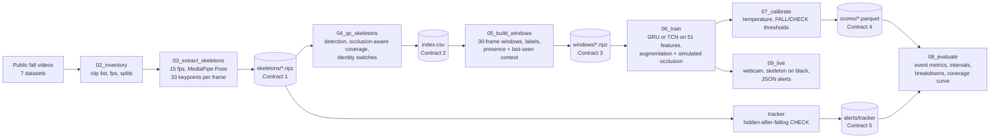

# fallsense – privacy-first fall detection from skeletons

**fallsense** watches a room through an ordinary camera, turns every frame into a 13-point stick figure, and decides from the last two seconds of movement whether someone is falling, has fallen, is lying or sitting down on purpose, or is simply upright. It raises a **FALL** alert when it is confident, asks a person to **CHECK** when it is not, and escalates to **ON FLOOR** when someone stays down. It never needs to store or show the camera image.

It is being built for older or injured people who are **alone and unsupervised** in care homes, hospital rooms and their own homes, where a fall can go unnoticed for a long time.

> **Status (17 Oct 2026, hackathon in progress).** Data pipeline, quality control, occlusion handling (parts 1 and 3), windows, models, training, the evaluator and the rule baseline are built and tested. The first nine models (E1–E3, three seeds each) are trained and evaluated on validation. Still to come: calibration (`07_calibrate.py`), the disappearance tracker (`tracker.py`, occlusion part 2), experiments E4–E8, the staged test set recorded in our own room, the live webcam demo (`09_live.py`), the final test-set evaluation and `DATA_CARD.md`. Sections below say clearly which parts are done and which are planned.

---

## Contents

1. [The problem](#1-the-problem)
2. [What fallsense does](#2-what-fallsense-does)
3. [Design principles](#3-design-principles)
4. [How it works – the pipeline](#4-how-it-works--the-pipeline)
5. [Data](#5-data)
6. [Pipeline stages in detail](#6-pipeline-stages-in-detail)
7. [Handling occlusion (falls behind furniture)](#7-handling-occlusion-falls-behind-furniture)
8. [Evaluation: how we measure it](#8-evaluation-how-we-measure-it)
9. [Results so far](#9-results-so-far)
10. [Known limitations and open issues](#10-known-limitations-and-open-issues)
11. [Experiments](#11-experiments)
12. [Repository layout](#12-repository-layout)
13. [Data contracts](#13-data-contracts)
14. [Setup](#14-setup)
15. [Running the pipeline](#15-running-the-pipeline)
16. [Development workflow](#16-development-workflow)
17. [Team and ownership](#17-team-and-ownership)
18. [Responsible use, privacy and licences](#18-responsible-use-privacy-and-licences)
19. [AI-assistance disclosure](#19-ai-assistance-disclosure)
20. [Roadmap](#20-roadmap)
21. [Further documentation](#21-further-documentation)

---

## 1. The problem

Falls are one of the most serious everyday risks for older and frail people. The fall itself is only part of the harm: someone who cannot get up, and who is alone, may lie on the floor for a long time before anyone finds them. Care homes and hospital wards cannot have a person watching every room all the time, and many people living alone have nobody nearby at all.

Existing approaches each have a gap:

| Approach | Gap |
| --- | --- |
| Wearable alarm buttons or pendants | Only work if worn, charged and pressed; an unconscious or confused person cannot press them |
| Wearable accelerometers | Must be worn; often taken off at night or in the bathroom, exactly where falls happen |
| Floor pressure mats, bed sensors | Cover one spot; expensive to fit across a room |
| Ordinary CCTV watched by staff | Needs a person watching; records identifiable video of people in private spaces |
| Video AI on raw frames | Accurate, but processes and often stores identifiable images, and is hard to audit |

fallsense aims for the useful middle: **a camera that only ever sees a stick figure**, that needs nothing worn or pressed, that works in the dark corners of a real room (including when furniture hides the person), and that **knows when it is unsure** and hands the decision to a human instead of guessing.

### Target setting

- **Who:** older people and people recovering from injury or illness.
- **Where:** a single room – care-home bedroom, hospital side room, a room at home.
- **When:** unsupervised periods, including at night.
- **Who gets the alert:** a carer, nurse or family member (the carer app and escalation are outside this repository; fallsense produces one JSON line per alert for them to consume).

---

## 2. What fallsense does

Every 0.2 seconds, fallsense looks at the last 2 seconds (30 frames at 15 fps) of skeleton movement and outputs four probabilities:

| Class | Meaning | Examples |
| --- | --- | --- |
| `upright` | standing, walking, normal activity | walking across the room, standing at a sink |
| `falling` | an uncontrolled fall is happening now | tripping, collapsing, sliding off a chair |
| `fallen` | on the floor after a fall | lying still after the fall |
| `controlled_low` | low on purpose | sitting down, lying down on a bed or mat, standing up |

From those probabilities it raises one of four outputs (event logic in `src/fallsense/calibrate.py`):

| Output | When | What a carer should do |
| --- | --- | --- |
| **silent** | fall score below the lower threshold | nothing |
| **CHECK** | fall score between the two thresholds, or the person vanished after going down (tracker, planned) | look at the room or call in – the system is unsure |
| **FALL** | fall score above the upper threshold | go now |
| **ON FLOOR** | `fallen` probability above 0.5 continuously for `on_floor_seconds` (20 s in the demo, 5 s on public clips) | go now – the person has not got up |

The fall score is `p_falling`, smoothed as the maximum over the last 3 evaluation windows (0.6 s) so a single flickering window cannot trigger or cancel an alert. After any alert there is a 30-second refractory period, so one fall is one alert; only a higher level (CHECK → FALL → ON FLOOR) can fire inside it.

Each alert is printed as one JSON line, which is the interface a carer app would consume:

```json
{"room": "demo", "time": "...", "level": "CHECK", "score": 0.58, "source": "pose", "model": "gru-v1"}
```

The CHECK band is deliberate: it is the measurable way the system "knows when to hand over". Section 8 shows how we trade coverage (decisions made without a human) against errors.

---

## 3. Design principles

1. **Privacy by design.** Only skeletons leave the pose estimator. The live display draws a skeleton on a black canvas, never the camera image. Raw public video was only used to extract skeletons and can be deleted afterwards.
2. **One code path offline and live.** The same `PoseExtractor`, `make_features`, `LastSeenState` and alert logic are used to build training data, to evaluate and to run the live demo, so the demo behaves like the numbers say.
3. **Honest evaluation.** Person-disjoint splits (OmniFall cross-subject), tuning and model selection on validation only, test opened once, confidence intervals by resampling whole clips, and a hand-written rule baseline that every model must beat.
4. **Know when to hand over.** A CHECK band between "confident fall" and "confident no fall", and a coverage–error curve that shows the cost of every setting.
5. **Robust to the real room.** Falls behind beds and sofas are handled explicitly (section 7), not left as missed detections.
6. **Fixed data contracts.** Five file formats (section 13) were agreed before code was written, so two developers could work in parallel on separate laptops.
7. **Measure, then decide.** Every threshold in the system was picked from data on training or validation clips, and the reports say where.

---

## 4. How it works – the pipeline



In one line: **video → 15 fps frames → MediaPipe skeletons → quality control → 2-second windows with "last seen" context → small neural network → calibrated probabilities → FALL / CHECK / ON FLOOR / silent.**

---

## 5. Data

### 5.1 Sources

All public data comes through the [OmniFall](https://huggingface.co/datasets/simplexsigil2/omnifall) benchmark and its `omnifall` Python package, which converts each original release into one layout and provides frame-accurate segment labels and cross-subject splits for all of them. Clip counts and hours are what passed into our `index.csv`.

| Dataset | Clips | Hours | What it is | Role |
| --- | --- | --- | --- | --- |
| [GMDCSA24](https://github.com/ekramalam/GMDCSA24-A-Dataset-for-Human-Fall-Detection-in-Videos) | 160 | 0.4 | 4 actors, 3 homes, laptop webcam | train / val / test |
| [CAUCAFall](https://data.mendeley.com/datasets/7w7fccy7ky/4) | 97 | 0.3 | 10 subjects, home-like room, includes night infrared and occlusion | train / val / test |
| [MCFD](https://www.iro.umontreal.ca/~labimage/Dataset/) (Multiple Cameras Fall Dataset) | 192 | 2.4 | 24 scenarios × 8 high corner cameras, one actor | train only (no val/test split in OmniFall) |
| [Le2i](https://search-data.ubfc.fr/imvia/FR-13002091000019-2024-04-09_Fall-Detection-Dataset.html) | 190 | 0.8 | home, office, coffee room, lecture room; 320×240 | train / val / test |
| [OCCU](https://doi.org/10.5281/zenodo.15494102) | 10 | 0.5 | long bedroom recordings, 2 views; falls hidden behind the bed | train / val / test; the real-occlusion check |
| [OF-Syn](https://huggingface.co/datasets/simplexsigil2/omnifall) (subset) | 5,335 | 7.5 | AI-generated videos with age group, BMI, camera and environment metadata | train / val / test; subgroup results by age and BMI |
| [OOPS-Fall](https://oops.cs.columbia.edu/data/) | 818 | 2.6 | genuine accidents from online "fail" compilations | out-of-domain test only, never trained on |
| **Total** | **6,802** | **14.5** | | |

"Core staged" in the experiments means GMDCSA24, CAUCAFall, Le2i and MCFD.

**OF-Syn subset.** OF-Syn has 12,000 clips in six age groups (toddler, child, teen, young adult, middle-aged, elderly; 2,000 each). We kept **all 2,000 elderly clips** – the population this is for – plus a third of every other group, 5,335 clips in total (`configs/of_syn_subset.csv`). That gives 202 elderly test clips instead of 54 with an even sample.

Skipped: UP-Fall (slow frame-to-video rebuild), CMDFall (access by email only) and EDF (same lab and setup as OCCU without the occlusion). These remain options if more staged indoor data is needed.

### 5.2 Labels

OmniFall labels every clip with time segments in 16 classes. We collapse them into our four (`src/fallsense/labels.py`):

| Our class | OmniFall classes |
| --- | --- |
| `upright` (0) | walk (0), standing (8), other (9), kneel_down, kneeling, squat_down, squatting, crawl, jump (10–15) |
| `falling` (1) | fall (1) |
| `fallen` (2) | fallen (2) |
| `controlled_low` (3) | sit_down (3), sitting (4), lie_down (5), lying (6), stand_up (7) |

Cleaning rules (counted and logged per dataset): negative start times clipped to 0, end times clipped to the video length, zero-length segments dropped, overlaps resolved by "later segment wins" (with a 1 ms tolerance), gaps left unlabelled (−1). Labels are applied per frame from the frame's own timestamp, never stored in the skeleton files, so a change to the mapping never forces re-extraction.

We checked label timing against the skeleton motion: 97–98% of fall starts line up with the movement within ±0.3 s (MCFD 81%, limited by its detection rate).

### 5.3 Splits

OmniFall's cross-subject (`-cs`) splits keep every person in only one of train, validation and test, so results measure performance on **people the model has never seen**. `05_build_windows.py` asserts that no clip and no (dataset, subject) pair appears in two splits. OOPS is test-only; MCFD (a single actor) is train-only.

| Split | Clips in index | Clips used for windows | Windows |
| --- | --- | --- | --- |
| train | 4,749 | 4,647 (QC-passing) | 53,429 |
| val | 600 | 589 (QC-passing) | 6,237 |
| test | 635 | 635 (all) | 14,673 |
| OOPS (test only) | 818 | 818 (all) | 38,872 |

---

## 6. Pipeline stages in detail

### 6.1 Inventory – `scripts/02_inventory.py`

Lists every labelled clip, opens each video once to read its frame rate, frame count and size, flags missing or unreadable files, and writes `data/inventory.csv` with the OmniFall split. Unusable clips are flagged, never silently dropped.

### 6.2 Frame reading – `src/fallsense/io_video.py`

`iter_frames(path, target_fps=15)` resamples any source (25, 30, 120 fps…) to 15 fps by timestamp while reading, so no video is re-encoded. Time is computed as frame index / source fps (more reliable than the codec's own position). If OpenCV cannot decode a file (for example some AV1 videos in OF-Syn), it falls back to PyAV.

### 6.3 Pose extraction – `src/fallsense/pose.py`, `scripts/03_extract_skeletons.py`

- **Model:** MediaPipe Pose Landmarker (Tasks API), `pose_landmarker_full.task`, VIDEO mode (tracks the person between frames), one pose per frame, detection/presence/tracking confidence 0.5.
- **Output per frame:** 33 keypoints (x, y normalised to the image, z, visibility) plus 33 world landmarks in metres; NaN and `detected = False` when nobody is found.
- **Kept for the model:** 13 keypoints – nose, shoulders, elbows, wrists, hips, knees, ankles.
- **Throughput:** resumable, parallel over clips (14 workers on the larger laptop). The OF-Syn subset took 75 minutes (5,335 clips, 405,460 frames, mean detection 99%); OOPS took 15 minutes (818 clips, 142,981 frames, mean detection 74% on real home videos).
- `PoseExtractor` is the same class offline and live.

### 6.4 Quality control – `scripts/04_qc_skeletons.py`

Runs on skeleton files and labels only (no video needed), so it works on skeletons from either laptop. Per clip:

| Measure | Definition |
| --- | --- |
| `det_rate` | share of frames with a pose (raw) |
| `det_rate_fall` | the same over frames labelled falling or fallen |
| `det_rate_covered` | share of frames where the pose is found, **or** the person is hidden after going down (`hidden_down` gap), **or** the person is off-screen (before walking in / after walking out at a frame border) |
| `det_rate_fall_covered` | fall frames found or inside a `hidden_down` gap (off-screen does **not** count here – the fall check stays strict) |
| `hidden_frac_fall`, `n_hidden_gaps` | how much of the fall happened out of sight, and how often |
| `id_jumps` | hip-midpoint jumps over 25% of the image diagonal between detections at most 2 frames apart (a sign MediaPipe switched to another person) |

**Pass rule:** `det_rate_covered ≥ 0.6` **and** (no fall frames **or** `det_rate_fall_covered ≥ 0.5`) **and** not more than 3 identity jumps. It is applied to train and val only; every test clip is kept so results can be reported both with and without failing clips.

Why "covered" rather than raw detection: on OCCU, MediaPipe finds the person in 99% of standing frames but **3%** of fallen frames, because they are fully hidden behind the bed. Raw detection would have thrown away every OCCU clip – exactly the data we need most. Why "off-screen" counts: in MCFD's eight cameras the actor walks in and out of each view; raw rules dropped 105 of 192 clips that had near-perfect fall detection.

| Dataset | Pass / total |
| --- | --- |
| GMDCSA24 | 155 / 160 |
| CAUCAFall | 86 / 97 |
| Le2i | 174 / 190 |
| MCFD | 118 / 192 (cameras 4 and 5 detect the person in only 34–44% of fall frames) |
| OCCU | 10 / 10 |
| OF-Syn | 5,313 / 5,335 |
| OOPS | 619 / 818 (kept for test anyway) |
| **Total** | **6,475 / 6,802** |

113 train/val clips are excluded; each one and its reason is in `reports/qc/excluded.csv`. Plots: `reports/qc/det_rate_by_dataset.png`, `reports/qc/det_rate_by_class.png`.

**Sample videos.** The script renders clips with the skeleton drawn in its labelled class colour (green upright, red FALLING, orange FALLEN, cyan controlled_low, grey unlabelled) over the original footage where it is available, or on black (`--black`) as "what the sensor sees". Any clip can be rendered on demand: `python scripts/04_qc_skeletons.py --clip le2i:Home_02/video_44`.

### 6.5 Windows – `src/fallsense/windows.py`, `scripts/05_build_windows.py`

Each example is a **30-frame (2 s) window labelled by what happens at its end**, because the live system must decide "is a fall happening now" from the last two seconds only.

1. **Drop** the window if over 30% of its frames are unlabelled, or over 40% have no pose **and no recent context** (so hidden-fallen windows are kept and labelled `fallen`).
2. **`falling`** if at least 5 of the last 20 frames are labelled falling (falls are short, so a majority rule would almost never produce this class).
3. Otherwise the most common label of the last 8 frames.

Window ends: train and val every 8 frames, plus every 2 frames within 1 s of a fall; test every 3 frames (0.2 s, for latency). Each window carries the 13 keypoints in pixels, the frame size, a per-frame `present` flag and the four "last seen" context values (section 7), computed over the whole clip so a window can know that someone vanished 8 seconds earlier. `falling` makes up 29.8% of train windows.

### 6.6 Features – `src/fallsense/features.py`

`make_features(kp, wh, present, ctx)` turns a window into 51 numbers per frame – the single source of truth used by training, evaluation and the live demo:

| Group | Count | Content |
| --- | --- | --- |
| Body shape | 26 | each keypoint's x, y relative to the hip midpoint, divided by torso length (scale- and position-free) |
| Visibility | 13 | MediaPipe visibility per keypoint (0 where lost) |
| Derived posture and motion | 8 | torso angle from vertical, hip height above ankles, head height above hips, hip vertical velocity, hip speed, log aspect ratio of the keypoint box, mean visibility, pose detected |
| Last-seen context | 4 | seconds since last seen (÷ cap), last hip height, last hip vertical speed, last distance to the frame edge |

Lost keypoints are carried forward for up to 5 frames (0.33 s); values are clipped to ±10 and NaN-free. Features are z-scored with mean and standard deviation computed on training windows and saved with each model.

### 6.7 Models – `src/fallsense/models.py`

Both are deliberately small so they run in real time on a laptop CPU:

| Model | Architecture | Parameters |
| --- | --- | --- |
| `FallGRU` | Linear(51→64) + ReLU + LayerNorm → 2-layer GRU (64, dropout 0.2) → Linear from the last time step to 4 classes | 53,636 |
| `FallTCN` | 3 dilated 1D convolution blocks (dilation 1, 2, 4; kernel 5; 64 channels; BatchNorm, ReLU, dropout 0.1) → concat(mean over time, last step) → Linear to 4 classes | 58,372 |

### 6.8 Training – `scripts/06_train.py`, `src/fallsense/dataset.py`

- **Loss:** cross-entropy with label smoothing 0.05 and class weights `w_c = sqrt(N / (4 n_c))` renormalised to mean 1.
- **Optimiser:** AdamW, learning rate 2e-3, weight decay 1e-4, batch 256, cosine decay over at most 40 epochs, gradient clipping 1.0.
- **Model selection:** each epoch on validation by average precision of falling-vs-rest, tie-broken by 4-class macro F1; early stop after 8 epochs without improvement.
- **Speed:** about 14 s per epoch on core staged sets on an 8-core laptop; a full run takes about 3 minutes.
- **Augmentation** (on raw keypoints, before features, so every augmented example goes through the same feature code):

| Augmentation | Probability | Range | Simulates |
| --- | --- | --- | --- |
| Mirror left–right | 0.5 | – | falls to either side |
| Rotation about the hips | 0.5 | ±10° | camera roll |
| Scale about the hips | 0.5 | 0.85–1.15 | distance to camera |
| Translation | 0.5 | ±10% of frame | position in room |
| Coordinate jitter | 1.0 | 1% of torso length | pose noise |
| Joint dropout | 0.05 per joint-frame | – | partial occlusion |
| Whole-frame dropout | 0.03 per frame | – | lost detection |
| Simulated occlusion (`--occlude`, E7) | 0.25 near falls, 0.15 elsewhere | rise or box | falls behind furniture; people walking behind it |
| Speed change | 0.3 | 0.8–1.2× | slower, frailer movement |

Every run folder holds `model.pt`, `feat_stats.npz`, a copy of the config and run arguments, `train_log.csv`, validation logits and a confusion matrix.

### 6.9 Calibration and alerts – `src/fallsense/calibrate.py` (event logic done; `07_calibrate.py` planned)

- `write_scores(run, windows)` runs a model over a windows file and writes Contract 4 scores.
- `alerts_from_scores(scores, thresholds)` is the **one** implementation of FALL / CHECK / ON FLOOR used by the evaluator, calibration and the live demo (rules in section 2).
- Planned in `07_calibrate.py`: temperature scaling (one scalar fitted on validation logits) and the search for the two thresholds on validation only, saved to `thresholds.yaml`.

### 6.10 Rule baseline – `src/fallsense/baseline.py`, `scripts/baseline_e0.py`

The honest yardstick: *a person whose keypoint box is wider than tall and whose hips are near the floor for over 2 seconds.* Per frame `low = present and log_aspect > a and hip_height < h`; FALL fires once `low` has held for 30 frames and re-arms after 30 frames of not-low. `a` and `h` were grid-searched on **train** clips of the core staged sets only (380 clips, 313 falls), maximising event F1: best `a = −0.2`, `h = 0.9` (train event F1 0.69). Its scores are written in the same format as a model, so the evaluator treats it identically.

---

## 7. Handling occlusion (falls behind furniture)

A person who falls behind a bed or sofa disappears from the skeleton stream. The skeleton file records "no person", but not *how* they vanished – and that is what separates a hidden fall from someone leaving the room. Measured on real clips: disappearances during OCCU falls happen mid-frame (median 0.35 of the frame from the nearest border) with the hips dropping fast; disappearances outside falls happen near a border while moving slowly.

Three parts, used together (`src/fallsense/occlusion.py`, pure numpy, the same code offline and live):

1. **Disappearance context as model input (done).** Every frame carries four "last seen" values – seconds since the pose was last present (capped at 20 s), last hip height, last hip vertical speed in **body heights per second** (so near and far cameras read the same) and last distance to the frame edge. The model can therefore tell "dropped fast mid-frame, then gone" from "walked to the edge, then gone". `LastSeenState` updates them one frame at a time for the live demo.
2. **Disappearance tracker as a safety net (planned, `tracker.py`).** A rule-based state machine (visible / left the frame / hidden after going down) that raises CHECK when someone has been hidden after going down for `hidden_check_s` seconds. It needs no training and is scored alone and merged with the model. `find_disappearances` already classifies every gap of at least 1 s after at least 5 visible frames as `left` or `hidden_down` (lost more than 10% of the frame from every border while the hips drop faster than 0.30 body heights/s). Detector blips under 5 frames and dropouts of 1–2 frames are smoothed out first, so one hidden fall is one disappearance.
3. **Simulated occlusion in training (done; experiment E7 pending).** Visible falls **and** normal activity from every training set are hidden on the fly: an occluder edge rises part-way down the hips' drop (`rise`) or a box covers 20–50% of the body (`box`); hidden keypoints become MediaPipe-like guesses that follow the body, with 3–8 frames of flicker before the loss. Occluding normal activity matters as much as occluding falls – otherwise the model would learn "vanished means fallen".

**Realism check** (`scripts/occlusion_realism.py` → `reports/occlusion_realism.md`): with the 0.30 threshold, 83% of real OCCU hidden falls are classified `hidden_down`, with 47 false `hidden_down` gaps outside falls on train clips (43 of them on MCFD's poor-detection cameras). Simulated hidden falls match OCCU on edge distance and keypoint loss order but vanish at a lower hip speed (36% classified `hidden_down`). The simulation was accepted as it is on 17 Oct; experiment E7 decides whether it helps, and its outcome will be recorded in the same report.

---

## 8. Evaluation: how we measure it

`scripts/08_evaluate.py` (`src/fallsense/metrics.py`) scores every system – models, the rule baseline and, once built, the tracker – exactly the same way. Alerts always come from `alerts_from_scores`, never reimplemented.

### 8.1 Definitions

- **Fall event:** each OmniFall `fall` segment.
- **Detected:** an alert between the segment start and 10 s after the segment end.
- **False alert:** an alert matching no fall event.
- **Normal-activity hours:** clip time outside \[fall start − 2 s, fall end + 10 s\].
- **Latency:** alert time minus fall segment start.

| Metric | Computed as |
| --- | --- |
| Fall sensitivity (FALL only) | events detected by FALL / all fall events |
| Fall sensitivity (FALL or CHECK) | events detected by either / all fall events |
| False FALL alerts per hour | false FALL alerts / normal-activity hours |
| CHECK requests per hour | CHECK alerts / total hours |
| Coverage | share of alerts and true events decided without a CHECK |
| Median latency | over detected events |
| Window macro F1, confusion matrix | over evaluation windows, 4 classes |

FALL and ON FLOOR both count as alarms. 95% intervals come from a bootstrap over **clips** (1,000 resamples with replacement), never over windows, because windows from one clip are not independent.

### 8.2 What each report contains

`reports/eval/eval_<run>_<split>.md` (and `.json`, `_coverage.png`):

- the run with one threshold, with its CHECK band, and the rule baseline (plus "+ tracker" rows once tracker alerts exist);
- a breakdown by dataset, by `qc_pass`, by OF-Syn age group and BMI band, and for the staged set by lighting and occlusion;
- the 4-class confusion matrix and macro F1 over windows;
- the **coverage–error curve**: the CHECK band is widened step by step and, at each width, missed falls and false FALL alerts are plotted against coverage. This is the trade-off between "the system decides on its own" and "it asks a human" in one picture.

`scripts/eval_summary.py` writes `reports/eval/summary_<split>.md/.csv`, comparing every run and experiment (mean and range over seeds) on threshold-free measures (window AP for falling, macro F1) and at a matched operating point (fewest false alerts while catching at least 80% of falls), because seeds land at different points of the trade-off at a fixed threshold.

### 8.3 Rules we follow

Tune and select on validation only. Freeze model, temperature and thresholds. Run test, staged_test and OOPS **once**, at the end. If anything changes after seeing test numbers, the report says so.

---

## 9. Results so far

All numbers are on the **validation split** (589 clips, 144 falls, 1.0 h of video), with thresholds not yet calibrated (temperature 1, FALL at 0.5, no CHECK band). Means over three seeds, range in brackets. Full tables: `reports/eval/summary_val.md`.

| | E0 rule baseline | E1 GRU | E2 GRU + augmentation | E3 TCN + augmentation |
| --- | --- | --- | --- | --- |
| Window AP, falling vs rest | 0.28 | 0.82 (0.81–0.83) | 0.82 (0.81–0.84) | **0.83** (0.83–0.83) |
| Window macro F1 (4 classes) | 0.23 | 0.64 | 0.66 | 0.66 |
| Falls detected by FALL, all val | 68.8% | 72.2% | **74.5%** | 72.0% |
| False FALL alerts per hour, all val | 168 | 94 | 103 | **73** |
| Falls detected, core staged sets | 68.4% | 97.4% | 98.2% | **99.1%** |
| Falls detected, OF-Syn (not trained on) | 81.1% | 67.0% | **70.7%** | 66.7% |
| Falls detected, OF-Syn elderly | 80.0% | 56.0% | **57.3%** | 41.3% |
| Falls detected, OCCU (hidden falls) | 0% | 41.7% | 39.6% | 37.5% |
| Fewest false alerts/h at ≥ 80% detected | – | 372 | 279 | **213** |

What this says so far:

- **Every learned model beats the hand rule clearly** – window AP 0.82–0.83 against 0.28, and 97–100% of falls caught on the people-held-out staged sets against 68%.
- **E1–E3 are within seed noise of each other.** The core validation sets are saturated (38 falls, 97–100% caught), so they cannot separate the models. TCN is the most stable and makes the fewest false alerts at matched sensitivity; GRU with augmentation is best on older bodies.
- **OF-Syn and elderly people are the weak spot** – expected, since E1–E3 never trained on OF-Syn. Experiment E5 adds it.
- **Hidden falls** are caught 38–42% of the time by the model alone (the rule: 0%). The tracker (occlusion part 2) is designed to close this gap.
- Most false alerts come from deliberate low movements (OF-Syn lie-downs, "other" activities including kneeling and crawling, GMDCSA24 daily activities): a falling-vs-controlled-low confusion.
- Validation windows from Dev B's laptop and Dev A's laptop are identical; the same model gives the same logits to within 2×10⁻⁷ on both.

**Read the false-alert rates as rough.** Validation contains only about 45 minutes of normal activity (7 minutes in the core sets), so one extra false alert moves the rate by about 8 per hour. Real deployments run for days; long normal-activity recordings are needed before the rate can be trusted (section 10).

---

## 10. Known limitations and open issues

Tracked in `reports/data_scope_review.md` (data) and the plans (training), to revisit once more models exist:

| Issue | Effect | Plan |
| --- | --- | --- |
| **Little normal-activity time in validation** (≈45 min) | false-alert rates per hour are very noisy; the planned "≤ 0.5 false FALLs per hour" threshold rule cannot be met on this data (on E1 it would set FALL at 0.95 and catch 12% of falls) | calibrate to a target sensitivity instead and report the false-alert rate with its interval; add long no-fall recordings |
| **Model selection on all of validation** while E1–E4 train only on core sets | the best epoch is picked mostly on OF-Syn, which those models never see | select on validation windows from the training datasets |
| **Validation windows use the training strides** (8 frames, 2 near falls) | more chances to alert near falls, fewer chances to alert falsely elsewhere – flatters event metrics | build validation windows every 3 frames like test |
| **Latency on OF-Syn** | 81 of 144 validation falls start in the clip's first 0.5 s; the first window ends at 1.93 s, so every model reports the same median | measure latency only on falls with ≥ 2 s of video before them |
| **Wrong person tracked** (`num_poses: 1`) | in multi-person scenes MediaPipe sometimes follows a bystander; about 1% of labelled falls show a skeleton that stays upright throughout, mostly in OOPS (test only) | candidate `label_conflict` QC reason for train/val; single-person scope documented |
| **Multi-person, merged skeletons, animals** | at least ~10% of OOPS clips and ~3% of OF-Syn clips have two or more people; occasional dog skeletons and merged skeletons | per-frame anatomy check (implausible frames are 3.5–4.3% on clean sets, 10.2% on OOPS) to treat as "no pose" |
| **Domain mismatch** | 52% of OF-Syn clips are outdoor and 37% show under-18s; OOPS is sport and stunts | experiment E8: care-home subset vs all data, judged on in-domain clips |
| **Kneeling, squatting and crawling mapped to `upright`** | after some falls the person crawls; the label says upright while the body is low | candidate re-mapping to `controlled_low` (about 2% of OF-Syn) |
| **Short public clips** | ON FLOOR is evaluated at 5 s instead of the demo's 20 s | staged recordings with longer end states |
| **MCFD cameras 4 and 5** | person found in only 34–44% of fall frames | excluded by QC where coverage fails |

---

## 11. Experiments

One row each in `reports/experiments.csv` (owned by Dev B), three seeds per row; how and where they run is in `docs/Training Run Plan (Fall Detection).md`.

| Id | Model | Train data | Augment | Question | Status |
| --- | --- | --- | --- | --- | --- |
| E0 | rule baseline | core staged | – | What does a hand rule achieve? | done (val) |
| E1 | GRU | core staged | no | Does learning beat the rule? | done (val) |
| E2 | GRU | core staged | yes | Does augmentation help on held-out people? | done (val) |
| E3 | TCN | core staged | yes | GRU or TCN? | done (val) |
| E4 | best of E2/E3 | core + OCCU | yes | Does real occlusion data help? | planned |
| E5 | best of E2/E3 | core + OCCU + OF-Syn | yes | Does synthetic diversity help, especially on older and heavier bodies? | planned |
| E6 | best config | all except CAUCAFall | yes | How much does accuracy drop in an unseen home? | planned |
| E7 | best config | as best of E4/E5 | yes + simulated occlusion | Does simulated occlusion help on hidden falls without more false alerts elsewhere? | planned |
| E8 | best config | care-home subset vs all | yes | Do outdoor and under-18 clips help or hurt in-domain? | deferred until a model exists |

---

## 12. Repository layout

```
configs/
  default.yaml             # every shared setting: fps, window, keypoints, classes, datasets, occlusion block
  of_syn_subset.csv        # the 5,335 OF-Syn clips we use
src/fallsense/
  config.py                # paths (FALL_DATA), config loading, contract paths
  io_video.py              # 15 fps frame reader with PyAV fallback            (Dev A)
  pose.py                  # MediaPipe Pose Landmarker wrapper, offline + live  (Dev A)
  labels.py                # OmniFall 16 classes -> 4, segment cleaning         (Dev A)
  occlusion.py             # last-seen context, disappearances, simulation      (Dev A)
  features.py              # 51 features per frame, single source of truth      (Dev B)
  windows.py               # Contract 3, window labelling rule, split checks    (Dev B)
  dataset.py               # torch Dataset, augmentation, ClipBank              (Dev B)
  models.py                # FallGRU, FallTCN                                   (Dev B)
  calibrate.py             # write_scores, alerts_from_scores (event logic)     (Dev B)
  scores.py                # Contract 4 read/write/validate                     (Dev B)
  metrics.py               # event metrics, bootstrap, window metrics           (Dev A)
  baseline.py              # rule baseline (E0)                                 (Dev A)
scripts/
  00_check_env.py          # environment check: Python, packages, ffmpeg, env vars, pose model, webcam
  02_inventory.py          # clip list with fps, size, flags                    (Dev A)
  03_extract_skeletons.py  # video -> Contract 1 skeletons, resumable, parallel (Dev A)
  04_qc_skeletons.py       # QC -> index.csv, plots, exclusions, sample videos  (Dev A)
  05_build_windows.py      # index + skeletons + labels -> windows              (Dev B)
  06_train.py              # train GRU/TCN, select on val                       (Dev B)
  08_evaluate.py           # event evaluation of one run on one split          (Dev A)
  eval_summary.py          # compare all runs and seeds                         (Dev A)
  baseline_e0.py           # tune the rule on train, write its scores           (Dev A)
  occlusion_realism.py     # real vs simulated disappearances report            (Dev A)
tests/                     # pytest: labels, occlusion, features, windows, dataset, model, calibrate, scores, metrics
reports/
  qc/                      # QC plots, excluded clips, sample videos (videos not committed)
  eval/                    # evaluation reports per run and the run comparison
  scores/<run>/            # thresholds.yaml per run (score .parquet files are not committed)
  occlusion_realism.md     # occlusion realism check and E7 outcome
  data_scope_review.md     # deferred data cuts, E8 plan, metrics to recompute
docs/                      # master build plan, Dev A plan, Dev B plan, training run plan, occlusion ideas
models/pose/               # MediaPipe .task files (downloaded, not committed)
.githooks/pre-push         # ruff format --check and ruff check before every push
.claude/                   # Claude Code hooks (see section 16)
data/                      # junction to C:\fall-data (not committed)
```

Planned additions: `07_calibrate.py`, `09_live.py`, `tracker.py` with `tests/test_tracker.py`, `record_staged.py`, `label_tool.py`, `DATA_CARD.md` (currently empty).

---

## 13. Data contracts

Fixed before any code was written so both developers could work in parallel. A change needs agreement from both and a `schema_version` bump in `configs/default.yaml` (currently 2).

| Contract | File | Writer → reader | Content |
| --- | --- | --- | --- |
| 1 – skeletons | `data/skeletons/{dataset}/{path}.npz` | Dev A → all | `kp` (T,33,4) normalised x, y, z, visibility; `world` (T,33,3) metres; `detected` (T,); `t_ms`; `fps` (15); `width`, `height`; `dataset`, `path`, `subject`, `cam`; `pose_model`. NaN where no person. No labels stored. |
| 2 – index | `data/skeletons/index.csv` | Dev A → Dev B | one row per clip: `dataset, path, subject, cam, split, n_frames, duration_s, width, height, det_rate, det_rate_fall, det_rate_covered, det_rate_fall_covered, hidden_frac_fall, n_hidden_gaps, id_jumps, qc_pass, qc_reason`. `clip_id` = row number. |
| 3 – windows | `data/windows/{split}.npz` | Dev B → training, evaluation | `kp` (N,30,13,3) pixel x, y, visibility; `wh` (N,2); `y` (N,) 0–3; `clip_id`; `end_frame`; `present` (N,30); `ctx` (N,30,4). OOPS goes to `oops.npz`. |
| 4 – scores | `reports/scores/{model}/{split}.parquet` | models, baseline → evaluator | `clip_id, end_frame, t_s, p_upright, p_falling, p_fallen, p_controlled_low`, one row per window, probabilities summing to 1 |
| 5 – tracker alerts | `reports/alerts/tracker/{split}.parquet` | tracker → evaluator | `clip_id, t_s, level` (always CHECK), `reason` (`hidden_down`) |

---

## 14. Setup

Windows (or macOS), natively, with **Python 3.11** managed by [`uv`](https://docs.astral.sh/uv/). Not WSL (webcams are awkward to pass through) and not Python 3.13/3.14 (MediaPipe wheels lag new releases).

1. Install `uv`, `ffmpeg` and the dataset tool:
   ```powershell
   uv tool install "omnifall[video]" --python 3.11 --with requests
   ```
2. Clone the repository and create the environment from the repo root:
   ```powershell
   uv venv --python 3.11 .venv
   .venv\Scripts\activate
   uv pip sync requirements.lock          # exact versions shared by both laptops
   uv pip install -e .                     # makes `import fallsense` work
   ```
   `requirements.lock` pins the CPU build of PyTorch, MediaPipe, OpenCV, the `omnifall` package and the tools.
3. Point the project at a data folder and save the environment variables (then close and reopen every terminal). The variable names are listed in `.env.ps1.example`:
   ```powershell
   setx FALL_DATA "C:\fall-data"
   setx OMNIFALL_CACHE_DIR "C:\fall-data\cache"
   setx OMNIFALL_DOWNLOAD_DIR "C:\fall-data\downloads"
   setx OMNIFALL_ROOT "C:\fall-data\cache\videos"
   New-Item -ItemType Junction -Path data -Target C:\fall-data
   ```
4. Download the pose models (use `curl.exe` in PowerShell):
   ```powershell
   New-Item -ItemType Directory -Force models\pose
   curl.exe -L -o models\pose\pose_landmarker_full.task https://storage.googleapis.com/mediapipe-models/pose_landmarker/pose_landmarker_full/float16/latest/pose_landmarker_full.task
   curl.exe -L -o models\pose\pose_landmarker_lite.task https://storage.googleapis.com/mediapipe-models/pose_landmarker/pose_landmarker_lite/float16/latest/pose_landmarker_lite.task
   ```
5. Download and verify the datasets you need (each can take a while):
   ```powershell
   omnifall prepare le2i --workers 4
   omnifall verify le2i
   ```
   Some sources need a manual browser download first (Le2i has a bot check; CAUCAFall needs "Download All" on Mendeley); `omnifall sources <dataset>` prints the exact archive name and terms.
6. Check everything: `python scripts\00_check_env.py` – every line must print OK.
7. Turn on the pre-push hook once per clone: `git config core.hooksPath .githooks`.

**Hardware.** Everything runs on a laptop CPU; no GPU is used. Our two machines: an Intel Core Ultra 9 285H (16 cores, 63 GB RAM) and an Intel Core i5-12450H (8 cores, 16 GB RAM).

---

## 15. Running the pipeline

From the repo root with the environment active. Each step writes the next contract.

```powershell
# 1. Inventory and skeletons
python scripts\02_inventory.py --datasets le2i occu
python scripts\03_extract_skeletons.py --datasets le2i occu
python scripts\03_extract_skeletons.py --datasets of-syn --clip-list configs\of_syn_subset.csv

# 2. Quality control -> data\skeletons\index.csv, reports\qc\
python scripts\04_qc_skeletons.py
python scripts\04_qc_skeletons.py --clip le2i:Home_02/video_44      # render one clip over its video

# 3. Occlusion realism report
python scripts\occlusion_realism.py

# 4. Windows -> data\windows\{train,val,test,oops}.npz
python scripts\05_build_windows.py

# 5. Train (examples; full queue in docs\Training Run Plan)
python scripts\06_train.py --model gru --no-augment --train-sets GMDCSA24 caucafall le2i mcfd --seed 1 --out models\e1_gru_s1
python scripts\06_train.py --model tcn --augment --train-sets GMDCSA24 caucafall le2i mcfd --seed 1 --out models\e3_tcn_s1
python scripts\06_train.py --model gru --augment --occlude --seed 1 --out models\e7_gru_s1

# 6. Scores for a run (Contract 4)
python -c "from fallsense.calibrate import write_scores; write_scores('models/e1_gru_s1', r'C:\fall-data\windows\val.npz')"

# 7. Rule baseline (tuned on train), then evaluate
python scripts\baseline_e0.py --splits val
python scripts\08_evaluate.py --model baseline --split val
python scripts\08_evaluate.py --model e1_gru_s1 --split val --windows C:\fall-data\windows\val.npz
python scripts\eval_summary.py                                        # compare every evaluated run

# 8. Ensemble of seeds (averages member probabilities), then calibrate + evaluate it like a run
python scripts\10_ensemble.py --name e9_ens_gru --members e9_gru_s1 e9_gru_s2 e9_gru_s3
python scripts\07_calibrate.py --run e9_ens_gru
python scripts\08_evaluate.py --model e9_ens_gru --split val

# 9. Live demo (skeleton on black, never the camera image; q quits, r resets)
python scripts\09_live.py --list-cameras                 # pick the camera that sees the room
python scripts\09_live.py --run e9_ens_gru --camera 0    # frozen model, its thresholds.yaml
python scripts\09_live.py --run e9_ens_gru --video clip.mp4 --no-display   # replay any video
python scripts\09_live.py --run e9_ens_gru --record logs\live\dry_run_1     # keep skeleton/scores/alerts

# 10. Tests and lint
python -m pytest -q
ruff format --check . ; ruff check .
```

The live demo runs the same code path as evaluation (replaying val clips through `09_live.py` reproduces the offline scores to 1e-4). The camera must see the whole body: a seated close-up on a laptop camera hides the hips and legs, and the model, trained on full-body views, then reads the pose as ambiguous (the display says "full body not in view").

Typical times on the larger laptop: QC of all 6,802 clips about 10 s; building every window file under a minute; one training run on the core sets about 3 minutes; one evaluation about 15 s.

---

## 16. Development workflow

- **Branch per task** (`a/<task>` for Dev A, `b/<task>` for Dev B), small pull requests, reviewed by the other developer when they touch shared files or contracts. Never commit anything under `data/`.
- **Checks:** the `.githooks/pre-push` hook runs `ruff format --check` and `ruff check` on every push; run `pytest -q` before opening a pull request. Type hints are welcome but not enforced.
- **Merge and sync points.** Work is coordinated by numbered merges (M1–M20) and syncs (S0–S17) in the plans: each sync is a short check where one developer confirms the other's delivery works on their machine (for example, both read out the same QC pass counts or the same evaluation numbers).
- **Claude Code hooks** (`.claude/settings.json`): one hook blocks the AI assistant from running `git commit` or `git push` (people make every commit), another runs ruff format and ruff check on every Python file it edits.
- **Line endings:** `.gitattributes` keeps hook scripts in LF so they run on every platform.

---

## 17. Team and ownership

| | Dev A – data in | Dev B – model out |
| --- | --- | --- |
| Owns | inventory, extraction, labels, QC, occlusion, tracker, rule baseline, evaluator, staged test set, data card | repo setup, config, features, windows, dataset and augmentation, models, training, calibration, live demo, experiments log |
| Videos on own laptop | Le2i, OCCU, OF-Syn, OOPS | GMDCSA24, CAUCAFall, MCFD |
| Modules | `io_video`, `pose`, `labels`, `occlusion`, `metrics`, `baseline`, `tracker` | `config`, `features`, `windows`, `dataset`, `models`, `calibrate`, `scores` |

Only small skeleton files and run folders move between laptops (through a shared drive); each laptop extracted skeletons from its own videos.

---

## 18. Responsible use, privacy and licences

- **Not a medical device.** fallsense is a hackathon prototype. It has not been clinically validated and must not replace care staff, nurse call systems or clinical judgement.
- **Staged data.** Almost all training falls are performed by actors or generated synthetically. Real falls of frail older people look different – often slower, partial and against furniture. Results on OOPS (real accidents, mostly young people) and our own staged recordings are reported separately for this reason.
- **Privacy.** The system processes skeletons, not identities, and the live display never shows the camera image. In any real deployment the people being monitored (or those legally acting for them) must consent, and local data-protection and care-regulation rules apply.
- **Fairness.** Results are broken down by OF-Syn age group and BMI band so weaker performance on any group is visible rather than averaged away. The current models are weakest on elderly bodies (section 9) – the group this is for – and the next experiments target that.
- **Staged test recordings.** Everyone who appears signs a consent form first; falls are performed only onto crash mats with a spotter; every clip is labelled "staged".
- **Licences.** OmniFall labels are **CC BY-NC-SA 4.0** and several video sources are research or non-commercial only (GMDCSA24 MIT, CAUCAFall CC BY 4.0, Le2i research use, MCFD citation requested, OCCU per its Zenodo terms, OF-Syn and OOPS non-commercial). **A commercial model would need its own labelled data.** Each dataset's citation and terms go into `DATA_CARD.md` (`omnifall cite <dataset>`, `omnifall sources <dataset>`).
- **MediaPipe** pose models are Apache 2.0.

---

## 19. AI-assistance disclosure

This project was built with the help of **Claude Code** (Anthropic's coding assistant), used by Dev A for planning, writing and testing code, running data analysis and writing documentation – including this README. Commits it helped write carry a `Co-Authored-By: Claude` trailer. Every commit and push was made by a person: a repository hook prevents the assistant from committing or pushing, and pull requests were reviewed by the other developer. All reported numbers come from scripts in this repository run on the data described above.

---

## 20. Roadmap

1. **Calibration** (`07_calibrate.py`): temperature scaling and the FALL/CHECK thresholds on validation, with a sensitivity-based target suited to the short validation set.
2. **Training fixes** before the next round: select epochs on validation from the training datasets, build validation windows at the evaluation stride, then retrain E1–E3 (about 30 minutes).
3. **Disappearance tracker** (`tracker.py`, occlusion part 2), tuned on validation, with "+ tracker" rows in every evaluation.
4. **Experiments E4–E7**, then E8 and the data-scope decisions in `reports/data_scope_review.md`.
5. **Staged test set:** 40–60 clips recorded in the demo room – falls forward, backward, sideways, off a chair, partly and fully hidden; walking behind furniture, sitting, kneeling, lying down on purpose – across two camera positions and two lighting levels.
6. **Live demo** (`09_live.py`): webcam at 640×480, skeleton on black, the four probabilities as bars, the alert level and an ON FLOOR timer, JSON alert lines, at least 10 fps on a laptop CPU.
7. **Final evaluation** of the frozen model on test, staged_test and OOPS, once each; `DATA_CARD.md`; tag `v1-hackathon`.

---

## 21. Further documentation

| Document | Content |
| --- | --- |
| `docs/Fall Detection – Camera Pipeline Build Plan.md` | the master plan: scope, stack, contracts, every phase, experiments, risks |
| `docs/Dev A Plan – Data In (Fall Detection).md` | Dev A's step-by-step plan with progress ticks |
| `docs/Dev B Plan – Model Out (Fall Detection).md` | Dev B's step-by-step plan with progress ticks |
| `docs/Training Run Plan (Fall Detection).md` | which laptop trains what, the run queue and comparability rules |
| `docs/occlusion-ideas.md` | the occlusion analysis and every idea considered |
| `reports/occlusion_realism.md` | real vs simulated disappearances, thresholds, E7 outcome |
| `reports/data_scope_review.md` | deferred data cuts, E8 plan, metrics to recompute |
| `reports/eval/summary_val.md` | all evaluated runs compared |
| `reports/qc/` | QC plots and excluded clips |
