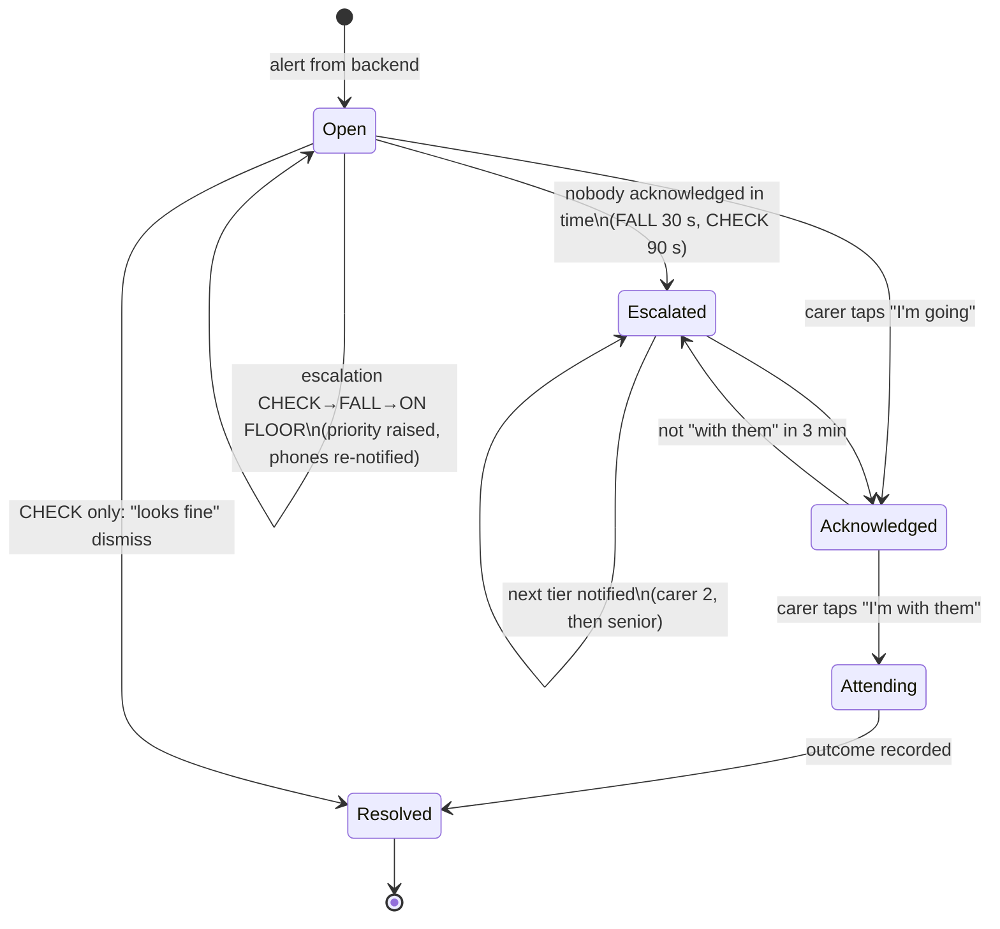
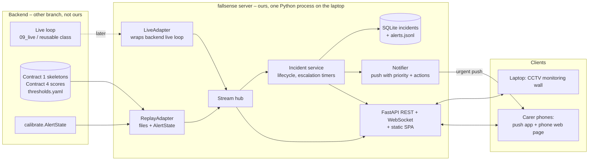

# Frontend Plan – Monitoring Wall, Carer Alerts and Demo (Fall Detection)

Oct 18, 2026 · @K · branch `frontend/plan` (based on `main` at 760f123; since merged with `main` and worked on in the main checkout, no separate worktree)

Planning only: no code on this branch yet. The frontend is built on this laptop, in this worktree. Model training and backend work carry on in the main checkout and on their own branches in a separate Claude session. Nothing here edits `main`, `a/*` or `b/*`.

---

## 1. Where the project is and what the frontend is for

**Backend (in progress, not ours):** pose extraction, occlusion context, features, GRU/TCN models, calibration (`thresholds.yaml`) and the event logic (`calibrate.AlertState`: silent / CHECK / FALL / ON FLOOR) exist. E5 GRU is the current pick; E8/E9 and an ensemble are being trained. Still to come on the backend: `09_live.py` (webcam → alerts in real time), `tracker.py` (hidden-after-falling CHECK), the staged test set, a final frozen model with fewer false FALLs.

**Frontend (ours):** everything after the backend says "FALL". The build plan leaves it out on purpose: *"Audio, the carer app, escalation and the manager log are out of scope … one JSON line per alert is the interface the carer app will consume later."*

**The product:** a fall-monitoring system for a care home that **does not need anyone watching a screen**. The AI watches; **carers' phones get high-priority alerts** and the workflow takes them from alert → acknowledge → attend → resolve. The laptop shows a **CCTV-style monitoring wall** with every camera and the incident queue, for a supervisor and for the demo, but nothing depends on someone looking at it.

### 1.1 Rule for this branch: prepare, don't duplicate

We are getting ready for the moment the model is good enough (fewer false FALLs, reliable live). So the frontend **consumes** what the backend produces and **never re-creates** it.

| Backend will create (we do **not** build) | Frontend owns (we build) |
| --- | --- |
| The live loop: camera frame → pose → features → model → probabilities (`09_live.py` and whatever reusable class sits behind it) | The server that **receives** those outputs and fans them out to browsers and phones |
| Alert decisions: thresholds, temperature, CHECK/FALL/ON FLOOR, refractory (`calibrate.py`, `thresholds.yaml`) | Incidents: one per fall, acknowledge / attend / resolve, escalation timers, log |
| Tracker CHECK (`tracker.py`) | Phone notifications with priority, escalation chain, action buttons |
| Model choice, ensemble, final calibration | The monitoring wall, room view, phone pages, presenter panel |
| Pose extraction for recorded clips (`03_extract_skeletons.py`) | Demo set-up: which camera tile shows which source |

The boundary between the two is a small **adapter interface** (§4.2). Until the backend's live loop exists, the frontend is fed by a **replay adapter** that reads files the backend has *already* produced (skeletons, Contract 1, and scores, Contract 4) and runs them through the backend's own `AlertState`. When the backend's live loop lands, a **live adapter** wraps it. Nothing in the UI, incidents or notifications changes. When a better model is trained, it is a config change (`model_run:` in `configs/rooms.yaml`), not a code change.

### 1.2 Facts from the backend that shape the design

| Fact | Consequence |
| --- | --- |
| A new decision every 0.2 s from the last 2 s (15 fps) | Scores at 5 Hz, skeletons at 15 Hz are all the UI needs |
| Alert levels and timing are decided by `AlertState` | The frontend shows and routes alerts; it never decides them |
| Privacy principle: the system only ever shows skeletons | Deployment mode is skeleton-only; raw video only in an explicit, labelled demo mode (§6.2) |
| Current E5 calibration has ~113 false FALLs/h on val (rough) | Phones must only get alerts that matter; quick dismiss and false-alarm feedback are part of the workflow; integration waits for the readiness gate (§8.1) |
| ON FLOOR after 20 s of "fallen" in the demo | Time on floor is the key number after a fall |
| One person per camera | One camera = one room = one resident |

---

## 2. Terms used in this plan

- **CHECK threshold (`t_low`).** The model gives a fall score from 0 to 1. Above `t_high` the backend raises **FALL** ("go now"). Between `t_low` and `t_high` it raises **CHECK** ("I'm not sure, someone should look"). That band is how the system "knows when it is unsure" (README §2). The thresholds come from the backend's calibration (`07_calibrate.py` → `thresholds.yaml`). The current E5 calibration sets both to 0.3, so there is **no CHECK band at the moment**: every alert is FALL or nothing. **The frontend does not set thresholds.** It handles CHECK whenever the backend emits it (from a band, or from the tracker), and the demo uses whatever the frozen model ships with.
- **Ensemble.** Several trained models (for example the three seeds of E5 GRU) run on the same input and their probabilities are averaged. Single models make odd one-off mistakes in different places, and averaging cancels some of them out, so an ensemble usually gives steadier scores and fewer flickering false alerts, at the cost of running 3 models instead of 1 (still cheap at 5 decisions per second). The backend is building it (`scripts/10_ensemble.py`, `ensemble.yaml`). To the frontend it is just another `model_run` name.
- **Adapter.** The frontend-side plug that turns "whatever the backend gives us" into the server's internal stream (§4.2).

---

## 3. What happens after a fall: the incident and notification workflow

The point of the AI is that **nobody has to watch the cameras**. So the primary channel is **the carer's phone**, and the wall is secondary.

### 3.1 Incident lifecycle

An **alert** is a backend event. An **incident** is what a person handles. One fall = one incident, even if it escalates CHECK → FALL → ON FLOOR.



### 3.2 Step by step

1. **t = 0, backend emits FALL for Room 4.** The server opens an incident and immediately:
   - sends an **urgent push notification** to the on-duty carer(s) for that room: *"FALL – Room 4 (D.) – tap to respond"*, with action buttons **I'm going** and **Open**;
   - the monitoring wall's Room 4 tile turns red, gets a flashing border and moves into the spotlight slot; an alarm tone plays on the laptop.
2. **Carer taps "I'm going"** (straight from the notification, without unlocking into an app if the phone allows it) → the incident is *Acknowledged*; the alarm stops on the wall; other carers get a quiet update "Sam is responding to Room 4".
3. **"Open"** shows the incident page on the phone: level and plain-language reason, a **time-on-floor timer**, the live skeleton and a looped skeleton replay of the 10 s before the alert (is the person moving? trying to get up?), and the next button.
4. **Nobody responds.** After 30 s (FALL / ON FLOOR) or 90 s (CHECK) the incident is *Escalated*: tier 2 (all carers on shift) gets an urgent push, then after another 30 s tier 3 (senior nurse / named contact). Each push repeats until someone acknowledges. ON FLOOR always re-notifies if nobody is yet *Attending*.
5. **Carer arrives, taps "I'm with them".** The escalation clocks stop. A **Carer in room** flag mutes new alerts from that room for up to 15 min (carers helping someone up are a common false-alarm source) and then switches off by itself.
6. **Resolve** in about three taps: *Real fall / Near miss / False alarm*; for a real fall, *Injury: none / minor / needs medical review*, time on floor prefilled; for a false alarm, *what were they doing*: sitting or lying on purpose / kneeling or bending / exercising / carer helping / another person / other. Optional note.
7. **Afterwards** the incident is in the handover log (time to acknowledge, time on floor, false alarms per room), and outcomes export to CSV for the backend team to use when re-tuning thresholds.

### 3.3 Rules

- **FALL and ON FLOOR are never closed automatically.** Even if the person gets up, a human resolves it.
- **CHECK** can be dismissed with "looks fine" once the live posture has been upright for 10 s; it sends a normal-priority push, not urgent.
- **Sensor offline is an incident too** (no frames for 5 s): a high-priority push "Room 6 camera offline – nobody is monitoring this room". A monitor that silently stops is worse than none.
- **Only actionable alerts reach phones.** Posture changes, scores and "lying on purpose" stay on the wall.
- **No camera images in notifications or on phones, in any mode.**

### 3.4 Notification priority map

| Event | Push priority | Sound / behaviour | Repeat until ack |
| --- | --- | --- | --- |
| ON FLOOR | urgent (max) | alarm, long vibration, breaks through Do Not Disturb where the phone allows it | every 30 s |
| FALL | urgent (max) | alarm | every 30 s |
| Escalated (tier 2/3) | urgent (max) | alarm | every 30 s |
| Sensor offline | high | strong tone | once, then every 5 min |
| CHECK (band or tracker) | default | normal tone | no; escalates after 90 s |
| "Sam is responding" / resolved | low | silent | no |

---

## 4. System architecture

### 4.1 Shape



### 4.2 The adapter boundary (what replaced "LiveEngine")

The first draft proposed writing a `LiveEngine` class: the real-time loop that takes a camera frame, runs pose, builds the 2-second window, runs the model and the alert logic. That loop is exactly what the backend's `09_live.py` will contain, so **we will not write it**. Instead the server defines what it needs from *any* source, and adapts to what the backend provides:

```text
RoomStream (per camera), emits:
  frame   : t, 13 keypoints (x, y, visibility, normalised), present        ~15 Hz
  scores  : t, [p_upright, p_falling, p_fallen, p_controlled_low], fall_score   ~5 Hz
  alert   : the backend's JSON line {room, time, level, score, source, model}
  status  : fps, source ok
```

| Adapter | Built when | Reads | Notes |
| --- | --- | --- | --- |
| **ReplayAdapter** | now | a clip's Contract 1 skeleton `.npz` + its Contract 4 rows from `reports/scores/<run>/<split>.parquet` + `thresholds.yaml` | Plays them back in real time; alerts come from `calibrate.AlertState` (imported, not copied). Real model outputs on real clips, no model run needed |
| **LiveAdapter** | when the backend's live loop is merged | the backend's per-frame / per-window outputs and its JSON alert lines | Thin wrapper only; if the backend exposes a class, call it; if it only prints JSON lines, read its stdout |
| **RecordedAdapter** | after LiveAdapter | a recorded MP4 fed through the same backend live loop | For pre-recorded demo rooms with real inference (§7) |

Agree the `RoomStream` fields with the backend developer early, so the live loop exposes them (most are already in the build plan: skeleton, four bars, level, ON FLOOR timer, JSON line).

### 4.3 Server (ours)

- **FastAPI + uvicorn** in the project's Python 3.11 venv; one process; serves the built web app, so the demo is one command: `python scripts/11_serve.py`.
- **Rooms** in `configs/rooms.yaml`: id, camera label (`CAM 04`), room name, resident initials, adapter + source, `model_run`, assigned carers.
- **Incidents** in SQLite (survives restarts mid-demo) and an append-only `alerts.jsonl` in the backend's exact JSON-line format.
- **Carers and tiers** in `configs/carers.yaml`: name, push topic, tier. Login on the phone page = pick your name + a 4-digit shift PIN (hackathon level, not real auth).
- **Privacy guard:** in deployment mode no endpoint returns pixels; a test checks every WebSocket message type. Demo video (§6.2) is only served when the server is started with `--demo-video`, and is watermarked.

### 4.4 Contracts (proposed, `schema_version` 1)

**Contract 6 – live stream** (WebSocket `/ws`, server → browser): `hello` (rooms, model run, `t_high`, `t_low`, `on_floor_s`, skeleton bones), `frame`, `scores`, `alert`, `incident`, `status`, with the fields of `RoomStream` above plus `room`. Coordinates normalised 0–1.

**Contract 7 – incident** (REST + `incident` messages): `id, room, opened_at, level (highest), levels[] (t, level, score, reason), state, acknowledged_by/at, attending_at, escalation_tier, resolved_by/at, outcome, injury, false_alarm_reason, on_floor_s, note`.

REST: `GET /api/rooms`, `GET /api/incidents`, `POST /api/incidents/{id}/ack|attend|resolve|dismiss`, `POST /api/rooms/{id}/carer_in_room`, `GET /api/incidents/{id}/replay` (skeleton only), `GET /api/export/incidents.csv`; presenter-only `POST /api/demo/*`.

---

## 5. Phone notifications without an app store

Requirements: high-priority alerts that make noise even when the phone is locked; a way to acknowledge fast; works for a hackathon without publishing anything.

| Option | How it works | Priority / lock screen | Acknowledge | Cost / effort | Verdict |
| --- | --- | --- | --- | --- | --- |
| **ntfy** (ntfy.sh) | Carers install the existing free ntfy app (Android / iOS) and subscribe to their own random topic. Server sends an HTTP POST per alert | 5 priority levels; "urgent" = persistent alarm-style notification; can bypass Do Not Disturb on Android if allowed | **Action buttons** on the notification (HTTP POST back to our server, or open our incident page) | free, no account, ~1 h | **Primary** |
| Web push from our own web page (PWA) | Service worker + VAPID keys; page added to the home screen | normal notification priority only; iOS needs home-screen install (16.4+) | buttons limited; opens page | needs HTTPS → tunnel; 3–4 h; flaky on iOS | No; the phone **page** is still a web app, just not the push channel |
| Telegram bot | Bot messages each carer; inline buttons | normal priority; easy to mute by accident | inline buttons work without a public URL (bot polls) | free, ~1–2 h | **Fallback** if ntfy misbehaves |
| Pushover | Paid app; "emergency" priority repeats until acknowledged, with receipts | best alarm semantics | built-in acknowledge + callback | 30-day free trial | Nice-to-have only |
| Twilio SMS / voice call | Real SMS or phone call for tier 3 | phone call is the strongest alarm there is | press 1 to acknowledge (voice) | trial credit, verified numbers only | Stretch goal for tier 3 |

**Plan:** ntfy for all pushes; the notification's **"I'm going"** button posts to `/api/incidents/{id}/ack` and **"Open"** opens the phone incident page. Notification text carries only level, room and initials, never names or images, and topics are long random strings (ntfy.sh is a public service).

**Network:** the phone must reach the laptop for the action buttons and the incident page. Simplest: laptop and phones on the **same hotspot** (a phone hotspot also gives the internet ntfy.sh needs). Backup: a **Cloudflare quick tunnel** (`cloudflared`, free, no account) gives the laptop a temporary HTTPS URL that works from any network. Never depend on venue Wi-Fi.

**Spike first (30 min, before building the rest):** send an urgent ntfy notification with two action buttons to an Android and an iPhone on the hotspot, lock the phones, and check sound, Do Not Disturb behaviour and that the button reaches the laptop. Record the result here; if iOS action buttons do not work, iOS carers use "Open" → button on the page.

---

## 6. UI and UX: a CCTV monitoring wall on the laptop

### 6.1 Principles

1. **Nobody has to watch it.** The wall is the supervisor's overview and the demo stage; the phone is how help gets sent. The UI says so ("Alerts go to carers' phones – you don't need to watch this screen").
2. **Looks and behaves like a security CCTV system**, so it is instantly familiar: camera tiles with `CAM 0X` labels, a running timestamp, a REC/LIVE dot, a dark control-room theme and a monospaced overlay font.
3. **The AI adds what CCTV cannot:** each tile shows the posture, the alert state and a timer; an alerting camera jumps to the spotlight by itself.
4. **One obvious next action** per incident; **never colour alone** (colour + icon + word + sound); big targets.
5. **Honest:** probabilities and thresholds are visible in the room view; the about panel shows the model's real numbers including its weak spots.

### 6.2 What a camera tile shows: skeleton, or video in demo mode

The project's core promise is that the system never shows the camera image. A CCTV look and that promise are combined like this:

| Mode | Tile content | When |
| --- | --- | --- |
| **Deployment (default)** | skeleton on black inside CCTV chrome: the "privacy camera" | always on phones; default on the wall |
| **Demo reveal** (presenter toggle, server started with `--demo-video`) | the recorded video with the skeleton drawn on top, watermarked "DEMO – real system never shows video" | only for pre-recorded staged clips, so judges can see what happened in rooms with no live actor |

The live webcam stays skeleton-only even in the demo, because the audience can see the person in the room. That contrast (person falls in front of you, screen shows only a stick figure, phone still buzzes) is the privacy pitch.

### 6.3 Laptop layout (1920×1080 full screen, also works at 1366×768)

```text
┌ FALLSENSE · Oakfield Care · Ward 3 ─────────── 21:14:07 ● LIVE ── 🔒 Skeleton only ── On shift: Sam, Priya ┐
│ ┌──────────── SPOTLIGHT: CAM 04 · Room 4 · D. ────────────┐ ┌ INCIDENTS ────────────────────────────┐ │
│ │                                                         │ │ ● FALL  Room 4  00:12                 │ │
│ │        [large skeleton, red, lying on floor]            │ │   On floor 0:12 · Sam responding      │ │
│ │                                                         │ │   [Open] [Assign] [Escalate]          │ │
│ │  FALL DETECTED 21:13:55        ON FLOOR 0:12            │ │ ─────────────────────────────────────  │ │
│ │  ▮▮▮▮▮▯ fallen 0.81   fall score ───/‾‾\──── t=0.30      │ │ ○ CHECK Room 2  resolved: lying down  │ │
│ └─────────────────────────────────────────────────────────┘ │   on purpose · 20:51 · Priya          │ │
│ ┌ CAM 01 · Rm 1 ┐ ┌ CAM 02 · Rm 2 ┐ ┌ CAM 03 · Rm 3 ┐       ├ CARERS ───────────────────────────────┤ │
│ │ [skeleton]    │ │ [skeleton]    │ │ [ghost]       │       │ Sam    → Room 4 (ack 0:04)            │ │
│ │ Upright 3m    │ │ Lying 41m     │ │ Out of view   │       │ Priya  available                      │ │
│ └───────────────┘ └───────────────┘ └───────────────┘       │ Nurse  tier 3                         │ │
│ ┌ CAM 05 · Rm 5 ┐ ┌ CAM 06 · Rm 6 ┐                         ├ SYSTEM ───────────────────────────────┤ │
│ │ Sitting 12m   │ │ //OFFLINE//   │                         │ model e5_gru · 14.8 fps · 6/6 cams    │ │
│ └───────────────┘ └───────────────┘                         └───────────────────────────────────────┘ │
│ EVENTS ▸ 21:13:55 CAM04 FALL 0.62 → push Sam, Priya ▸ 21:13:59 Sam: I'm going ▸ 21:14:07 ON FLOOR …       │
└──────────────────────────────────────────────────────────────────────────────────────────────────────────────┘
```

- **Grid modes:** 2×2, 2×3, 3×3, and spotlight (one large + small tiles). When nothing is happening the wall is an even grid; an alert switches it to spotlight on that camera automatically, and goes back when the incident is resolved.
- **Tile chrome:** `CAM 0X`, room, resident initials, timestamp, LIVE (webcam) / REPLAY (recorded) badge, posture chip with how long ("Lying on purpose · 41 min"), level border.
- **Right rail:** incidents queue (by severity), carers and what they are doing, system health (model run, fps, cameras online).
- **Bottom ticker:** every alert, push sent, acknowledgement and escalation, so the audience can see the notification chain happen.
- Clicking a tile opens the **room view**: big skeleton, four probability bars, 60 s fall-score line with `t_low`/`t_high` and alert markers, context (seconds since seen, near edge), Carer-in-room toggle. This is the explainability screen.
- **Handover / incidents page:** table, filters, shift summary (incidents, median time to acknowledge, median time on floor, false alarms per room, top reasons), CSV export.

### 6.4 Level system

| State | Colour | Icon + words | Wall sound | Push |
| --- | --- | --- | --- | --- |
| Normal | slate | figure: "Upright" / "Sitting or lying on purpose" | – | – |
| Out of view | slate dashed, fading "last seen" ghost | eye-off: "Out of view 2 min" | – | – |
| CHECK | amber | "Possible fall – please check" / tracker: "Went out of view low down" | chime once | default |
| FALL | red, flashing border | "Fall detected" | alarm until ack | urgent |
| ON FLOOR | deep red + big timer | "On the floor 1:12 – has not got up" | alarm until attending | urgent, repeats |
| Escalated | red with hazard edge | "No response – escalated to tier 2" | louder alarm | urgent to next tier |
| Acknowledged / attending | blue | "Sam is on the way" / "Sam is with them" | stops | low (info) |
| Offline | grey stripes | "Camera offline since 21:02" | low tone | high |

### 6.5 Phone web page (opened from the notification; not an installed app)

Large single-column pages, readable at arm's length:

- **Incident:** level banner, room, time-on-floor timer, live skeleton + 10 s skeleton replay, then one big button for the next step (I'm going → I'm with them → Resolve), and "Can't go – pass on" (escalates immediately).
- **Resolve:** three-tap outcome sheet (§3.2 step 6).
- **My shift:** open incidents, my rooms, "test my alerts" button (sends a test push, useful at the start of the demo).

### 6.6 Front-end stack

| Concern | Choice | Why |
| --- | --- | --- |
| App | React 18 + TypeScript + Vite | typed Contract 6/7 messages, fast dev; served as static files by FastAPI |
| UI kit | Tailwind CSS + shadcn/ui (Radix) | accessible dialogs/sheets, dark control-room theme |
| Live state | Zustand + one WebSocket client | 6 cameras × 15 Hz without re-render storms |
| Server state | TanStack Query | incidents, rooms, carers |
| Skeleton + CCTV tile | HTML canvas 2D | 13 points at 15 fps is trivial; one renderer for tiles, spotlight, replay and phone |
| Demo video (reveal mode) | `<video>` element synced to the replay clock, skeleton canvas on top | only in demo mode |
| Charts | uPlot | streaming fall-score line |
| Sound | Web Audio, unlocked by a "Start monitoring" button (browsers block sound until a click) | |
| Push | ntfy over HTTP from the server (`httpx`) | §5 |
| Tests | pytest for the incident state machine, escalation timers and the no-pixels guard; Vitest for the store; one Playwright run of alert → push → ack → resolve | |

```text
frontend/                  React app (views: Wall, Room, Incidents, Phone, Presenter)
src/fallsense_server/      FastAPI app, adapters, incident service, notifier
scripts/11_serve.py        one-command start
configs/rooms.yaml         cameras, sources, model_run
configs/carers.yaml        carers, ntfy topics, tiers
```

---

## 7. The demo: live webcam **and** pre-recorded rooms

**Recommendation: both.** One camera is the live webcam (credibility: a real person falls in front of the judges and the phone buzzes). The other cameras are **pre-recorded rooms** (scale: it looks like a real ward with several rooms; reliability: their events happen exactly on cue; coverage: scenarios that are hard to do live, such as a fall hidden behind a bed or a camera going offline).

### 7.1 Where the pre-recorded rooms come from

| Source | Content | Status | Use |
| --- | --- | --- | --- |
| **Our staged recordings** (Dev A's protocol: falls on crash mats, sitting, kneeling, lying on purpose, hidden falls; consent signed) | real video of the team | planned by backend | best: consented, can be shown in demo-reveal mode, same room as live |
| Public dataset clips already skeletonised and scored (val/test) | skeleton + scores only | exists now | skeleton-only tiles; good for development and normal-activity background rooms |
| `reports/qc/samples/*.mp4` | skeleton-on-black renders | exists | visual reference only |

Public dataset **video** stays off screen (licences are research/non-commercial and some raw video may be deleted); public clips appear as skeletons only.

### 7.2 How each tile is driven

| Tile | Adapter | Before backend live loop exists | After |
| --- | --- | --- | --- |
| CAM 04 (live) | LiveAdapter (webcam) | not available; rehearse with a replay of a staged fall | real live inference |
| CAM 01–03, 05 (pre-recorded) | ReplayAdapter, or RecordedAdapter once live loop exists | backend's stored skeletons + scores → real `AlertState` | recorded MP4 → backend live loop (real inference), or stored skeletons + live model if CPU is tight |
| CAM 06 | any | presenter "cut camera" | same |

CPU budget: the laptop can only run pose estimation live for about one stream at 10–15 fps. Pre-recorded rooms therefore play **pre-extracted skeletons** (extracted by the backend's own `03_extract_skeletons.py`, same code as live) and only the light model step runs live for them.

### 7.3 Script (about 3 minutes)

| Time | Stage | Screen / phone | Point |
| --- | --- | --- | --- |
| 0:00 | "In care homes nobody can watch every room, and people lie on the floor for hours." | wall in grid mode, all quiet | the problem; nobody needs to watch |
| 0:15 | Presenter hands a phone to a judge ("you're the carer"), taps "test my alerts" | test push arrives | the alert channel |
| 0:30 | Actor sits, then lies on the mat on purpose | CAM 04: "Lying on purpose", no alert | it knows the difference |
| 0:50 | Actor stands and falls onto the mat | CAM 04 jumps to spotlight, alarm; judge's phone rings urgently | detection → notification |
| 1:05 | Presenter turns the laptop away: "Nobody is watching the screen now." Judge taps "I'm going" on the notification | ticker: ack; alarm stops | the workflow doesn't need the wall |
| 1:20 | Actor stays down | ON FLOOR escalation after 20 s, phone re-notifies | long-lie protection |
| 1:45 | Judge taps "I'm with them", resolves as real fall | incident in the log with times | closed loop |
| 2:00 | CAM 02 (pre-recorded): fall behind a bed; nobody acknowledges | tracker CHECK → escalates to tier 2 on a second phone | hidden falls + escalation |
| 2:30 | Demo-reveal toggle on CAM 02 | the recorded video under the skeleton, watermarked | what actually happened; why video is off by default |
| 2:45 | Cut CAM 06 | "Camera offline" push | never fails silently |

### 7.4 Fallbacks

1. Live webcam misbehaves → CAM 04 switches to a recorded staged fall (labelled REPLAY).
2. Push fails (network) → the phone page and the wall still show the workflow; switch to the Telegram fallback if prepared.
3. Everything fails → a screen recording of the full flow, recorded at the final rehearsal.

---

## 8. Build plan

### 8.1 Readiness gate: when to connect the real model

Everything in steps F0–F7 can be built and tested now against the ReplayAdapter. Connect the live model (F8) only when the backend reports:

- a frozen model run (single or ensemble) with `thresholds.yaml`;
- false FALLs per hour on a long normal-activity recording at a level the team accepts (val is too short to trust: about 0.75 h of normal activity), and sensitivity on the staged test set;
- the live loop running at ≥ 10 fps on this laptop;
- the tracker merged (for the hidden-fall scene; otherwise drop that scene).

Until then, the demo rooms use real recorded model outputs, and switching to a better model later is a `model_run` change.

### 8.2 Steps

| Step | What | Depends on | Estimate |
| --- | --- | --- | --- |
| F0 | Agree `RoomStream` fields and Contracts 6/7 with the backend developer; write them into this doc | – | 0.5 h |
| F1 | **Notification spike**: ntfy urgent push + action buttons to Android and iPhone on a hotspot, phones locked | – | 0.5 h |
| F2 | Server skeleton: FastAPI, WebSocket hub, rooms/carers config, ReplayAdapter on existing skeleton + score files | F0 | 2–3 h |
| F3 | Incident service: state machine, escalation tiers and timers, SQLite, `alerts.jsonl`, tests | F2 | 2–3 h |
| F4 | Notifier: ntfy priorities, action buttons → ack endpoint, repeat-until-ack, test push | F1, F3 | 1.5 h |
| F5 | Front-end scaffold, Contract types, WS store, canvas skeleton renderer, CCTV tile | F0 | 2–3 h |
| F6 | Monitoring wall: grid/spotlight, right rail, ticker, room view, sounds | F2, F5 | 3–4 h |
| F7 | Phone pages (incident, resolve, my shift), PIN login, incidents/handover page, CSV export | F3, F5 | 3 h |
| F8 | LiveAdapter (webcam) and RecordedAdapter around the backend live loop; fps check; no-pixels test | readiness gate | 1–2 h |
| F9 | Demo: staged clips into rooms.yaml, demo-reveal mode, presenter panel, rehearsal, fallback recording | F6, F7, staged recordings | 2–3 h |

About 18–23 h. Branches off `frontend/plan` in this worktree (`f/server`, `f/notify`, `f/wall`, `f/phone`, `f/live`), merged into `main` by PR like the rest of the repo.

**If time runs short, cut in this order:** escalation tier 3, handover statistics, demo-reveal video, room view charts. **Never cut:** urgent push + acknowledge, the wall with spotlight, resolve, offline alert.

---

## 9. Risks

| Risk | Mitigation |
| --- | --- |
| Model still has many false FALLs at demo time | readiness gate; rehearse exact moves; quick dismiss; Carer-in-room mute between scenes; pre-recorded rooms carry the story if live misfires |
| Backend live loop late | ReplayAdapter shows genuine model outputs; live tile falls back to a recorded staged fall labelled REPLAY |
| iOS limits on ntfy actions / Do Not Disturb | spike F1 first; "Open" → page button as the universal path; use Android for the judge's phone |
| Network at the venue | phone hotspot for laptop and phones; Cloudflare quick tunnel as backup |
| CPU: pose for several streams + training | only one live pose stream; pre-recorded rooms use pre-extracted skeletons; never train on the demo laptop during the demo |
| Browser blocks sound | "Start monitoring" click; flashing border and push as well as sound |
| Webcam held by another process (Windows) | only one process opens the camera |
| Duplicating backend work | §1.1 boundary; adapters only wrap backend code |

**Out of scope (hackathon):** app-store apps, real authentication and audit, multi-site, nurse-call / EHR integration, video in deployment mode, clinical validation. The about page lists these as "what a real deployment needs".

---

## 10. Decisions

| Decision | Status |
| --- | --- |
| Build on this laptop, in this worktree, separate from the backend session | decided |
| CCTV monitoring wall on the laptop + phone push alerts; nobody needs to watch | decided |
| Demo uses live webcam + pre-recorded rooms | recommended |
| Demo-reveal video only for our own staged clips, skeleton-only everywhere else | recommended |
| Push channel: ntfy (Telegram fallback) | recommended, pending spike F1 |
| Thresholds and ensemble: whatever the backend freezes; no demo-specific thresholds | recommended |
| Carer names, ward name, number of cameras (6 suggested) | open |
| Who has the "carer" phones in the demo (judge + teammate) | open |
