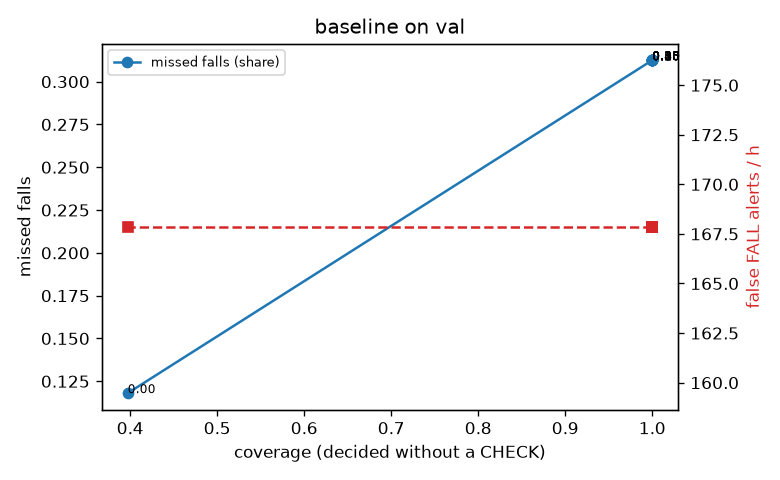

# Evaluation: baseline on val

Thresholds: t_high 0.5, t_low 0.5 (reports\scores\baseline\thresholds.yaml). 589 clips, 144 falls, 1.00 h (0.75 h normal activity); 0 clips have no score rows (counted as silent). 95% intervals: bootstrap over clips.

## Systems

| System | Sensitivity (FALL) | Sensitivity (FALL or CHECK) | False FALL alerts / h | CHECK requests / h | Coverage | Median latency (s) | Alerts |
| --- | --- | --- | --- | --- | --- | --- | --- |
| baseline (one threshold) | 68.8% (56.7%–80.6%) | 68.8% (56.7%–80.6%) | 167.86 (142.60–195.93) | 0.00 (0.00–0.00) | 100.0% (100.0%–100.0%) | 2.53 (2.33–2.77) | 226 FALL, 0 CHECK |

## Breakdown (baseline (one threshold))

| Group | Value | Clips | Falls | Hours | Sens. (FALL) | Sens. (any) | False FALL / h | CHECK / h |
| --- | --- | --- | --- | --- | --- | --- | --- | --- |
| dataset | GMDCSA24 | 47 | 23 | 0.12 | 73.9% (54.2%–90.5%) | 73.9% (54.2%–90.5%) | 148.93 (69.01–242.61) | 0.00 (0.00–0.00) |
| dataset | caucafall | 8 | 4 | 0.03 | 50.0% (0.0%–100.0%) | 50.0% (0.0%–100.0%) | 0.00 (0.00–0.00) | 0.00 (0.00–0.00) |
| dataset | le2i | 15 | 11 | 0.04 | 63.6% (33.3%–90.0%) | 63.6% (33.3%–90.0%) | 75.45 (0.00–175.80) | 0.00 (0.00–0.00) |
| dataset | occu | 2 | 16 | 0.08 | 0.0% (0.0%–0.0%) | 0.0% (0.0%–0.0%) | 68.91 (66.43–71.58) | 0.00 (0.00–0.00) |
| dataset | of-syn | 517 | 90 | 0.73 | 81.1% (73.0%–89.0%) | 81.1% (73.0%–89.0%) | 183.03 (153.57–212.81) | 0.00 (0.00–0.00) |
| qc_pass | True | 589 | 144 | 1.00 | 68.8% (56.7%–80.6%) | 68.8% (56.7%–80.6%) | 167.86 (142.60–195.93) | 0.00 (0.00–0.00) |
| of-syn age | child | 72 | 13 | 0.10 | 84.6% (61.5%–100.0%) | 84.6% (61.5%–100.0%) | 168.59 (97.96–245.99) | 0.00 (0.00–0.00) |
| of-syn age | elderly | 184 | 25 | 0.26 | 80.0% (63.2%–95.2%) | 80.0% (63.2%–95.2%) | 192.14 (142.10–242.82) | 0.00 (0.00–0.00) |
| of-syn age | middle-aged | 61 | 12 | 0.09 | 83.3% (60.0%–100.0%) | 83.3% (60.0%–100.0%) | 173.99 (92.06–262.57) | 0.00 (0.00–0.00) |
| of-syn age | teen | 61 | 10 | 0.09 | 70.0% (40.0%–100.0%) | 70.0% (40.0%–100.0%) | 208.96 (127.89–300.63) | 0.00 (0.00–0.00) |
| of-syn age | toddler | 72 | 15 | 0.10 | 93.3% (76.9%–100.0%) | 93.3% (76.9%–100.0%) | 174.50 (97.52–252.88) | 0.00 (0.00–0.00) |
| of-syn age | young adult | 67 | 15 | 0.09 | 73.3% (50.0%–93.3%) | 73.3% (50.0%–93.3%) | 163.96 (85.18–252.90) | 0.00 (0.00–0.00) |
| of-syn BMI | normal | 135 | 19 | 0.19 | 100.0% (100.0%–100.0%) | 100.0% (100.0%–100.0%) | 244.99 (183.35–300.14) | 0.00 (0.00–0.00) |
| of-syn BMI | obese | 125 | 18 | 0.18 | 66.7% (43.5%–88.9%) | 66.7% (43.5%–88.9%) | 166.00 (111.83–224.39) | 0.00 (0.00–0.00) |
| of-syn BMI | overweight | 134 | 27 | 0.19 | 88.9% (76.0%–100.0%) | 88.9% (76.0%–100.0%) | 126.16 (74.43–177.66) | 0.00 (0.00–0.00) |
| of-syn BMI | underweight | 123 | 26 | 0.17 | 69.2% (52.4%–85.7%) | 69.2% (52.4%–85.7%) | 190.44 (131.81–255.22) | 0.00 (0.00–0.00) |

## Windows (4 classes)

Macro F1 0.229 over 2105 windows.

| true \ predicted | upright | falling | fallen | controlled_low |
| --- | --- | --- | --- | --- |
| upright | 648 | 8 | 68 | 0 |
| falling | 186 | 26 | 389 | 0 |
| fallen | 74 | 21 | 85 | 0 |
| controlled_low | 327 | 74 | 199 | 0 |

## Coverage–error curve

| CHECK band | t_low | Coverage | Missed falls | False FALL / h | CHECK / h |
| --- | --- | --- | --- | --- | --- |
| 0.00 | 0.50 | 100.0% | 31.2% | 167.86 | 0.00 |
| 0.05 | 0.45 | 100.0% | 31.2% | 167.86 | 0.00 |
| 0.10 | 0.40 | 100.0% | 31.2% | 167.86 | 0.00 |
| 0.15 | 0.35 | 100.0% | 31.2% | 167.86 | 0.00 |
| 0.20 | 0.30 | 100.0% | 31.2% | 167.86 | 0.00 |
| 0.25 | 0.25 | 100.0% | 31.2% | 167.86 | 0.00 |
| 0.30 | 0.20 | 100.0% | 31.2% | 167.86 | 0.00 |
| 0.35 | 0.15 | 100.0% | 31.2% | 167.86 | 0.00 |
| 0.40 | 0.10 | 100.0% | 31.2% | 167.86 | 0.00 |
| 0.45 | 0.05 | 100.0% | 31.2% | 167.86 | 0.00 |
| 0.50 | 0.00 | 39.7% | 11.8% | 167.86 | 490.53 |

Definitions: fall event = OmniFall `fall` segment; detected = alert from the segment start to 10 s after its end; false alert = alert matching no fall; normal-activity hours exclude [start − 2 s, end + 10 s]; FALL and ON FLOOR count as alarms, CHECK hands over to a person.
