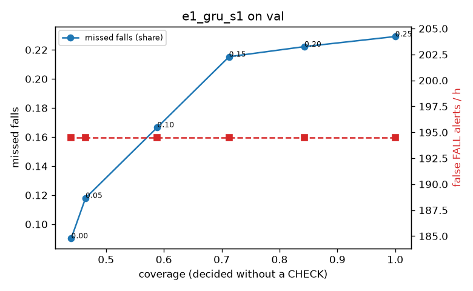

# Evaluation: e1_gru_s1 on val

Thresholds: t_high 0.25, t_low 0.05 (models\e1_gru_s1\thresholds.yaml). 589 clips, 144 falls, 1.00 h (0.75 h normal activity); 0 clips have no score rows (counted as silent). 95% intervals: bootstrap over clips.

## Systems

| System | Sensitivity (FALL) | Sensitivity (FALL or CHECK) | False FALL alerts / h | CHECK requests / h | Coverage | Median latency (s) | Alerts |
| --- | --- | --- | --- | --- | --- | --- | --- |
| e1_gru_s1 (one threshold) | 77.1% (69.0%–85.7%) | 77.1% (69.0%–85.7%) | 194.51 (170.67–222.14) | 0.00 (0.00–0.00) | 100.0% (100.0%–100.0%) | 1.93 (1.61–1.93) | 260 FALL, 0 CHECK |
| e1_gru_s1 (CHECK band) | 77.1% (69.0%–85.7%) | 88.2% (80.3%–96.0%) | 194.51 (170.67–222.14) | 430.59 (385.26–473.38) | 46.5% (42.7%–50.2%) | 1.93 (1.61–1.93) | 260 FALL, 431 CHECK |
| rule baseline (E0) | 68.8% (56.7%–80.6%) | 68.8% (56.7%–80.6%) | 167.86 (142.60–195.93) | 0.00 (0.00–0.00) | 100.0% (100.0%–100.0%) | 2.53 (2.33–2.77) | 226 FALL, 0 CHECK |

## Breakdown (e1_gru_s1 (CHECK band))

| Group | Value | Clips | Falls | Hours | Sens. (FALL) | Sens. (any) | False FALL / h | CHECK / h |
| --- | --- | --- | --- | --- | --- | --- | --- | --- |
| dataset | GMDCSA24 | 47 | 23 | 0.12 | 95.7% (85.7%–100.0%) | 95.7% (85.7%–100.0%) | 210.99 (142.10–271.00) | 317.74 (269.63–361.38) |
| dataset | caucafall | 8 | 4 | 0.03 | 100.0% (100.0%–100.0%) | 100.0% (100.0%–100.0%) | 296.27 (275.48–313.88) | 113.05 (34.47–233.45) |
| dataset | le2i | 15 | 11 | 0.04 | 81.8% (58.3%–100.0%) | 81.8% (58.3%–100.0%) | 226.34 (90.57–374.56) | 313.95 (241.90–385.13) |
| dataset | occu | 2 | 16 | 0.08 | 37.5% (37.5%–37.5%) | 37.5% (37.5%–37.5%) | 137.82 (132.86–143.16) | 75.56 (73.80–77.40) |
| dataset | of-syn | 517 | 90 | 0.73 | 77.8% (69.0%–86.7%) | 95.6% (91.2%–100.0%) | 191.35 (163.43–222.24) | 507.09 (479.61–534.58) |
| qc_pass | True | 589 | 144 | 1.00 | 77.1% (69.0%–85.7%) | 88.2% (80.3%–96.0%) | 194.51 (170.67–222.14) | 430.59 (385.26–473.38) |
| of-syn age | child | 72 | 13 | 0.10 | 76.9% (50.0%–100.0%) | 92.3% (72.7%–100.0%) | 168.59 (99.66–244.59) | 473.65 (394.71–542.73) |
| of-syn age | elderly | 184 | 25 | 0.26 | 72.0% (54.5%–88.5%) | 96.0% (87.0%–100.0%) | 205.55 (157.87–258.42) | 548.30 (505.83–590.78) |
| of-syn age | middle-aged | 61 | 12 | 0.09 | 66.7% (36.4%–92.3%) | 100.0% (100.0%–100.0%) | 116.00 (43.50–195.03) | 547.42 (465.89–617.30) |
| of-syn age | teen | 61 | 10 | 0.09 | 90.0% (66.7%–100.0%) | 100.0% (100.0%–100.0%) | 195.03 (109.30–289.47) | 500.83 (407.65–582.36) |
| of-syn age | toddler | 72 | 15 | 0.10 | 80.0% (58.3%–100.0%) | 93.3% (76.9%–100.0%) | 199.43 (118.41–284.19) | 463.79 (384.84–542.73) |
| of-syn age | young adult | 67 | 15 | 0.09 | 86.7% (70.0%–100.0%) | 93.3% (77.8%–100.0%) | 232.27 (144.66–328.93) | 445.38 (360.54–519.60) |
| of-syn BMI | normal | 135 | 19 | 0.19 | 78.9% (58.8%–95.0%) | 94.7% (82.6%–100.0%) | 214.37 (157.85–278.01) | 499.97 (442.08–557.86) |
| of-syn BMI | obese | 125 | 18 | 0.18 | 77.8% (57.9%–95.0%) | 94.4% (81.2%–100.0%) | 225.76 (167.56–284.19) | 511.55 (454.71–568.38) |
| of-syn BMI | overweight | 134 | 27 | 0.19 | 74.1% (56.0%–90.0%) | 96.3% (86.7%–100.0%) | 166.00 (113.94–224.03) | 530.21 (482.49–583.23) |
| of-syn BMI | underweight | 123 | 26 | 0.17 | 80.8% (65.4%–93.3%) | 96.2% (88.0%–100.0%) | 153.82 (100.37–212.33) | 485.21 (427.44–542.97) |

## Windows (4 classes)

Macro F1 0.642 over 12454 windows.

| true \ predicted | upright | falling | fallen | controlled_low |
| --- | --- | --- | --- | --- |
| upright | 3673 | 309 | 141 | 997 |
| falling | 151 | 763 | 79 | 182 |
| fallen | 59 | 148 | 1095 | 260 |
| controlled_low | 833 | 223 | 744 | 2797 |

## Coverage–error curve

| CHECK band | t_low | Coverage | Missed falls | False FALL / h | CHECK / h |
| --- | --- | --- | --- | --- | --- |
| 0.00 | 0.25 | 100.0% | 22.9% | 194.51 | 0.00 |
| 0.05 | 0.20 | 84.3% | 22.2% | 194.51 | 73.93 |
| 0.10 | 0.15 | 71.3% | 21.5% | 194.51 | 159.85 |
| 0.15 | 0.10 | 58.9% | 16.7% | 194.51 | 266.75 |
| 0.20 | 0.05 | 46.5% | 11.8% | 194.51 | 430.59 |
| 0.25 | 0.00 | 44.0% | 9.0% | 194.51 | 468.55 |

Definitions: fall event = OmniFall `fall` segment; detected = alert from the segment start to 10 s after its end; false alert = alert matching no fall; normal-activity hours exclude [start − 2 s, end + 10 s]; FALL and ON FLOOR count as alarms, CHECK hands over to a person.
