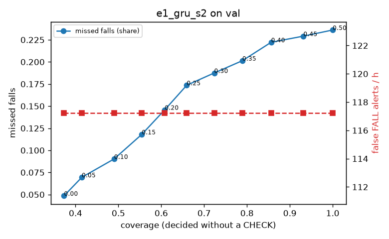

# Evaluation: e1_gru_s2 on val

Thresholds: t_high 0.5, t_low 0.5 (reports\scores\e1_gru_s2\thresholds.yaml). 589 clips, 144 falls, 1.00 h (0.75 h normal activity); 0 clips have no score rows (counted as silent). 95% intervals: bootstrap over clips.

## Systems

| System | Sensitivity (FALL) | Sensitivity (FALL or CHECK) | False FALL alerts / h | CHECK requests / h | Coverage | Median latency (s) | Alerts |
| --- | --- | --- | --- | --- | --- | --- | --- |
| e1_gru_s2 (one threshold) | 76.4% (68.1%–84.4%) | 76.4% (68.1%–84.4%) | 117.24 (95.71–138.98) | 0.00 (0.00–0.00) | 100.0% (100.0%–100.0%) | 1.93 (1.37–1.93) | 198 FALL, 0 CHECK |
| rule baseline (E0) | 68.8% (56.7%–80.6%) | 68.8% (56.7%–80.6%) | 167.86 (142.60–195.93) | 0.00 (0.00–0.00) | 100.0% (100.0%–100.0%) | 2.53 (2.33–2.77) | 226 FALL, 0 CHECK |

## Breakdown (e1_gru_s2 (one threshold))

| Group | Value | Clips | Falls | Hours | Sens. (FALL) | Sens. (any) | False FALL / h | CHECK / h |
| --- | --- | --- | --- | --- | --- | --- | --- | --- |
| dataset | GMDCSA24 | 47 | 23 | 0.12 | 95.7% (85.7%–100.0%) | 95.7% (85.7%–100.0%) | 148.93 (84.87–217.30) | 0.00 (0.00–0.00) |
| dataset | caucafall | 8 | 4 | 0.03 | 100.0% (100.0%–100.0%) | 100.0% (100.0%–100.0%) | 296.27 (275.48–313.88) | 0.00 (0.00–0.00) |
| dataset | le2i | 15 | 11 | 0.04 | 100.0% (100.0%–100.0%) | 100.0% (100.0%–100.0%) | 37.72 (0.00–118.36) | 0.00 (0.00–0.00) |
| dataset | occu | 2 | 16 | 0.08 | 43.8% (37.5%–50.0%) | 43.8% (37.5%–50.0%) | 137.82 (132.86–143.16) | 0.00 (0.00–0.00) |
| dataset | of-syn | 517 | 90 | 0.73 | 73.3% (63.7%–82.2%) | 73.3% (63.7%–82.2%) | 111.48 (86.26–134.55) | 0.00 (0.00–0.00) |
| qc_pass | True | 589 | 144 | 1.00 | 76.4% (68.1%–84.4%) | 76.4% (68.1%–84.4%) | 117.24 (95.71–138.98) | 0.00 (0.00–0.00) |
| of-syn age | child | 72 | 13 | 0.10 | 76.9% (50.0%–100.0%) | 76.9% (50.0%–100.0%) | 120.42 (59.18–184.27) | 0.00 (0.00–0.00) |
| of-syn age | elderly | 184 | 25 | 0.26 | 64.0% (45.4%–83.3%) | 64.0% (45.4%–83.3%) | 107.24 (68.75–148.20) | 0.00 (0.00–0.00) |
| of-syn age | middle-aged | 61 | 12 | 0.09 | 66.7% (36.4%–92.3%) | 66.7% (36.4%–92.3%) | 58.00 (13.93–116.00) | 0.00 (0.00–0.00) |
| of-syn age | teen | 61 | 10 | 0.09 | 80.0% (50.0%–100.0%) | 80.0% (50.0%–100.0%) | 125.38 (59.18–198.98) | 0.00 (0.00–0.00) |
| of-syn age | toddler | 72 | 15 | 0.10 | 73.3% (50.0%–93.3%) | 73.3% (50.0%–93.3%) | 124.65 (56.84–201.08) | 0.00 (0.00–0.00) |
| of-syn age | young adult | 67 | 15 | 0.09 | 86.7% (64.3%–100.0%) | 86.7% (64.3%–100.0%) | 136.63 (68.32–213.14) | 0.00 (0.00–0.00) |
| of-syn BMI | normal | 135 | 19 | 0.19 | 78.9% (60.0%–95.2%) | 78.9% (60.0%–95.2%) | 110.25 (67.13–160.44) | 0.00 (0.00–0.00) |
| of-syn BMI | obese | 125 | 18 | 0.18 | 61.1% (38.9%–83.4%) | 61.1% (38.9%–83.4%) | 119.52 (71.68–170.79) | 0.00 (0.00–0.00) |
| of-syn BMI | overweight | 134 | 27 | 0.19 | 70.4% (52.0%–86.7%) | 70.4% (52.0%–86.7%) | 132.80 (83.97–184.46) | 0.00 (0.00–0.00) |
| of-syn BMI | underweight | 123 | 26 | 0.17 | 80.8% (65.2%–93.3%) | 80.8% (65.2%–93.3%) | 80.57 (37.00–127.14) | 0.00 (0.00–0.00) |

## Windows (4 classes)

Macro F1 0.638 over 6237 windows.

| true \ predicted | upright | falling | fallen | controlled_low |
| --- | --- | --- | --- | --- |
| upright | 1527 | 208 | 69 | 350 |
| falling | 170 | 1244 | 124 | 209 |
| fallen | 38 | 74 | 337 | 125 |
| controlled_low | 347 | 136 | 236 | 1043 |

## Coverage–error curve

| CHECK band | t_low | Coverage | Missed falls | False FALL / h | CHECK / h |
| --- | --- | --- | --- | --- | --- |
| 0.00 | 0.50 | 100.0% | 23.6% | 117.24 | 0.00 |
| 0.05 | 0.45 | 93.2% | 22.9% | 117.24 | 23.98 |
| 0.10 | 0.40 | 85.6% | 22.2% | 117.24 | 54.95 |
| 0.15 | 0.35 | 78.9% | 20.1% | 117.24 | 84.92 |
| 0.20 | 0.30 | 72.4% | 18.8% | 117.24 | 120.88 |
| 0.25 | 0.25 | 65.9% | 17.4% | 117.24 | 162.84 |
| 0.30 | 0.20 | 60.8% | 14.6% | 117.24 | 198.81 |
| 0.35 | 0.15 | 55.5% | 11.8% | 117.24 | 243.77 |
| 0.40 | 0.10 | 49.0% | 9.0% | 117.24 | 312.70 |
| 0.45 | 0.05 | 41.5% | 6.9% | 117.24 | 424.59 |
| 0.50 | 0.00 | 37.3% | 4.9% | 117.24 | 501.52 |

Definitions: fall event = OmniFall `fall` segment; detected = alert from the segment start to 10 s after its end; false alert = alert matching no fall; normal-activity hours exclude [start − 2 s, end + 10 s]; FALL and ON FLOOR count as alarms, CHECK hands over to a person.
