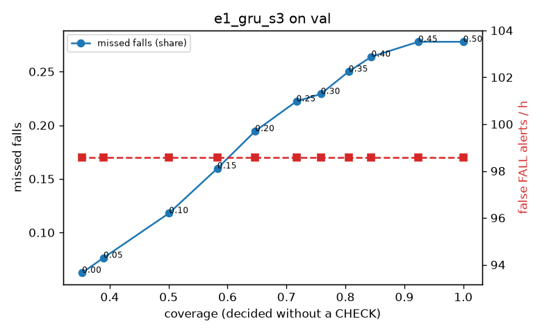

# Evaluation: e1_gru_s3 on val

Thresholds: t_high 0.5, t_low 0.5 (reports\scores\e1_gru_s3\thresholds.yaml). 589 clips, 144 falls, 1.00 h (0.75 h normal activity); 0 clips have no score rows (counted as silent). 95% intervals: bootstrap over clips.

## Systems

| System | Sensitivity (FALL) | Sensitivity (FALL or CHECK) | False FALL alerts / h | CHECK requests / h | Coverage | Median latency (s) | Alerts |
| --- | --- | --- | --- | --- | --- | --- | --- |
| e1_gru_s3 (one threshold) | 72.2% (64.7%–80.1%) | 72.2% (64.7%–80.1%) | 98.59 (78.87–119.38) | 0.00 (0.00–0.00) | 100.0% (100.0%–100.0%) | 1.93 (1.34–1.93) | 183 FALL, 0 CHECK |
| rule baseline (E0) | 68.8% (56.7%–80.6%) | 68.8% (56.7%–80.6%) | 167.86 (142.60–195.93) | 0.00 (0.00–0.00) | 100.0% (100.0%–100.0%) | 2.53 (2.33–2.77) | 226 FALL, 0 CHECK |

## Breakdown (e1_gru_s3 (one threshold))

| Group | Value | Clips | Falls | Hours | Sens. (FALL) | Sens. (any) | False FALL / h | CHECK / h |
| --- | --- | --- | --- | --- | --- | --- | --- | --- |
| dataset | GMDCSA24 | 47 | 23 | 0.12 | 95.7% (85.7%–100.0%) | 95.7% (85.7%–100.0%) | 148.93 (81.20–214.31) | 0.00 (0.00–0.00) |
| dataset | caucafall | 8 | 4 | 0.03 | 100.0% (100.0%–100.0%) | 100.0% (100.0%–100.0%) | 222.20 (76.25–299.97) | 0.00 (0.00–0.00) |
| dataset | le2i | 15 | 11 | 0.04 | 100.0% (100.0%–100.0%) | 100.0% (100.0%–100.0%) | 0.00 (0.00–0.00) | 0.00 (0.00–0.00) |
| dataset | occu | 2 | 16 | 0.08 | 43.8% (37.5%–50.0%) | 43.8% (37.5%–50.0%) | 68.91 (66.43–71.58) | 0.00 (0.00–0.00) |
| dataset | of-syn | 517 | 90 | 0.73 | 66.7% (56.8%–76.2%) | 66.7% (56.8%–76.2%) | 94.84 (72.03–117.84) | 0.00 (0.00–0.00) |
| qc_pass | True | 589 | 144 | 1.00 | 72.2% (64.7%–80.1%) | 72.2% (64.7%–80.1%) | 98.59 (78.87–119.38) | 0.00 (0.00–0.00) |
| of-syn age | child | 72 | 13 | 0.10 | 61.5% (30.8%–88.9%) | 61.5% (30.8%–88.9%) | 132.46 (68.73–201.30) | 0.00 (0.00–0.00) |
| of-syn age | elderly | 184 | 25 | 0.26 | 56.0% (35.3%–73.1%) | 56.0% (35.3%–73.1%) | 84.90 (50.41–124.33) | 0.00 (0.00–0.00) |
| of-syn age | middle-aged | 61 | 12 | 0.09 | 75.0% (46.1%–100.0%) | 75.0% (46.1%–100.0%) | 58.00 (12.59–116.06) | 0.00 (0.00–0.00) |
| of-syn age | teen | 61 | 10 | 0.09 | 80.0% (54.5%–100.0%) | 80.0% (54.5%–100.0%) | 125.38 (53.62–204.95) | 0.00 (0.00–0.00) |
| of-syn age | toddler | 72 | 15 | 0.10 | 60.0% (33.3%–83.3%) | 60.0% (33.3%–83.3%) | 99.72 (40.20–171.50) | 0.00 (0.00–0.00) |
| of-syn age | young adult | 67 | 15 | 0.09 | 80.0% (57.1%–100.0%) | 80.0% (57.1%–100.0%) | 81.98 (27.33–145.00) | 0.00 (0.00–0.00) |
| of-syn BMI | normal | 135 | 19 | 0.19 | 63.2% (40.9%–84.2%) | 63.2% (40.9%–84.2%) | 85.75 (44.39–133.21) | 0.00 (0.00–0.00) |
| of-syn BMI | obese | 125 | 18 | 0.18 | 50.0% (27.3%–73.7%) | 50.0% (27.3%–73.7%) | 79.68 (39.84–118.41) | 0.00 (0.00–0.00) |
| of-syn BMI | overweight | 134 | 27 | 0.19 | 66.7% (48.3%–84.0%) | 66.7% (48.3%–84.0%) | 99.60 (59.19–147.74) | 0.00 (0.00–0.00) |
| of-syn BMI | underweight | 123 | 26 | 0.17 | 80.8% (62.9%–95.2%) | 80.8% (62.9%–95.2%) | 117.19 (68.98–171.06) | 0.00 (0.00–0.00) |

## Windows (4 classes)

Macro F1 0.645 over 6237 windows.

| true \ predicted | upright | falling | fallen | controlled_low |
| --- | --- | --- | --- | --- |
| upright | 1650 | 117 | 111 | 276 |
| falling | 219 | 1142 | 228 | 158 |
| fallen | 35 | 50 | 456 | 33 |
| controlled_low | 294 | 137 | 399 | 932 |

## Coverage–error curve

| CHECK band | t_low | Coverage | Missed falls | False FALL / h | CHECK / h |
| --- | --- | --- | --- | --- | --- |
| 0.00 | 0.50 | 100.0% | 27.8% | 98.59 | 0.00 |
| 0.05 | 0.45 | 92.4% | 27.8% | 98.59 | 26.97 |
| 0.10 | 0.40 | 84.4% | 26.4% | 98.59 | 57.94 |
| 0.15 | 0.35 | 80.5% | 25.0% | 98.59 | 73.93 |
| 0.20 | 0.30 | 75.8% | 22.9% | 98.59 | 94.91 |
| 0.25 | 0.25 | 71.7% | 22.2% | 98.59 | 117.89 |
| 0.30 | 0.20 | 64.7% | 19.4% | 98.59 | 159.85 |
| 0.35 | 0.15 | 58.3% | 16.0% | 98.59 | 204.80 |
| 0.40 | 0.10 | 50.1% | 11.8% | 98.59 | 279.73 |
| 0.45 | 0.05 | 39.0% | 7.6% | 98.59 | 437.58 |
| 0.50 | 0.00 | 35.3% | 6.2% | 98.59 | 510.51 |

Definitions: fall event = OmniFall `fall` segment; detected = alert from the segment start to 10 s after its end; false alert = alert matching no fall; normal-activity hours exclude [start − 2 s, end + 10 s]; FALL and ON FLOOR count as alarms, CHECK hands over to a person.
