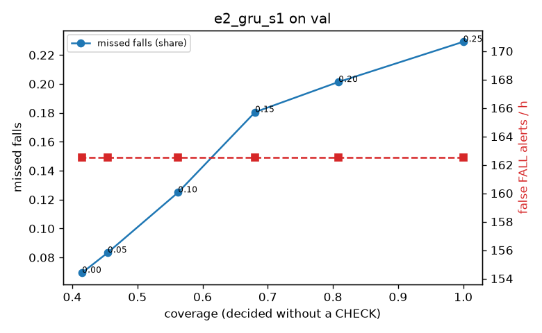

# Evaluation: e2_gru_s1 on val

Thresholds: t_high 0.25, t_low 0.05 (models\e2_gru_s1\thresholds.yaml). 589 clips, 144 falls, 1.00 h (0.75 h normal activity); 0 clips have no score rows (counted as silent). 95% intervals: bootstrap over clips.

## Systems

| System | Sensitivity (FALL) | Sensitivity (FALL or CHECK) | False FALL alerts / h | CHECK requests / h | Coverage | Median latency (s) | Alerts |
| --- | --- | --- | --- | --- | --- | --- | --- |
| e2_gru_s1 (one threshold) | 77.1% (69.5%–85.3%) | 77.1% (69.5%–85.3%) | 162.53 (138.45–187.04) | 0.00 (0.00–0.00) | 100.0% (100.0%–100.0%) | 1.93 (1.48–1.93) | 236 FALL, 0 CHECK |
| e2_gru_s1 (CHECK band) | 77.1% (69.5%–85.3%) | 91.7% (84.1%–99.2%) | 162.53 (138.45–187.04) | 409.61 (367.82–453.04) | 45.4% (41.3%–49.2%) | 1.93 (1.48–1.93) | 236 FALL, 410 CHECK |
| rule baseline (E0) | 68.8% (56.7%–80.6%) | 68.8% (56.7%–80.6%) | 167.86 (142.60–195.93) | 0.00 (0.00–0.00) | 100.0% (100.0%–100.0%) | 2.53 (2.33–2.77) | 226 FALL, 0 CHECK |

## Breakdown (e2_gru_s1 (CHECK band))

| Group | Value | Clips | Falls | Hours | Sens. (FALL) | Sens. (any) | False FALL / h | CHECK / h |
| --- | --- | --- | --- | --- | --- | --- | --- | --- |
| dataset | GMDCSA24 | 47 | 23 | 0.12 | 100.0% (100.0%–100.0%) | 100.0% (100.0%–100.0%) | 186.17 (120.26–257.18) | 301.45 (249.68–346.92) |
| dataset | caucafall | 8 | 4 | 0.03 | 100.0% (100.0%–100.0%) | 100.0% (100.0%–100.0%) | 296.27 (275.48–313.88) | 150.73 (38.54–249.89) |
| dataset | le2i | 15 | 11 | 0.04 | 90.9% (70.0%–100.0%) | 90.9% (70.0%–100.0%) | 150.89 (39.57–283.04) | 336.38 (263.74–416.04) |
| dataset | occu | 2 | 16 | 0.08 | 43.8% (37.5%–50.0%) | 43.8% (37.5%–50.0%) | 103.36 (71.58–132.86) | 75.56 (73.80–77.40) |
| dataset | of-syn | 517 | 90 | 0.73 | 74.4% (65.7%–83.8%) | 97.8% (94.3%–100.0%) | 159.73 (133.19–189.35) | 478.23 (449.37–508.47) |
| qc_pass | True | 589 | 144 | 1.00 | 77.1% (69.5%–85.3%) | 91.7% (84.1%–99.2%) | 162.53 (138.45–187.04) | 409.61 (367.82–453.04) |
| of-syn age | child | 72 | 13 | 0.10 | 76.9% (50.0%–100.0%) | 92.3% (72.7%–100.0%) | 216.76 (142.10–299.15) | 414.45 (335.50–493.39) |
| of-syn age | elderly | 184 | 25 | 0.26 | 64.0% (44.0%–82.6%) | 96.0% (86.4%–100.0%) | 151.93 (107.90–203.02) | 490.39 (444.05–532.86) |
| of-syn age | middle-aged | 61 | 12 | 0.09 | 66.7% (36.4%–91.7%) | 100.0% (100.0%–100.0%) | 116.00 (45.35–191.28) | 477.54 (384.36–559.07) |
| of-syn age | teen | 61 | 10 | 0.09 | 90.0% (68.8%–100.0%) | 100.0% (100.0%–100.0%) | 139.31 (64.59–217.52) | 465.89 (372.71–547.42) |
| of-syn age | toddler | 72 | 15 | 0.10 | 73.3% (50.0%–93.3%) | 100.0% (100.0%–100.0%) | 137.11 (72.25–211.90) | 562.46 (493.39–621.67) |
| of-syn age | young adult | 67 | 15 | 0.09 | 86.7% (66.7%–100.0%) | 100.0% (100.0%–100.0%) | 204.95 (124.60–289.45) | 434.77 (349.94–519.60) |
| of-syn BMI | normal | 135 | 19 | 0.19 | 84.2% (66.7%–100.0%) | 100.0% (100.0%–100.0%) | 189.87 (137.08–248.97) | 473.65 (415.76–531.54) |
| of-syn BMI | obese | 125 | 18 | 0.18 | 55.6% (33.3%–77.8%) | 94.4% (82.4%–100.0%) | 146.08 (92.08–198.47) | 500.18 (443.34–557.02) |
| of-syn BMI | overweight | 134 | 27 | 0.19 | 70.4% (52.9%–87.5%) | 96.3% (86.7%–100.0%) | 152.72 (99.56–209.77) | 482.49 (424.17–535.51) |
| of-syn BMI | underweight | 123 | 26 | 0.17 | 84.6% (69.7%–96.3%) | 100.0% (100.0%–100.0%) | 146.49 (90.53–206.97) | 456.32 (392.79–508.31) |

## Windows (4 classes)

Macro F1 0.623 over 12454 windows.

| true \ predicted | upright | falling | fallen | controlled_low |
| --- | --- | --- | --- | --- |
| upright | 2962 | 284 | 202 | 1672 |
| falling | 129 | 755 | 110 | 181 |
| fallen | 46 | 179 | 1034 | 303 |
| controlled_low | 540 | 184 | 633 | 3240 |

## Coverage–error curve

| CHECK band | t_low | Coverage | Missed falls | False FALL / h | CHECK / h |
| --- | --- | --- | --- | --- | --- |
| 0.00 | 0.25 | 100.0% | 22.9% | 162.53 | 0.00 |
| 0.05 | 0.20 | 80.9% | 20.1% | 162.53 | 84.92 |
| 0.10 | 0.15 | 68.1% | 18.1% | 162.53 | 167.84 |
| 0.15 | 0.10 | 56.2% | 12.5% | 162.53 | 268.74 |
| 0.20 | 0.05 | 45.4% | 8.3% | 162.53 | 409.61 |
| 0.25 | 0.00 | 41.5% | 6.9% | 162.53 | 479.54 |

Definitions: fall event = OmniFall `fall` segment; detected = alert from the segment start to 10 s after its end; false alert = alert matching no fall; normal-activity hours exclude [start − 2 s, end + 10 s]; FALL and ON FLOOR count as alarms, CHECK hands over to a person.
