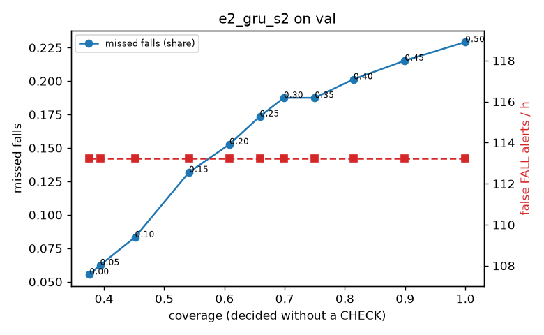

# Evaluation: e2_gru_s2 on val

Thresholds: t_high 0.5, t_low 0.1 (models\e2_gru_s2\thresholds.yaml). 589 clips, 144 falls, 1.00 h (0.75 h normal activity); 0 clips have no score rows (counted as silent). 95% intervals: bootstrap over clips.

## Systems

| System | Sensitivity (FALL) | Sensitivity (FALL or CHECK) | False FALL alerts / h | CHECK requests / h | Coverage | Median latency (s) | Alerts |
| --- | --- | --- | --- | --- | --- | --- | --- |
| e2_gru_s2 (one threshold) | 77.1% (70.2%–84.1%) | 77.1% (70.2%–84.1%) | 113.24 (92.14–135.67) | 0.00 (0.00–0.00) | 100.0% (100.0%–100.0%) | 1.93 (1.45–1.93) | 198 FALL, 0 CHECK |
| e2_gru_s2 (CHECK band) | 77.1% (70.2%–84.1%) | 91.7% (85.6%–98.3%) | 113.24 (92.14–135.67) | 368.65 (329.29–407.86) | 45.1% (40.8%–49.3%) | 1.93 (1.45–1.93) | 198 FALL, 369 CHECK |
| rule baseline (E0) | 68.8% (56.7%–80.6%) | 68.8% (56.7%–80.6%) | 167.86 (142.60–195.93) | 0.00 (0.00–0.00) | 100.0% (100.0%–100.0%) | 2.53 (2.33–2.77) | 226 FALL, 0 CHECK |

## Breakdown (e2_gru_s2 (CHECK band))

| Group | Value | Clips | Falls | Hours | Sens. (FALL) | Sens. (any) | False FALL / h | CHECK / h |
| --- | --- | --- | --- | --- | --- | --- | --- | --- |
| dataset | GMDCSA24 | 47 | 23 | 0.12 | 95.7% (85.7%–100.0%) | 95.7% (85.7%–100.0%) | 136.52 (68.61–204.46) | 334.04 (298.12–371.25) |
| dataset | caucafall | 8 | 4 | 0.03 | 100.0% (100.0%–100.0%) | 100.0% (100.0%–100.0%) | 222.20 (76.25–299.97) | 188.41 (74.52–295.69) |
| dataset | le2i | 15 | 11 | 0.04 | 100.0% (100.0%–100.0%) | 100.0% (100.0%–100.0%) | 0.00 (0.00–0.00) | 336.38 (263.74–416.04) |
| dataset | occu | 2 | 16 | 0.08 | 56.2% (50.0%–62.5%) | 56.2% (50.0%–62.5%) | 68.91 (66.43–71.58) | 62.97 (51.60–73.80) |
| dataset | of-syn | 517 | 90 | 0.73 | 72.2% (62.8%–81.3%) | 95.6% (91.0%–99.0%) | 114.81 (92.16–140.16) | 416.39 (386.16–445.25) |
| qc_pass | True | 589 | 144 | 1.00 | 77.1% (70.2%–84.1%) | 91.7% (85.6%–98.3%) | 113.24 (92.14–135.67) | 368.65 (329.29–407.86) |
| of-syn age | child | 72 | 13 | 0.10 | 76.9% (50.0%–100.0%) | 92.3% (72.7%–100.0%) | 132.46 (64.56–204.72) | 374.98 (296.03–453.92) |
| of-syn age | elderly | 184 | 25 | 0.26 | 56.0% (36.8%–75.0%) | 92.0% (80.0%–100.0%) | 107.24 (68.48–147.63) | 413.16 (359.10–467.22) |
| of-syn age | middle-aged | 61 | 12 | 0.09 | 75.0% (50.0%–100.0%) | 100.0% (100.0%–100.0%) | 58.00 (13.93–116.00) | 430.95 (337.77–524.12) |
| of-syn age | teen | 61 | 10 | 0.09 | 80.0% (50.0%–100.0%) | 100.0% (100.0%–100.0%) | 111.45 (41.79–187.67) | 407.65 (314.47–489.18) |
| of-syn age | toddler | 72 | 15 | 0.10 | 73.3% (50.0%–93.3%) | 93.3% (77.8%–100.0%) | 124.65 (58.21–198.00) | 473.65 (394.71–552.60) |
| of-syn age | young adult | 67 | 15 | 0.09 | 86.7% (64.3%–100.0%) | 100.0% (100.0%–100.0%) | 163.96 (92.10–249.31) | 402.96 (318.13–477.19) |
| of-syn BMI | normal | 135 | 19 | 0.19 | 78.9% (58.8%–95.0%) | 94.7% (83.3%–100.0%) | 128.62 (79.61–182.02) | 431.55 (378.79–489.44) |
| of-syn BMI | obese | 125 | 18 | 0.18 | 55.6% (33.3%–77.8%) | 100.0% (100.0%–100.0%) | 119.52 (73.02–168.30) | 437.66 (375.13–494.49) |
| of-syn BMI | overweight | 134 | 27 | 0.19 | 70.4% (53.3%–86.4%) | 92.6% (80.9%–100.0%) | 106.24 (60.90–155.65) | 450.68 (392.35–503.70) |
| of-syn BMI | underweight | 123 | 26 | 0.17 | 80.8% (65.2%–93.3%) | 96.2% (88.0%–100.0%) | 102.54 (56.84–152.80) | 340.80 (277.26–404.34) |

## Windows (4 classes)

Macro F1 0.635 over 12454 windows.

| true \ predicted | upright | falling | fallen | controlled_low |
| --- | --- | --- | --- | --- |
| upright | 3742 | 393 | 193 | 792 |
| falling | 93 | 827 | 117 | 138 |
| fallen | 77 | 195 | 1129 | 161 |
| controlled_low | 690 | 368 | 911 | 2628 |

## Coverage–error curve

| CHECK band | t_low | Coverage | Missed falls | False FALL / h | CHECK / h |
| --- | --- | --- | --- | --- | --- |
| 0.00 | 0.50 | 100.0% | 22.9% | 113.24 | 0.00 |
| 0.05 | 0.45 | 89.9% | 21.5% | 113.24 | 35.97 |
| 0.10 | 0.40 | 81.4% | 20.1% | 113.24 | 72.93 |
| 0.15 | 0.35 | 75.0% | 18.8% | 113.24 | 105.90 |
| 0.20 | 0.30 | 69.9% | 18.8% | 113.24 | 138.87 |
| 0.25 | 0.25 | 65.9% | 17.4% | 113.24 | 164.84 |
| 0.30 | 0.20 | 60.8% | 15.3% | 113.24 | 201.81 |
| 0.35 | 0.15 | 54.1% | 13.2% | 113.24 | 263.75 |
| 0.40 | 0.10 | 45.1% | 8.3% | 113.24 | 368.65 |
| 0.45 | 0.05 | 39.4% | 6.2% | 113.24 | 465.56 |
| 0.50 | 0.00 | 37.6% | 5.6% | 113.24 | 500.52 |

Definitions: fall event = OmniFall `fall` segment; detected = alert from the segment start to 10 s after its end; false alert = alert matching no fall; normal-activity hours exclude [start − 2 s, end + 10 s]; FALL and ON FLOOR count as alarms, CHECK hands over to a person.
