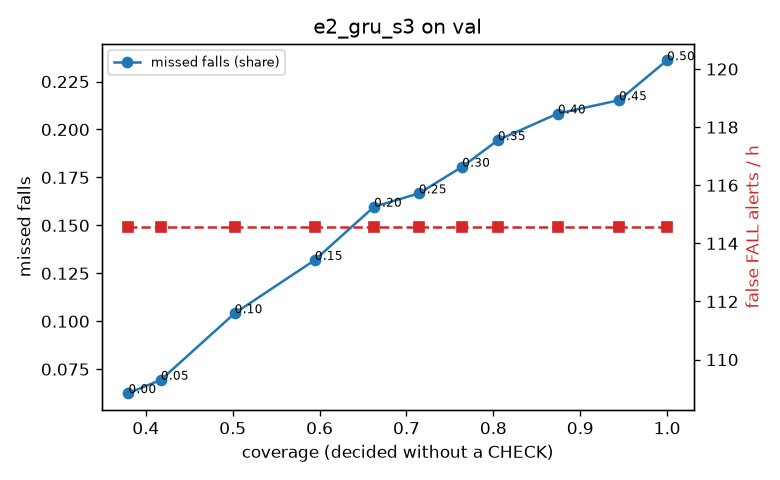

# Evaluation: e2_gru_s3 on val

Thresholds: t_high 0.5, t_low 0.5 (reports\scores\e2_gru_s3\thresholds.yaml). 589 clips, 144 falls, 1.00 h (0.75 h normal activity); 0 clips have no score rows (counted as silent). 95% intervals: bootstrap over clips.

## Systems

| System | Sensitivity (FALL) | Sensitivity (FALL or CHECK) | False FALL alerts / h | CHECK requests / h | Coverage | Median latency (s) | Alerts |
| --- | --- | --- | --- | --- | --- | --- | --- |
| e2_gru_s3 (one threshold) | 76.4% (68.4%–84.7%) | 76.4% (68.4%–84.7%) | 114.57 (95.07–136.31) | 0.00 (0.00–0.00) | 100.0% (100.0%–100.0%) | 1.93 (1.37–1.93) | 201 FALL, 0 CHECK |
| rule baseline (E0) | 68.8% (56.7%–80.6%) | 68.8% (56.7%–80.6%) | 167.86 (142.60–195.93) | 0.00 (0.00–0.00) | 100.0% (100.0%–100.0%) | 2.53 (2.33–2.77) | 226 FALL, 0 CHECK |

## Breakdown (e2_gru_s3 (one threshold))

| Group | Value | Clips | Falls | Hours | Sens. (FALL) | Sens. (any) | False FALL / h | CHECK / h |
| --- | --- | --- | --- | --- | --- | --- | --- | --- |
| dataset | GMDCSA24 | 47 | 23 | 0.12 | 95.7% (85.7%–100.0%) | 95.7% (85.7%–100.0%) | 148.93 (81.20–227.08) | 0.00 (0.00–0.00) |
| dataset | caucafall | 8 | 4 | 0.03 | 100.0% (100.0%–100.0%) | 100.0% (100.0%–100.0%) | 222.20 (59.19–313.86) | 0.00 (0.00–0.00) |
| dataset | le2i | 15 | 11 | 0.04 | 100.0% (100.0%–100.0%) | 100.0% (100.0%–100.0%) | 0.00 (0.00–0.00) | 0.00 (0.00–0.00) |
| dataset | occu | 2 | 16 | 0.08 | 43.8% (37.5%–50.0%) | 43.8% (37.5%–50.0%) | 68.91 (66.43–71.58) | 0.00 (0.00–0.00) |
| dataset | of-syn | 517 | 90 | 0.73 | 73.3% (64.0%–82.5%) | 73.3% (64.0%–82.5%) | 114.81 (91.94–138.10) | 0.00 (0.00–0.00) |
| qc_pass | True | 589 | 144 | 1.00 | 76.4% (68.4%–84.7%) | 76.4% (68.4%–84.7%) | 114.57 (95.07–136.31) | 0.00 (0.00–0.00) |
| of-syn age | child | 72 | 13 | 0.10 | 76.9% (50.0%–100.0%) | 76.9% (50.0%–100.0%) | 108.38 (47.37–171.50) | 0.00 (0.00–0.00) |
| of-syn age | elderly | 184 | 25 | 0.26 | 60.0% (40.0%–78.8%) | 60.0% (40.0%–78.8%) | 116.18 (75.96–159.86) | 0.00 (0.00–0.00) |
| of-syn age | middle-aged | 61 | 12 | 0.09 | 75.0% (46.1%–100.0%) | 75.0% (46.1%–100.0%) | 72.50 (15.12–136.05) | 0.00 (0.00–0.00) |
| of-syn age | teen | 61 | 10 | 0.09 | 80.0% (50.0%–100.0%) | 80.0% (50.0%–100.0%) | 167.17 (85.22–254.70) | 0.00 (0.00–0.00) |
| of-syn age | toddler | 72 | 15 | 0.10 | 66.7% (41.7%–89.5%) | 66.7% (41.7%–89.5%) | 124.65 (57.27–199.43) | 0.00 (0.00–0.00) |
| of-syn age | young adult | 67 | 15 | 0.09 | 93.3% (77.8%–100.0%) | 93.3% (77.8%–100.0%) | 95.64 (40.22–166.30) | 0.00 (0.00–0.00) |
| of-syn BMI | normal | 135 | 19 | 0.19 | 78.9% (60.0%–95.2%) | 78.9% (60.0%–95.2%) | 128.62 (80.43–180.63) | 0.00 (0.00–0.00) |
| of-syn BMI | obese | 125 | 18 | 0.18 | 55.6% (33.3%–78.6%) | 55.6% (33.3%–78.6%) | 99.60 (56.59–142.10) | 0.00 (0.00–0.00) |
| of-syn BMI | overweight | 134 | 27 | 0.19 | 70.4% (53.3%–87.0%) | 70.4% (53.3%–87.0%) | 119.52 (74.41–169.78) | 0.00 (0.00–0.00) |
| of-syn BMI | underweight | 123 | 26 | 0.17 | 84.6% (70.6%–96.6%) | 84.6% (70.6%–96.6%) | 109.87 (59.83–165.08) | 0.00 (0.00–0.00) |

## Windows (4 classes)

Macro F1 0.660 over 6237 windows.

| true \ predicted | upright | falling | fallen | controlled_low |
| --- | --- | --- | --- | --- |
| upright | 1671 | 125 | 64 | 294 |
| falling | 216 | 1220 | 159 | 152 |
| fallen | 22 | 77 | 423 | 52 |
| controlled_low | 323 | 168 | 316 | 955 |

## Coverage–error curve

| CHECK band | t_low | Coverage | Missed falls | False FALL / h | CHECK / h |
| --- | --- | --- | --- | --- | --- |
| 0.00 | 0.50 | 100.0% | 23.6% | 114.57 | 0.00 |
| 0.05 | 0.45 | 94.5% | 21.5% | 114.57 | 16.98 |
| 0.10 | 0.40 | 87.4% | 20.8% | 114.57 | 44.96 |
| 0.15 | 0.35 | 80.5% | 19.4% | 114.57 | 75.93 |
| 0.20 | 0.30 | 76.4% | 18.1% | 114.57 | 95.91 |
| 0.25 | 0.25 | 71.4% | 16.7% | 114.57 | 123.88 |
| 0.30 | 0.20 | 66.3% | 16.0% | 114.57 | 158.85 |
| 0.35 | 0.15 | 59.5% | 13.2% | 114.57 | 209.80 |
| 0.40 | 0.10 | 50.2% | 10.4% | 114.57 | 303.71 |
| 0.45 | 0.05 | 41.7% | 6.9% | 114.57 | 423.60 |
| 0.50 | 0.00 | 38.0% | 6.2% | 114.57 | 496.53 |

Definitions: fall event = OmniFall `fall` segment; detected = alert from the segment start to 10 s after its end; false alert = alert matching no fall; normal-activity hours exclude [start − 2 s, end + 10 s]; FALL and ON FLOOR count as alarms, CHECK hands over to a person.
