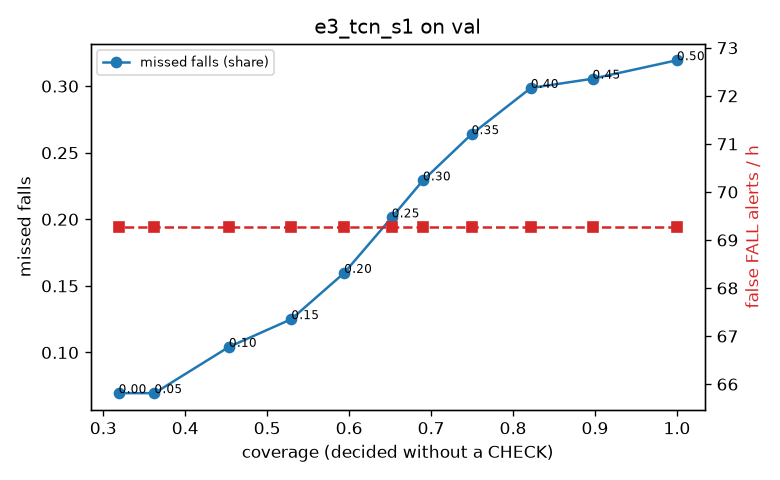

# Evaluation: e3_tcn_s1 on val

Thresholds: t_high 0.5, t_low 0.5 (reports\scores\e3_tcn_s1\thresholds.yaml). 589 clips, 144 falls, 1.00 h (0.75 h normal activity); 0 clips have no score rows (counted as silent). 95% intervals: bootstrap over clips.

## Systems

| System | Sensitivity (FALL) | Sensitivity (FALL or CHECK) | False FALL alerts / h | CHECK requests / h | Coverage | Median latency (s) | Alerts |
| --- | --- | --- | --- | --- | --- | --- | --- |
| e3_tcn_s1 (one threshold) | 68.1% (60.1%–76.7%) | 68.1% (60.1%–76.7%) | 69.28 (51.47–86.68) | 0.00 (0.00–0.00) | 100.0% (100.0%–100.0%) | 1.93 (1.34–1.93) | 154 FALL, 0 CHECK |
| rule baseline (E0) | 68.8% (56.7%–80.6%) | 68.8% (56.7%–80.6%) | 167.86 (142.60–195.93) | 0.00 (0.00–0.00) | 100.0% (100.0%–100.0%) | 2.53 (2.33–2.77) | 226 FALL, 0 CHECK |

## Breakdown (e3_tcn_s1 (one threshold))

| Group | Value | Clips | Falls | Hours | Sens. (FALL) | Sens. (any) | False FALL / h | CHECK / h |
| --- | --- | --- | --- | --- | --- | --- | --- | --- |
| dataset | GMDCSA24 | 47 | 23 | 0.12 | 100.0% (100.0%–100.0%) | 100.0% (100.0%–100.0%) | 111.70 (54.00–173.35) | 0.00 (0.00–0.00) |
| dataset | caucafall | 8 | 4 | 0.03 | 100.0% (100.0%–100.0%) | 100.0% (100.0%–100.0%) | 148.14 (0.00–294.96) | 0.00 (0.00–0.00) |
| dataset | le2i | 15 | 11 | 0.04 | 100.0% (100.0%–100.0%) | 100.0% (100.0%–100.0%) | 0.00 (0.00–0.00) | 0.00 (0.00–0.00) |
| dataset | occu | 2 | 16 | 0.08 | 37.5% (37.5%–37.5%) | 37.5% (37.5%–37.5%) | 137.82 (132.86–143.16) | 0.00 (0.00–0.00) |
| dataset | of-syn | 517 | 90 | 0.73 | 60.0% (50.6%–70.3%) | 60.0% (50.6%–70.3%) | 61.56 (41.79–80.82) | 0.00 (0.00–0.00) |
| qc_pass | True | 589 | 144 | 1.00 | 68.1% (60.1%–76.7%) | 68.1% (60.1%–76.7%) | 69.28 (51.47–86.68) | 0.00 (0.00–0.00) |
| of-syn age | child | 72 | 13 | 0.10 | 76.9% (50.0%–100.0%) | 76.9% (50.0%–100.0%) | 60.21 (13.16–116.27) | 0.00 (0.00–0.00) |
| of-syn age | elderly | 184 | 25 | 0.26 | 32.0% (14.3%–50.0%) | 32.0% (14.3%–50.0%) | 62.56 (34.87–95.91) | 0.00 (0.00–0.00) |
| of-syn age | middle-aged | 61 | 12 | 0.09 | 58.3% (28.6%–85.7%) | 58.3% (28.6%–85.7%) | 29.00 (0.00–74.01) | 0.00 (0.00–0.00) |
| of-syn age | teen | 61 | 10 | 0.09 | 70.0% (40.0%–100.0%) | 70.0% (40.0%–100.0%) | 55.72 (13.41–109.36) | 0.00 (0.00–0.00) |
| of-syn age | toddler | 72 | 15 | 0.10 | 73.3% (50.0%–93.3%) | 73.3% (50.0%–93.3%) | 74.79 (24.50–132.46) | 0.00 (0.00–0.00) |
| of-syn age | young adult | 67 | 15 | 0.09 | 73.3% (52.6%–93.8%) | 73.3% (52.6%–93.8%) | 81.98 (27.85–148.02) | 0.00 (0.00–0.00) |
| of-syn BMI | normal | 135 | 19 | 0.19 | 63.2% (42.1%–84.6%) | 63.2% (42.1%–84.6%) | 42.87 (12.80–79.57) | 0.00 (0.00–0.00) |
| of-syn BMI | obese | 125 | 18 | 0.18 | 55.6% (33.3%–79.0%) | 55.6% (33.3%–79.0%) | 53.12 (20.30–89.61) | 0.00 (0.00–0.00) |
| of-syn BMI | overweight | 134 | 27 | 0.19 | 59.3% (39.4%–77.4%) | 59.3% (39.4%–77.4%) | 73.04 (34.83–116.00) | 0.00 (0.00–0.00) |
| of-syn BMI | underweight | 123 | 26 | 0.17 | 61.5% (41.7%–80.0%) | 61.5% (41.7%–80.0%) | 80.57 (38.20–125.83) | 0.00 (0.00–0.00) |

## Windows (4 classes)

Macro F1 0.648 over 6237 windows.

| true \ predicted | upright | falling | fallen | controlled_low |
| --- | --- | --- | --- | --- |
| upright | 1470 | 124 | 116 | 444 |
| falling | 187 | 1180 | 187 | 193 |
| fallen | 4 | 65 | 449 | 56 |
| controlled_low | 202 | 113 | 385 | 1062 |

## Coverage–error curve

| CHECK band | t_low | Coverage | Missed falls | False FALL / h | CHECK / h |
| --- | --- | --- | --- | --- | --- |
| 0.00 | 0.50 | 100.0% | 31.9% | 69.28 | 0.00 |
| 0.05 | 0.45 | 89.7% | 30.6% | 69.28 | 31.97 |
| 0.10 | 0.40 | 82.2% | 29.9% | 69.28 | 60.94 |
| 0.15 | 0.35 | 74.9% | 26.4% | 69.28 | 88.92 |
| 0.20 | 0.30 | 69.0% | 22.9% | 69.28 | 114.89 |
| 0.25 | 0.25 | 65.2% | 20.1% | 69.28 | 132.87 |
| 0.30 | 0.20 | 59.4% | 16.0% | 69.28 | 164.84 |
| 0.35 | 0.15 | 52.9% | 12.5% | 69.28 | 211.80 |
| 0.40 | 0.10 | 45.3% | 10.4% | 69.28 | 290.72 |
| 0.45 | 0.05 | 36.2% | 6.9% | 69.28 | 424.59 |
| 0.50 | 0.00 | 31.9% | 6.9% | 69.28 | 523.50 |

Definitions: fall event = OmniFall `fall` segment; detected = alert from the segment start to 10 s after its end; false alert = alert matching no fall; normal-activity hours exclude [start − 2 s, end + 10 s]; FALL and ON FLOOR count as alarms, CHECK hands over to a person.
