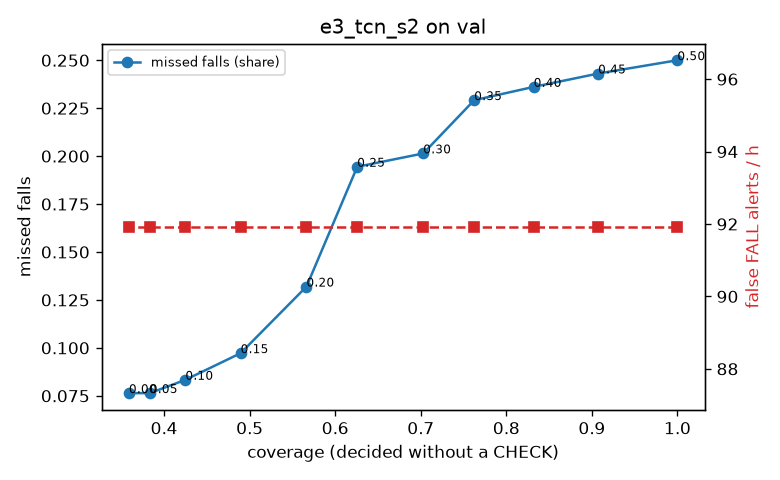

# Evaluation: e3_tcn_s2 on val

Thresholds: t_high 0.5, t_low 0.5 (reports\scores\e3_tcn_s2\thresholds.yaml). 589 clips, 144 falls, 1.00 h (0.75 h normal activity); 0 clips have no score rows (counted as silent). 95% intervals: bootstrap over clips.

## Systems

| System | Sensitivity (FALL) | Sensitivity (FALL or CHECK) | False FALL alerts / h | CHECK requests / h | Coverage | Median latency (s) | Alerts |
| --- | --- | --- | --- | --- | --- | --- | --- |
| e3_tcn_s2 (one threshold) | 75.0% (66.9%–83.5%) | 75.0% (66.9%–83.5%) | 91.93 (72.47–111.68) | 0.00 (0.00–0.00) | 100.0% (100.0%–100.0%) | 1.93 (1.47–1.93) | 180 FALL, 0 CHECK |
| rule baseline (E0) | 68.8% (56.7%–80.6%) | 68.8% (56.7%–80.6%) | 167.86 (142.60–195.93) | 0.00 (0.00–0.00) | 100.0% (100.0%–100.0%) | 2.53 (2.33–2.77) | 226 FALL, 0 CHECK |

## Breakdown (e3_tcn_s2 (one threshold))

| Group | Value | Clips | Falls | Hours | Sens. (FALL) | Sens. (any) | False FALL / h | CHECK / h |
| --- | --- | --- | --- | --- | --- | --- | --- | --- |
| dataset | GMDCSA24 | 47 | 23 | 0.12 | 95.7% (85.7%–100.0%) | 95.7% (85.7%–100.0%) | 111.70 (54.61–174.24) | 0.00 (0.00–0.00) |
| dataset | caucafall | 8 | 4 | 0.03 | 100.0% (100.0%–100.0%) | 100.0% (100.0%–100.0%) | 148.14 (0.00–294.96) | 0.00 (0.00–0.00) |
| dataset | le2i | 15 | 11 | 0.04 | 100.0% (100.0%–100.0%) | 100.0% (100.0%–100.0%) | 75.45 (0.00–172.08) | 0.00 (0.00–0.00) |
| dataset | occu | 2 | 16 | 0.08 | 37.5% (37.5%–37.5%) | 37.5% (37.5%–37.5%) | 137.82 (132.86–143.16) | 0.00 (0.00–0.00) |
| dataset | of-syn | 517 | 90 | 0.73 | 72.2% (63.0%–81.8%) | 72.2% (63.0%–81.8%) | 86.52 (65.04–108.27) | 0.00 (0.00–0.00) |
| qc_pass | True | 589 | 144 | 1.00 | 75.0% (66.9%–83.5%) | 75.0% (66.9%–83.5%) | 91.93 (72.47–111.68) | 0.00 (0.00–0.00) |
| of-syn age | child | 72 | 13 | 0.10 | 76.9% (50.0%–100.0%) | 76.9% (50.0%–100.0%) | 120.42 (61.25–190.33) | 0.00 (0.00–0.00) |
| of-syn age | elderly | 184 | 25 | 0.26 | 44.0% (25.0%–64.0%) | 44.0% (25.0%–64.0%) | 80.43 (47.94–116.91) | 0.00 (0.00–0.00) |
| of-syn age | middle-aged | 61 | 12 | 0.09 | 66.7% (36.4%–92.9%) | 66.7% (36.4%–92.9%) | 58.00 (13.66–116.00) | 0.00 (0.00–0.00) |
| of-syn age | teen | 61 | 10 | 0.09 | 100.0% (100.0%–100.0%) | 100.0% (100.0%–100.0%) | 97.52 (40.22–166.30) | 0.00 (0.00–0.00) |
| of-syn age | toddler | 72 | 15 | 0.10 | 80.0% (58.3%–100.0%) | 80.0% (58.3%–100.0%) | 74.79 (24.08–134.75) | 0.00 (0.00–0.00) |
| of-syn age | young adult | 67 | 15 | 0.09 | 93.3% (77.8%–100.0%) | 93.3% (77.8%–100.0%) | 95.64 (40.22–164.01) | 0.00 (0.00–0.00) |
| of-syn BMI | normal | 135 | 19 | 0.19 | 63.2% (42.1%–83.3%) | 63.2% (42.1%–83.3%) | 85.75 (46.95–129.21) | 0.00 (0.00–0.00) |
| of-syn BMI | obese | 125 | 18 | 0.18 | 66.7% (45.0%–87.5%) | 66.7% (45.0%–87.5%) | 73.04 (36.22–113.95) | 0.00 (0.00–0.00) |
| of-syn BMI | overweight | 134 | 27 | 0.19 | 66.7% (48.3%–84.0%) | 66.7% (48.3%–84.0%) | 86.32 (46.91–130.38) | 0.00 (0.00–0.00) |
| of-syn BMI | underweight | 123 | 26 | 0.17 | 88.5% (76.0%–100.0%) | 88.5% (76.0%–100.0%) | 102.54 (56.27–152.25) | 0.00 (0.00–0.00) |

## Windows (4 classes)

Macro F1 0.670 over 6237 windows.

| true \ predicted | upright | falling | fallen | controlled_low |
| --- | --- | --- | --- | --- |
| upright | 1611 | 148 | 74 | 321 |
| falling | 165 | 1308 | 128 | 146 |
| fallen | 5 | 69 | 422 | 78 |
| controlled_low | 279 | 150 | 339 | 994 |

## Coverage–error curve

| CHECK band | t_low | Coverage | Missed falls | False FALL / h | CHECK / h |
| --- | --- | --- | --- | --- | --- |
| 0.00 | 0.50 | 100.0% | 25.0% | 91.93 | 0.00 |
| 0.05 | 0.45 | 90.7% | 24.3% | 91.93 | 31.97 |
| 0.10 | 0.40 | 83.2% | 23.6% | 91.93 | 62.94 |
| 0.15 | 0.35 | 76.2% | 22.9% | 91.93 | 96.91 |
| 0.20 | 0.30 | 70.3% | 20.1% | 91.93 | 126.88 |
| 0.25 | 0.25 | 62.6% | 19.4% | 91.93 | 180.83 |
| 0.30 | 0.20 | 56.6% | 13.2% | 91.93 | 217.79 |
| 0.35 | 0.15 | 48.9% | 9.7% | 91.93 | 292.72 |
| 0.40 | 0.10 | 42.5% | 8.3% | 91.93 | 381.64 |
| 0.45 | 0.05 | 38.3% | 7.6% | 91.93 | 455.56 |
| 0.50 | 0.00 | 35.9% | 7.6% | 91.93 | 508.51 |

Definitions: fall event = OmniFall `fall` segment; detected = alert from the segment start to 10 s after its end; false alert = alert matching no fall; normal-activity hours exclude [start − 2 s, end + 10 s]; FALL and ON FLOOR count as alarms, CHECK hands over to a person.
