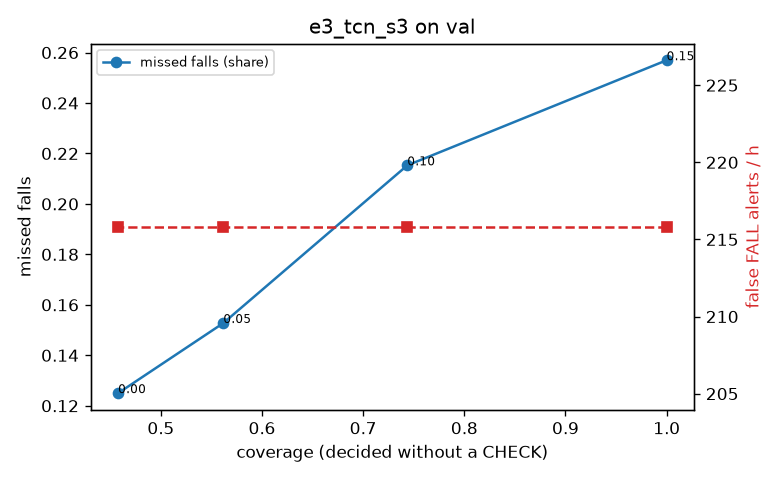

# Evaluation: e3_tcn_s3 on val

Thresholds: t_high 0.15, t_low 0.05 (models\e3_tcn_s3\thresholds.yaml). 589 clips, 144 falls, 1.00 h (0.75 h normal activity); 0 clips have no score rows (counted as silent). 95% intervals: bootstrap over clips.

## Systems

| System | Sensitivity (FALL) | Sensitivity (FALL or CHECK) | False FALL alerts / h | CHECK requests / h | Coverage | Median latency (s) | Alerts |
| --- | --- | --- | --- | --- | --- | --- | --- |
| e3_tcn_s3 (one threshold) | 74.3% (66.7%–82.8%) | 74.3% (66.7%–82.8%) | 215.82 (189.85–244.16) | 0.00 (0.00–0.00) | 100.0% (100.0%–100.0%) | 1.93 (1.93–1.93) | 271 FALL, 0 CHECK |
| e3_tcn_s3 (CHECK band) | 74.3% (66.7%–82.8%) | 84.7% (77.2%–92.9%) | 215.82 (189.85–244.16) | 296.72 (259.69–334.35) | 56.2% (52.0%–59.9%) | 1.93 (1.93–1.93) | 271 FALL, 297 CHECK |
| rule baseline (E0) | 68.8% (56.7%–80.6%) | 68.8% (56.7%–80.6%) | 167.86 (142.60–195.93) | 0.00 (0.00–0.00) | 100.0% (100.0%–100.0%) | 2.53 (2.33–2.77) | 226 FALL, 0 CHECK |

## Breakdown (e3_tcn_s3 (CHECK band))

| Group | Value | Clips | Falls | Hours | Sens. (FALL) | Sens. (any) | False FALL / h | CHECK / h |
| --- | --- | --- | --- | --- | --- | --- | --- | --- |
| dataset | GMDCSA24 | 47 | 23 | 0.12 | 87.0% (71.4%–100.0%) | 87.0% (71.4%–100.0%) | 260.63 (195.18–331.42) | 268.86 (218.01–316.87) |
| dataset | caucafall | 8 | 4 | 0.03 | 100.0% (100.0%–100.0%) | 100.0% (100.0%–100.0%) | 296.27 (275.48–313.88) | 188.41 (78.88–280.21) |
| dataset | le2i | 15 | 11 | 0.04 | 45.5% (16.7%–72.8%) | 45.5% (16.7%–72.8%) | 377.23 (263.26–577.97) | 269.10 (190.81–356.81) |
| dataset | occu | 2 | 16 | 0.08 | 43.8% (37.5%–50.0%) | 43.8% (37.5%–50.0%) | 137.82 (132.86–143.16) | 37.78 (25.80–49.20) |
| dataset | of-syn | 517 | 90 | 0.73 | 78.9% (70.5%–87.3%) | 95.6% (91.0%–99.0%) | 204.66 (172.17–235.11) | 335.31 (307.83–365.55) |
| qc_pass | True | 589 | 144 | 1.00 | 74.3% (66.7%–82.8%) | 84.7% (77.2%–92.9%) | 215.82 (189.85–244.16) | 296.72 (259.69–334.35) |
| of-syn age | child | 72 | 13 | 0.10 | 76.9% (50.0%–100.0%) | 92.3% (72.7%–100.0%) | 216.76 (135.31–296.03) | 296.03 (216.84–375.22) |
| of-syn age | elderly | 184 | 25 | 0.26 | 64.0% (45.0%–81.8%) | 92.0% (80.0%–100.0%) | 169.80 (125.37–217.22) | 335.93 (281.88–386.23) |
| of-syn age | middle-aged | 61 | 12 | 0.09 | 83.3% (55.5%–100.0%) | 100.0% (100.0%–100.0%) | 145.00 (69.65–227.35) | 361.06 (267.89–454.24) |
| of-syn age | teen | 61 | 10 | 0.09 | 90.0% (68.8%–100.0%) | 90.0% (68.8%–100.0%) | 250.76 (159.50–335.15) | 314.47 (221.30–396.01) |
| of-syn age | toddler | 72 | 15 | 0.10 | 80.0% (58.3%–100.0%) | 100.0% (100.0%–100.0%) | 224.36 (142.04–313.13) | 404.58 (315.77–483.52) |
| of-syn age | young adult | 67 | 15 | 0.09 | 93.3% (77.8%–100.0%) | 100.0% (100.0%–100.0%) | 286.92 (201.08–381.55) | 296.92 (212.08–371.15) |
| of-syn BMI | normal | 135 | 19 | 0.19 | 78.9% (60.9%–95.0%) | 94.7% (81.8%–100.0%) | 214.37 (151.81–276.65) | 373.66 (310.51–431.55) |
| of-syn BMI | obese | 125 | 18 | 0.18 | 61.1% (37.5%–82.6%) | 88.9% (72.7%–100.0%) | 212.48 (152.71–272.13) | 363.77 (301.24–420.60) |
| of-syn BMI | overweight | 134 | 27 | 0.19 | 77.8% (62.5%–92.3%) | 96.3% (86.7%–100.0%) | 185.92 (133.20–243.83) | 312.82 (259.80–371.15) |
| of-syn BMI | underweight | 123 | 26 | 0.17 | 92.3% (80.9%–100.0%) | 100.0% (100.0%–100.0%) | 205.09 (142.05–268.27) | 288.81 (225.27–346.58) |

## Windows (4 classes)

Macro F1 0.645 over 12454 windows.

| true \ predicted | upright | falling | fallen | controlled_low |
| --- | --- | --- | --- | --- |
| upright | 3418 | 304 | 197 | 1201 |
| falling | 117 | 723 | 106 | 229 |
| fallen | 60 | 126 | 1107 | 269 |
| controlled_low | 605 | 117 | 766 | 3109 |

## Coverage–error curve

| CHECK band | t_low | Coverage | Missed falls | False FALL / h | CHECK / h |
| --- | --- | --- | --- | --- | --- |
| 0.00 | 0.15 | 100.0% | 25.7% | 215.82 | 0.00 |
| 0.05 | 0.10 | 74.4% | 21.5% | 215.82 | 134.87 |
| 0.10 | 0.05 | 56.2% | 15.3% | 215.82 | 296.72 |
| 0.15 | 0.00 | 45.8% | 12.5% | 215.82 | 449.57 |

Definitions: fall event = OmniFall `fall` segment; detected = alert from the segment start to 10 s after its end; false alert = alert matching no fall; normal-activity hours exclude [start − 2 s, end + 10 s]; FALL and ON FLOOR count as alarms, CHECK hands over to a person.
