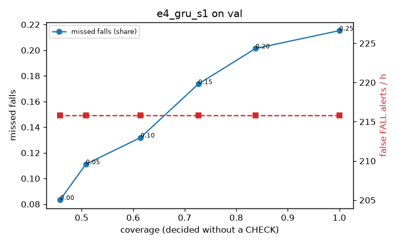

# Evaluation: e4_gru_s1 on val

Thresholds: t_high 0.25, t_low 0.1 (models\e4_gru_s1\thresholds.yaml). 589 clips, 144 falls, 1.00 h (0.75 h normal activity); 0 clips have no score rows (counted as silent). 95% intervals: bootstrap over clips.

## Systems

| System | Sensitivity (FALL) | Sensitivity (FALL or CHECK) | False FALL alerts / h | CHECK requests / h | Coverage | Median latency (s) | Alerts |
| --- | --- | --- | --- | --- | --- | --- | --- |
| e4_gru_s1 (one threshold) | 78.5% (71.4%–86.1%) | 78.5% (71.4%–86.1%) | 215.82 (188.63–244.15) | 0.00 (0.00–0.00) | 100.0% (100.0%–100.0%) | 1.93 (1.93–1.93) | 276 FALL, 0 CHECK |
| e4_gru_s1 (CHECK band) | 78.5% (71.4%–86.1%) | 86.8% (80.0%–93.9%) | 215.82 (188.63–244.15) | 243.77 (216.97–274.04) | 61.4% (57.9%–64.6%) | 1.93 (1.93–1.93) | 276 FALL, 244 CHECK |
| rule baseline (E0) | 68.8% (56.7%–80.6%) | 68.8% (56.7%–80.6%) | 167.86 (142.60–195.93) | 0.00 (0.00–0.00) | 100.0% (100.0%–100.0%) | 2.53 (2.33–2.77) | 226 FALL, 0 CHECK |

## Breakdown (e4_gru_s1 (CHECK band))

| Group | Value | Clips | Falls | Hours | Sens. (FALL) | Sens. (any) | False FALL / h | CHECK / h |
| --- | --- | --- | --- | --- | --- | --- | --- | --- |
| dataset | GMDCSA24 | 47 | 23 | 0.12 | 91.3% (78.3%–100.0%) | 91.3% (78.3%–100.0%) | 223.40 (141.69–301.30) | 236.27 (184.24–291.51) |
| dataset | caucafall | 8 | 4 | 0.03 | 100.0% (100.0%–100.0%) | 100.0% (100.0%–100.0%) | 296.27 (275.48–313.88) | 75.37 (0.00–186.12) |
| dataset | le2i | 15 | 11 | 0.04 | 81.8% (58.3%–100.0%) | 81.8% (58.3%–100.0%) | 188.61 (60.10–345.00) | 313.95 (241.90–385.13) |
| dataset | occu | 2 | 16 | 0.08 | 50.0% (50.0%–50.0%) | 50.0% (50.0%–50.0%) | 103.36 (71.58–132.86) | 62.97 (49.20–77.40) |
| dataset | of-syn | 517 | 90 | 0.73 | 78.9% (69.7%–87.0%) | 92.2% (86.2%–97.6%) | 219.63 (188.90–250.86) | 266.60 (237.74–295.46) |
| qc_pass | True | 589 | 144 | 1.00 | 78.5% (71.4%–86.1%) | 86.8% (80.0%–93.9%) | 215.82 (188.63–244.15) | 243.77 (216.97–274.04) |
| of-syn age | child | 72 | 13 | 0.10 | 76.9% (50.0%–100.0%) | 92.3% (72.7%–100.0%) | 216.76 (142.10–302.87) | 236.83 (157.88–315.77) |
| of-syn age | elderly | 184 | 25 | 0.26 | 72.0% (52.9%–88.9%) | 84.0% (69.2%–96.4%) | 227.89 (176.44–285.12) | 243.26 (196.93–293.46) |
| of-syn age | middle-aged | 61 | 12 | 0.09 | 50.0% (22.2%–78.6%) | 91.7% (71.4%–100.0%) | 159.50 (82.60–241.87) | 279.53 (198.00–361.06) |
| of-syn age | teen | 61 | 10 | 0.09 | 100.0% (100.0%–100.0%) | 100.0% (100.0%–100.0%) | 236.83 (148.02–328.93) | 244.59 (163.06–326.12) |
| of-syn age | toddler | 72 | 15 | 0.10 | 86.7% (65.0%–100.0%) | 93.3% (77.8%–100.0%) | 199.43 (120.64–286.69) | 335.50 (256.56–414.69) |
| of-syn age | young adult | 67 | 15 | 0.09 | 93.3% (77.8%–100.0%) | 100.0% (100.0%–100.0%) | 259.60 (173.59–355.24) | 296.92 (212.08–381.75) |
| of-syn BMI | normal | 135 | 19 | 0.19 | 84.2% (66.7%–100.0%) | 89.5% (75.0%–100.0%) | 275.62 (213.76–343.00) | 268.40 (210.51–326.29) |
| of-syn BMI | obese | 125 | 18 | 0.18 | 66.7% (45.0%–87.5%) | 88.9% (73.3%–100.0%) | 199.20 (140.59–256.56) | 301.24 (238.72–363.77) |
| of-syn BMI | overweight | 134 | 27 | 0.19 | 74.1% (57.6%–88.9%) | 96.3% (86.7%–100.0%) | 212.48 (156.27–278.88) | 307.52 (249.07–365.84) |
| of-syn BMI | underweight | 123 | 26 | 0.17 | 88.5% (75.0%–100.0%) | 92.3% (80.9%–100.0%) | 183.11 (126.30–241.91) | 184.84 (132.85–242.60) |

## Windows (4 classes)

Macro F1 0.657 over 12454 windows.

| true \ predicted | upright | falling | fallen | controlled_low |
| --- | --- | --- | --- | --- |
| upright | 4072 | 329 | 169 | 550 |
| falling | 125 | 834 | 60 | 156 |
| fallen | 18 | 196 | 1024 | 324 |
| controlled_low | 1094 | 293 | 533 | 2677 |

## Coverage–error curve

| CHECK band | t_low | Coverage | Missed falls | False FALL / h | CHECK / h |
| --- | --- | --- | --- | --- | --- |
| 0.00 | 0.25 | 100.0% | 21.5% | 215.82 | 0.00 |
| 0.05 | 0.20 | 83.8% | 20.1% | 215.82 | 78.92 |
| 0.10 | 0.15 | 72.6% | 17.4% | 215.82 | 149.86 |
| 0.15 | 0.10 | 61.4% | 13.2% | 215.82 | 243.77 |
| 0.20 | 0.05 | 50.8% | 11.1% | 215.82 | 376.64 |
| 0.25 | 0.00 | 45.8% | 8.3% | 215.82 | 454.57 |

Definitions: fall event = OmniFall `fall` segment; detected = alert from the segment start to 10 s after its end; false alert = alert matching no fall; normal-activity hours exclude [start − 2 s, end + 10 s]; FALL and ON FLOOR count as alarms, CHECK hands over to a person.
