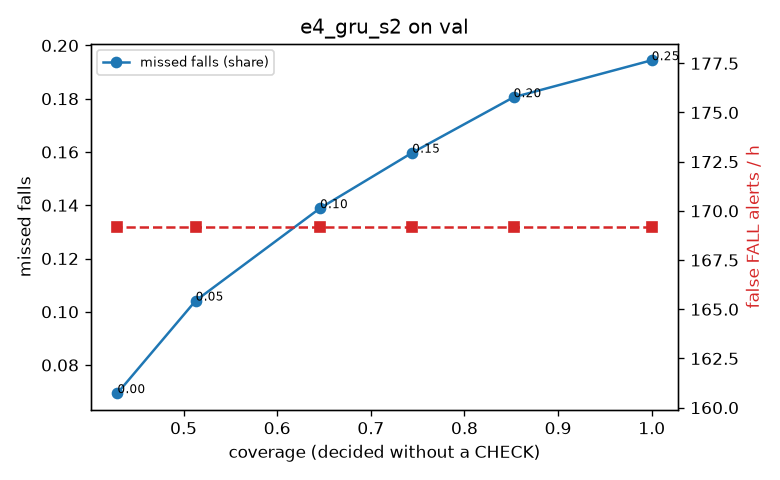

# Evaluation: e4_gru_s2 on val

Thresholds: t_high 0.25, t_low 0.05 (models\e4_gru_s2\thresholds.yaml). 589 clips, 144 falls, 1.00 h (0.75 h normal activity); 0 clips have no score rows (counted as silent). 95% intervals: bootstrap over clips.

## Systems

| System | Sensitivity (FALL) | Sensitivity (FALL or CHECK) | False FALL alerts / h | CHECK requests / h | Coverage | Median latency (s) | Alerts |
| --- | --- | --- | --- | --- | --- | --- | --- |
| e4_gru_s2 (one threshold) | 80.6% (72.7%–88.6%) | 80.6% (72.7%–88.6%) | 169.20 (145.14–196.04) | 0.00 (0.00–0.00) | 100.0% (100.0%–100.0%) | 1.93 (1.93–1.93) | 245 FALL, 0 CHECK |
| e4_gru_s2 (CHECK band) | 80.6% (72.7%–88.6%) | 89.6% (83.1%–96.7%) | 169.20 (145.14–196.04) | 343.67 (304.88–381.33) | 51.3% (47.1%–55.1%) | 1.93 (1.93–1.93) | 245 FALL, 344 CHECK |
| rule baseline (E0) | 68.8% (56.7%–80.6%) | 68.8% (56.7%–80.6%) | 167.86 (142.60–195.93) | 0.00 (0.00–0.00) | 100.0% (100.0%–100.0%) | 2.53 (2.33–2.77) | 226 FALL, 0 CHECK |

## Breakdown (e4_gru_s2 (CHECK band))

| Group | Value | Clips | Falls | Hours | Sens. (FALL) | Sens. (any) | False FALL / h | CHECK / h |
| --- | --- | --- | --- | --- | --- | --- | --- | --- |
| dataset | GMDCSA24 | 47 | 23 | 0.12 | 91.3% (78.3%–100.0%) | 91.3% (78.3%–100.0%) | 248.22 (173.70–323.46) | 301.45 (254.08–345.40) |
| dataset | caucafall | 8 | 4 | 0.03 | 100.0% (100.0%–100.0%) | 100.0% (100.0%–100.0%) | 222.20 (62.17–307.96) | 188.41 (78.88–280.21) |
| dataset | le2i | 15 | 11 | 0.04 | 100.0% (100.0%–100.0%) | 100.0% (100.0%–100.0%) | 113.17 (0.00–219.25) | 336.38 (263.74–416.04) |
| dataset | occu | 2 | 16 | 0.08 | 43.8% (37.5%–50.0%) | 50.0% (50.0%–50.0%) | 68.91 (0.00–132.86) | 50.37 (24.60–77.40) |
| dataset | of-syn | 517 | 90 | 0.73 | 81.1% (72.4%–89.0%) | 94.4% (89.2%–98.8%) | 164.72 (138.04–192.73) | 388.91 (357.30–416.39) |
| qc_pass | True | 589 | 144 | 1.00 | 80.6% (72.7%–88.6%) | 89.6% (83.1%–96.7%) | 169.20 (145.14–196.04) | 343.67 (304.88–381.33) |
| of-syn age | child | 72 | 13 | 0.10 | 84.6% (62.5%–100.0%) | 100.0% (100.0%–100.0%) | 180.63 (108.38–259.41) | 365.11 (276.05–444.05) |
| of-syn age | elderly | 184 | 25 | 0.26 | 64.0% (45.0%–81.5%) | 84.0% (66.7%–96.3%) | 125.12 (84.89–167.70) | 405.44 (355.14–451.77) |
| of-syn age | middle-aged | 61 | 12 | 0.09 | 83.3% (60.0%–100.0%) | 100.0% (100.0%–100.0%) | 159.50 (82.61–232.00) | 291.18 (198.00–384.36) |
| of-syn age | teen | 61 | 10 | 0.09 | 90.0% (66.7%–100.0%) | 100.0% (100.0%–100.0%) | 181.10 (99.47–259.60) | 396.01 (302.83–489.18) |
| of-syn age | toddler | 72 | 15 | 0.10 | 86.7% (65.0%–100.0%) | 93.3% (77.8%–100.0%) | 224.36 (139.76–313.09) | 404.58 (315.77–473.65) |
| of-syn age | young adult | 67 | 15 | 0.09 | 93.3% (77.8%–100.0%) | 100.0% (100.0%–100.0%) | 191.28 (109.25–281.23) | 434.77 (349.94–509.27) |
| of-syn BMI | normal | 135 | 19 | 0.19 | 78.9% (60.9%–95.0%) | 94.7% (83.3%–100.0%) | 183.74 (128.09–238.98) | 421.02 (363.00–478.92) |
| of-syn BMI | obese | 125 | 18 | 0.18 | 66.7% (45.0%–87.5%) | 94.4% (82.4%–100.0%) | 159.36 (108.80–217.09) | 386.50 (323.98–449.02) |
| of-syn BMI | overweight | 134 | 27 | 0.19 | 88.9% (76.0%–100.0%) | 96.3% (87.9%–100.0%) | 146.08 (94.73–204.83) | 402.96 (344.64–466.58) |
| of-syn BMI | underweight | 123 | 26 | 0.17 | 84.6% (70.8%–96.3%) | 92.3% (80.9%–100.0%) | 168.46 (112.52–229.86) | 340.80 (277.26–404.34) |

## Windows (4 classes)

Macro F1 0.681 over 12454 windows.

| true \ predicted | upright | falling | fallen | controlled_low |
| --- | --- | --- | --- | --- |
| upright | 4260 | 243 | 155 | 462 |
| falling | 146 | 804 | 93 | 132 |
| fallen | 24 | 176 | 1099 | 263 |
| controlled_low | 989 | 237 | 580 | 2791 |

## Coverage–error curve

| CHECK band | t_low | Coverage | Missed falls | False FALL / h | CHECK / h |
| --- | --- | --- | --- | --- | --- |
| 0.00 | 0.25 | 100.0% | 19.4% | 169.20 | 0.00 |
| 0.05 | 0.20 | 85.2% | 18.1% | 169.20 | 64.94 |
| 0.10 | 0.15 | 74.4% | 16.0% | 169.20 | 126.88 |
| 0.15 | 0.10 | 64.6% | 13.9% | 169.20 | 200.81 |
| 0.20 | 0.05 | 51.3% | 10.4% | 169.20 | 343.67 |
| 0.25 | 0.00 | 42.9% | 6.9% | 169.20 | 474.55 |

Definitions: fall event = OmniFall `fall` segment; detected = alert from the segment start to 10 s after its end; false alert = alert matching no fall; normal-activity hours exclude [start − 2 s, end + 10 s]; FALL and ON FLOOR count as alarms, CHECK hands over to a person.
