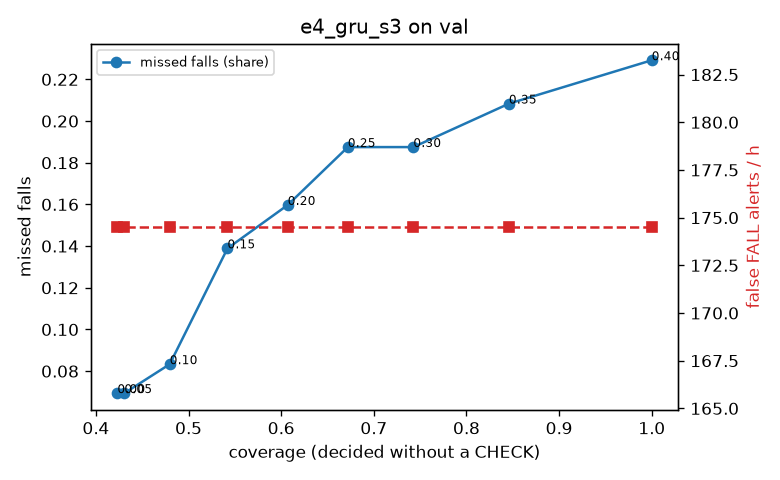

# Evaluation: e4_gru_s3 on val

Thresholds: t_high 0.4, t_low 0.1 (models\e4_gru_s3\thresholds.yaml). 589 clips, 144 falls, 1.00 h (0.75 h normal activity); 0 clips have no score rows (counted as silent). 95% intervals: bootstrap over clips.

## Systems

| System | Sensitivity (FALL) | Sensitivity (FALL or CHECK) | False FALL alerts / h | CHECK requests / h | Coverage | Median latency (s) | Alerts |
| --- | --- | --- | --- | --- | --- | --- | --- |
| e4_gru_s3 (one threshold) | 77.1% (69.9%–84.8%) | 77.1% (69.9%–84.8%) | 174.52 (151.53–199.65) | 0.00 (0.00–0.00) | 100.0% (100.0%–100.0%) | 1.93 (1.49–1.93) | 243 FALL, 0 CHECK |
| e4_gru_s3 (CHECK band) | 77.1% (69.9%–84.8%) | 91.7% (85.3%–97.7%) | 174.52 (151.53–199.65) | 375.64 (336.24–415.86) | 48.0% (44.0%–51.7%) | 1.93 (1.49–1.93) | 243 FALL, 376 CHECK |
| rule baseline (E0) | 68.8% (56.7%–80.6%) | 68.8% (56.7%–80.6%) | 167.86 (142.60–195.93) | 0.00 (0.00–0.00) | 100.0% (100.0%–100.0%) | 2.53 (2.33–2.77) | 226 FALL, 0 CHECK |

## Breakdown (e4_gru_s3 (CHECK band))

| Group | Value | Clips | Falls | Hours | Sens. (FALL) | Sens. (any) | False FALL / h | CHECK / h |
| --- | --- | --- | --- | --- | --- | --- | --- | --- |
| dataset | GMDCSA24 | 47 | 23 | 0.12 | 95.7% (85.7%–100.0%) | 95.7% (85.7%–100.0%) | 210.99 (147.25–272.57) | 252.56 (199.19–308.67) |
| dataset | caucafall | 8 | 4 | 0.03 | 100.0% (100.0%–100.0%) | 100.0% (100.0%–100.0%) | 296.27 (275.48–313.88) | 150.73 (38.54–249.89) |
| dataset | le2i | 15 | 11 | 0.04 | 81.8% (55.6%–100.0%) | 81.8% (55.6%–100.0%) | 150.89 (34.18–325.69) | 269.10 (190.80–353.33) |
| dataset | occu | 2 | 16 | 0.08 | 50.0% (50.0%–50.0%) | 56.2% (50.0%–62.5%) | 103.36 (71.58–132.86) | 75.56 (73.80–77.40) |
| dataset | of-syn | 517 | 90 | 0.73 | 75.6% (66.3%–84.0%) | 97.8% (94.1%–100.0%) | 171.38 (142.74–198.55) | 443.88 (413.64–472.74) |
| qc_pass | True | 589 | 144 | 1.00 | 77.1% (69.9%–84.8%) | 91.7% (85.3%–97.7%) | 174.52 (151.53–199.65) | 375.64 (336.24–415.86) |
| of-syn age | child | 72 | 13 | 0.10 | 76.9% (50.0%–100.0%) | 92.3% (72.7%–100.0%) | 192.67 (120.42–270.67) | 453.92 (365.11–532.86) |
| of-syn age | elderly | 184 | 25 | 0.26 | 60.0% (38.5%–78.3%) | 96.0% (87.0%–100.0%) | 178.74 (132.91–229.04) | 440.19 (389.99–490.39) |
| of-syn age | middle-aged | 61 | 12 | 0.09 | 83.3% (58.3%–100.0%) | 100.0% (100.0%–100.0%) | 116.00 (49.57–192.42) | 442.59 (349.42–524.12) |
| of-syn age | teen | 61 | 10 | 0.09 | 90.0% (66.7%–100.0%) | 100.0% (100.0%–100.0%) | 153.24 (78.91–232.28) | 396.01 (302.83–477.54) |
| of-syn age | toddler | 72 | 15 | 0.10 | 66.7% (41.7%–89.5%) | 100.0% (100.0%–100.0%) | 174.50 (99.72–261.76) | 483.52 (404.58–562.46) |
| of-syn age | young adult | 67 | 15 | 0.09 | 93.3% (77.8%–100.0%) | 100.0% (100.0%–100.0%) | 191.28 (116.00–279.18) | 445.38 (360.54–519.60) |
| of-syn BMI | normal | 135 | 19 | 0.19 | 84.2% (66.7%–100.0%) | 100.0% (100.0%–100.0%) | 165.37 (109.30–225.03) | 468.39 (415.76–526.28) |
| of-syn BMI | obese | 125 | 18 | 0.18 | 61.1% (38.5%–83.3%) | 100.0% (100.0%–100.0%) | 179.28 (123.85–234.71) | 477.44 (414.78–534.28) |
| of-syn BMI | overweight | 134 | 27 | 0.19 | 66.7% (48.3%–84.0%) | 96.3% (86.7%–100.0%) | 185.92 (130.49–244.04) | 445.38 (381.75–503.70) |
| of-syn BMI | underweight | 123 | 26 | 0.17 | 88.5% (75.0%–100.0%) | 96.2% (88.0%–100.0%) | 153.82 (98.48–210.24) | 381.23 (323.33–444.77) |

## Windows (4 classes)

Macro F1 0.648 over 12454 windows.

| true \ predicted | upright | falling | fallen | controlled_low |
| --- | --- | --- | --- | --- |
| upright | 3658 | 456 | 184 | 822 |
| falling | 81 | 862 | 87 | 145 |
| fallen | 19 | 167 | 1071 | 305 |
| controlled_low | 560 | 348 | 778 | 2911 |

## Coverage–error curve

| CHECK band | t_low | Coverage | Missed falls | False FALL / h | CHECK / h |
| --- | --- | --- | --- | --- | --- |
| 0.00 | 0.40 | 100.0% | 22.9% | 174.52 | 0.00 |
| 0.05 | 0.35 | 84.6% | 20.8% | 174.52 | 66.94 |
| 0.10 | 0.30 | 74.3% | 18.8% | 174.52 | 125.88 |
| 0.15 | 0.25 | 67.2% | 18.8% | 174.52 | 179.83 |
| 0.20 | 0.20 | 60.7% | 16.0% | 174.52 | 233.78 |
| 0.25 | 0.15 | 54.2% | 13.9% | 174.52 | 302.71 |
| 0.30 | 0.10 | 48.0% | 8.3% | 174.52 | 375.64 |
| 0.35 | 0.05 | 43.1% | 6.9% | 174.52 | 457.56 |
| 0.40 | 0.00 | 42.3% | 6.9% | 174.52 | 472.55 |

Definitions: fall event = OmniFall `fall` segment; detected = alert from the segment start to 10 s after its end; false alert = alert matching no fall; normal-activity hours exclude [start − 2 s, end + 10 s]; FALL and ON FLOOR count as alarms, CHECK hands over to a person.
