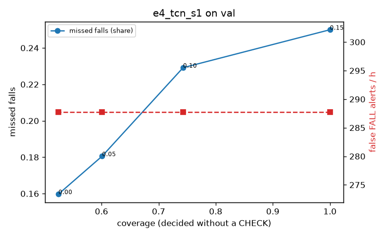

# Evaluation: e4_tcn_s1 on val

Thresholds: t_high 0.15, t_low 0.05 (models\e4_tcn_s1\thresholds.yaml). 589 clips, 144 falls, 1.00 h (0.75 h normal activity); 0 clips have no score rows (counted as silent). 95% intervals: bootstrap over clips.

## Systems

| System | Sensitivity (FALL) | Sensitivity (FALL or CHECK) | False FALL alerts / h | CHECK requests / h | Coverage | Median latency (s) | Alerts |
| --- | --- | --- | --- | --- | --- | --- | --- |
| e4_tcn_s1 (one threshold) | 75.0% (67.3%–82.6%) | 75.0% (67.3%–82.6%) | 287.77 (259.74–317.91) | 0.00 (0.00–0.00) | 100.0% (100.0%–100.0%) | 1.93 (1.93–1.93) | 327 FALL, 0 CHECK |
| e4_tcn_s1 (CHECK band) | 75.0% (67.3%–82.6%) | 81.9% (74.7%–89.3%) | 287.77 (259.74–317.91) | 295.72 (258.65–333.84) | 60.1% (56.5%–63.4%) | 1.93 (1.93–1.93) | 327 FALL, 296 CHECK |
| rule baseline (E0) | 68.8% (56.7%–80.6%) | 68.8% (56.7%–80.6%) | 167.86 (142.60–195.93) | 0.00 (0.00–0.00) | 100.0% (100.0%–100.0%) | 2.53 (2.33–2.77) | 226 FALL, 0 CHECK |

## Breakdown (e4_tcn_s1 (CHECK band))

| Group | Value | Clips | Falls | Hours | Sens. (FALL) | Sens. (any) | False FALL / h | CHECK / h |
| --- | --- | --- | --- | --- | --- | --- | --- | --- |
| dataset | GMDCSA24 | 47 | 23 | 0.12 | 69.6% (50.0%–87.5%) | 69.6% (50.0%–87.5%) | 335.10 (267.23–421.21) | 171.09 (120.51–220.97) |
| dataset | caucafall | 8 | 4 | 0.03 | 100.0% (100.0%–100.0%) | 100.0% (100.0%–100.0%) | 296.27 (275.48–313.88) | 188.41 (78.88–280.21) |
| dataset | le2i | 15 | 11 | 0.04 | 27.3% (0.0%–54.6%) | 27.3% (0.0%–54.6%) | 452.67 (316.57–707.84) | 313.95 (241.90–385.13) |
| dataset | occu | 2 | 16 | 0.08 | 50.0% (50.0%–50.0%) | 50.0% (50.0%–50.0%) | 137.82 (132.86–143.16) | 25.19 (0.00–51.60) |
| dataset | of-syn | 517 | 90 | 0.73 | 85.6% (77.9%–92.6%) | 96.7% (92.8%–100.0%) | 281.20 (248.74–316.88) | 349.06 (320.20–379.29) |
| qc_pass | True | 589 | 144 | 1.00 | 75.0% (67.3%–82.6%) | 81.9% (74.7%–89.3%) | 287.77 (259.74–317.91) | 295.72 (258.65–333.84) |
| of-syn age | child | 72 | 13 | 0.10 | 84.6% (62.5%–100.0%) | 92.3% (72.7%–100.0%) | 276.97 (191.66–361.26) | 365.11 (286.17–444.05) |
| of-syn age | elderly | 184 | 25 | 0.26 | 72.0% (52.9%–88.9%) | 100.0% (100.0%–100.0%) | 254.70 (198.58–308.91) | 370.68 (316.63–420.98) |
| of-syn age | middle-aged | 61 | 12 | 0.09 | 91.7% (72.7%–100.0%) | 100.0% (100.0%–100.0%) | 202.99 (118.41–294.94) | 326.12 (232.94–419.30) |
| of-syn age | teen | 61 | 10 | 0.09 | 100.0% (100.0%–100.0%) | 100.0% (100.0%–100.0%) | 292.55 (198.89–388.75) | 326.12 (232.94–407.65) |
| of-syn age | toddler | 72 | 15 | 0.10 | 80.0% (58.3%–100.0%) | 86.7% (69.2%–100.0%) | 286.68 (201.30–381.58) | 404.58 (315.77–483.52) |
| of-syn age | young adult | 67 | 15 | 0.09 | 100.0% (100.0%–100.0%) | 100.0% (100.0%–100.0%) | 423.56 (327.91–514.00) | 254.50 (169.67–339.33) |
| of-syn BMI | normal | 135 | 19 | 0.19 | 89.5% (75.0%–100.0%) | 94.7% (83.3%–100.0%) | 318.49 (253.68–386.97) | 363.13 (305.24–421.02) |
| of-syn BMI | obese | 125 | 18 | 0.18 | 72.2% (50.0%–92.9%) | 100.0% (100.0%–100.0%) | 272.24 (209.34–335.86) | 375.13 (306.93–437.66) |
| of-syn BMI | overweight | 134 | 27 | 0.19 | 85.2% (70.8%–96.6%) | 92.6% (81.8%–100.0%) | 272.24 (209.31–338.68) | 355.24 (291.61–418.86) |
| of-syn BMI | underweight | 123 | 26 | 0.17 | 92.3% (80.9%–100.0%) | 100.0% (100.0%–100.0%) | 256.36 (191.82–324.36) | 300.37 (242.60–358.13) |

## Windows (4 classes)

Macro F1 0.683 over 12454 windows.

| true \ predicted | upright | falling | fallen | controlled_low |
| --- | --- | --- | --- | --- |
| upright | 3869 | 217 | 222 | 812 |
| falling | 80 | 773 | 88 | 234 |
| fallen | 11 | 115 | 1104 | 332 |
| controlled_low | 812 | 128 | 559 | 3098 |

## Coverage–error curve

| CHECK band | t_low | Coverage | Missed falls | False FALL / h | CHECK / h |
| --- | --- | --- | --- | --- | --- |
| 0.00 | 0.15 | 100.0% | 25.0% | 287.77 | 0.00 |
| 0.05 | 0.10 | 74.3% | 22.9% | 287.77 | 158.85 |
| 0.10 | 0.05 | 60.1% | 18.1% | 287.77 | 295.72 |
| 0.15 | 0.00 | 52.5% | 16.0% | 287.77 | 401.62 |

Definitions: fall event = OmniFall `fall` segment; detected = alert from the segment start to 10 s after its end; false alert = alert matching no fall; normal-activity hours exclude [start − 2 s, end + 10 s]; FALL and ON FLOOR count as alarms, CHECK hands over to a person.
