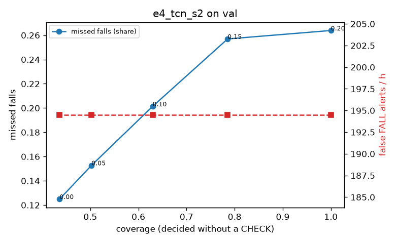

# Evaluation: e4_tcn_s2 on val

Thresholds: t_high 0.2, t_low 0.05 (models\e4_tcn_s2\thresholds.yaml). 589 clips, 144 falls, 1.00 h (0.75 h normal activity); 0 clips have no score rows (counted as silent). 95% intervals: bootstrap over clips.

## Systems

| System | Sensitivity (FALL) | Sensitivity (FALL or CHECK) | False FALL alerts / h | CHECK requests / h | Coverage | Median latency (s) | Alerts |
| --- | --- | --- | --- | --- | --- | --- | --- |
| e4_tcn_s2 (one threshold) | 73.6% (65.3%–82.1%) | 73.6% (65.3%–82.1%) | 194.51 (169.08–219.73) | 0.00 (0.00–0.00) | 100.0% (100.0%–100.0%) | 1.93 (1.93–1.93) | 256 FALL, 0 CHECK |
| e4_tcn_s2 (CHECK band) | 73.6% (65.3%–82.1%) | 84.7% (76.0%–93.1%) | 194.51 (169.08–219.73) | 363.65 (324.17–404.03) | 50.3% (46.1%–54.0%) | 1.93 (1.93–1.93) | 256 FALL, 364 CHECK |
| rule baseline (E0) | 68.8% (56.7%–80.6%) | 68.8% (56.7%–80.6%) | 167.86 (142.60–195.93) | 0.00 (0.00–0.00) | 100.0% (100.0%–100.0%) | 2.53 (2.33–2.77) | 226 FALL, 0 CHECK |

## Breakdown (e4_tcn_s2 (CHECK band))

| Group | Value | Clips | Falls | Hours | Sens. (FALL) | Sens. (any) | False FALL / h | CHECK / h |
| --- | --- | --- | --- | --- | --- | --- | --- | --- |
| dataset | GMDCSA24 | 47 | 23 | 0.12 | 87.0% (71.4%–100.0%) | 87.0% (71.4%–100.0%) | 285.46 (216.97–362.86) | 236.27 (182.47–290.61) |
| dataset | caucafall | 8 | 4 | 0.03 | 100.0% (100.0%–100.0%) | 100.0% (100.0%–100.0%) | 296.27 (275.48–313.88) | 113.05 (36.83–214.16) |
| dataset | le2i | 15 | 11 | 0.04 | 54.5% (25.0%–83.4%) | 54.5% (25.0%–83.4%) | 339.51 (231.94–502.90) | 313.95 (241.90–385.13) |
| dataset | occu | 2 | 16 | 0.08 | 37.5% (37.5%–37.5%) | 37.5% (37.5%–37.5%) | 172.27 (143.16–199.29) | 62.97 (49.20–77.40) |
| dataset | of-syn | 517 | 90 | 0.73 | 77.8% (68.7%–86.5%) | 95.6% (90.5%–99.0%) | 174.71 (145.69–203.91) | 430.14 (401.28–458.99) |
| qc_pass | True | 589 | 144 | 1.00 | 73.6% (65.3%–82.1%) | 84.7% (76.0%–93.1%) | 194.51 (169.08–219.73) | 363.65 (324.17–404.03) |
| of-syn age | child | 72 | 13 | 0.10 | 84.6% (62.5%–100.0%) | 92.3% (75.0%–100.0%) | 192.67 (118.36–272.35) | 345.37 (266.43–424.31) |
| of-syn age | elderly | 184 | 25 | 0.26 | 64.0% (44.0%–82.6%) | 92.0% (79.2%–100.0%) | 169.80 (123.97–217.23) | 444.05 (389.99–490.39) |
| of-syn age | middle-aged | 61 | 12 | 0.09 | 58.3% (28.6%–87.5%) | 91.7% (72.7%–100.0%) | 145.00 (69.65–222.05) | 361.06 (267.89–454.24) |
| of-syn age | teen | 61 | 10 | 0.09 | 100.0% (100.0%–100.0%) | 100.0% (100.0%–100.0%) | 153.24 (80.43–241.06) | 477.54 (396.01–559.07) |
| of-syn age | toddler | 72 | 15 | 0.10 | 80.0% (58.3%–100.0%) | 100.0% (100.0%–100.0%) | 186.97 (112.76–268.14) | 493.39 (414.45–562.46) |
| of-syn age | young adult | 67 | 15 | 0.09 | 93.3% (77.8%–100.0%) | 100.0% (100.0%–100.0%) | 204.95 (125.36–292.61) | 434.77 (339.33–519.60) |
| of-syn BMI | normal | 135 | 19 | 0.19 | 78.9% (60.0%–95.2%) | 100.0% (100.0%–100.0%) | 177.62 (127.49–236.83) | 478.92 (421.02–531.54) |
| of-syn BMI | obese | 125 | 18 | 0.18 | 66.7% (45.0%–87.5%) | 83.3% (64.3%–100.0%) | 185.92 (129.15–245.97) | 454.71 (392.18–511.55) |
| of-syn BMI | overweight | 134 | 27 | 0.19 | 74.1% (55.9%–90.6%) | 96.3% (87.9%–100.0%) | 166.00 (110.80–222.02) | 418.86 (360.54–477.19) |
| of-syn BMI | underweight | 123 | 26 | 0.17 | 88.5% (76.0%–100.0%) | 100.0% (100.0%–100.0%) | 168.46 (113.94–228.94) | 363.90 (300.37–421.67) |

## Windows (4 classes)

Macro F1 0.687 over 12454 windows.

| true \ predicted | upright | falling | fallen | controlled_low |
| --- | --- | --- | --- | --- |
| upright | 3934 | 161 | 155 | 870 |
| falling | 113 | 724 | 113 | 225 |
| fallen | 13 | 87 | 1208 | 254 |
| controlled_low | 666 | 141 | 745 | 3045 |

## Coverage–error curve

| CHECK band | t_low | Coverage | Missed falls | False FALL / h | CHECK / h |
| --- | --- | --- | --- | --- | --- |
| 0.00 | 0.20 | 100.0% | 26.4% | 194.51 | 0.00 |
| 0.05 | 0.15 | 78.5% | 25.7% | 194.51 | 107.90 |
| 0.10 | 0.10 | 63.0% | 20.1% | 194.51 | 220.79 |
| 0.15 | 0.05 | 50.3% | 15.3% | 194.51 | 363.65 |
| 0.20 | 0.00 | 43.6% | 12.5% | 194.51 | 470.55 |

Definitions: fall event = OmniFall `fall` segment; detected = alert from the segment start to 10 s after its end; false alert = alert matching no fall; normal-activity hours exclude [start − 2 s, end + 10 s]; FALL and ON FLOOR count as alarms, CHECK hands over to a person.
