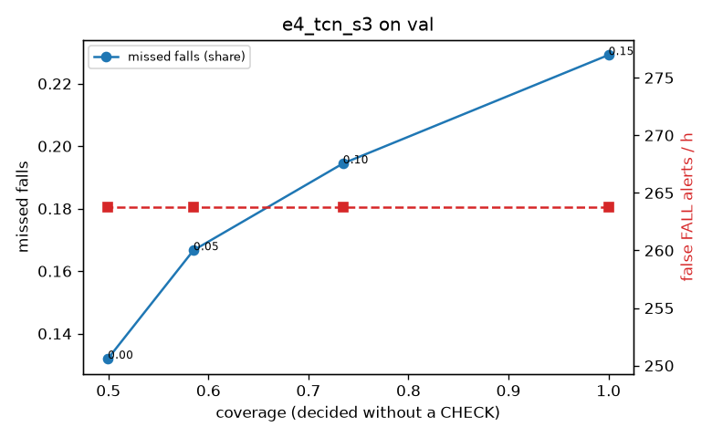

# Evaluation: e4_tcn_s3 on val

Thresholds: t_high 0.15, t_low 0.1 (models\e4_tcn_s3\thresholds.yaml). 589 clips, 144 falls, 1.00 h (0.75 h normal activity); 0 clips have no score rows (counted as silent). 95% intervals: bootstrap over clips.

## Systems

| System | Sensitivity (FALL) | Sensitivity (FALL or CHECK) | False FALL alerts / h | CHECK requests / h | Coverage | Median latency (s) | Alerts |
| --- | --- | --- | --- | --- | --- | --- | --- |
| e4_tcn_s3 (one threshold) | 77.1% (69.9%–85.3%) | 77.1% (69.9%–85.3%) | 263.79 (235.03–292.71) | 0.00 (0.00–0.00) | 100.0% (100.0%–100.0%) | 1.93 (1.93–1.93) | 312 FALL, 0 CHECK |
| e4_tcn_s3 (CHECK band) | 77.1% (69.9%–85.3%) | 80.6% (72.8%–88.5%) | 263.79 (235.03–292.71) | 157.85 (134.14–185.69) | 73.5% (70.0%–76.8%) | 1.93 (1.93–1.93) | 312 FALL, 158 CHECK |
| rule baseline (E0) | 68.8% (56.7%–80.6%) | 68.8% (56.7%–80.6%) | 167.86 (142.60–195.93) | 0.00 (0.00–0.00) | 100.0% (100.0%–100.0%) | 2.53 (2.33–2.77) | 226 FALL, 0 CHECK |

## Breakdown (e4_tcn_s3 (CHECK band))

| Group | Value | Clips | Falls | Hours | Sens. (FALL) | Sens. (any) | False FALL / h | CHECK / h |
| --- | --- | --- | --- | --- | --- | --- | --- | --- |
| dataset | GMDCSA24 | 47 | 23 | 0.12 | 82.6% (66.7%–96.0%) | 82.6% (66.7%–96.0%) | 322.69 (261.37–387.51) | 114.06 (64.61–169.26) |
| dataset | caucafall | 8 | 4 | 0.03 | 100.0% (100.0%–100.0%) | 100.0% (100.0%–100.0%) | 296.27 (275.48–313.88) | 113.05 (34.47–233.45) |
| dataset | le2i | 15 | 11 | 0.04 | 45.5% (16.7%–72.8%) | 45.5% (16.7%–72.8%) | 377.23 (263.26–577.97) | 89.70 (24.34–157.55) |
| dataset | occu | 2 | 16 | 0.08 | 43.8% (37.5%–50.0%) | 43.8% (37.5%–50.0%) | 137.82 (132.86–143.16) | 37.78 (0.00–77.40) |
| dataset | of-syn | 517 | 90 | 0.73 | 84.4% (77.6%–92.0%) | 90.0% (83.9%–96.1%) | 256.24 (224.08–289.15) | 184.15 (158.04–211.67) |
| qc_pass | True | 589 | 144 | 1.00 | 77.1% (69.9%–85.3%) | 80.6% (72.8%–88.5%) | 263.79 (235.03–292.71) | 157.85 (134.14–185.69) |
| of-syn age | child | 72 | 13 | 0.10 | 92.3% (72.7%–100.0%) | 100.0% (100.0%–100.0%) | 301.05 (213.11–387.53) | 177.62 (108.55–246.69) |
| of-syn age | elderly | 184 | 25 | 0.26 | 80.0% (63.0%–95.0%) | 84.0% (68.2%–96.6%) | 214.48 (164.27–264.79) | 154.45 (115.84–200.79) |
| of-syn age | middle-aged | 61 | 12 | 0.09 | 75.0% (49.9%–100.0%) | 91.7% (70.0%–100.0%) | 246.49 (151.17–335.23) | 151.41 (81.53–232.94) |
| of-syn age | teen | 61 | 10 | 0.09 | 90.0% (68.8%–100.0%) | 90.0% (68.8%–100.0%) | 264.69 (174.26–355.24) | 209.65 (128.12–291.18) |
| of-syn age | toddler | 72 | 15 | 0.10 | 80.0% (58.3%–100.0%) | 86.7% (65.0%–100.0%) | 274.22 (184.71–367.50) | 266.43 (187.49–355.24) |
| of-syn age | young adult | 67 | 15 | 0.09 | 93.3% (77.8%–100.0%) | 93.3% (77.8%–100.0%) | 314.25 (222.82–404.28) | 190.88 (116.65–265.10) |
| of-syn BMI | normal | 135 | 19 | 0.19 | 84.2% (66.7%–100.0%) | 84.2% (66.7%–100.0%) | 281.74 (218.61–343.00) | 189.46 (136.83–242.09) |
| of-syn BMI | obese | 125 | 18 | 0.18 | 66.7% (44.4%–87.5%) | 77.8% (56.5%–94.7%) | 232.40 (177.58–296.62) | 193.25 (136.41–250.09) |
| of-syn BMI | overweight | 134 | 27 | 0.19 | 85.2% (70.4%–97.0%) | 92.6% (80.0%–100.0%) | 245.68 (185.92–309.19) | 196.18 (137.85–254.50) |
| of-syn BMI | underweight | 123 | 26 | 0.17 | 96.2% (88.0%–100.0%) | 100.0% (100.0%–100.0%) | 263.68 (197.76–332.11) | 155.96 (109.60–207.95) |

## Windows (4 classes)

Macro F1 0.679 over 12454 windows.

| true \ predicted | upright | falling | fallen | controlled_low |
| --- | --- | --- | --- | --- |
| upright | 3791 | 187 | 181 | 961 |
| falling | 109 | 780 | 99 | 187 |
| fallen | 14 | 136 | 1110 | 302 |
| controlled_low | 786 | 137 | 605 | 3069 |

## Coverage–error curve

| CHECK band | t_low | Coverage | Missed falls | False FALL / h | CHECK / h |
| --- | --- | --- | --- | --- | --- |
| 0.00 | 0.15 | 100.0% | 22.9% | 263.79 | 0.00 |
| 0.05 | 0.10 | 73.5% | 19.4% | 263.79 | 157.85 |
| 0.10 | 0.05 | 58.5% | 16.7% | 263.79 | 307.71 |
| 0.15 | 0.00 | 49.9% | 13.2% | 263.79 | 428.59 |

Definitions: fall event = OmniFall `fall` segment; detected = alert from the segment start to 10 s after its end; false alert = alert matching no fall; normal-activity hours exclude [start − 2 s, end + 10 s]; FALL and ON FLOOR count as alarms, CHECK hands over to a person.
