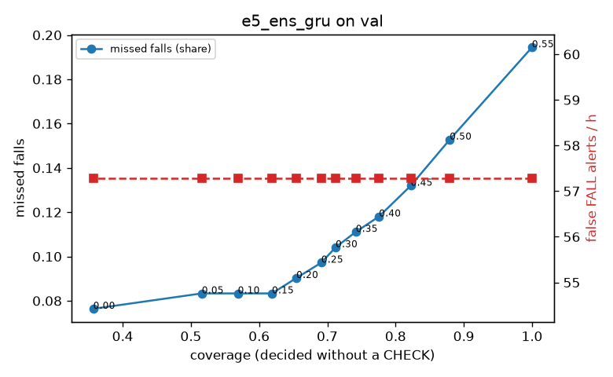

# Evaluation: e5_ens_gru on val

Thresholds: t_high 0.55, t_low 0.4 (models\e5_ens_gru\thresholds.yaml). 589 clips, 144 falls, 1.00 h (0.75 h normal activity); 0 clips have no score rows (counted as silent). 95% intervals: bootstrap over clips.

## Systems

| System | Sensitivity (FALL) | Sensitivity (FALL or CHECK) | False FALL alerts / h | CHECK requests / h | Coverage | Median latency (s) | Alerts |
| --- | --- | --- | --- | --- | --- | --- | --- |
| e5_ens_gru (one threshold) | 80.6% (72.5%–89.2%) | 80.6% (72.5%–89.2%) | 57.29 (43.32–74.58) | 0.00 (0.00–0.00) | 100.0% (100.0%–100.0%) | 1.93 (1.76–1.93) | 161 FALL, 0 CHECK |
| e5_ens_gru (CHECK band) | 80.6% (72.5%–89.2%) | 88.2% (80.0%–96.6%) | 57.29 (43.32–74.58) | 73.93 (59.46–91.34) | 77.6% (72.8%–81.7%) | 1.93 (1.76–1.93) | 161 FALL, 74 CHECK |
| rule baseline (E0) | 68.8% (56.7%–80.6%) | 68.8% (56.7%–80.6%) | 167.86 (142.60–195.93) | 0.00 (0.00–0.00) | 100.0% (100.0%–100.0%) | 2.53 (2.33–2.77) | 226 FALL, 0 CHECK |

## Breakdown (e5_ens_gru (CHECK band))

| Group | Value | Clips | Falls | Hours | Sens. (FALL) | Sens. (any) | False FALL / h | CHECK / h |
| --- | --- | --- | --- | --- | --- | --- | --- | --- |
| dataset | GMDCSA24 | 47 | 23 | 0.12 | 95.7% (85.7%–100.0%) | 100.0% (100.0%–100.0%) | 74.47 (24.30–129.54) | 73.32 (33.28–119.90) |
| dataset | caucafall | 8 | 4 | 0.03 | 100.0% (100.0%–100.0%) | 100.0% (100.0%–100.0%) | 148.14 (0.00–294.96) | 188.41 (79.29–274.91) |
| dataset | le2i | 15 | 11 | 0.04 | 100.0% (100.0%–100.0%) | 100.0% (100.0%–100.0%) | 0.00 (0.00–0.00) | 179.40 (88.75–291.18) |
| dataset | occu | 2 | 16 | 0.08 | 37.5% (37.5%–37.5%) | 37.5% (37.5%–37.5%) | 68.91 (66.43–71.58) | 25.19 (24.60–25.80) |
| dataset | of-syn | 517 | 90 | 0.73 | 81.1% (73.3%–88.9%) | 92.2% (86.3%–97.6%) | 54.91 (38.36–73.84) | 68.71 (50.85–86.58) |
| qc_pass | True | 589 | 144 | 1.00 | 80.6% (72.5%–89.2%) | 88.2% (80.0%–96.6%) | 57.29 (43.32–74.58) | 73.93 (59.46–91.34) |
| of-syn age | child | 72 | 13 | 0.10 | 84.6% (62.5%–100.0%) | 92.3% (72.7%–100.0%) | 84.29 (25.37–146.62) | 49.34 (9.87–88.81) |
| of-syn age | elderly | 184 | 25 | 0.26 | 72.0% (53.8%–88.9%) | 88.0% (75.0%–100.0%) | 58.09 (30.31–90.43) | 81.09 (50.20–115.84) |
| of-syn age | middle-aged | 61 | 12 | 0.09 | 75.0% (49.9%–100.0%) | 91.7% (71.4%–100.0%) | 29.00 (0.00–72.50) | 69.88 (23.29–128.12) |
| of-syn age | teen | 61 | 10 | 0.09 | 90.0% (66.7%–100.0%) | 90.0% (66.7%–100.0%) | 41.79 (0.00–93.84) | 69.88 (23.29–128.12) |
| of-syn age | toddler | 72 | 15 | 0.10 | 80.0% (58.3%–100.0%) | 93.3% (77.8%–100.0%) | 62.32 (12.92–116.26) | 69.07 (29.60–118.41) |
| of-syn age | young adult | 67 | 15 | 0.09 | 93.3% (77.8%–100.0%) | 100.0% (100.0%–100.0%) | 40.99 (0.00–90.43) | 53.02 (10.60–95.44) |
| of-syn BMI | normal | 135 | 19 | 0.19 | 89.5% (75.0%–100.0%) | 94.7% (83.3%–100.0%) | 42.87 (13.27–77.62) | 52.63 (21.05–89.47) |
| of-syn BMI | obese | 125 | 18 | 0.18 | 72.2% (50.0%–91.7%) | 77.8% (56.5%–95.2%) | 59.76 (26.31–96.58) | 68.21 (34.10–102.45) |
| of-syn BMI | overweight | 134 | 27 | 0.19 | 70.4% (51.9%–87.5%) | 92.6% (80.6%–100.0%) | 66.40 (32.59–105.27) | 84.83 (47.72–122.08) |
| of-syn BMI | underweight | 123 | 26 | 0.17 | 92.3% (80.9%–100.0%) | 100.0% (100.0%–100.0%) | 51.27 (14.96–90.70) | 69.32 (34.66–109.75) |

## Windows (4 classes)

Macro F1 0.735 over 12454 windows.

| true \ predicted | upright | falling | fallen | controlled_low |
| --- | --- | --- | --- | --- |
| upright | 4273 | 222 | 95 | 530 |
| falling | 112 | 989 | 21 | 53 |
| fallen | 28 | 268 | 970 | 296 |
| controlled_low | 540 | 332 | 292 | 3433 |

## Coverage–error curve

| CHECK band | t_low | Coverage | Missed falls | False FALL / h | CHECK / h |
| --- | --- | --- | --- | --- | --- |
| 0.00 | 0.55 | 100.0% | 19.4% | 57.29 | 0.00 |
| 0.05 | 0.50 | 87.9% | 15.3% | 57.29 | 34.97 |
| 0.10 | 0.45 | 82.2% | 13.2% | 57.29 | 54.95 |
| 0.15 | 0.40 | 77.6% | 11.8% | 57.29 | 73.93 |
| 0.20 | 0.35 | 74.2% | 11.1% | 57.29 | 89.91 |
| 0.25 | 0.30 | 71.2% | 10.4% | 57.29 | 104.90 |
| 0.30 | 0.25 | 69.1% | 9.7% | 57.29 | 115.89 |
| 0.35 | 0.20 | 65.5% | 9.0% | 57.29 | 137.87 |
| 0.40 | 0.15 | 61.9% | 8.3% | 57.29 | 161.85 |
| 0.45 | 0.10 | 56.9% | 8.3% | 57.29 | 202.81 |
| 0.50 | 0.05 | 51.6% | 8.3% | 57.29 | 254.76 |
| 0.55 | 0.00 | 35.7% | 7.6% | 57.29 | 501.52 |

Definitions: fall event = OmniFall `fall` segment; detected = alert from the segment start to 10 s after its end; false alert = alert matching no fall; normal-activity hours exclude [start − 2 s, end + 10 s]; FALL and ON FLOOR count as alarms, CHECK hands over to a person.
