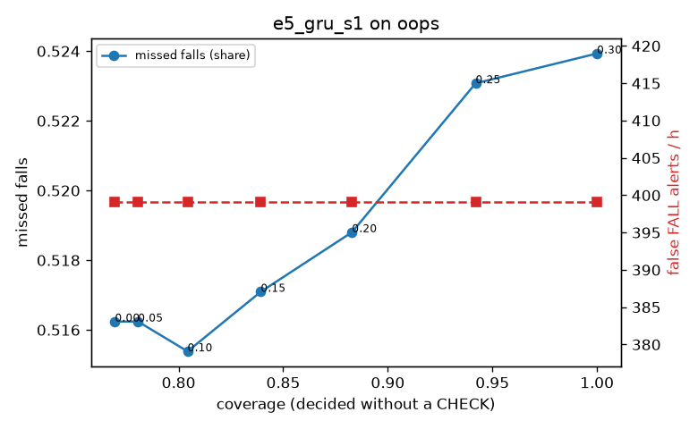

# Evaluation: e5_gru_s1 on oops

Thresholds: t_high 0.3, t_low 0.3 (models\e5_gru_s1\thresholds.yaml). 818 clips, 1170 falls, 2.65 h (0.89 h normal activity); 6 clips have no score rows (counted as silent). 95% intervals: bootstrap over clips.

## Systems

| System | Sensitivity (FALL) | Sensitivity (FALL or CHECK) | False FALL alerts / h | CHECK requests / h | Coverage | Median latency (s) | Alerts |
| --- | --- | --- | --- | --- | --- | --- | --- |
| e5_gru_s1 (one threshold) | 47.6% (44.3%–51.2%) | 47.6% (44.3%–51.2%) | 399.03 (363.09–439.73) | 0.00 (0.00–0.00) | 100.0% (100.0%–100.0%) | 0.56 (0.49–0.62) | 796 FALL, 0 CHECK |
| rule baseline (E0) | 18.5% (15.6%–21.6%) | 18.5% (15.6%–21.6%) | 34.94 (23.00–47.10) | 0.00 (0.00–0.00) | 100.0% (100.0%–100.0%) | 2.94 (2.74–3.29) | 181 FALL, 0 CHECK |

## Breakdown (e5_gru_s1 (one threshold))

| Group | Value | Clips | Falls | Hours | Sens. (FALL) | Sens. (any) | False FALL / h | CHECK / h |
| --- | --- | --- | --- | --- | --- | --- | --- | --- |
| dataset | OOPS | 818 | 1170 | 2.65 | 47.6% (44.3%–51.2%) | 47.6% (44.3%–51.2%) | 399.03 (363.09–439.73) | 0.00 (0.00–0.00) |
| qc_pass | False | 199 | 295 | 0.69 | 47.8% (41.5%–54.5%) | 47.8% (41.5%–54.5%) | 392.16 (322.18–480.64) | 0.00 (0.00–0.00) |
| qc_pass | True | 619 | 875 | 1.96 | 47.5% (43.5%–51.5%) | 47.5% (43.5%–51.5%) | 401.29 (361.81–448.11) | 0.00 (0.00–0.00) |

## Windows (4 classes)

Macro F1 0.424 over 38872 windows.

| true \ predicted | upright | falling | fallen | controlled_low |
| --- | --- | --- | --- | --- |
| upright | 13209 | 3289 | 1867 | 2806 |
| falling | 2202 | 6070 | 491 | 1143 |
| fallen | 530 | 1520 | 497 | 876 |
| controlled_low | 1297 | 1113 | 310 | 1652 |

## Coverage–error curve

| CHECK band | t_low | Coverage | Missed falls | False FALL / h | CHECK / h |
| --- | --- | --- | --- | --- | --- |
| 0.00 | 0.30 | 100.0% | 52.4% | 399.03 | 0.00 |
| 0.05 | 0.25 | 94.2% | 52.3% | 399.03 | 45.32 |
| 0.10 | 0.20 | 88.3% | 51.9% | 399.03 | 95.93 |
| 0.15 | 0.15 | 83.9% | 51.7% | 399.03 | 138.61 |
| 0.20 | 0.10 | 80.4% | 51.5% | 399.03 | 176.00 |
| 0.25 | 0.05 | 78.1% | 51.6% | 399.03 | 204.32 |
| 0.30 | 0.00 | 77.0% | 51.6% | 399.03 | 217.92 |

Definitions: fall event = OmniFall `fall` segment; detected = alert from the segment start to 10 s after its end; false alert = alert matching no fall; normal-activity hours exclude [start − 2 s, end + 10 s]; FALL and ON FLOOR count as alarms, CHECK hands over to a person.
