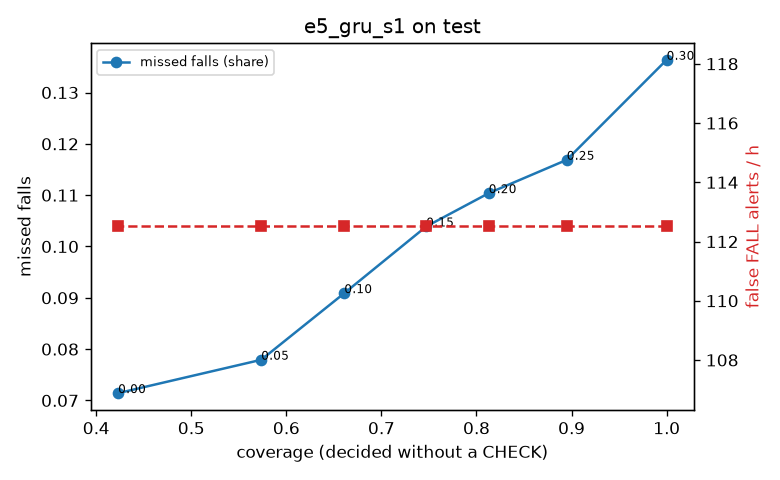

# Evaluation: e5_gru_s1 on test

Thresholds: t_high 0.3, t_low 0.3 (models\e5_gru_s1\thresholds.yaml). 635 clips, 154 falls, 1.17 h (0.90 h normal activity); 1 clips have no score rows (counted as silent). 95% intervals: bootstrap over clips.

## Systems

| System | Sensitivity (FALL) | Sensitivity (FALL or CHECK) | False FALL alerts / h | CHECK requests / h | Coverage | Median latency (s) | Alerts |
| --- | --- | --- | --- | --- | --- | --- | --- |
| e5_gru_s1 (one threshold) | 86.4% (78.2%–93.4%) | 86.4% (78.2%–93.4%) | 112.51 (92.95–132.12) | 0.00 (0.00–0.00) | 100.0% (100.0%–100.0%) | 1.93 (1.40–1.93) | 241 FALL, 0 CHECK |
| rule baseline (E0) | 59.1% (48.0%–69.4%) | 59.1% (48.0%–69.4%) | 173.77 (147.13–200.24) | 0.00 (0.00–0.00) | 100.0% (100.0%–100.0%) | 2.53 (2.22–2.73) | 247 FALL, 0 CHECK |

## Breakdown (e5_gru_s1 (one threshold))

| Group | Value | Clips | Falls | Hours | Sens. (FALL) | Sens. (any) | False FALL / h | CHECK / h |
| --- | --- | --- | --- | --- | --- | --- | --- | --- |
| dataset | GMDCSA24 | 37 | 17 | 0.08 | 94.1% (81.8%–100.0%) | 94.1% (81.8%–100.0%) | 128.85 (51.71–212.15) | 0.00 (0.00–0.00) |
| dataset | caucafall | 19 | 9 | 0.06 | 88.9% (63.6%–100.0%) | 88.9% (63.6%–100.0%) | 128.67 (37.97–234.79) | 0.00 (0.00–0.00) |
| dataset | le2i | 38 | 22 | 0.17 | 100.0% (100.0%–100.0%) | 100.0% (100.0%–100.0%) | 45.23 (17.11–73.28) | 0.00 (0.00–0.00) |
| dataset | occu | 2 | 16 | 0.10 | 43.8% (37.5%–50.0%) | 43.8% (37.5%–50.0%) | 88.13 (79.18–99.35) | 0.00 (0.00–0.00) |
| dataset | of-syn | 539 | 90 | 0.76 | 88.9% (81.8%–95.1%) | 88.9% (81.8%–95.1%) | 126.13 (101.65–151.58) | 0.00 (0.00–0.00) |
| qc_pass | False | 15 | 7 | 0.04 | 85.7% (50.0%–100.0%) | 85.7% (50.0%–100.0%) | 191.99 (49.15–377.25) | 0.00 (0.00–0.00) |
| qc_pass | True | 620 | 147 | 1.13 | 86.4% (78.9%–94.0%) | 86.4% (78.9%–94.0%) | 110.62 (91.78–131.55) | 0.00 (0.00–0.00) |
| of-syn age | child | 71 | 10 | 0.10 | 90.0% (66.7%–100.0%) | 90.0% (66.7%–100.0%) | 128.10 (63.36–199.86) | 0.00 (0.00–0.00) |
| of-syn age | elderly | 202 | 31 | 0.28 | 93.5% (83.3%–100.0%) | 93.5% (83.3%–100.0%) | 132.96 (93.03–174.43) | 0.00 (0.00–0.00) |
| of-syn age | middle-aged | 71 | 15 | 0.10 | 73.3% (50.0%–93.3%) | 73.3% (50.0%–93.3%) | 101.50 (45.09–171.04) | 0.00 (0.00–0.00) |
| of-syn age | teen | 67 | 8 | 0.09 | 100.0% (100.0%–100.0%) | 100.0% (100.0%–100.0%) | 72.25 (24.08–134.75) | 0.00 (0.00–0.00) |
| of-syn age | toddler | 60 | 17 | 0.08 | 88.2% (70.0%–100.0%) | 88.2% (70.0%–100.0%) | 193.77 (99.14–297.41) | 0.00 (0.00–0.00) |
| of-syn age | young adult | 68 | 9 | 0.10 | 88.9% (66.6%–100.0%) | 88.9% (66.6%–100.0%) | 131.07 (61.29–206.14) | 0.00 (0.00–0.00) |
| of-syn BMI | normal | 145 | 28 | 0.20 | 82.1% (66.6%–95.5%) | 82.1% (66.6%–95.5%) | 109.03 (62.87–158.85) | 0.00 (0.00–0.00) |
| of-syn BMI | obese | 131 | 24 | 0.18 | 95.8% (86.4%–100.0%) | 95.8% (86.4%–100.0%) | 151.29 (102.39–207.49) | 0.00 (0.00–0.00) |
| of-syn BMI | overweight | 128 | 21 | 0.18 | 90.5% (75.0%–100.0%) | 90.5% (75.0%–100.0%) | 132.80 (81.40–185.93) | 0.00 (0.00–0.00) |
| of-syn BMI | underweight | 135 | 17 | 0.19 | 88.2% (70.0%–100.0%) | 88.2% (70.0%–100.0%) | 114.08 (72.03–165.79) | 0.00 (0.00–0.00) |

## Windows (4 classes)

Macro F1 0.725 over 14673 windows.

| true \ predicted | upright | falling | fallen | controlled_low |
| --- | --- | --- | --- | --- |
| upright | 5051 | 321 | 99 | 517 |
| falling | 108 | 940 | 100 | 76 |
| fallen | 52 | 228 | 1072 | 128 |
| controlled_low | 638 | 357 | 585 | 4401 |

## Coverage–error curve

| CHECK band | t_low | Coverage | Missed falls | False FALL / h | CHECK / h |
| --- | --- | --- | --- | --- | --- |
| 0.00 | 0.30 | 100.0% | 13.6% | 112.51 | 0.00 |
| 0.05 | 0.25 | 89.5% | 11.7% | 112.51 | 36.80 |
| 0.10 | 0.20 | 81.3% | 11.0% | 112.51 | 73.60 |
| 0.15 | 0.15 | 74.7% | 10.4% | 112.51 | 108.68 |
| 0.20 | 0.10 | 66.1% | 9.1% | 112.51 | 164.31 |
| 0.25 | 0.05 | 57.4% | 7.8% | 112.51 | 237.90 |
| 0.30 | 0.00 | 42.3% | 7.1% | 112.51 | 440.72 |

Definitions: fall event = OmniFall `fall` segment; detected = alert from the segment start to 10 s after its end; false alert = alert matching no fall; normal-activity hours exclude [start − 2 s, end + 10 s]; FALL and ON FLOOR count as alarms, CHECK hands over to a person.
