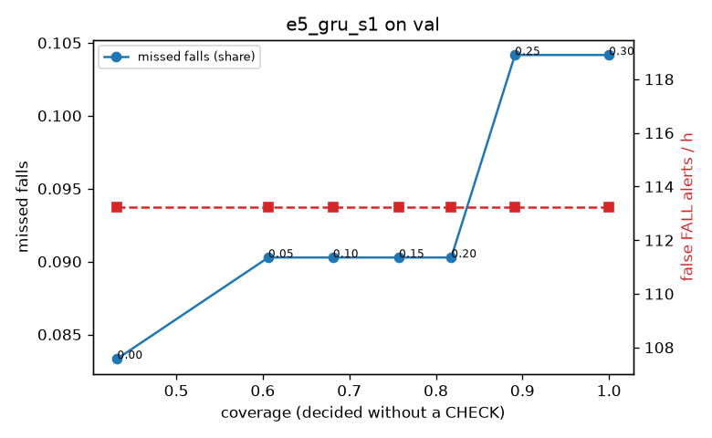

# Evaluation: e5_gru_s1 on val

Thresholds: t_high 0.3, t_low 0.3 (models\e5_gru_s1\thresholds.yaml). 589 clips, 144 falls, 1.00 h (0.75 h normal activity); 0 clips have no score rows (counted as silent). 95% intervals: bootstrap over clips.

## Systems

| System | Sensitivity (FALL) | Sensitivity (FALL or CHECK) | False FALL alerts / h | CHECK requests / h | Coverage | Median latency (s) | Alerts |
| --- | --- | --- | --- | --- | --- | --- | --- |
| e5_gru_s1 (one threshold) | 89.6% (81.3%–97.8%) | 89.6% (81.3%–97.8%) | 113.24 (91.92–136.80) | 0.00 (0.00–0.00) | 100.0% (100.0%–100.0%) | 1.93 (1.93–1.93) | 217 FALL, 0 CHECK |
| rule baseline (E0) | 68.8% (56.7%–80.6%) | 68.8% (56.7%–80.6%) | 167.86 (142.60–195.93) | 0.00 (0.00–0.00) | 100.0% (100.0%–100.0%) | 2.53 (2.33–2.77) | 226 FALL, 0 CHECK |

## Breakdown (e5_gru_s1 (one threshold))

| Group | Value | Clips | Falls | Hours | Sens. (FALL) | Sens. (any) | False FALL / h | CHECK / h |
| --- | --- | --- | --- | --- | --- | --- | --- | --- |
| dataset | GMDCSA24 | 47 | 23 | 0.12 | 95.7% (85.7%–100.0%) | 95.7% (85.7%–100.0%) | 124.11 (64.67–194.66) | 0.00 (0.00–0.00) |
| dataset | caucafall | 8 | 4 | 0.03 | 100.0% (100.0%–100.0%) | 100.0% (100.0%–100.0%) | 222.20 (76.25–299.97) | 0.00 (0.00–0.00) |
| dataset | le2i | 15 | 11 | 0.04 | 90.9% (70.0%–100.0%) | 90.9% (70.0%–100.0%) | 113.17 (24.47–245.30) | 0.00 (0.00–0.00) |
| dataset | occu | 2 | 16 | 0.08 | 37.5% (37.5%–37.5%) | 37.5% (37.5%–37.5%) | 103.36 (66.43–143.16) | 0.00 (0.00–0.00) |
| dataset | of-syn | 517 | 90 | 0.73 | 96.7% (92.4%–100.0%) | 96.7% (92.4%–100.0%) | 109.82 (85.92–134.19) | 0.00 (0.00–0.00) |
| qc_pass | True | 589 | 144 | 1.00 | 89.6% (81.3%–97.8%) | 89.6% (81.3%–97.8%) | 113.24 (91.92–136.80) | 0.00 (0.00–0.00) |
| of-syn age | child | 72 | 13 | 0.10 | 92.3% (72.7%–100.0%) | 92.3% (72.7%–100.0%) | 144.50 (74.79–225.08) | 0.00 (0.00–0.00) |
| of-syn age | elderly | 184 | 25 | 0.26 | 100.0% (100.0%–100.0%) | 100.0% (100.0%–100.0%) | 120.65 (80.43–161.91) | 0.00 (0.00–0.00) |
| of-syn age | middle-aged | 61 | 12 | 0.09 | 100.0% (100.0%–100.0%) | 100.0% (100.0%–100.0%) | 58.00 (13.93–111.49) | 0.00 (0.00–0.00) |
| of-syn age | teen | 61 | 10 | 0.09 | 100.0% (100.0%–100.0%) | 100.0% (100.0%–100.0%) | 111.45 (51.54–188.49) | 0.00 (0.00–0.00) |
| of-syn age | toddler | 72 | 15 | 0.10 | 86.7% (65.0%–100.0%) | 86.7% (65.0%–100.0%) | 124.65 (62.32–193.79) | 0.00 (0.00–0.00) |
| of-syn age | young adult | 67 | 15 | 0.09 | 100.0% (100.0%–100.0%) | 100.0% (100.0%–100.0%) | 68.32 (14.49–133.24) | 0.00 (0.00–0.00) |
| of-syn BMI | normal | 135 | 19 | 0.19 | 94.7% (83.3%–100.0%) | 94.7% (83.3%–100.0%) | 91.87 (48.57–138.32) | 0.00 (0.00–0.00) |
| of-syn BMI | obese | 125 | 18 | 0.18 | 94.4% (81.2%–100.0%) | 94.4% (81.2%–100.0%) | 106.24 (60.31–156.44) | 0.00 (0.00–0.00) |
| of-syn BMI | overweight | 134 | 27 | 0.19 | 96.3% (86.7%–100.0%) | 96.3% (86.7%–100.0%) | 139.44 (88.81–193.14) | 0.00 (0.00–0.00) |
| of-syn BMI | underweight | 123 | 26 | 0.17 | 100.0% (100.0%–100.0%) | 100.0% (100.0%–100.0%) | 102.54 (57.40–152.79) | 0.00 (0.00–0.00) |

## Windows (4 classes)

Macro F1 0.737 over 12454 windows.

| true \ predicted | upright | falling | fallen | controlled_low |
| --- | --- | --- | --- | --- |
| upright | 4238 | 202 | 125 | 555 |
| falling | 130 | 954 | 38 | 53 |
| fallen | 24 | 220 | 1058 | 260 |
| controlled_low | 613 | 321 | 304 | 3359 |

## Coverage–error curve

| CHECK band | t_low | Coverage | Missed falls | False FALL / h | CHECK / h |
| --- | --- | --- | --- | --- | --- |
| 0.00 | 0.30 | 100.0% | 10.4% | 113.24 | 0.00 |
| 0.05 | 0.25 | 89.1% | 10.4% | 113.24 | 43.96 |
| 0.10 | 0.20 | 81.8% | 9.0% | 113.24 | 77.93 |
| 0.15 | 0.15 | 75.7% | 9.0% | 113.24 | 112.89 |
| 0.20 | 0.10 | 68.1% | 9.0% | 113.24 | 165.84 |
| 0.25 | 0.05 | 60.6% | 9.0% | 113.24 | 230.78 |
| 0.30 | 0.00 | 43.2% | 8.3% | 113.24 | 467.55 |

Definitions: fall event = OmniFall `fall` segment; detected = alert from the segment start to 10 s after its end; false alert = alert matching no fall; normal-activity hours exclude [start − 2 s, end + 10 s]; FALL and ON FLOOR count as alarms, CHECK hands over to a person.
