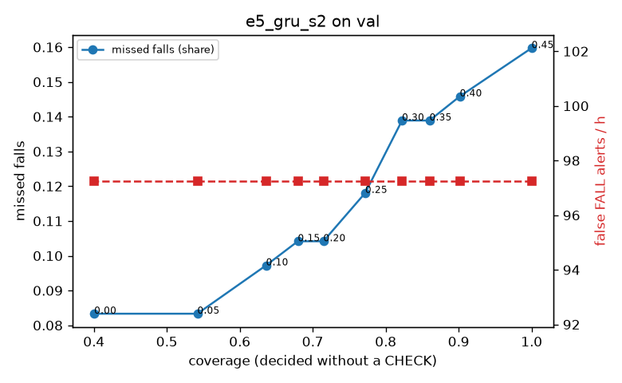

# Evaluation: e5_gru_s2 on val

Thresholds: t_high 0.45, t_low 0.2 (models\e5_gru_s2\thresholds.yaml). 589 clips, 144 falls, 1.00 h (0.75 h normal activity); 0 clips have no score rows (counted as silent). 95% intervals: bootstrap over clips.

## Systems

| System | Sensitivity (FALL) | Sensitivity (FALL or CHECK) | False FALL alerts / h | CHECK requests / h | Coverage | Median latency (s) | Alerts |
| --- | --- | --- | --- | --- | --- | --- | --- |
| e5_gru_s2 (one threshold) | 84.0% (75.9%–92.5%) | 84.0% (75.9%–92.5%) | 97.25 (79.48–118.95) | 0.00 (0.00–0.00) | 100.0% (100.0%–100.0%) | 1.93 (1.93–1.93) | 197 FALL, 0 CHECK |
| e5_gru_s2 (CHECK band) | 84.0% (75.9%–92.5%) | 89.6% (81.2%–97.7%) | 97.25 (79.48–118.95) | 124.88 (105.35–146.10) | 71.5% (67.1%–75.4%) | 1.93 (1.93–1.93) | 197 FALL, 125 CHECK |
| rule baseline (E0) | 68.8% (56.7%–80.6%) | 68.8% (56.7%–80.6%) | 167.86 (142.60–195.93) | 0.00 (0.00–0.00) | 100.0% (100.0%–100.0%) | 2.53 (2.33–2.77) | 226 FALL, 0 CHECK |

## Breakdown (e5_gru_s2 (CHECK band))

| Group | Value | Clips | Falls | Hours | Sens. (FALL) | Sens. (any) | False FALL / h | CHECK / h |
| --- | --- | --- | --- | --- | --- | --- | --- | --- |
| dataset | GMDCSA24 | 47 | 23 | 0.12 | 91.3% (78.3%–100.0%) | 91.3% (78.3%–100.0%) | 99.29 (42.18–172.93) | 146.65 (92.23–208.25) |
| dataset | caucafall | 8 | 4 | 0.03 | 100.0% (100.0%–100.0%) | 100.0% (100.0%–100.0%) | 222.20 (76.25–299.97) | 188.41 (77.59–276.32) |
| dataset | le2i | 15 | 11 | 0.04 | 90.9% (70.0%–100.0%) | 90.9% (70.0%–100.0%) | 113.17 (24.47–245.30) | 269.10 (191.01–367.20) |
| dataset | occu | 2 | 16 | 0.08 | 37.5% (37.5%–37.5%) | 37.5% (37.5%–37.5%) | 68.91 (66.43–71.58) | 50.37 (49.20–51.60) |
| dataset | of-syn | 517 | 90 | 0.73 | 88.9% (82.4%–95.4%) | 97.8% (94.2%–100.0%) | 94.84 (72.70–117.06) | 118.18 (94.82–141.55) |
| qc_pass | True | 589 | 144 | 1.00 | 84.0% (75.9%–92.5%) | 89.6% (81.2%–97.7%) | 97.25 (79.48–118.95) | 124.88 (105.35–146.10) |
| of-syn age | child | 72 | 13 | 0.10 | 92.3% (72.7%–100.0%) | 92.3% (72.7%–100.0%) | 96.34 (37.38–165.80) | 59.21 (19.74–108.55) |
| of-syn age | elderly | 184 | 25 | 0.26 | 88.0% (74.1%–100.0%) | 96.0% (87.0%–100.0%) | 111.71 (73.65–155.02) | 123.56 (88.81–162.27) |
| of-syn age | middle-aged | 61 | 12 | 0.09 | 91.7% (71.4%–100.0%) | 100.0% (100.0%–100.0%) | 43.50 (0.00–95.67) | 58.24 (11.65–104.82) |
| of-syn age | teen | 61 | 10 | 0.09 | 90.0% (66.7%–100.0%) | 100.0% (100.0%–100.0%) | 97.52 (36.30–171.12) | 163.06 (93.18–233.24) |
| of-syn age | toddler | 72 | 15 | 0.10 | 80.0% (58.3%–100.0%) | 100.0% (100.0%–100.0%) | 99.72 (41.77–167.93) | 187.49 (118.41–266.43) |
| of-syn age | young adult | 67 | 15 | 0.09 | 93.3% (77.8%–100.0%) | 100.0% (100.0%–100.0%) | 81.98 (26.81–147.51) | 106.04 (53.02–169.67) |
| of-syn BMI | normal | 135 | 19 | 0.19 | 89.5% (75.0%–100.0%) | 100.0% (100.0%–100.0%) | 91.87 (49.00–139.56) | 110.52 (73.68–152.62) |
| of-syn BMI | obese | 125 | 18 | 0.18 | 83.3% (65.0%–100.0%) | 94.4% (81.8%–100.0%) | 86.32 (45.17–125.02) | 125.04 (79.57–170.52) |
| of-syn BMI | overweight | 134 | 27 | 0.19 | 85.2% (70.8%–100.0%) | 96.3% (86.7%–100.0%) | 112.88 (71.05–164.50) | 121.95 (79.53–169.67) |
| of-syn BMI | underweight | 123 | 26 | 0.17 | 96.2% (87.5%–100.0%) | 100.0% (100.0%–100.0%) | 87.89 (44.37–139.01) | 115.53 (75.09–161.74) |

## Windows (4 classes)

Macro F1 0.717 over 12454 windows.

| true \ predicted | upright | falling | fallen | controlled_low |
| --- | --- | --- | --- | --- |
| upright | 4206 | 276 | 84 | 554 |
| falling | 113 | 971 | 34 | 57 |
| fallen | 26 | 259 | 847 | 430 |
| controlled_low | 523 | 348 | 218 | 3508 |

## Coverage–error curve

| CHECK band | t_low | Coverage | Missed falls | False FALL / h | CHECK / h |
| --- | --- | --- | --- | --- | --- |
| 0.00 | 0.45 | 100.0% | 16.0% | 97.25 | 0.00 |
| 0.05 | 0.40 | 90.2% | 14.6% | 97.25 | 34.97 |
| 0.10 | 0.35 | 86.0% | 13.9% | 97.25 | 51.95 |
| 0.15 | 0.30 | 82.2% | 13.9% | 97.25 | 69.93 |
| 0.20 | 0.25 | 77.2% | 11.8% | 97.25 | 92.91 |
| 0.25 | 0.20 | 71.5% | 10.4% | 97.25 | 124.88 |
| 0.30 | 0.15 | 68.0% | 10.4% | 97.25 | 148.86 |
| 0.35 | 0.10 | 63.6% | 9.7% | 97.25 | 180.83 |
| 0.40 | 0.05 | 54.2% | 8.3% | 97.25 | 267.74 |
| 0.45 | 0.00 | 40.0% | 8.3% | 97.25 | 482.54 |

Definitions: fall event = OmniFall `fall` segment; detected = alert from the segment start to 10 s after its end; false alert = alert matching no fall; normal-activity hours exclude [start − 2 s, end + 10 s]; FALL and ON FLOOR count as alarms, CHECK hands over to a person.
