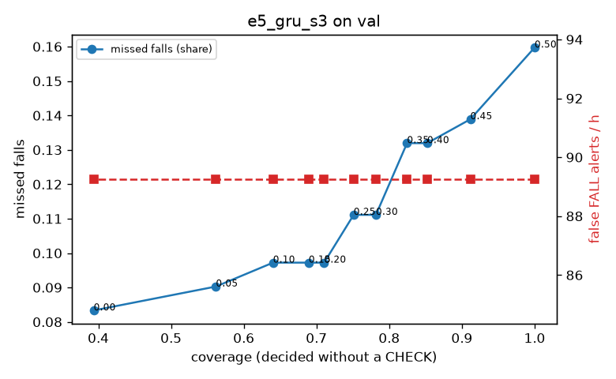

# Evaluation: e5_gru_s3 on val

Thresholds: t_high 0.5, t_low 0.3 (models\e5_gru_s3\thresholds.yaml). 589 clips, 144 falls, 1.00 h (0.75 h normal activity); 0 clips have no score rows (counted as silent). 95% intervals: bootstrap over clips.

## Systems

| System | Sensitivity (FALL) | Sensitivity (FALL or CHECK) | False FALL alerts / h | CHECK requests / h | Coverage | Median latency (s) | Alerts |
| --- | --- | --- | --- | --- | --- | --- | --- |
| e5_gru_s3 (one threshold) | 84.0% (76.4%–92.6%) | 84.0% (76.4%–92.6%) | 89.26 (72.05–109.36) | 0.00 (0.00–0.00) | 100.0% (100.0%–100.0%) | 1.93 (1.93–1.93) | 189 FALL, 0 CHECK |
| e5_gru_s3 (CHECK band) | 84.0% (76.4%–92.6%) | 88.9% (81.0%–97.4%) | 89.26 (72.05–109.36) | 83.92 (67.04–102.48) | 78.2% (74.3%–82.0%) | 1.93 (1.93–1.93) | 189 FALL, 84 CHECK |
| rule baseline (E0) | 68.8% (56.7%–80.6%) | 68.8% (56.7%–80.6%) | 167.86 (142.60–195.93) | 0.00 (0.00–0.00) | 100.0% (100.0%–100.0%) | 2.53 (2.33–2.77) | 226 FALL, 0 CHECK |

## Breakdown (e5_gru_s3 (CHECK band))

| Group | Value | Clips | Falls | Hours | Sens. (FALL) | Sens. (any) | False FALL / h | CHECK / h |
| --- | --- | --- | --- | --- | --- | --- | --- | --- |
| dataset | GMDCSA24 | 47 | 23 | 0.12 | 95.7% (85.7%–100.0%) | 95.7% (85.7%–100.0%) | 111.70 (54.87–180.34) | 105.91 (56.70–162.21) |
| dataset | caucafall | 8 | 4 | 0.03 | 100.0% (100.0%–100.0%) | 100.0% (100.0%–100.0%) | 222.20 (76.25–299.97) | 75.37 (0.00–170.13) |
| dataset | le2i | 15 | 11 | 0.04 | 90.9% (70.0%–100.0%) | 90.9% (70.0%–100.0%) | 75.45 (0.00–146.46) | 134.55 (52.32–235.93) |
| dataset | occu | 2 | 16 | 0.08 | 37.5% (37.5%–37.5%) | 37.5% (37.5%–37.5%) | 103.36 (71.58–132.86) | 25.19 (24.60–25.80) |
| dataset | of-syn | 517 | 90 | 0.73 | 87.8% (80.9%–94.1%) | 95.6% (90.8%–99.1%) | 83.19 (61.13–104.39) | 83.83 (64.59–104.44) |
| qc_pass | True | 589 | 144 | 1.00 | 84.0% (76.4%–92.6%) | 88.9% (81.0%–97.4%) | 89.26 (72.05–109.36) | 83.92 (67.04–102.48) |
| of-syn age | child | 72 | 13 | 0.10 | 84.6% (62.5%–100.0%) | 92.3% (72.7%–100.0%) | 108.38 (48.98–177.62) | 69.07 (19.74–118.41) |
| of-syn age | elderly | 184 | 25 | 0.26 | 84.0% (69.0%–96.0%) | 92.0% (80.0%–100.0%) | 89.37 (55.36–126.72) | 96.53 (61.78–135.15) |
| of-syn age | middle-aged | 61 | 12 | 0.09 | 83.3% (58.3%–100.0%) | 100.0% (100.0%–100.0%) | 43.50 (0.00–95.67) | 58.24 (11.65–116.47) |
| of-syn age | teen | 61 | 10 | 0.09 | 90.0% (66.7%–100.0%) | 100.0% (100.0%–100.0%) | 69.65 (14.49–139.62) | 116.47 (58.24–186.36) |
| of-syn age | toddler | 72 | 15 | 0.10 | 86.7% (69.2%–100.0%) | 93.3% (77.8%–100.0%) | 99.72 (39.45–167.19) | 88.81 (39.47–148.02) |
| of-syn age | young adult | 67 | 15 | 0.09 | 100.0% (100.0%–100.0%) | 100.0% (100.0%–100.0%) | 68.32 (25.36–125.38) | 53.02 (10.60–95.44) |
| of-syn BMI | normal | 135 | 19 | 0.19 | 94.7% (83.3%–100.0%) | 94.7% (83.3%–100.0%) | 73.50 (36.43–116.26) | 52.63 (21.05–89.47) |
| of-syn BMI | obese | 125 | 18 | 0.18 | 83.3% (64.7%–100.0%) | 88.9% (72.7%–100.0%) | 99.60 (54.13–147.49) | 96.63 (56.84–136.41) |
| of-syn BMI | overweight | 134 | 27 | 0.19 | 77.8% (61.5%–93.3%) | 96.3% (86.7%–100.0%) | 86.32 (47.81–130.50) | 121.95 (79.53–164.36) |
| of-syn BMI | underweight | 123 | 26 | 0.17 | 96.2% (88.0%–100.0%) | 100.0% (100.0%–100.0%) | 73.25 (36.61–118.44) | 63.54 (34.51–103.97) |

## Windows (4 classes)

Macro F1 0.734 over 12454 windows.

| true \ predicted | upright | falling | fallen | controlled_low |
| --- | --- | --- | --- | --- |
| upright | 4207 | 241 | 107 | 565 |
| falling | 89 | 1006 | 14 | 66 |
| fallen | 35 | 301 | 1016 | 210 |
| controlled_low | 529 | 353 | 326 | 3389 |

## Coverage–error curve

| CHECK band | t_low | Coverage | Missed falls | False FALL / h | CHECK / h |
| --- | --- | --- | --- | --- | --- |
| 0.00 | 0.50 | 100.0% | 16.0% | 89.26 | 0.00 |
| 0.05 | 0.45 | 91.2% | 13.9% | 89.26 | 28.97 |
| 0.10 | 0.40 | 85.2% | 13.2% | 89.26 | 52.95 |
| 0.15 | 0.35 | 82.5% | 13.2% | 89.26 | 65.94 |
| 0.20 | 0.30 | 78.2% | 11.1% | 89.26 | 83.92 |
| 0.25 | 0.25 | 75.1% | 11.1% | 89.26 | 100.90 |
| 0.30 | 0.20 | 71.1% | 9.7% | 89.26 | 122.88 |
| 0.35 | 0.15 | 68.9% | 9.7% | 89.26 | 136.87 |
| 0.40 | 0.10 | 64.0% | 9.7% | 89.26 | 172.83 |
| 0.45 | 0.05 | 56.2% | 9.0% | 89.26 | 241.77 |
| 0.50 | 0.00 | 39.4% | 8.3% | 89.26 | 484.54 |

Definitions: fall event = OmniFall `fall` segment; detected = alert from the segment start to 10 s after its end; false alert = alert matching no fall; normal-activity hours exclude [start − 2 s, end + 10 s]; FALL and ON FLOOR count as alarms, CHECK hands over to a person.
