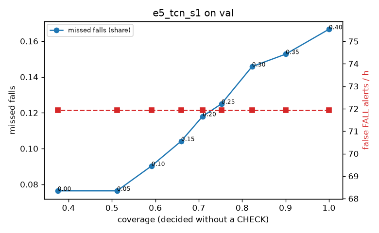

# Evaluation: e5_tcn_s1 on val

Thresholds: t_high 0.4, t_low 0.15 (models\e5_tcn_s1\thresholds.yaml). 589 clips, 144 falls, 1.00 h (0.75 h normal activity); 0 clips have no score rows (counted as silent). 95% intervals: bootstrap over clips.

## Systems

| System | Sensitivity (FALL) | Sensitivity (FALL or CHECK) | False FALL alerts / h | CHECK requests / h | Coverage | Median latency (s) | Alerts |
| --- | --- | --- | --- | --- | --- | --- | --- |
| e5_tcn_s1 (one threshold) | 83.3% (75.2%–92.1%) | 83.3% (75.2%–92.1%) | 71.94 (54.45–88.57) | 0.00 (0.00–0.00) | 100.0% (100.0%–100.0%) | 1.93 (1.93–1.93) | 175 FALL, 0 CHECK |
| e5_tcn_s1 (CHECK band) | 83.3% (75.2%–92.1%) | 89.6% (81.4%–97.9%) | 71.94 (54.45–88.57) | 150.86 (127.86–174.42) | 66.0% (61.4%–70.4%) | 1.93 (1.93–1.93) | 175 FALL, 151 CHECK |
| rule baseline (E0) | 68.8% (56.7%–80.6%) | 68.8% (56.7%–80.6%) | 167.86 (142.60–195.93) | 0.00 (0.00–0.00) | 100.0% (100.0%–100.0%) | 2.53 (2.33–2.77) | 226 FALL, 0 CHECK |

## Breakdown (e5_tcn_s1 (CHECK band))

| Group | Value | Clips | Falls | Hours | Sens. (FALL) | Sens. (any) | False FALL / h | CHECK / h |
| --- | --- | --- | --- | --- | --- | --- | --- | --- |
| dataset | GMDCSA24 | 47 | 23 | 0.12 | 95.7% (85.7%–100.0%) | 95.7% (85.7%–100.0%) | 74.47 (25.94–127.94) | 236.27 (183.00–293.15) |
| dataset | caucafall | 8 | 4 | 0.03 | 100.0% (100.0%–100.0%) | 100.0% (100.0%–100.0%) | 296.27 (275.48–313.88) | 188.41 (78.88–280.21) |
| dataset | le2i | 15 | 11 | 0.04 | 100.0% (100.0%–100.0%) | 100.0% (100.0%–100.0%) | 37.72 (0.00–118.36) | 291.53 (219.58–366.46) |
| dataset | occu | 2 | 16 | 0.08 | 37.5% (37.5%–37.5%) | 37.5% (37.5%–37.5%) | 103.36 (71.58–132.86) | 25.19 (24.60–25.80) |
| dataset | of-syn | 517 | 90 | 0.73 | 85.6% (78.0%–92.4%) | 95.6% (90.9%–99.0%) | 66.56 (48.03–86.70) | 140.17 (116.81–166.28) |
| qc_pass | True | 589 | 144 | 1.00 | 83.3% (75.2%–92.1%) | 89.6% (81.4%–97.9%) | 71.94 (54.45–88.57) | 150.86 (127.86–174.42) |
| of-syn age | child | 72 | 13 | 0.10 | 84.6% (62.5%–100.0%) | 92.3% (72.7%–100.0%) | 108.38 (48.17–183.74) | 128.28 (69.07–187.49) |
| of-syn age | elderly | 184 | 25 | 0.26 | 76.0% (57.7%–90.5%) | 96.0% (86.4%–100.0%) | 67.03 (37.89–100.20) | 158.31 (115.84–204.65) |
| of-syn age | middle-aged | 61 | 12 | 0.09 | 83.3% (58.8%–100.0%) | 91.7% (71.4%–100.0%) | 29.00 (0.00–74.01) | 81.53 (34.94–139.77) |
| of-syn age | teen | 61 | 10 | 0.09 | 100.0% (100.0%–100.0%) | 100.0% (100.0%–100.0%) | 55.72 (12.91–116.00) | 139.77 (69.88–209.65) |
| of-syn age | toddler | 72 | 15 | 0.10 | 86.7% (68.4%–100.0%) | 93.3% (76.9%–100.0%) | 87.25 (26.80–151.43) | 128.28 (69.07–197.36) |
| of-syn age | young adult | 67 | 15 | 0.09 | 93.3% (77.8%–100.0%) | 100.0% (100.0%–100.0%) | 40.99 (0.00–90.43) | 169.67 (106.04–243.90) |
| of-syn BMI | normal | 135 | 19 | 0.19 | 94.7% (82.6%–100.0%) | 100.0% (100.0%–100.0%) | 55.12 (20.10–93.85) | 131.57 (89.47–178.94) |
| of-syn BMI | obese | 125 | 18 | 0.18 | 77.8% (57.1%–94.7%) | 88.9% (72.7%–100.0%) | 73.04 (38.74–113.94) | 153.46 (102.31–204.62) |
| of-syn BMI | overweight | 134 | 27 | 0.19 | 74.1% (56.7%–90.0%) | 92.6% (81.5%–100.0%) | 86.32 (45.62–131.59) | 153.76 (105.91–206.78) |
| of-syn BMI | underweight | 123 | 26 | 0.17 | 96.2% (88.0%–100.0%) | 100.0% (100.0%–100.0%) | 51.27 (14.96–91.70) | 121.30 (80.87–167.51) |

## Windows (4 classes)

Macro F1 0.750 over 12454 windows.

| true \ predicted | upright | falling | fallen | controlled_low |
| --- | --- | --- | --- | --- |
| upright | 4196 | 147 | 116 | 661 |
| falling | 106 | 929 | 54 | 86 |
| fallen | 13 | 144 | 1056 | 349 |
| controlled_low | 530 | 200 | 333 | 3534 |

## Coverage–error curve

| CHECK band | t_low | Coverage | Missed falls | False FALL / h | CHECK / h |
| --- | --- | --- | --- | --- | --- |
| 0.00 | 0.40 | 100.0% | 16.7% | 71.94 | 0.00 |
| 0.05 | 0.35 | 90.1% | 15.3% | 71.94 | 32.97 |
| 0.10 | 0.30 | 82.3% | 14.6% | 71.94 | 64.94 |
| 0.15 | 0.25 | 75.2% | 12.5% | 71.94 | 96.91 |
| 0.20 | 0.20 | 70.9% | 11.8% | 71.94 | 120.88 |
| 0.25 | 0.15 | 66.0% | 10.4% | 71.94 | 150.86 |
| 0.30 | 0.10 | 59.1% | 9.0% | 71.94 | 201.81 |
| 0.35 | 0.05 | 51.2% | 7.6% | 71.94 | 278.73 |
| 0.40 | 0.00 | 37.5% | 7.6% | 71.94 | 496.53 |

Definitions: fall event = OmniFall `fall` segment; detected = alert from the segment start to 10 s after its end; false alert = alert matching no fall; normal-activity hours exclude [start − 2 s, end + 10 s]; FALL and ON FLOOR count as alarms, CHECK hands over to a person.
