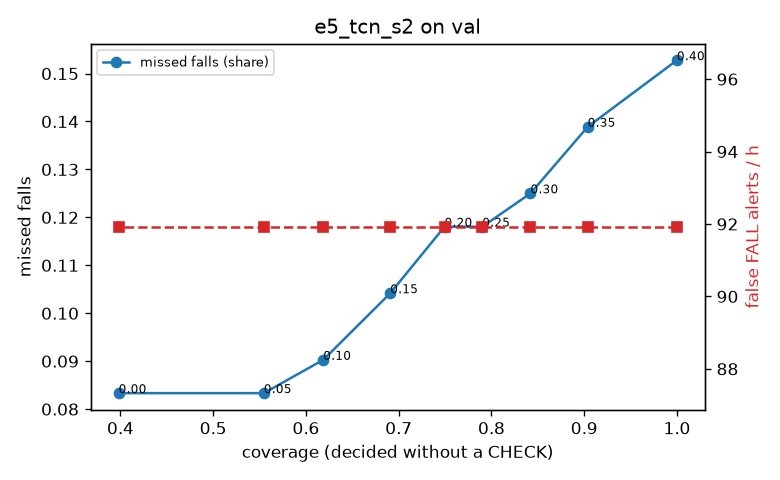

# Evaluation: e5_tcn_s2 on val

Thresholds: t_high 0.4, t_low 0.15 (models\e5_tcn_s2\thresholds.yaml). 589 clips, 144 falls, 1.00 h (0.75 h normal activity); 0 clips have no score rows (counted as silent). 95% intervals: bootstrap over clips.

## Systems

| System | Sensitivity (FALL) | Sensitivity (FALL or CHECK) | False FALL alerts / h | CHECK requests / h | Coverage | Median latency (s) | Alerts |
| --- | --- | --- | --- | --- | --- | --- | --- |
| e5_tcn_s2 (one threshold) | 84.7% (76.5%–93.4%) | 84.7% (76.5%–93.4%) | 91.93 (73.90–110.56) | 0.00 (0.00–0.00) | 100.0% (100.0%–100.0%) | 1.93 (1.93–1.93) | 196 FALL, 0 CHECK |
| e5_tcn_s2 (CHECK band) | 84.7% (76.5%–93.4%) | 89.6% (80.8%–97.6%) | 91.93 (73.90–110.56) | 141.86 (122.68–165.08) | 69.1% (64.7%–72.7%) | 1.93 (1.93–1.93) | 196 FALL, 142 CHECK |
| rule baseline (E0) | 68.8% (56.7%–80.6%) | 68.8% (56.7%–80.6%) | 167.86 (142.60–195.93) | 0.00 (0.00–0.00) | 100.0% (100.0%–100.0%) | 2.53 (2.33–2.77) | 226 FALL, 0 CHECK |

## Breakdown (e5_tcn_s2 (CHECK band))

| Group | Value | Clips | Falls | Hours | Sens. (FALL) | Sens. (any) | False FALL / h | CHECK / h |
| --- | --- | --- | --- | --- | --- | --- | --- | --- |
| dataset | GMDCSA24 | 47 | 23 | 0.12 | 95.7% (85.7%–100.0%) | 95.7% (85.7%–100.0%) | 161.34 (102.41–226.07) | 211.83 (157.18–273.44) |
| dataset | caucafall | 8 | 4 | 0.03 | 100.0% (100.0%–100.0%) | 100.0% (100.0%–100.0%) | 222.20 (76.25–299.97) | 188.41 (78.88–280.21) |
| dataset | le2i | 15 | 11 | 0.04 | 90.9% (70.0%–100.0%) | 90.9% (70.0%–100.0%) | 75.45 (0.00–195.25) | 269.10 (195.88–352.79) |
| dataset | occu | 2 | 16 | 0.08 | 37.5% (37.5%–37.5%) | 37.5% (37.5%–37.5%) | 103.36 (66.43–143.16) | 50.37 (49.20–51.60) |
| dataset | of-syn | 517 | 90 | 0.73 | 88.9% (82.2%–95.0%) | 96.7% (92.6%–100.0%) | 79.87 (59.34–100.77) | 130.55 (105.78–156.66) |
| qc_pass | True | 589 | 144 | 1.00 | 84.7% (76.5%–93.4%) | 89.6% (80.8%–97.6%) | 91.93 (73.90–110.56) | 141.86 (122.68–165.08) |
| of-syn age | child | 72 | 13 | 0.10 | 92.3% (72.7%–100.0%) | 92.3% (72.7%–100.0%) | 108.38 (48.17–177.62) | 98.68 (49.34–157.88) |
| of-syn age | elderly | 184 | 25 | 0.26 | 84.0% (68.4%–96.4%) | 92.0% (81.0%–100.0%) | 75.96 (45.25–112.64) | 154.45 (115.84–200.79) |
| of-syn age | middle-aged | 61 | 12 | 0.09 | 91.7% (71.4%–100.0%) | 100.0% (100.0%–100.0%) | 43.50 (0.00–94.73) | 46.59 (11.65–93.18) |
| of-syn age | teen | 61 | 10 | 0.09 | 100.0% (100.0%–100.0%) | 100.0% (100.0%–100.0%) | 55.72 (13.41–116.31) | 116.47 (57.94–186.36) |
| of-syn age | toddler | 72 | 15 | 0.10 | 80.0% (58.3%–100.0%) | 100.0% (100.0%–100.0%) | 99.72 (40.97–164.93) | 157.88 (88.81–226.96) |
| of-syn age | young adult | 67 | 15 | 0.09 | 93.3% (77.8%–100.0%) | 100.0% (100.0%–100.0%) | 95.64 (41.77–162.85) | 159.06 (95.44–233.29) |
| of-syn BMI | normal | 135 | 19 | 0.19 | 89.5% (75.0%–100.0%) | 100.0% (100.0%–100.0%) | 55.12 (24.29–89.63) | 131.57 (84.20–184.20) |
| of-syn BMI | obese | 125 | 18 | 0.18 | 72.2% (50.0%–91.7%) | 88.9% (72.2%–100.0%) | 79.68 (39.83–121.82) | 153.46 (102.31–204.62) |
| of-syn BMI | overweight | 134 | 27 | 0.19 | 88.9% (75.9%–100.0%) | 96.3% (86.7%–100.0%) | 112.88 (67.36–165.55) | 148.46 (100.74–201.48) |
| of-syn BMI | underweight | 123 | 26 | 0.17 | 100.0% (100.0%–100.0%) | 100.0% (100.0%–100.0%) | 73.25 (33.03–119.66) | 86.64 (51.99–127.08) |

## Windows (4 classes)

Macro F1 0.742 over 12454 windows.

| true \ predicted | upright | falling | fallen | controlled_low |
| --- | --- | --- | --- | --- |
| upright | 4168 | 221 | 154 | 577 |
| falling | 98 | 973 | 47 | 57 |
| fallen | 8 | 225 | 1055 | 274 |
| controlled_low | 499 | 274 | 327 | 3497 |

## Coverage–error curve

| CHECK band | t_low | Coverage | Missed falls | False FALL / h | CHECK / h |
| --- | --- | --- | --- | --- | --- |
| 0.00 | 0.40 | 100.0% | 15.3% | 91.93 | 0.00 |
| 0.05 | 0.35 | 90.4% | 13.9% | 91.93 | 33.97 |
| 0.10 | 0.30 | 84.2% | 12.5% | 91.93 | 58.94 |
| 0.15 | 0.25 | 79.0% | 11.8% | 91.93 | 83.92 |
| 0.20 | 0.20 | 74.9% | 11.8% | 91.93 | 106.90 |
| 0.25 | 0.15 | 69.1% | 10.4% | 91.93 | 141.86 |
| 0.30 | 0.10 | 61.9% | 9.0% | 91.93 | 194.81 |
| 0.35 | 0.05 | 55.5% | 8.3% | 91.93 | 254.76 |
| 0.40 | 0.00 | 39.8% | 8.3% | 91.93 | 488.53 |

Definitions: fall event = OmniFall `fall` segment; detected = alert from the segment start to 10 s after its end; false alert = alert matching no fall; normal-activity hours exclude [start − 2 s, end + 10 s]; FALL and ON FLOOR count as alarms, CHECK hands over to a person.
