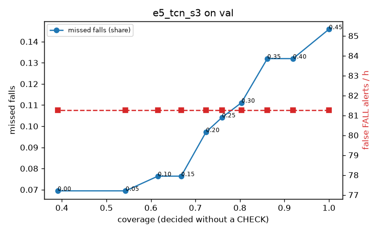

# Evaluation: e5_tcn_s3 on val

Thresholds: t_high 0.45, t_low 0.2 (models\e5_tcn_s3\thresholds.yaml). 589 clips, 144 falls, 1.00 h (0.75 h normal activity); 0 clips have no score rows (counted as silent). 95% intervals: bootstrap over clips.

## Systems

| System | Sensitivity (FALL) | Sensitivity (FALL or CHECK) | False FALL alerts / h | CHECK requests / h | Coverage | Median latency (s) | Alerts |
| --- | --- | --- | --- | --- | --- | --- | --- |
| e5_tcn_s3 (one threshold) | 85.4% (77.1%–94.7%) | 85.4% (77.1%–94.7%) | 81.27 (64.12–100.73) | 0.00 (0.00–0.00) | 100.0% (100.0%–100.0%) | 1.93 (1.93–1.93) | 188 FALL, 0 CHECK |
| e5_tcn_s3 (CHECK band) | 85.4% (77.1%–94.7%) | 90.3% (82.0%–98.4%) | 81.27 (64.12–100.73) | 116.89 (98.21–137.00) | 72.4% (68.4%–76.5%) | 1.93 (1.93–1.93) | 188 FALL, 117 CHECK |
| rule baseline (E0) | 68.8% (56.7%–80.6%) | 68.8% (56.7%–80.6%) | 167.86 (142.60–195.93) | 0.00 (0.00–0.00) | 100.0% (100.0%–100.0%) | 2.53 (2.33–2.77) | 226 FALL, 0 CHECK |

## Breakdown (e5_tcn_s3 (CHECK band))

| Group | Value | Clips | Falls | Hours | Sens. (FALL) | Sens. (any) | False FALL / h | CHECK / h |
| --- | --- | --- | --- | --- | --- | --- | --- | --- |
| dataset | GMDCSA24 | 47 | 23 | 0.12 | 95.7% (85.7%–100.0%) | 95.7% (85.7%–100.0%) | 124.11 (67.70–191.70) | 195.53 (144.84–247.84) |
| dataset | caucafall | 8 | 4 | 0.03 | 100.0% (100.0%–100.0%) | 100.0% (100.0%–100.0%) | 222.20 (76.25–299.97) | 150.73 (40.39–249.84) |
| dataset | le2i | 15 | 11 | 0.04 | 100.0% (100.0%–100.0%) | 100.0% (100.0%–100.0%) | 37.72 (0.00–118.36) | 201.83 (115.88–312.03) |
| dataset | occu | 2 | 16 | 0.08 | 31.2% (25.0%–37.5%) | 37.5% (37.5%–37.5%) | 103.36 (71.58–132.86) | 62.97 (25.80–98.41) |
| dataset | of-syn | 517 | 90 | 0.73 | 90.0% (83.7%–95.6%) | 96.7% (92.5%–100.0%) | 73.21 (54.27–94.06) | 103.07 (81.08–123.68) |
| qc_pass | True | 589 | 144 | 1.00 | 85.4% (77.1%–94.7%) | 90.3% (82.0%–98.4%) | 81.27 (64.12–100.73) | 116.89 (98.21–137.00) |
| of-syn age | child | 72 | 13 | 0.10 | 92.3% (72.7%–100.0%) | 92.3% (72.7%–100.0%) | 120.42 (59.21–194.84) | 98.68 (49.34–157.88) |
| of-syn age | elderly | 184 | 25 | 0.26 | 88.0% (75.0%–100.0%) | 92.0% (80.0%–100.0%) | 80.43 (49.14–121.41) | 108.12 (73.36–150.59) |
| of-syn age | middle-aged | 61 | 12 | 0.09 | 91.7% (71.4%–100.0%) | 100.0% (100.0%–100.0%) | 43.50 (0.00–92.67) | 58.24 (11.65–116.47) |
| of-syn age | teen | 61 | 10 | 0.09 | 90.0% (66.7%–100.0%) | 100.0% (100.0%–100.0%) | 55.72 (12.92–116.00) | 104.82 (46.59–174.71) |
| of-syn age | toddler | 72 | 15 | 0.10 | 86.7% (69.2%–100.0%) | 100.0% (100.0%–100.0%) | 74.79 (25.36–137.56) | 148.02 (88.81–217.34) |
| of-syn age | young adult | 67 | 15 | 0.09 | 93.3% (77.3%–100.0%) | 100.0% (100.0%–100.0%) | 40.99 (0.00–90.43) | 84.83 (31.81–137.85) |
| of-syn BMI | normal | 135 | 19 | 0.19 | 94.7% (83.3%–100.0%) | 100.0% (100.0%–100.0%) | 55.12 (24.50–92.67) | 89.47 (52.63–131.57) |
| of-syn BMI | obese | 125 | 18 | 0.18 | 83.3% (66.7%–100.0%) | 94.4% (82.4%–100.0%) | 53.12 (20.11–89.69) | 125.04 (85.26–170.52) |
| of-syn BMI | overweight | 134 | 27 | 0.19 | 88.9% (75.9%–100.0%) | 92.6% (81.5%–100.0%) | 106.24 (62.87–155.63) | 127.25 (84.83–169.80) |
| of-syn BMI | underweight | 123 | 26 | 0.17 | 92.3% (80.9%–100.0%) | 100.0% (100.0%–100.0%) | 80.57 (36.62–127.14) | 69.32 (34.66–109.75) |

## Windows (4 classes)

Macro F1 0.759 over 12454 windows.

| true \ predicted | upright | falling | fallen | controlled_low |
| --- | --- | --- | --- | --- |
| upright | 4406 | 193 | 49 | 472 |
| falling | 108 | 958 | 30 | 79 |
| fallen | 14 | 173 | 1121 | 254 |
| controlled_low | 630 | 267 | 349 | 3351 |

## Coverage–error curve

| CHECK band | t_low | Coverage | Missed falls | False FALL / h | CHECK / h |
| --- | --- | --- | --- | --- | --- |
| 0.00 | 0.45 | 100.0% | 14.6% | 81.27 | 0.00 |
| 0.05 | 0.40 | 91.9% | 13.2% | 81.27 | 26.97 |
| 0.10 | 0.35 | 86.2% | 13.2% | 81.27 | 50.95 |
| 0.15 | 0.30 | 80.3% | 11.1% | 81.27 | 74.93 |
| 0.20 | 0.25 | 76.0% | 10.4% | 81.27 | 96.91 |
| 0.25 | 0.20 | 72.4% | 9.7% | 81.27 | 116.89 |
| 0.30 | 0.15 | 66.8% | 7.6% | 81.27 | 149.86 |
| 0.35 | 0.10 | 61.6% | 7.6% | 81.27 | 190.82 |
| 0.40 | 0.05 | 54.3% | 6.9% | 81.27 | 258.75 |
| 0.45 | 0.00 | 39.1% | 6.9% | 81.27 | 489.53 |

Definitions: fall event = OmniFall `fall` segment; detected = alert from the segment start to 10 s after its end; false alert = alert matching no fall; normal-activity hours exclude [start − 2 s, end + 10 s]; FALL and ON FLOOR count as alarms, CHECK hands over to a person.
