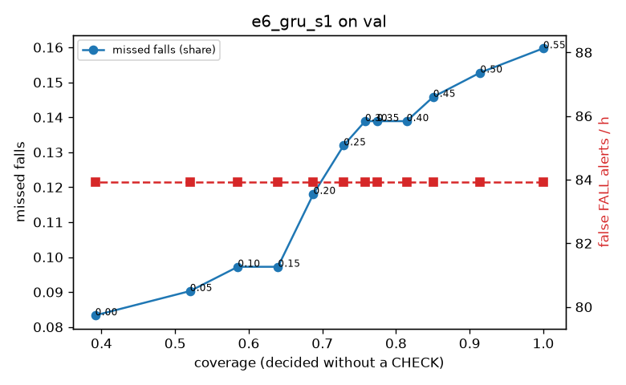

# Evaluation: e6_gru_s1 on val

Thresholds: t_high 0.55, t_low 0.2 (models\e6_gru_s1\thresholds.yaml). 589 clips, 144 falls, 1.00 h (0.75 h normal activity); 0 clips have no score rows (counted as silent). 95% intervals: bootstrap over clips.

## Systems

| System | Sensitivity (FALL) | Sensitivity (FALL or CHECK) | False FALL alerts / h | CHECK requests / h | Coverage | Median latency (s) | Alerts |
| --- | --- | --- | --- | --- | --- | --- | --- |
| e6_gru_s1 (one threshold) | 84.0% (75.1%–92.4%) | 84.0% (75.1%–92.4%) | 83.93 (66.49–103.01) | 0.00 (0.00–0.00) | 100.0% (100.0%–100.0%) | 1.93 (1.93–1.93) | 188 FALL, 0 CHECK |
| e6_gru_s1 (CHECK band) | 84.0% (75.1%–92.4%) | 88.2% (81.1%–95.2%) | 83.93 (66.49–103.01) | 141.86 (122.31–164.24) | 68.8% (64.8%–72.7%) | 1.93 (1.93–1.93) | 188 FALL, 142 CHECK |
| rule baseline (E0) | 68.8% (56.7%–80.6%) | 68.8% (56.7%–80.6%) | 167.86 (142.60–195.93) | 0.00 (0.00–0.00) | 100.0% (100.0%–100.0%) | 2.53 (2.33–2.77) | 226 FALL, 0 CHECK |

## Breakdown (e6_gru_s1 (CHECK band))

| Group | Value | Clips | Falls | Hours | Sens. (FALL) | Sens. (any) | False FALL / h | CHECK / h |
| --- | --- | --- | --- | --- | --- | --- | --- | --- |
| dataset | GMDCSA24 | 47 | 23 | 0.12 | 95.7% (85.7%–100.0%) | 95.7% (85.7%–100.0%) | 111.70 (49.83–177.73) | 211.83 (159.26–267.73) |
| dataset | caucafall | 8 | 4 | 0.03 | 100.0% (100.0%–100.0%) | 100.0% (100.0%–100.0%) | 148.14 (0.00–283.19) | 113.05 (34.47–233.45) |
| dataset | le2i | 15 | 11 | 0.04 | 72.7% (44.4%–100.0%) | 72.7% (44.4%–100.0%) | 188.61 (65.12–389.70) | 201.83 (115.67–293.18) |
| dataset | occu | 2 | 16 | 0.08 | 37.5% (25.0%–50.0%) | 50.0% (50.0%–50.0%) | 103.36 (71.58–132.86) | 75.56 (51.60–98.41) |
| dataset | of-syn | 517 | 90 | 0.73 | 90.0% (83.2%–95.7%) | 94.4% (89.4%–98.8%) | 73.21 (52.75–93.97) | 134.68 (112.69–159.45) |
| qc_pass | True | 589 | 144 | 1.00 | 84.0% (75.1%–92.4%) | 88.2% (81.1%–95.2%) | 83.93 (66.49–103.01) | 141.86 (122.31–164.24) |
| of-syn age | child | 72 | 13 | 0.10 | 84.6% (62.5%–100.0%) | 92.3% (72.7%–100.0%) | 108.38 (47.37–180.85) | 167.75 (98.68–246.69) |
| of-syn age | elderly | 184 | 25 | 0.26 | 88.0% (75.0%–100.0%) | 92.0% (80.0%–100.0%) | 84.90 (50.74–124.35) | 104.26 (73.36–142.87) |
| of-syn age | middle-aged | 61 | 12 | 0.09 | 83.3% (58.8%–100.0%) | 100.0% (100.0%–100.0%) | 58.00 (14.21–118.41) | 93.18 (34.94–151.41) |
| of-syn age | teen | 61 | 10 | 0.09 | 100.0% (100.0%–100.0%) | 100.0% (100.0%–100.0%) | 41.79 (0.00–95.64) | 186.36 (116.47–267.89) |
| of-syn age | toddler | 72 | 15 | 0.10 | 86.7% (69.2%–100.0%) | 86.7% (69.2%–100.0%) | 49.86 (12.04–101.54) | 167.75 (98.68–236.83) |
| of-syn age | young adult | 67 | 15 | 0.09 | 100.0% (100.0%–100.0%) | 100.0% (100.0%–100.0%) | 68.32 (24.93–127.92) | 137.85 (84.83–201.48) |
| of-syn BMI | normal | 135 | 19 | 0.19 | 94.7% (83.3%–100.0%) | 94.7% (83.3%–100.0%) | 67.37 (31.72–106.90) | 136.83 (94.73–189.46) |
| of-syn BMI | obese | 125 | 18 | 0.18 | 83.3% (66.7%–100.0%) | 88.9% (73.3%–100.0%) | 59.76 (26.81–94.73) | 142.10 (90.94–193.25) |
| of-syn BMI | overweight | 134 | 27 | 0.19 | 85.2% (71.4%–96.6%) | 92.6% (81.8%–100.0%) | 79.68 (42.19–123.89) | 153.76 (106.04–206.78) |
| of-syn BMI | underweight | 123 | 26 | 0.17 | 96.2% (88.0%–100.0%) | 100.0% (100.0%–100.0%) | 87.89 (45.83–134.62) | 103.97 (63.54–150.18) |

## Windows (4 classes)

Macro F1 0.717 over 12454 windows.

| true \ predicted | upright | falling | fallen | controlled_low |
| --- | --- | --- | --- | --- |
| upright | 4044 | 301 | 133 | 642 |
| falling | 100 | 991 | 27 | 57 |
| fallen | 29 | 297 | 981 | 255 |
| controlled_low | 468 | 339 | 369 | 3421 |

## Coverage–error curve

| CHECK band | t_low | Coverage | Missed falls | False FALL / h | CHECK / h |
| --- | --- | --- | --- | --- | --- |
| 0.00 | 0.55 | 100.0% | 16.0% | 83.93 | 0.00 |
| 0.05 | 0.50 | 91.4% | 15.3% | 83.93 | 29.97 |
| 0.10 | 0.45 | 85.1% | 14.6% | 83.93 | 55.95 |
| 0.15 | 0.40 | 81.4% | 13.9% | 83.93 | 71.93 |
| 0.20 | 0.35 | 77.4% | 13.9% | 83.93 | 92.91 |
| 0.25 | 0.30 | 75.8% | 13.9% | 83.93 | 101.90 |
| 0.30 | 0.25 | 72.9% | 13.2% | 83.93 | 117.89 |
| 0.35 | 0.20 | 68.8% | 11.8% | 83.93 | 141.86 |
| 0.40 | 0.15 | 64.0% | 9.7% | 83.93 | 172.83 |
| 0.45 | 0.10 | 58.5% | 9.7% | 83.93 | 219.79 |
| 0.50 | 0.05 | 52.0% | 9.0% | 83.93 | 286.73 |
| 0.55 | 0.00 | 39.1% | 8.3% | 83.93 | 487.53 |

Definitions: fall event = OmniFall `fall` segment; detected = alert from the segment start to 10 s after its end; false alert = alert matching no fall; normal-activity hours exclude [start − 2 s, end + 10 s]; FALL and ON FLOOR count as alarms, CHECK hands over to a person.
