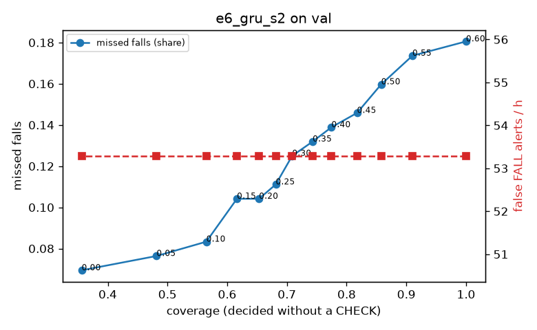

# Evaluation: e6_gru_s2 on val

Thresholds: t_high 0.6, t_low 0.2 (models\e6_gru_s2\thresholds.yaml). 589 clips, 144 falls, 1.00 h (0.75 h normal activity); 0 clips have no score rows (counted as silent). 95% intervals: bootstrap over clips.

## Systems

| System | Sensitivity (FALL) | Sensitivity (FALL or CHECK) | False FALL alerts / h | CHECK requests / h | Coverage | Median latency (s) | Alerts |
| --- | --- | --- | --- | --- | --- | --- | --- |
| e6_gru_s2 (one threshold) | 81.9% (74.1%–90.3%) | 81.9% (74.1%–90.3%) | 53.29 (38.94–70.17) | 0.00 (0.00–0.00) | 100.0% (100.0%–100.0%) | 1.93 (1.93–1.93) | 161 FALL, 0 CHECK |
| e6_gru_s2 (CHECK band) | 81.9% (74.1%–90.3%) | 89.6% (81.3%–97.9%) | 53.29 (38.94–70.17) | 144.86 (123.55–167.90) | 65.3% (60.8%–69.6%) | 1.93 (1.93–1.93) | 161 FALL, 145 CHECK |
| rule baseline (E0) | 68.8% (56.7%–80.6%) | 68.8% (56.7%–80.6%) | 167.86 (142.60–195.93) | 0.00 (0.00–0.00) | 100.0% (100.0%–100.0%) | 2.53 (2.33–2.77) | 226 FALL, 0 CHECK |

## Breakdown (e6_gru_s2 (CHECK band))

| Group | Value | Clips | Falls | Hours | Sens. (FALL) | Sens. (any) | False FALL / h | CHECK / h |
| --- | --- | --- | --- | --- | --- | --- | --- | --- |
| dataset | GMDCSA24 | 47 | 23 | 0.12 | 100.0% (100.0%–100.0%) | 100.0% (100.0%–100.0%) | 86.88 (34.31–149.45) | 244.42 (185.32–304.49) |
| dataset | caucafall | 8 | 4 | 0.03 | 100.0% (100.0%–100.0%) | 100.0% (100.0%–100.0%) | 74.07 (0.00–213.14) | 188.41 (79.29–274.91) |
| dataset | le2i | 15 | 11 | 0.04 | 100.0% (100.0%–100.0%) | 100.0% (100.0%–100.0%) | 0.00 (0.00–0.00) | 246.68 (163.54–338.32) |
| dataset | occu | 2 | 16 | 0.08 | 37.5% (37.5%–37.5%) | 37.5% (37.5%–37.5%) | 68.91 (66.43–71.58) | 62.97 (51.60–73.80) |
| dataset | of-syn | 517 | 90 | 0.73 | 82.2% (74.2%–89.7%) | 94.4% (89.1%–98.9%) | 49.92 (33.41–67.35) | 129.18 (108.53–152.54) |
| qc_pass | True | 589 | 144 | 1.00 | 81.9% (74.1%–90.3%) | 89.6% (81.3%–97.9%) | 53.29 (38.94–70.17) | 144.86 (123.55–167.90) |
| of-syn age | child | 72 | 13 | 0.10 | 84.6% (62.5%–100.0%) | 92.3% (72.7%–100.0%) | 84.29 (34.36–146.62) | 108.55 (49.34–167.75) |
| of-syn age | elderly | 184 | 25 | 0.26 | 76.0% (59.1%–90.9%) | 92.0% (80.0%–100.0%) | 53.62 (26.81–86.00) | 139.01 (104.26–181.48) |
| of-syn age | middle-aged | 61 | 12 | 0.09 | 66.7% (36.4%–92.3%) | 91.7% (71.4%–100.0%) | 0.00 (0.00–0.00) | 93.18 (34.94–151.70) |
| of-syn age | teen | 61 | 10 | 0.09 | 80.0% (50.0%–100.0%) | 100.0% (100.0%–100.0%) | 55.72 (13.41–116.31) | 174.71 (93.18–244.88) |
| of-syn age | toddler | 72 | 15 | 0.10 | 93.3% (77.8%–100.0%) | 93.3% (77.8%–100.0%) | 37.39 (0.00–85.79) | 118.41 (68.83–177.62) |
| of-syn age | young adult | 67 | 15 | 0.09 | 93.3% (77.8%–100.0%) | 100.0% (100.0%–100.0%) | 54.65 (13.16–105.85) | 127.25 (63.63–190.88) |
| of-syn BMI | normal | 135 | 19 | 0.19 | 84.2% (66.7%–100.0%) | 94.7% (83.3%–100.0%) | 49.00 (18.86–85.03) | 136.83 (94.73–184.20) |
| of-syn BMI | obese | 125 | 18 | 0.18 | 77.8% (56.5%–95.2%) | 83.3% (66.7%–100.0%) | 46.48 (19.02–83.60) | 119.36 (73.89–164.83) |
| of-syn BMI | overweight | 134 | 27 | 0.19 | 74.1% (56.0%–90.0%) | 96.3% (86.7%–100.0%) | 46.48 (19.37–82.48) | 153.76 (106.04–206.78) |
| of-syn BMI | underweight | 123 | 26 | 0.17 | 92.3% (80.0%–100.0%) | 100.0% (100.0%–100.0%) | 58.60 (21.75–100.40) | 103.97 (63.54–150.18) |

## Windows (4 classes)

Macro F1 0.716 over 12454 windows.

| true \ predicted | upright | falling | fallen | controlled_low |
| --- | --- | --- | --- | --- |
| upright | 4228 | 209 | 92 | 591 |
| falling | 113 | 969 | 29 | 64 |
| fallen | 37 | 296 | 806 | 423 |
| controlled_low | 478 | 304 | 248 | 3567 |

## Coverage–error curve

| CHECK band | t_low | Coverage | Missed falls | False FALL / h | CHECK / h |
| --- | --- | --- | --- | --- | --- |
| 0.00 | 0.60 | 100.0% | 18.1% | 53.29 | 0.00 |
| 0.05 | 0.55 | 91.0% | 17.4% | 53.29 | 28.97 |
| 0.10 | 0.50 | 85.8% | 16.0% | 53.29 | 46.96 |
| 0.15 | 0.45 | 81.7% | 14.6% | 53.29 | 61.94 |
| 0.20 | 0.40 | 77.5% | 13.9% | 53.29 | 80.92 |
| 0.25 | 0.35 | 74.3% | 13.2% | 53.29 | 95.91 |
| 0.30 | 0.30 | 70.9% | 12.5% | 53.29 | 113.89 |
| 0.35 | 0.25 | 68.1% | 11.1% | 53.29 | 127.88 |
| 0.40 | 0.20 | 65.3% | 10.4% | 53.29 | 144.86 |
| 0.45 | 0.15 | 61.6% | 10.4% | 53.29 | 171.84 |
| 0.50 | 0.10 | 56.5% | 8.3% | 53.29 | 209.80 |
| 0.55 | 0.05 | 48.2% | 7.6% | 53.29 | 296.72 |
| 0.60 | 0.00 | 35.6% | 6.9% | 53.29 | 505.52 |

Definitions: fall event = OmniFall `fall` segment; detected = alert from the segment start to 10 s after its end; false alert = alert matching no fall; normal-activity hours exclude [start − 2 s, end + 10 s]; FALL and ON FLOOR count as alarms, CHECK hands over to a person.
