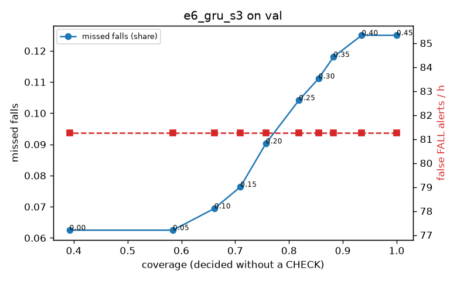

# Evaluation: e6_gru_s3 on val

Thresholds: t_high 0.45, t_low 0.2 (models\e6_gru_s3\thresholds.yaml). 589 clips, 144 falls, 1.00 h (0.75 h normal activity); 0 clips have no score rows (counted as silent). 95% intervals: bootstrap over clips.

## Systems

| System | Sensitivity (FALL) | Sensitivity (FALL or CHECK) | False FALL alerts / h | CHECK requests / h | Coverage | Median latency (s) | Alerts |
| --- | --- | --- | --- | --- | --- | --- | --- |
| e6_gru_s3 (one threshold) | 87.5% (79.8%–95.0%) | 87.5% (79.8%–95.0%) | 81.27 (65.26–102.23) | 0.00 (0.00–0.00) | 100.0% (100.0%–100.0%) | 1.93 (1.93–1.93) | 188 FALL, 0 CHECK |
| e6_gru_s3 (CHECK band) | 87.5% (79.8%–95.0%) | 91.0% (83.1%–98.4%) | 81.27 (65.26–102.23) | 99.90 (82.20–119.61) | 75.7% (71.6%–79.6%) | 1.93 (1.93–1.93) | 188 FALL, 100 CHECK |
| rule baseline (E0) | 68.8% (56.7%–80.6%) | 68.8% (56.7%–80.6%) | 167.86 (142.60–195.93) | 0.00 (0.00–0.00) | 100.0% (100.0%–100.0%) | 2.53 (2.33–2.77) | 226 FALL, 0 CHECK |

## Breakdown (e6_gru_s3 (CHECK band))

| Group | Value | Clips | Falls | Hours | Sens. (FALL) | Sens. (any) | False FALL / h | CHECK / h |
| --- | --- | --- | --- | --- | --- | --- | --- | --- |
| dataset | GMDCSA24 | 47 | 23 | 0.12 | 100.0% (100.0%–100.0%) | 100.0% (100.0%–100.0%) | 99.29 (46.17–164.77) | 130.36 (81.49–183.68) |
| dataset | caucafall | 8 | 4 | 0.03 | 100.0% (100.0%–100.0%) | 100.0% (100.0%–100.0%) | 222.20 (76.25–299.97) | 75.37 (0.00–156.86) |
| dataset | le2i | 15 | 11 | 0.04 | 100.0% (100.0%–100.0%) | 100.0% (100.0%–100.0%) | 37.72 (0.00–113.64) | 156.98 (73.23–246.47) |
| dataset | occu | 2 | 16 | 0.08 | 43.8% (37.5%–50.0%) | 43.8% (37.5%–50.0%) | 68.91 (66.43–71.58) | 37.78 (25.80–49.20) |
| dataset | of-syn | 517 | 90 | 0.73 | 90.0% (83.7%–95.8%) | 95.6% (91.1%–99.0%) | 78.20 (58.78–99.54) | 98.94 (78.33–120.97) |
| qc_pass | True | 589 | 144 | 1.00 | 87.5% (79.8%–95.0%) | 91.0% (83.1%–98.4%) | 81.27 (65.26–102.23) | 99.90 (82.20–119.61) |
| of-syn age | child | 72 | 13 | 0.10 | 92.3% (72.7%–100.0%) | 92.3% (72.7%–100.0%) | 72.25 (23.29–132.46) | 108.55 (49.34–167.75) |
| of-syn age | elderly | 184 | 25 | 0.26 | 88.0% (75.0%–100.0%) | 92.0% (81.0%–100.0%) | 84.90 (52.45–125.14) | 100.39 (69.50–135.15) |
| of-syn age | middle-aged | 61 | 12 | 0.09 | 91.7% (70.0%–100.0%) | 91.7% (70.0%–100.0%) | 58.00 (13.93–111.49) | 23.29 (0.00–58.24) |
| of-syn age | teen | 61 | 10 | 0.09 | 90.0% (66.7%–100.0%) | 100.0% (100.0%–100.0%) | 111.45 (49.77–188.49) | 116.47 (58.24–186.36) |
| of-syn age | toddler | 72 | 15 | 0.10 | 86.7% (69.2%–100.0%) | 100.0% (100.0%–100.0%) | 74.79 (24.93–137.12) | 148.02 (88.81–217.09) |
| of-syn age | young adult | 67 | 15 | 0.09 | 93.3% (77.8%–100.0%) | 100.0% (100.0%–100.0%) | 54.65 (13.16–105.85) | 84.83 (31.81–148.46) |
| of-syn BMI | normal | 135 | 19 | 0.19 | 89.5% (75.0%–100.0%) | 100.0% (100.0%–100.0%) | 61.25 (29.85–100.60) | 73.68 (42.10–110.52) |
| of-syn BMI | obese | 125 | 18 | 0.18 | 77.8% (56.2%–95.2%) | 88.9% (72.2%–100.0%) | 86.32 (43.06–130.36) | 125.04 (79.57–176.20) |
| of-syn BMI | overweight | 134 | 27 | 0.19 | 88.9% (75.0%–100.0%) | 92.6% (80.0%–100.0%) | 86.32 (45.19–129.84) | 106.04 (63.63–148.46) |
| of-syn BMI | underweight | 123 | 26 | 0.17 | 100.0% (100.0%–100.0%) | 100.0% (100.0%–100.0%) | 80.57 (38.19–128.58) | 92.42 (51.99–132.85) |

## Windows (4 classes)

Macro F1 0.729 over 12454 windows.

| true \ predicted | upright | falling | fallen | controlled_low |
| --- | --- | --- | --- | --- |
| upright | 4395 | 195 | 48 | 482 |
| falling | 116 | 978 | 15 | 66 |
| fallen | 59 | 267 | 852 | 384 |
| controlled_low | 597 | 294 | 267 | 3439 |

## Coverage–error curve

| CHECK band | t_low | Coverage | Missed falls | False FALL / h | CHECK / h |
| --- | --- | --- | --- | --- | --- |
| 0.00 | 0.45 | 100.0% | 12.5% | 81.27 | 0.00 |
| 0.05 | 0.40 | 93.5% | 12.5% | 81.27 | 22.98 |
| 0.10 | 0.35 | 88.3% | 11.8% | 81.27 | 42.96 |
| 0.15 | 0.30 | 85.5% | 11.1% | 81.27 | 53.95 |
| 0.20 | 0.25 | 81.8% | 10.4% | 81.27 | 69.93 |
| 0.25 | 0.20 | 75.7% | 9.0% | 81.27 | 99.90 |
| 0.30 | 0.15 | 71.0% | 7.6% | 81.27 | 125.88 |
| 0.35 | 0.10 | 66.1% | 6.9% | 81.27 | 157.85 |
| 0.40 | 0.05 | 58.4% | 6.2% | 81.27 | 220.79 |
| 0.45 | 0.00 | 39.2% | 6.2% | 81.27 | 491.53 |

Definitions: fall event = OmniFall `fall` segment; detected = alert from the segment start to 10 s after its end; false alert = alert matching no fall; normal-activity hours exclude [start − 2 s, end + 10 s]; FALL and ON FLOOR count as alarms, CHECK hands over to a person.
