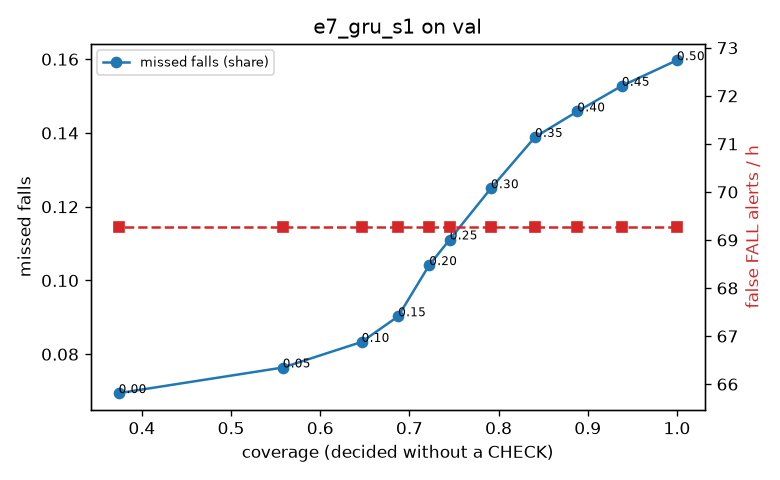

# Evaluation: e7_gru_s1 on val

Thresholds: t_high 0.5, t_low 0.2 (models\e7_gru_s1\thresholds.yaml). 589 clips, 144 falls, 1.00 h (0.75 h normal activity); 0 clips have no score rows (counted as silent). 95% intervals: bootstrap over clips.

## Systems

| System | Sensitivity (FALL) | Sensitivity (FALL or CHECK) | False FALL alerts / h | CHECK requests / h | Coverage | Median latency (s) | Alerts |
| --- | --- | --- | --- | --- | --- | --- | --- |
| e7_gru_s1 (one threshold) | 84.0% (75.9%–92.6%) | 84.0% (75.9%–92.6%) | 69.28 (52.42–87.80) | 0.00 (0.00–0.00) | 100.0% (100.0%–100.0%) | 1.93 (1.86–1.93) | 176 FALL, 0 CHECK |
| e7_gru_s1 (CHECK band) | 84.0% (75.9%–92.6%) | 89.6% (81.8%–97.7%) | 69.28 (52.42–87.80) | 111.89 (93.89–131.39) | 72.2% (67.7%–76.2%) | 1.93 (1.86–1.93) | 176 FALL, 112 CHECK |
| rule baseline (E0) | 68.8% (56.7%–80.6%) | 68.8% (56.7%–80.6%) | 167.86 (142.60–195.93) | 0.00 (0.00–0.00) | 100.0% (100.0%–100.0%) | 2.53 (2.33–2.77) | 226 FALL, 0 CHECK |

## Breakdown (e7_gru_s1 (CHECK band))

| Group | Value | Clips | Falls | Hours | Sens. (FALL) | Sens. (any) | False FALL / h | CHECK / h |
| --- | --- | --- | --- | --- | --- | --- | --- | --- |
| dataset | GMDCSA24 | 47 | 23 | 0.12 | 100.0% (100.0%–100.0%) | 100.0% (100.0%–100.0%) | 86.88 (36.78–150.38) | 146.65 (96.38–202.51) |
| dataset | caucafall | 8 | 4 | 0.03 | 100.0% (100.0%–100.0%) | 100.0% (100.0%–100.0%) | 74.07 (0.00–213.14) | 188.41 (80.78–268.47) |
| dataset | le2i | 15 | 11 | 0.04 | 100.0% (100.0%–100.0%) | 100.0% (100.0%–100.0%) | 37.72 (0.00–118.36) | 112.13 (44.15–188.74) |
| dataset | occu | 2 | 16 | 0.08 | 37.5% (37.5%–37.5%) | 37.5% (37.5%–37.5%) | 103.36 (66.43–143.16) | 50.37 (49.20–51.60) |
| dataset | of-syn | 517 | 90 | 0.73 | 85.6% (78.5%–92.7%) | 94.4% (89.5%–98.9%) | 66.56 (47.69–86.69) | 109.94 (87.92–131.96) |
| qc_pass | True | 589 | 144 | 1.00 | 84.0% (75.9%–92.6%) | 89.6% (81.8%–97.7%) | 69.28 (52.42–87.80) | 111.89 (93.89–131.39) |
| of-syn age | child | 72 | 13 | 0.10 | 84.6% (62.5%–100.0%) | 92.3% (72.7%–100.0%) | 96.34 (36.13–163.06) | 98.68 (49.34–157.88) |
| of-syn age | elderly | 184 | 25 | 0.26 | 88.0% (73.9%–100.0%) | 92.0% (80.0%–100.0%) | 75.96 (45.83–113.36) | 104.26 (65.64–142.87) |
| of-syn age | middle-aged | 61 | 12 | 0.09 | 83.3% (58.3%–100.0%) | 100.0% (100.0%–100.0%) | 43.50 (0.00–95.67) | 69.88 (23.29–116.76) |
| of-syn age | teen | 61 | 10 | 0.09 | 80.0% (50.0%–100.0%) | 90.0% (66.7%–100.0%) | 83.59 (27.31–156.31) | 221.30 (139.77–302.83) |
| of-syn age | toddler | 72 | 15 | 0.10 | 80.0% (58.3%–100.0%) | 93.3% (77.8%–100.0%) | 24.93 (0.00–65.79) | 98.68 (49.34–157.88) |
| of-syn age | young adult | 67 | 15 | 0.09 | 93.3% (77.8%–100.0%) | 100.0% (100.0%–100.0%) | 54.65 (13.16–107.29) | 84.83 (31.81–148.46) |
| of-syn BMI | normal | 135 | 19 | 0.19 | 89.5% (75.0%–100.0%) | 94.7% (83.3%–100.0%) | 55.12 (24.28–93.84) | 94.73 (57.76–136.83) |
| of-syn BMI | obese | 125 | 18 | 0.18 | 72.2% (50.0%–92.9%) | 88.9% (72.7%–100.0%) | 53.12 (22.67–89.76) | 125.04 (79.57–176.20) |
| of-syn BMI | overweight | 134 | 27 | 0.19 | 85.2% (71.4%–96.3%) | 92.6% (80.6%–100.0%) | 73.04 (34.83–116.29) | 111.34 (68.93–153.76) |
| of-syn BMI | underweight | 123 | 26 | 0.17 | 92.3% (80.0%–100.0%) | 100.0% (100.0%–100.0%) | 87.89 (46.92–137.78) | 109.75 (69.32–155.96) |

## Windows (4 classes)

Macro F1 0.732 over 12454 windows.

| true \ predicted | upright | falling | fallen | controlled_low |
| --- | --- | --- | --- | --- |
| upright | 4254 | 198 | 113 | 555 |
| falling | 99 | 972 | 32 | 72 |
| fallen | 21 | 231 | 903 | 407 |
| controlled_low | 518 | 292 | 255 | 3532 |

## Coverage–error curve

| CHECK band | t_low | Coverage | Missed falls | False FALL / h | CHECK / h |
| --- | --- | --- | --- | --- | --- |
| 0.00 | 0.50 | 100.0% | 16.0% | 69.28 | 0.00 |
| 0.05 | 0.45 | 93.8% | 15.3% | 69.28 | 19.98 |
| 0.10 | 0.40 | 88.8% | 14.6% | 69.28 | 37.96 |
| 0.15 | 0.35 | 84.1% | 13.9% | 69.28 | 56.95 |
| 0.20 | 0.30 | 79.1% | 12.5% | 69.28 | 77.93 |
| 0.25 | 0.25 | 74.5% | 11.1% | 69.28 | 99.90 |
| 0.30 | 0.20 | 72.2% | 10.4% | 69.28 | 111.89 |
| 0.35 | 0.15 | 68.7% | 9.0% | 69.28 | 130.87 |
| 0.40 | 0.10 | 64.6% | 8.3% | 69.28 | 157.85 |
| 0.45 | 0.05 | 55.8% | 7.6% | 69.28 | 231.78 |
| 0.50 | 0.00 | 37.4% | 6.9% | 69.28 | 500.52 |

Definitions: fall event = OmniFall `fall` segment; detected = alert from the segment start to 10 s after its end; false alert = alert matching no fall; normal-activity hours exclude [start − 2 s, end + 10 s]; FALL and ON FLOOR count as alarms, CHECK hands over to a person.
