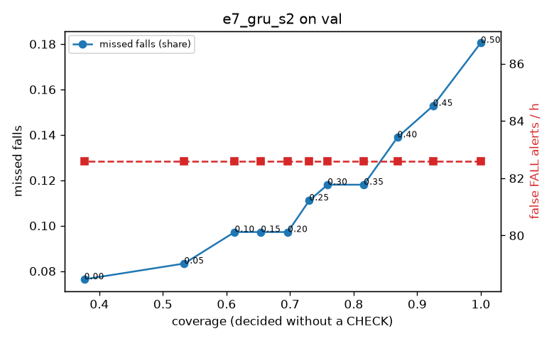

# Evaluation: e7_gru_s2 on val

Thresholds: t_high 0.5, t_low 0.25 (models\e7_gru_s2\thresholds.yaml). 589 clips, 144 falls, 1.00 h (0.75 h normal activity); 0 clips have no score rows (counted as silent). 95% intervals: bootstrap over clips.

## Systems

| System | Sensitivity (FALL) | Sensitivity (FALL or CHECK) | False FALL alerts / h | CHECK requests / h | Coverage | Median latency (s) | Alerts |
| --- | --- | --- | --- | --- | --- | --- | --- |
| e7_gru_s2 (one threshold) | 81.9% (74.8%–89.6%) | 81.9% (74.8%–89.6%) | 82.60 (66.05–103.50) | 0.00 (0.00–0.00) | 100.0% (100.0%–100.0%) | 1.93 (1.93–1.93) | 180 FALL, 0 CHECK |
| e7_gru_s2 (CHECK band) | 81.9% (74.8%–89.6%) | 88.9% (82.4%–95.7%) | 82.60 (66.05–103.50) | 105.90 (88.23–125.57) | 73.0% (68.8%–76.9%) | 1.93 (1.93–1.93) | 180 FALL, 106 CHECK |
| rule baseline (E0) | 68.8% (56.7%–80.6%) | 68.8% (56.7%–80.6%) | 167.86 (142.60–195.93) | 0.00 (0.00–0.00) | 100.0% (100.0%–100.0%) | 2.53 (2.33–2.77) | 226 FALL, 0 CHECK |

## Breakdown (e7_gru_s2 (CHECK band))

| Group | Value | Clips | Falls | Hours | Sens. (FALL) | Sens. (any) | False FALL / h | CHECK / h |
| --- | --- | --- | --- | --- | --- | --- | --- | --- |
| dataset | GMDCSA24 | 47 | 23 | 0.12 | 95.7% (85.7%–100.0%) | 95.7% (85.7%–100.0%) | 86.88 (33.29–152.87) | 187.39 (128.04–251.24) |
| dataset | caucafall | 8 | 4 | 0.03 | 100.0% (100.0%–100.0%) | 100.0% (100.0%–100.0%) | 222.20 (76.25–299.97) | 150.73 (40.39–245.64) |
| dataset | le2i | 15 | 11 | 0.04 | 72.7% (44.4%–100.0%) | 72.7% (44.4%–100.0%) | 188.61 (65.12–389.70) | 89.70 (24.83–158.24) |
| dataset | occu | 2 | 16 | 0.08 | 50.0% (37.5%–62.5%) | 56.2% (50.0%–62.5%) | 68.91 (66.43–71.58) | 50.37 (25.80–73.80) |
| dataset | of-syn | 517 | 90 | 0.73 | 84.4% (77.4%–91.6%) | 94.4% (89.4%–98.9%) | 74.87 (54.78–96.73) | 97.57 (78.33–119.56) |
| qc_pass | True | 589 | 144 | 1.00 | 81.9% (74.8%–89.6%) | 88.9% (82.4%–95.7%) | 82.60 (66.05–103.50) | 105.90 (88.23–125.57) |
| of-syn age | child | 72 | 13 | 0.10 | 92.3% (72.7%–100.0%) | 92.3% (72.7%–100.0%) | 84.29 (26.30–144.73) | 98.68 (49.34–157.88) |
| of-syn age | elderly | 184 | 25 | 0.26 | 76.0% (56.5%–91.3%) | 88.0% (75.0%–100.0%) | 84.90 (51.04–121.30) | 92.67 (61.68–131.28) |
| of-syn age | middle-aged | 61 | 12 | 0.09 | 91.7% (71.4%–100.0%) | 100.0% (100.0%–100.0%) | 43.50 (0.00–95.67) | 69.88 (23.29–128.12) |
| of-syn age | teen | 61 | 10 | 0.09 | 90.0% (70.0%–100.0%) | 100.0% (100.0%–100.0%) | 69.65 (14.49–131.61) | 104.82 (46.59–163.06) |
| of-syn age | toddler | 72 | 15 | 0.10 | 80.0% (58.8%–100.0%) | 93.3% (77.8%–100.0%) | 62.32 (13.66–116.27) | 108.55 (59.21–168.00) |
| of-syn age | young adult | 67 | 15 | 0.09 | 86.7% (66.7%–100.0%) | 100.0% (100.0%–100.0%) | 81.98 (27.85–142.16) | 116.65 (63.63–180.27) |
| of-syn BMI | normal | 135 | 19 | 0.19 | 84.2% (66.7%–100.0%) | 94.7% (83.3%–100.0%) | 67.37 (31.72–108.39) | 110.52 (68.28–157.88) |
| of-syn BMI | obese | 125 | 18 | 0.18 | 72.2% (50.0%–93.8%) | 83.3% (63.2%–100.0%) | 79.68 (40.22–121.80) | 85.26 (45.47–125.04) |
| of-syn BMI | overweight | 134 | 27 | 0.19 | 81.5% (66.7%–95.2%) | 96.3% (86.7%–100.0%) | 79.68 (39.84–122.99) | 111.34 (74.10–159.06) |
| of-syn BMI | underweight | 123 | 26 | 0.17 | 96.2% (86.7%–100.0%) | 100.0% (100.0%–100.0%) | 73.25 (36.24–120.79) | 80.87 (46.21–121.30) |

## Windows (4 classes)

Macro F1 0.721 over 12454 windows.

| true \ predicted | upright | falling | fallen | controlled_low |
| --- | --- | --- | --- | --- |
| upright | 4310 | 228 | 73 | 509 |
| falling | 123 | 972 | 30 | 50 |
| fallen | 81 | 220 | 883 | 378 |
| controlled_low | 585 | 318 | 320 | 3374 |

## Coverage–error curve

| CHECK band | t_low | Coverage | Missed falls | False FALL / h | CHECK / h |
| --- | --- | --- | --- | --- | --- |
| 0.00 | 0.50 | 100.0% | 18.1% | 82.60 | 0.00 |
| 0.05 | 0.45 | 92.5% | 15.3% | 82.60 | 21.98 |
| 0.10 | 0.40 | 86.9% | 13.9% | 82.60 | 41.96 |
| 0.15 | 0.35 | 81.6% | 11.8% | 82.60 | 61.94 |
| 0.20 | 0.30 | 75.9% | 11.8% | 82.60 | 90.91 |
| 0.25 | 0.25 | 73.0% | 11.1% | 82.60 | 105.90 |
| 0.30 | 0.20 | 69.6% | 9.7% | 82.60 | 123.88 |
| 0.35 | 0.15 | 65.4% | 9.7% | 82.60 | 152.85 |
| 0.40 | 0.10 | 61.3% | 9.7% | 82.60 | 184.82 |
| 0.45 | 0.05 | 53.4% | 8.3% | 82.60 | 256.75 |
| 0.50 | 0.00 | 37.6% | 7.6% | 82.60 | 496.53 |

Definitions: fall event = OmniFall `fall` segment; detected = alert from the segment start to 10 s after its end; false alert = alert matching no fall; normal-activity hours exclude [start − 2 s, end + 10 s]; FALL and ON FLOOR count as alarms, CHECK hands over to a person.
