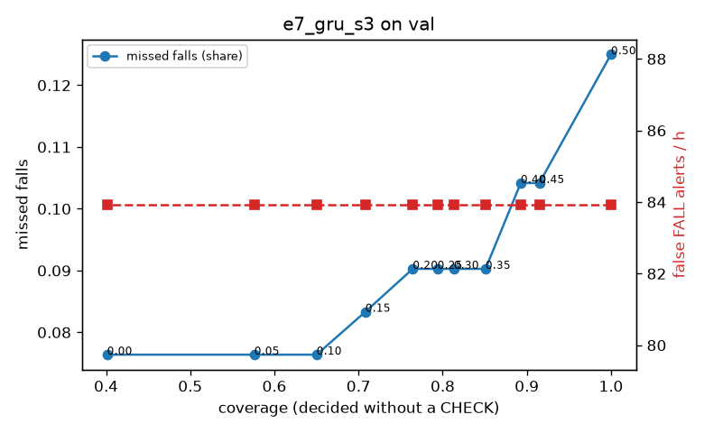

# Evaluation: e7_gru_s3 on val

Thresholds: t_high 0.5, t_low 0.45 (models\e7_gru_s3\thresholds.yaml). 589 clips, 144 falls, 1.00 h (0.75 h normal activity); 0 clips have no score rows (counted as silent). 95% intervals: bootstrap over clips.

## Systems

| System | Sensitivity (FALL) | Sensitivity (FALL or CHECK) | False FALL alerts / h | CHECK requests / h | Coverage | Median latency (s) | Alerts |
| --- | --- | --- | --- | --- | --- | --- | --- |
| e7_gru_s3 (one threshold) | 87.5% (79.1%–95.7%) | 87.5% (79.1%–95.7%) | 83.93 (67.98–102.97) | 0.00 (0.00–0.00) | 100.0% (100.0%–100.0%) | 1.93 (1.93–1.93) | 192 FALL, 0 CHECK |
| e7_gru_s3 (CHECK band) | 87.5% (79.1%–95.7%) | 89.6% (81.0%–97.5%) | 83.93 (67.98–102.97) | 27.97 (18.43–38.74) | 91.5% (88.3%–94.3%) | 1.93 (1.93–1.93) | 192 FALL, 28 CHECK |
| rule baseline (E0) | 68.8% (56.7%–80.6%) | 68.8% (56.7%–80.6%) | 167.86 (142.60–195.93) | 0.00 (0.00–0.00) | 100.0% (100.0%–100.0%) | 2.53 (2.33–2.77) | 226 FALL, 0 CHECK |

## Breakdown (e7_gru_s3 (CHECK band))

| Group | Value | Clips | Falls | Hours | Sens. (FALL) | Sens. (any) | False FALL / h | CHECK / h |
| --- | --- | --- | --- | --- | --- | --- | --- | --- |
| dataset | GMDCSA24 | 47 | 23 | 0.12 | 95.7% (85.7%–100.0%) | 95.7% (85.7%–100.0%) | 99.29 (44.39–162.70) | 8.15 (0.00–25.11) |
| dataset | caucafall | 8 | 4 | 0.03 | 100.0% (100.0%–100.0%) | 100.0% (100.0%–100.0%) | 222.20 (76.25–299.97) | 75.37 (0.00–156.86) |
| dataset | le2i | 15 | 11 | 0.04 | 100.0% (100.0%–100.0%) | 100.0% (100.0%–100.0%) | 0.00 (0.00–0.00) | 22.43 (0.00–77.33) |
| dataset | occu | 2 | 16 | 0.08 | 37.5% (37.5%–37.5%) | 37.5% (37.5%–37.5%) | 68.91 (66.43–71.58) | 12.59 (0.00–24.60) |
| dataset | of-syn | 517 | 90 | 0.73 | 92.2% (86.4%–97.7%) | 95.6% (91.0%–99.0%) | 83.19 (62.69–105.02) | 31.61 (20.61–42.60) |
| qc_pass | True | 589 | 144 | 1.00 | 87.5% (79.1%–95.7%) | 89.6% (81.0%–97.5%) | 83.93 (67.98–102.97) | 27.97 (18.43–38.74) |
| of-syn age | child | 72 | 13 | 0.10 | 92.3% (72.7%–100.0%) | 92.3% (72.7%–100.0%) | 96.34 (36.11–165.78) | 0.00 (0.00–0.00) |
| of-syn age | elderly | 184 | 25 | 0.26 | 84.0% (68.2%–96.0%) | 96.0% (86.9%–100.0%) | 98.31 (64.20–140.23) | 50.20 (27.03–77.23) |
| of-syn age | middle-aged | 61 | 12 | 0.09 | 91.7% (70.0%–100.0%) | 91.7% (70.0%–100.0%) | 58.00 (13.93–111.49) | 11.65 (0.00–34.94) |
| of-syn age | teen | 61 | 10 | 0.09 | 100.0% (100.0%–100.0%) | 100.0% (100.0%–100.0%) | 83.59 (26.81–153.24) | 34.94 (0.00–81.53) |
| of-syn age | toddler | 72 | 15 | 0.10 | 93.3% (77.8%–100.0%) | 93.3% (77.8%–100.0%) | 87.25 (26.80–152.25) | 39.47 (9.87–78.94) |
| of-syn age | young adult | 67 | 15 | 0.09 | 100.0% (100.0%–100.0%) | 100.0% (100.0%–100.0%) | 40.99 (0.00–90.43) | 21.21 (0.00–53.02) |
| of-syn BMI | normal | 135 | 19 | 0.19 | 94.7% (83.3%–100.0%) | 94.7% (83.3%–100.0%) | 79.62 (42.13–120.55) | 21.05 (5.26–42.10) |
| of-syn BMI | obese | 125 | 18 | 0.18 | 88.9% (72.2%–100.0%) | 94.4% (81.2%–100.0%) | 73.04 (33.83–111.85) | 51.15 (22.74–90.94) |
| of-syn BMI | overweight | 134 | 27 | 0.19 | 88.9% (75.8%–100.0%) | 92.6% (80.0%–100.0%) | 99.60 (60.88–145.91) | 26.51 (5.30–53.02) |
| of-syn BMI | underweight | 123 | 26 | 0.17 | 96.2% (88.0%–100.0%) | 100.0% (100.0%–100.0%) | 80.57 (42.20–127.90) | 28.88 (5.78–52.13) |

## Windows (4 classes)

Macro F1 0.726 over 12454 windows.

| true \ predicted | upright | falling | fallen | controlled_low |
| --- | --- | --- | --- | --- |
| upright | 4168 | 261 | 77 | 614 |
| falling | 102 | 999 | 22 | 52 |
| fallen | 68 | 315 | 980 | 199 |
| controlled_low | 524 | 369 | 313 | 3391 |

## Coverage–error curve

| CHECK band | t_low | Coverage | Missed falls | False FALL / h | CHECK / h |
| --- | --- | --- | --- | --- | --- |
| 0.00 | 0.50 | 100.0% | 12.5% | 83.93 | 0.00 |
| 0.05 | 0.45 | 91.5% | 10.4% | 83.93 | 27.97 |
| 0.10 | 0.40 | 89.3% | 10.4% | 83.93 | 36.96 |
| 0.15 | 0.35 | 85.1% | 9.0% | 83.93 | 52.95 |
| 0.20 | 0.30 | 81.3% | 9.0% | 83.93 | 70.93 |
| 0.25 | 0.25 | 79.4% | 9.0% | 83.93 | 80.92 |
| 0.30 | 0.20 | 76.4% | 9.0% | 83.93 | 96.91 |
| 0.35 | 0.15 | 70.8% | 8.3% | 83.93 | 129.88 |
| 0.40 | 0.10 | 65.0% | 7.6% | 83.93 | 169.84 |
| 0.45 | 0.05 | 57.6% | 7.6% | 83.93 | 234.78 |
| 0.50 | 0.00 | 40.1% | 7.6% | 83.93 | 483.54 |

Definitions: fall event = OmniFall `fall` segment; detected = alert from the segment start to 10 s after its end; false alert = alert matching no fall; normal-activity hours exclude [start − 2 s, end + 10 s]; FALL and ON FLOOR count as alarms, CHECK hands over to a person.
