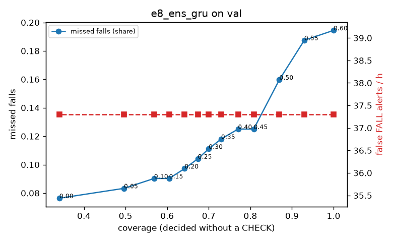

# Evaluation: e8_ens_gru on val

Thresholds: t_high 0.6, t_low 0.35 (models\e8_ens_gru\thresholds.yaml). 589 clips, 144 falls, 1.00 h (0.75 h normal activity); 0 clips have no score rows (counted as silent). 95% intervals: bootstrap over clips.

## Systems

| System | Sensitivity (FALL) | Sensitivity (FALL or CHECK) | False FALL alerts / h | CHECK requests / h | Coverage | Median latency (s) | Alerts |
| --- | --- | --- | --- | --- | --- | --- | --- |
| e8_ens_gru (one threshold) | 80.6% (72.8%–88.8%) | 80.6% (72.8%–88.8%) | 37.30 (25.25–51.02) | 0.00 (0.00–0.00) | 100.0% (100.0%–100.0%) | 1.93 (1.93–1.93) | 148 FALL, 0 CHECK |
| e8_ens_gru (CHECK band) | 80.6% (72.8%–88.8%) | 88.2% (80.0%–96.6%) | 37.30 (25.25–51.02) | 92.91 (76.97–110.91) | 73.0% (67.8%–77.3%) | 1.93 (1.93–1.93) | 148 FALL, 93 CHECK |
| rule baseline (E0) | 68.8% (56.7%–80.6%) | 68.8% (56.7%–80.6%) | 167.86 (142.60–195.93) | 0.00 (0.00–0.00) | 100.0% (100.0%–100.0%) | 2.53 (2.33–2.77) | 226 FALL, 0 CHECK |

## Breakdown (e8_ens_gru (CHECK band))

| Group | Value | Clips | Falls | Hours | Sens. (FALL) | Sens. (any) | False FALL / h | CHECK / h |
| --- | --- | --- | --- | --- | --- | --- | --- | --- |
| dataset | GMDCSA24 | 47 | 23 | 0.12 | 95.7% (85.7%–100.0%) | 100.0% (100.0%–100.0%) | 37.23 (0.00–82.43) | 105.91 (59.50–159.33) |
| dataset | caucafall | 8 | 4 | 0.03 | 100.0% (100.0%–100.0%) | 100.0% (100.0%–100.0%) | 74.07 (0.00–213.14) | 188.41 (79.29–274.91) |
| dataset | le2i | 15 | 11 | 0.04 | 100.0% (100.0%–100.0%) | 100.0% (100.0%–100.0%) | 0.00 (0.00–0.00) | 179.40 (97.01–276.83) |
| dataset | occu | 2 | 16 | 0.08 | 37.5% (37.5%–37.5%) | 37.5% (37.5%–37.5%) | 68.91 (66.43–71.58) | 37.78 (25.80–49.20) |
| dataset | of-syn | 517 | 90 | 0.73 | 81.1% (72.5%–89.0%) | 92.2% (86.3%–97.6%) | 36.61 (23.45–51.79) | 87.95 (70.09–108.56) |
| qc_pass | True | 589 | 144 | 1.00 | 80.6% (72.8%–88.8%) | 88.2% (80.0%–96.6%) | 37.30 (25.25–51.02) | 92.91 (76.97–110.91) |
| of-syn age | child | 72 | 13 | 0.10 | 84.6% (62.5%–100.0%) | 92.3% (72.7%–100.0%) | 60.21 (12.46–114.64) | 78.94 (29.60–138.15) |
| of-syn age | elderly | 184 | 25 | 0.26 | 72.0% (53.8%–88.9%) | 88.0% (75.0%–100.0%) | 44.68 (18.33–74.10) | 104.26 (69.50–142.87) |
| of-syn age | middle-aged | 61 | 12 | 0.09 | 83.3% (58.3%–100.0%) | 91.7% (71.4%–100.0%) | 29.00 (0.00–72.50) | 69.88 (23.29–128.12) |
| of-syn age | teen | 61 | 10 | 0.09 | 80.0% (50.0%–100.0%) | 90.0% (66.7%–100.0%) | 13.93 (0.00–46.36) | 104.82 (46.59–174.71) |
| of-syn age | toddler | 72 | 15 | 0.10 | 80.0% (58.3%–100.0%) | 93.3% (77.8%–100.0%) | 24.93 (0.00–65.79) | 78.94 (29.60–138.15) |
| of-syn age | young adult | 67 | 15 | 0.09 | 93.3% (77.8%–100.0%) | 100.0% (100.0%–100.0%) | 27.33 (0.00–69.65) | 63.63 (21.21–116.65) |
| of-syn BMI | normal | 135 | 19 | 0.19 | 84.2% (66.7%–100.0%) | 94.7% (83.3%–100.0%) | 24.50 (5.97–49.87) | 78.94 (42.10–115.78) |
| of-syn BMI | obese | 125 | 18 | 0.18 | 66.7% (44.4%–88.0%) | 77.8% (56.5%–95.2%) | 19.92 (0.00–45.22) | 85.26 (51.15–125.04) |
| of-syn BMI | overweight | 134 | 27 | 0.19 | 81.5% (65.7%–95.8%) | 92.6% (80.6%–100.0%) | 53.12 (20.69–87.99) | 111.34 (74.23–153.76) |
| of-syn BMI | underweight | 123 | 26 | 0.17 | 88.5% (75.0%–100.0%) | 100.0% (100.0%–100.0%) | 51.27 (14.96–90.70) | 75.09 (40.43–115.53) |

## Windows (4 classes)

Macro F1 0.734 over 12454 windows.

| true \ predicted | upright | falling | fallen | controlled_low |
| --- | --- | --- | --- | --- |
| upright | 4205 | 180 | 84 | 651 |
| falling | 102 | 973 | 30 | 70 |
| fallen | 35 | 284 | 945 | 298 |
| controlled_low | 533 | 266 | 286 | 3512 |

## Coverage–error curve

| CHECK band | t_low | Coverage | Missed falls | False FALL / h | CHECK / h |
| --- | --- | --- | --- | --- | --- |
| 0.00 | 0.60 | 100.0% | 19.4% | 37.30 | 0.00 |
| 0.05 | 0.55 | 93.0% | 18.8% | 37.30 | 20.98 |
| 0.10 | 0.50 | 87.0% | 16.0% | 37.30 | 37.96 |
| 0.15 | 0.45 | 80.8% | 12.5% | 37.30 | 56.95 |
| 0.20 | 0.40 | 77.0% | 12.5% | 37.30 | 73.93 |
| 0.25 | 0.35 | 73.0% | 11.8% | 37.30 | 92.91 |
| 0.30 | 0.30 | 70.0% | 11.1% | 37.30 | 107.90 |
| 0.35 | 0.25 | 67.4% | 10.4% | 37.30 | 121.88 |
| 0.40 | 0.20 | 64.2% | 9.7% | 37.30 | 140.87 |
| 0.45 | 0.15 | 60.5% | 9.0% | 37.30 | 165.84 |
| 0.50 | 0.10 | 56.9% | 9.0% | 37.30 | 194.81 |
| 0.55 | 0.05 | 49.6% | 8.3% | 37.30 | 263.75 |
| 0.60 | 0.00 | 34.1% | 7.6% | 37.30 | 513.51 |

Definitions: fall event = OmniFall `fall` segment; detected = alert from the segment start to 10 s after its end; false alert = alert matching no fall; normal-activity hours exclude [start − 2 s, end + 10 s]; FALL and ON FLOOR count as alarms, CHECK hands over to a person.
