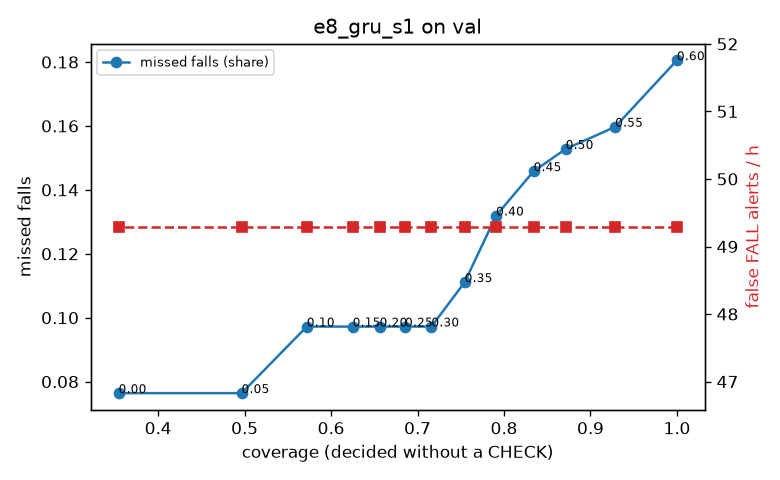

# Evaluation: e8_gru_s1 on val

Thresholds: t_high 0.6, t_low 0.35 (models\e8_gru_s1\thresholds.yaml). 589 clips, 144 falls, 1.00 h (0.75 h normal activity); 0 clips have no score rows (counted as silent). 95% intervals: bootstrap over clips.

## Systems

| System | Sensitivity (FALL) | Sensitivity (FALL or CHECK) | False FALL alerts / h | CHECK requests / h | Coverage | Median latency (s) | Alerts |
| --- | --- | --- | --- | --- | --- | --- | --- |
| e8_gru_s1 (one threshold) | 81.9% (73.7%–90.2%) | 81.9% (73.7%–90.2%) | 49.29 (35.23–64.76) | 0.00 (0.00–0.00) | 100.0% (100.0%–100.0%) | 1.93 (1.93–1.93) | 158 FALL, 0 CHECK |
| e8_gru_s1 (CHECK band) | 81.9% (73.7%–90.2%) | 88.9% (80.8%–96.9%) | 49.29 (35.23–64.76) | 84.92 (67.87–102.10) | 75.5% (70.8%–79.7%) | 1.93 (1.93–1.93) | 158 FALL, 85 CHECK |
| rule baseline (E0) | 68.8% (56.7%–80.6%) | 68.8% (56.7%–80.6%) | 167.86 (142.60–195.93) | 0.00 (0.00–0.00) | 100.0% (100.0%–100.0%) | 2.53 (2.33–2.77) | 226 FALL, 0 CHECK |

## Breakdown (e8_gru_s1 (CHECK band))

| Group | Value | Clips | Falls | Hours | Sens. (FALL) | Sens. (any) | False FALL / h | CHECK / h |
| --- | --- | --- | --- | --- | --- | --- | --- | --- |
| dataset | GMDCSA24 | 47 | 23 | 0.12 | 95.7% (85.7%–100.0%) | 100.0% (100.0%–100.0%) | 86.88 (34.31–145.05) | 146.65 (92.56–201.63) |
| dataset | caucafall | 8 | 4 | 0.03 | 100.0% (100.0%–100.0%) | 100.0% (100.0%–100.0%) | 148.14 (0.00–283.19) | 188.41 (74.52–295.69) |
| dataset | le2i | 15 | 11 | 0.04 | 100.0% (100.0%–100.0%) | 100.0% (100.0%–100.0%) | 37.72 (0.00–118.36) | 201.83 (106.11–318.98) |
| dataset | occu | 2 | 16 | 0.08 | 37.5% (37.5%–37.5%) | 37.5% (37.5%–37.5%) | 103.36 (66.43–143.16) | 25.19 (24.60–25.80) |
| dataset | of-syn | 517 | 90 | 0.73 | 83.3% (75.5%–91.1%) | 93.3% (87.5%–98.0%) | 39.93 (26.18–55.83) | 70.09 (52.22–89.33) |
| qc_pass | True | 589 | 144 | 1.00 | 81.9% (73.7%–90.2%) | 88.9% (80.8%–96.9%) | 49.29 (35.23–64.76) | 84.92 (67.87–102.10) |
| of-syn age | child | 72 | 13 | 0.10 | 84.6% (62.5%–100.0%) | 84.6% (62.5%–100.0%) | 60.21 (12.46–118.41) | 59.21 (19.74–108.55) |
| of-syn age | elderly | 184 | 25 | 0.26 | 80.0% (63.0%–95.5%) | 88.0% (74.2%–100.0%) | 49.15 (22.77–77.43) | 61.78 (34.75–92.67) |
| of-syn age | middle-aged | 61 | 12 | 0.09 | 83.3% (58.3%–100.0%) | 100.0% (100.0%–100.0%) | 14.50 (0.00–47.37) | 81.53 (34.94–139.77) |
| of-syn age | teen | 61 | 10 | 0.09 | 90.0% (66.7%–100.0%) | 100.0% (100.0%–100.0%) | 27.86 (0.00–71.05) | 81.53 (23.29–139.77) |
| of-syn age | toddler | 72 | 15 | 0.10 | 73.3% (50.0%–93.3%) | 93.3% (77.8%–100.0%) | 37.39 (0.00–81.98) | 59.21 (19.74–108.55) |
| of-syn age | young adult | 67 | 15 | 0.09 | 93.3% (77.8%–100.0%) | 100.0% (100.0%–100.0%) | 27.33 (0.00–69.65) | 95.44 (42.42–159.06) |
| of-syn BMI | normal | 135 | 19 | 0.19 | 84.2% (66.7%–100.0%) | 94.7% (83.3%–100.0%) | 30.62 (6.18–59.21) | 57.89 (26.31–94.73) |
| of-syn BMI | obese | 125 | 18 | 0.18 | 66.7% (45.5%–88.9%) | 83.3% (63.6%–100.0%) | 26.56 (6.40–52.16) | 73.89 (34.10–107.99) |
| of-syn BMI | overweight | 134 | 27 | 0.19 | 81.5% (65.7%–95.8%) | 96.3% (86.7%–100.0%) | 46.48 (13.93–82.47) | 95.44 (58.32–137.85) |
| of-syn BMI | underweight | 123 | 26 | 0.17 | 96.2% (87.5%–100.0%) | 96.2% (87.5%–100.0%) | 58.60 (21.53–102.53) | 51.99 (23.11–86.64) |

## Windows (4 classes)

Macro F1 0.723 over 12454 windows.

| true \ predicted | upright | falling | fallen | controlled_low |
| --- | --- | --- | --- | --- |
| upright | 4077 | 210 | 88 | 745 |
| falling | 102 | 975 | 38 | 60 |
| fallen | 35 | 306 | 908 | 313 |
| controlled_low | 517 | 280 | 252 | 3548 |

## Coverage–error curve

| CHECK band | t_low | Coverage | Missed falls | False FALL / h | CHECK / h |
| --- | --- | --- | --- | --- | --- |
| 0.00 | 0.60 | 100.0% | 18.1% | 49.29 | 0.00 |
| 0.05 | 0.55 | 92.9% | 16.0% | 49.29 | 19.98 |
| 0.10 | 0.50 | 87.1% | 15.3% | 49.29 | 39.96 |
| 0.15 | 0.45 | 83.4% | 14.6% | 49.29 | 53.95 |
| 0.20 | 0.40 | 79.1% | 13.2% | 49.29 | 70.93 |
| 0.25 | 0.35 | 75.5% | 11.1% | 49.29 | 84.92 |
| 0.30 | 0.30 | 71.6% | 9.7% | 49.29 | 102.90 |
| 0.35 | 0.25 | 68.6% | 9.7% | 49.29 | 120.88 |
| 0.40 | 0.20 | 65.6% | 9.7% | 49.29 | 139.87 |
| 0.45 | 0.15 | 62.5% | 9.7% | 49.29 | 161.85 |
| 0.50 | 0.10 | 57.2% | 9.7% | 49.29 | 204.80 |
| 0.55 | 0.05 | 49.7% | 7.6% | 49.29 | 275.74 |
| 0.60 | 0.00 | 35.4% | 7.6% | 49.29 | 507.51 |

Definitions: fall event = OmniFall `fall` segment; detected = alert from the segment start to 10 s after its end; false alert = alert matching no fall; normal-activity hours exclude [start − 2 s, end + 10 s]; FALL and ON FLOOR count as alarms, CHECK hands over to a person.
