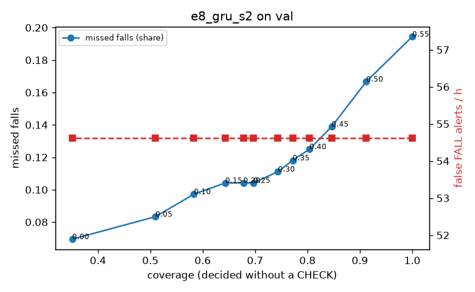

# Evaluation: e8_gru_s2 on val

Thresholds: t_high 0.55, t_low 0.35 (models\e8_gru_s2\thresholds.yaml). 589 clips, 144 falls, 1.00 h (0.75 h normal activity); 0 clips have no score rows (counted as silent). 95% intervals: bootstrap over clips.

## Systems

| System | Sensitivity (FALL) | Sensitivity (FALL or CHECK) | False FALL alerts / h | CHECK requests / h | Coverage | Median latency (s) | Alerts |
| --- | --- | --- | --- | --- | --- | --- | --- |
| e8_gru_s2 (one threshold) | 80.6% (72.3%–89.2%) | 80.6% (72.3%–89.2%) | 54.62 (41.01–70.27) | 0.00 (0.00–0.00) | 100.0% (100.0%–100.0%) | 1.93 (1.93–1.93) | 161 FALL, 0 CHECK |
| e8_gru_s2 (CHECK band) | 80.6% (72.3%–89.2%) | 88.2% (79.9%–96.6%) | 54.62 (41.01–70.27) | 75.93 (60.92–92.56) | 77.2% (72.6%–81.3%) | 1.93 (1.93–1.93) | 161 FALL, 76 CHECK |
| rule baseline (E0) | 68.8% (56.7%–80.6%) | 68.8% (56.7%–80.6%) | 167.86 (142.60–195.93) | 0.00 (0.00–0.00) | 100.0% (100.0%–100.0%) | 2.53 (2.33–2.77) | 226 FALL, 0 CHECK |

## Breakdown (e8_gru_s2 (CHECK band))

| Group | Value | Clips | Falls | Hours | Sens. (FALL) | Sens. (any) | False FALL / h | CHECK / h |
| --- | --- | --- | --- | --- | --- | --- | --- | --- |
| dataset | GMDCSA24 | 47 | 23 | 0.12 | 100.0% (100.0%–100.0%) | 100.0% (100.0%–100.0%) | 62.06 (14.47–116.47) | 105.91 (58.23–159.35) |
| dataset | caucafall | 8 | 4 | 0.03 | 100.0% (100.0%–100.0%) | 100.0% (100.0%–100.0%) | 74.07 (0.00–213.14) | 150.73 (40.39–245.64) |
| dataset | le2i | 15 | 11 | 0.04 | 100.0% (100.0%–100.0%) | 100.0% (100.0%–100.0%) | 0.00 (0.00–0.00) | 89.70 (24.83–160.53) |
| dataset | occu | 2 | 16 | 0.08 | 37.5% (37.5%–37.5%) | 37.5% (37.5%–37.5%) | 68.91 (66.43–71.58) | 25.19 (24.60–25.80) |
| dataset | of-syn | 517 | 90 | 0.73 | 80.0% (71.6%–87.9%) | 92.2% (86.2%–97.4%) | 54.91 (37.83–72.92) | 72.83 (56.31–90.73) |
| qc_pass | True | 589 | 144 | 1.00 | 80.6% (72.3%–89.2%) | 88.2% (79.9%–96.6%) | 54.62 (41.01–70.27) | 75.93 (60.92–92.56) |
| of-syn age | child | 72 | 13 | 0.10 | 84.6% (62.5%–100.0%) | 92.3% (72.7%–100.0%) | 84.29 (32.73–156.55) | 49.34 (9.87–88.81) |
| of-syn age | elderly | 184 | 25 | 0.26 | 72.0% (53.8%–88.9%) | 92.0% (81.0%–100.0%) | 71.49 (43.59–107.94) | 84.95 (54.06–119.70) |
| of-syn age | middle-aged | 61 | 12 | 0.09 | 75.0% (50.0%–100.0%) | 91.7% (71.4%–100.0%) | 29.00 (0.00–72.50) | 69.88 (23.29–128.12) |
| of-syn age | teen | 61 | 10 | 0.09 | 80.0% (50.0%–100.0%) | 90.0% (66.7%–100.0%) | 27.86 (0.00–71.05) | 81.53 (34.94–139.77) |
| of-syn age | toddler | 72 | 15 | 0.10 | 80.0% (58.3%–100.0%) | 86.7% (69.2%–100.0%) | 37.39 (0.00–82.89) | 59.21 (19.74–108.55) |
| of-syn age | young adult | 67 | 15 | 0.09 | 93.3% (77.8%–100.0%) | 100.0% (100.0%–100.0%) | 40.99 (0.00–90.43) | 74.23 (31.81–127.25) |
| of-syn BMI | normal | 135 | 19 | 0.19 | 84.2% (66.7%–100.0%) | 94.7% (83.3%–100.0%) | 49.00 (18.86–87.14) | 78.94 (42.10–121.04) |
| of-syn BMI | obese | 125 | 18 | 0.18 | 72.2% (50.0%–91.7%) | 83.3% (63.6%–100.0%) | 19.92 (0.00–45.22) | 68.21 (34.10–102.31) |
| of-syn BMI | overweight | 134 | 27 | 0.19 | 74.1% (56.5%–90.3%) | 88.9% (76.0%–100.0%) | 79.68 (43.98–123.87) | 84.83 (53.02–122.08) |
| of-syn BMI | underweight | 123 | 26 | 0.17 | 88.5% (75.0%–100.0%) | 100.0% (100.0%–100.0%) | 73.25 (30.88–122.01) | 57.76 (28.88–92.42) |

## Windows (4 classes)

Macro F1 0.721 over 12454 windows.

| true \ predicted | upright | falling | fallen | controlled_low |
| --- | --- | --- | --- | --- |
| upright | 4129 | 199 | 74 | 718 |
| falling | 112 | 951 | 29 | 83 |
| fallen | 22 | 296 | 931 | 313 |
| controlled_low | 441 | 278 | 371 | 3507 |

## Coverage–error curve

| CHECK band | t_low | Coverage | Missed falls | False FALL / h | CHECK / h |
| --- | --- | --- | --- | --- | --- |
| 0.00 | 0.55 | 100.0% | 19.4% | 54.62 | 0.00 |
| 0.05 | 0.50 | 91.2% | 16.7% | 54.62 | 24.98 |
| 0.10 | 0.45 | 84.6% | 13.9% | 54.62 | 45.96 |
| 0.15 | 0.40 | 80.4% | 12.5% | 54.62 | 61.94 |
| 0.20 | 0.35 | 77.2% | 11.8% | 54.62 | 75.93 |
| 0.25 | 0.30 | 74.4% | 11.1% | 54.62 | 88.92 |
| 0.30 | 0.25 | 69.7% | 10.4% | 54.62 | 113.89 |
| 0.35 | 0.20 | 67.7% | 10.4% | 54.62 | 125.88 |
| 0.40 | 0.15 | 64.3% | 10.4% | 54.62 | 148.86 |
| 0.45 | 0.10 | 58.3% | 9.7% | 54.62 | 193.81 |
| 0.50 | 0.05 | 51.0% | 8.3% | 54.62 | 261.75 |
| 0.55 | 0.00 | 35.1% | 6.9% | 54.62 | 512.51 |

Definitions: fall event = OmniFall `fall` segment; detected = alert from the segment start to 10 s after its end; false alert = alert matching no fall; normal-activity hours exclude [start − 2 s, end + 10 s]; FALL and ON FLOOR count as alarms, CHECK hands over to a person.
