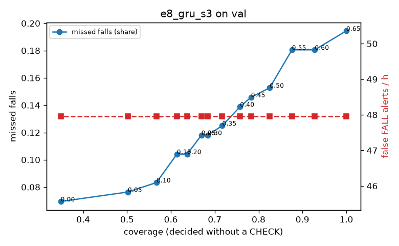

# Evaluation: e8_gru_s3 on val

Thresholds: t_high 0.65, t_low 0.3 (models\e8_gru_s3\thresholds.yaml). 589 clips, 144 falls, 1.00 h (0.75 h normal activity); 0 clips have no score rows (counted as silent). 95% intervals: bootstrap over clips.

## Systems

| System | Sensitivity (FALL) | Sensitivity (FALL or CHECK) | False FALL alerts / h | CHECK requests / h | Coverage | Median latency (s) | Alerts |
| --- | --- | --- | --- | --- | --- | --- | --- |
| e8_gru_s3 (one threshold) | 80.6% (72.6%–89.0%) | 80.6% (72.6%–89.0%) | 47.96 (34.39–63.60) | 0.00 (0.00–0.00) | 100.0% (100.0%–100.0%) | 1.93 (1.75–1.93) | 155 FALL, 0 CHECK |
| e8_gru_s3 (CHECK band) | 80.6% (72.6%–89.0%) | 88.2% (80.3%–96.4%) | 47.96 (34.39–63.60) | 121.88 (102.37–143.58) | 68.4% (63.7%–72.5%) | 1.93 (1.75–1.93) | 155 FALL, 122 CHECK |
| rule baseline (E0) | 68.8% (56.7%–80.6%) | 68.8% (56.7%–80.6%) | 167.86 (142.60–195.93) | 0.00 (0.00–0.00) | 100.0% (100.0%–100.0%) | 2.53 (2.33–2.77) | 226 FALL, 0 CHECK |

## Breakdown (e8_gru_s3 (CHECK band))

| Group | Value | Clips | Falls | Hours | Sens. (FALL) | Sens. (any) | False FALL / h | CHECK / h |
| --- | --- | --- | --- | --- | --- | --- | --- | --- |
| dataset | GMDCSA24 | 47 | 23 | 0.12 | 95.7% (85.7%–100.0%) | 95.7% (85.7%–100.0%) | 49.64 (11.98–99.97) | 203.68 (144.25–268.12) |
| dataset | caucafall | 8 | 4 | 0.03 | 100.0% (100.0%–100.0%) | 100.0% (100.0%–100.0%) | 74.07 (0.00–213.14) | 188.41 (79.29–274.91) |
| dataset | le2i | 15 | 11 | 0.04 | 100.0% (100.0%–100.0%) | 100.0% (100.0%–100.0%) | 0.00 (0.00–0.00) | 291.53 (214.27–375.75) |
| dataset | occu | 2 | 16 | 0.08 | 37.5% (37.5%–37.5%) | 37.5% (37.5%–37.5%) | 68.91 (66.43–71.58) | 50.37 (49.20–51.60) |
| dataset | of-syn | 517 | 90 | 0.73 | 81.1% (73.3%–88.9%) | 93.3% (88.0%–98.0%) | 48.25 (32.68–65.05) | 103.07 (81.08–125.06) |
| qc_pass | True | 589 | 144 | 1.00 | 80.6% (72.6%–89.0%) | 88.2% (80.3%–96.4%) | 47.96 (34.39–63.60) | 121.88 (102.37–143.58) |
| of-syn age | child | 72 | 13 | 0.10 | 92.3% (72.7%–100.0%) | 92.3% (72.7%–100.0%) | 72.25 (23.29–128.12) | 98.68 (49.34–157.88) |
| of-syn age | elderly | 184 | 25 | 0.26 | 72.0% (53.8%–88.9%) | 88.0% (75.0%–100.0%) | 49.15 (22.92–79.46) | 108.12 (73.36–146.73) |
| of-syn age | middle-aged | 61 | 12 | 0.09 | 91.7% (71.4%–100.0%) | 100.0% (100.0%–100.0%) | 29.00 (0.00–72.50) | 58.24 (11.65–104.82) |
| of-syn age | teen | 61 | 10 | 0.09 | 60.0% (27.3%–88.9%) | 100.0% (100.0%–100.0%) | 55.72 (12.92–111.49) | 163.06 (93.18–232.94) |
| of-syn age | toddler | 72 | 15 | 0.10 | 80.0% (58.3%–100.0%) | 93.3% (77.8%–100.0%) | 49.86 (11.84–103.13) | 98.68 (49.34–157.88) |
| of-syn age | young adult | 67 | 15 | 0.09 | 93.3% (77.8%–100.0%) | 93.3% (77.8%–100.0%) | 27.33 (0.00–69.65) | 84.83 (31.81–148.46) |
| of-syn BMI | normal | 135 | 19 | 0.19 | 89.5% (75.0%–100.0%) | 89.5% (75.0%–100.0%) | 30.62 (6.29–59.21) | 78.94 (42.10–121.04) |
| of-syn BMI | obese | 125 | 18 | 0.18 | 61.1% (38.5%–84.6%) | 83.3% (63.2%–100.0%) | 33.20 (6.70–61.50) | 113.68 (68.21–159.15) |
| of-syn BMI | overweight | 134 | 27 | 0.19 | 81.5% (65.7%–95.8%) | 96.3% (86.7%–100.0%) | 73.04 (36.23–114.85) | 132.55 (90.14–180.27) |
| of-syn BMI | underweight | 123 | 26 | 0.17 | 88.5% (75.0%–100.0%) | 100.0% (100.0%–100.0%) | 58.60 (21.97–101.52) | 86.64 (46.21–127.08) |

## Windows (4 classes)

Macro F1 0.726 over 12454 windows.

| true \ predicted | upright | falling | fallen | controlled_low |
| --- | --- | --- | --- | --- |
| upright | 4202 | 246 | 83 | 589 |
| falling | 98 | 972 | 19 | 86 |
| fallen | 33 | 276 | 963 | 290 |
| controlled_low | 589 | 323 | 291 | 3394 |

## Coverage–error curve

| CHECK band | t_low | Coverage | Missed falls | False FALL / h | CHECK / h |
| --- | --- | --- | --- | --- | --- |
| 0.00 | 0.65 | 100.0% | 19.4% | 47.96 | 0.00 |
| 0.05 | 0.60 | 92.8% | 18.1% | 47.96 | 20.98 |
| 0.10 | 0.55 | 87.6% | 18.1% | 47.96 | 39.96 |
| 0.15 | 0.50 | 82.5% | 15.3% | 47.96 | 55.95 |
| 0.20 | 0.45 | 78.3% | 14.6% | 47.96 | 73.93 |
| 0.25 | 0.40 | 75.8% | 13.9% | 47.96 | 84.92 |
| 0.30 | 0.35 | 71.7% | 12.5% | 47.96 | 103.90 |
| 0.35 | 0.30 | 68.4% | 11.8% | 47.96 | 121.88 |
| 0.40 | 0.25 | 67.0% | 11.8% | 47.96 | 130.87 |
| 0.45 | 0.20 | 63.7% | 10.4% | 47.96 | 149.86 |
| 0.50 | 0.15 | 61.4% | 10.4% | 47.96 | 166.84 |
| 0.55 | 0.10 | 56.7% | 8.3% | 47.96 | 199.81 |
| 0.60 | 0.05 | 50.2% | 7.6% | 47.96 | 262.75 |
| 0.65 | 0.00 | 34.9% | 6.9% | 47.96 | 506.52 |

Definitions: fall event = OmniFall `fall` segment; detected = alert from the segment start to 10 s after its end; false alert = alert matching no fall; normal-activity hours exclude [start − 2 s, end + 10 s]; FALL and ON FLOOR count as alarms, CHECK hands over to a person.
