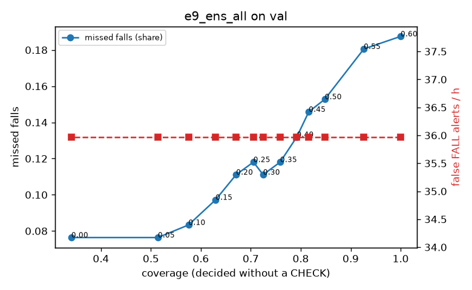

# Evaluation: e9_ens_all on val

Thresholds: t_high 0.6, t_low 0.35 (models\e9_ens_all\thresholds.yaml). 589 clips, 144 falls, 1.00 h (0.75 h normal activity); 0 clips have no score rows (counted as silent). 95% intervals: bootstrap over clips.

## Systems

| System | Sensitivity (FALL) | Sensitivity (FALL or CHECK) | False FALL alerts / h | CHECK requests / h | Coverage | Median latency (s) | Alerts |
| --- | --- | --- | --- | --- | --- | --- | --- |
| e9_ens_all (one threshold) | 81.2% (73.3%–89.9%) | 81.2% (73.3%–89.9%) | 35.97 (24.16–50.13) | 0.00 (0.00–0.00) | 100.0% (100.0%–100.0%) | 1.93 (1.93–1.93) | 146 FALL, 0 CHECK |
| e9_ens_all (CHECK band) | 81.2% (73.3%–89.9%) | 88.2% (80.1%–96.4%) | 35.97 (24.16–50.13) | 78.92 (62.74–95.73) | 75.9% (71.1%–80.3%) | 1.93 (1.93–1.93) | 146 FALL, 79 CHECK |
| rule baseline (E0) | 68.8% (56.7%–80.6%) | 68.8% (56.7%–80.6%) | 167.86 (142.60–195.93) | 0.00 (0.00–0.00) | 100.0% (100.0%–100.0%) | 2.53 (2.33–2.77) | 226 FALL, 0 CHECK |

## Breakdown (e9_ens_all (CHECK band))

| Group | Value | Clips | Falls | Hours | Sens. (FALL) | Sens. (any) | False FALL / h | CHECK / h |
| --- | --- | --- | --- | --- | --- | --- | --- | --- |
| dataset | GMDCSA24 | 47 | 23 | 0.12 | 95.7% (85.7%–100.0%) | 100.0% (100.0%–100.0%) | 24.82 (0.00–64.17) | 138.50 (85.21–202.25) |
| dataset | caucafall | 8 | 4 | 0.03 | 100.0% (100.0%–100.0%) | 100.0% (100.0%–100.0%) | 148.14 (0.00–283.19) | 113.05 (37.97–208.63) |
| dataset | le2i | 15 | 11 | 0.04 | 100.0% (100.0%–100.0%) | 100.0% (100.0%–100.0%) | 0.00 (0.00–0.00) | 156.98 (77.51–243.13) |
| dataset | occu | 2 | 16 | 0.08 | 37.5% (37.5%–37.5%) | 37.5% (37.5%–37.5%) | 68.91 (66.43–71.58) | 25.19 (24.60–25.80) |
| dataset | of-syn | 517 | 90 | 0.73 | 82.2% (74.1%–90.0%) | 92.2% (86.2%–97.7%) | 34.94 (21.89–49.45) | 68.71 (52.22–86.58) |
| qc_pass | True | 589 | 144 | 1.00 | 81.2% (73.3%–89.9%) | 88.2% (80.1%–96.4%) | 35.97 (24.16–50.13) | 78.92 (62.74–95.73) |
| of-syn age | child | 72 | 13 | 0.10 | 84.6% (62.5%–100.0%) | 92.3% (72.7%–100.0%) | 48.17 (11.45–98.04) | 88.81 (39.47–148.02) |
| of-syn age | elderly | 184 | 25 | 0.26 | 76.0% (59.1%–90.9%) | 84.0% (68.9%–96.2%) | 35.75 (13.75–62.56) | 61.78 (34.75–92.67) |
| of-syn age | middle-aged | 61 | 12 | 0.09 | 91.7% (71.4%–100.0%) | 91.7% (71.4%–100.0%) | 29.00 (0.00–72.50) | 69.88 (23.29–128.12) |
| of-syn age | teen | 61 | 10 | 0.09 | 70.0% (40.0%–100.0%) | 100.0% (100.0%–100.0%) | 41.79 (0.00–93.84) | 69.88 (23.29–128.41) |
| of-syn age | toddler | 72 | 15 | 0.10 | 80.0% (58.3%–100.0%) | 93.3% (77.8%–100.0%) | 24.93 (0.00–65.79) | 69.07 (29.60–118.41) |
| of-syn age | young adult | 67 | 15 | 0.09 | 93.3% (77.8%–100.0%) | 100.0% (100.0%–100.0%) | 27.33 (0.00–69.65) | 63.63 (21.21–116.65) |
| of-syn BMI | normal | 135 | 19 | 0.19 | 89.5% (75.0%–100.0%) | 94.7% (83.3%–100.0%) | 24.50 (5.97–53.31) | 52.63 (21.05–84.20) |
| of-syn BMI | obese | 125 | 18 | 0.18 | 66.7% (44.4%–87.0%) | 77.8% (56.5%–95.2%) | 19.92 (0.00–45.22) | 62.52 (28.42–96.63) |
| of-syn BMI | overweight | 134 | 27 | 0.19 | 77.8% (62.1%–92.9%) | 96.3% (86.7%–100.0%) | 46.48 (18.12–78.96) | 106.04 (63.63–153.76) |
| of-syn BMI | underweight | 123 | 26 | 0.17 | 92.3% (80.0%–100.0%) | 96.2% (88.0%–100.0%) | 51.27 (14.96–90.70) | 51.99 (23.11–86.64) |

## Windows (4 classes)

Macro F1 0.745 over 12454 windows.

| true \ predicted | upright | falling | fallen | controlled_low |
| --- | --- | --- | --- | --- |
| upright | 4144 | 181 | 59 | 736 |
| falling | 104 | 969 | 21 | 81 |
| fallen | 22 | 229 | 917 | 394 |
| controlled_low | 434 | 206 | 241 | 3716 |

## Coverage–error curve

| CHECK band | t_low | Coverage | Missed falls | False FALL / h | CHECK / h |
| --- | --- | --- | --- | --- | --- |
| 0.00 | 0.60 | 100.0% | 18.8% | 35.97 | 0.00 |
| 0.05 | 0.55 | 92.6% | 18.1% | 35.97 | 21.98 |
| 0.10 | 0.50 | 84.8% | 15.3% | 35.97 | 45.96 |
| 0.15 | 0.45 | 81.6% | 14.6% | 35.97 | 57.94 |
| 0.20 | 0.40 | 79.2% | 13.2% | 35.97 | 65.94 |
| 0.25 | 0.35 | 75.9% | 11.8% | 35.97 | 78.92 |
| 0.30 | 0.30 | 72.5% | 11.1% | 35.97 | 94.91 |
| 0.35 | 0.25 | 70.5% | 11.8% | 35.97 | 106.90 |
| 0.40 | 0.20 | 67.1% | 11.1% | 35.97 | 125.88 |
| 0.45 | 0.15 | 63.0% | 9.7% | 35.97 | 149.86 |
| 0.50 | 0.10 | 57.5% | 8.3% | 35.97 | 187.82 |
| 0.55 | 0.05 | 51.4% | 7.6% | 35.97 | 242.77 |
| 0.60 | 0.00 | 34.1% | 7.6% | 35.97 | 513.51 |

Definitions: fall event = OmniFall `fall` segment; detected = alert from the segment start to 10 s after its end; false alert = alert matching no fall; normal-activity hours exclude [start − 2 s, end + 10 s]; FALL and ON FLOOR count as alarms, CHECK hands over to a person.
