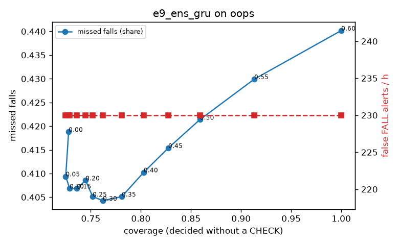

# Evaluation: e9_ens_gru on oops

Thresholds: t_high 0.6, t_low 0.3 (models\e9_ens_gru\thresholds.yaml). 818 clips, 1170 falls, 2.65 h (0.89 h normal activity); 6 clips have no score rows (counted as silent). 95% intervals: bootstrap over clips.

## Systems

| System | Sensitivity (FALL) | Sensitivity (FALL or CHECK) | False FALL alerts / h | CHECK requests / h | Coverage | Median latency (s) | Alerts |
| --- | --- | --- | --- | --- | --- | --- | --- |
| e9_ens_gru (one threshold) | 56.0% (52.7%–59.8%) | 56.0% (52.7%–59.8%) | 229.95 (201.93–258.94) | 0.00 (0.00–0.00) | 100.0% (100.0%–100.0%) | 0.60 (0.55–0.66) | 714 FALL, 0 CHECK |
| e9_ens_gru (CHECK band) | 56.0% (52.7%–59.8%) | 59.6% (56.3%–63.4%) | 229.95 (201.93–258.94) | 201.30 (188.57–214.69) | 76.2% (74.9%–77.6%) | 0.60 (0.55–0.66) | 714 FALL, 533 CHECK |
| rule baseline (E0) | 18.5% (15.6%–21.6%) | 18.5% (15.6%–21.6%) | 34.94 (23.00–47.10) | 0.00 (0.00–0.00) | 100.0% (100.0%–100.0%) | 2.94 (2.74–3.29) | 181 FALL, 0 CHECK |

## Breakdown (e9_ens_gru (CHECK band))

| Group | Value | Clips | Falls | Hours | Sens. (FALL) | Sens. (any) | False FALL / h | CHECK / h |
| --- | --- | --- | --- | --- | --- | --- | --- | --- |
| dataset | OOPS | 818 | 1170 | 2.65 | 56.0% (52.7%–59.8%) | 59.6% (56.3%–63.4%) | 229.95 (201.93–258.94) | 201.30 (188.57–214.69) |
| qc_pass | False | 199 | 295 | 0.69 | 51.2% (44.9%–57.3%) | 56.3% (49.7%–62.2%) | 232.56 (179.00–295.16) | 184.64 (161.94–211.11) |
| qc_pass | True | 619 | 875 | 1.96 | 57.6% (53.4%–62.1%) | 60.7% (56.4%–65.0%) | 229.10 (200.59–262.97) | 207.14 (192.97–222.77) |

## Windows (4 classes)

Macro F1 0.427 over 38872 windows.

| true \ predicted | upright | falling | fallen | controlled_low |
| --- | --- | --- | --- | --- |
| upright | 12145 | 3456 | 1468 | 4102 |
| falling | 1726 | 6313 | 380 | 1487 |
| fallen | 464 | 1450 | 487 | 1022 |
| controlled_low | 1077 | 1007 | 270 | 2018 |

## Coverage–error curve

| CHECK band | t_low | Coverage | Missed falls | False FALL / h | CHECK / h |
| --- | --- | --- | --- | --- | --- |
| 0.00 | 0.60 | 100.0% | 44.0% | 229.95 | 0.00 |
| 0.05 | 0.55 | 91.3% | 43.0% | 229.95 | 62.69 |
| 0.10 | 0.50 | 85.9% | 42.1% | 229.95 | 107.26 |
| 0.15 | 0.45 | 82.7% | 41.5% | 229.95 | 135.21 |
| 0.20 | 0.40 | 80.3% | 41.0% | 229.95 | 158.24 |
| 0.25 | 0.35 | 78.1% | 40.5% | 229.95 | 179.77 |
| 0.30 | 0.30 | 76.2% | 40.4% | 229.95 | 201.30 |
| 0.35 | 0.25 | 75.2% | 40.5% | 229.95 | 214.14 |
| 0.40 | 0.20 | 74.5% | 40.9% | 229.95 | 225.09 |
| 0.45 | 0.15 | 73.6% | 40.7% | 229.95 | 234.91 |
| 0.50 | 0.10 | 72.9% | 40.7% | 229.95 | 244.35 |
| 0.55 | 0.05 | 72.5% | 40.9% | 229.95 | 251.15 |
| 0.60 | 0.00 | 72.8% | 41.9% | 229.95 | 253.04 |

Definitions: fall event = OmniFall `fall` segment; detected = alert from the segment start to 10 s after its end; false alert = alert matching no fall; normal-activity hours exclude [start − 2 s, end + 10 s]; FALL and ON FLOOR count as alarms, CHECK hands over to a person.
