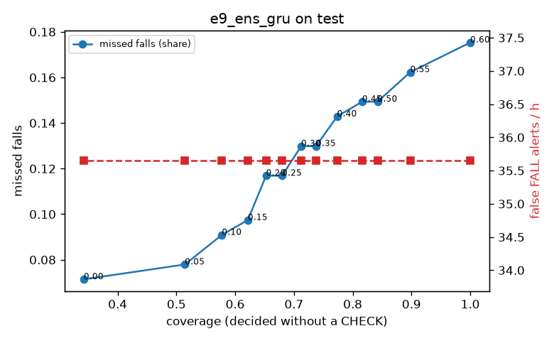

# Evaluation: e9_ens_gru on test

Thresholds: t_high 0.6, t_low 0.3 (models\e9_ens_gru\thresholds.yaml). 635 clips, 154 falls, 1.17 h (0.90 h normal activity); 1 clips have no score rows (counted as silent). 95% intervals: bootstrap over clips.

## Systems

| System | Sensitivity (FALL) | Sensitivity (FALL or CHECK) | False FALL alerts / h | CHECK requests / h | Coverage | Median latency (s) | Alerts |
| --- | --- | --- | --- | --- | --- | --- | --- |
| e9_ens_gru (one threshold) | 82.5% (74.7%–89.3%) | 82.5% (74.7%–89.3%) | 35.65 (24.89–48.19) | 0.00 (0.00–0.00) | 100.0% (100.0%–100.0%) | 1.93 (1.67–1.93) | 165 FALL, 0 CHECK |
| e9_ens_gru (CHECK band) | 82.5% (74.7%–89.3%) | 87.0% (79.4%–93.7%) | 35.65 (24.89–48.19) | 101.84 (83.04–121.26) | 71.2% (66.6%–75.7%) | 1.93 (1.67–1.93) | 165 FALL, 119 CHECK |
| rule baseline (E0) | 59.1% (48.0%–69.4%) | 59.1% (48.0%–69.4%) | 173.77 (147.13–200.24) | 0.00 (0.00–0.00) | 100.0% (100.0%–100.0%) | 2.53 (2.22–2.73) | 247 FALL, 0 CHECK |

## Breakdown (e9_ens_gru (CHECK band))

| Group | Value | Clips | Falls | Hours | Sens. (FALL) | Sens. (any) | False FALL / h | CHECK / h |
| --- | --- | --- | --- | --- | --- | --- | --- | --- |
| dataset | GMDCSA24 | 37 | 17 | 0.08 | 88.2% (72.2%–100.0%) | 94.1% (81.8%–100.0%) | 18.41 (0.00–62.73) | 186.77 (116.04–272.14) |
| dataset | caucafall | 19 | 9 | 0.06 | 88.9% (63.6%–100.0%) | 88.9% (63.6%–100.0%) | 32.17 (0.00–103.57) | 180.42 (107.39–259.79) |
| dataset | le2i | 38 | 22 | 0.17 | 95.5% (84.2%–100.0%) | 95.5% (84.2%–100.0%) | 30.16 (7.12–55.34) | 116.35 (84.39–159.17) |
| dataset | occu | 2 | 16 | 0.10 | 50.0% (37.5%–62.5%) | 50.0% (37.5%–62.5%) | 22.03 (0.00–39.59) | 19.55 (18.49–20.75) |
| dataset | of-syn | 539 | 90 | 0.76 | 83.3% (75.6%–90.9%) | 90.0% (83.3%–95.5%) | 39.42 (24.97–56.97) | 94.91 (76.42–116.00) |
| qc_pass | False | 15 | 7 | 0.04 | 71.4% (33.3%–100.0%) | 71.4% (33.3%–100.0%) | 96.00 (0.00–215.27) | 164.88 (66.73–296.76) |
| qc_pass | True | 620 | 147 | 1.13 | 83.0% (75.2%–90.4%) | 87.8% (80.1%–94.7%) | 34.21 (22.90–45.27) | 99.81 (82.19–118.29) |
| of-syn age | child | 71 | 10 | 0.10 | 90.0% (66.7%–100.0%) | 90.0% (66.7%–100.0%) | 69.87 (22.20–127.86) | 80.05 (30.02–140.09) |
| of-syn age | elderly | 202 | 31 | 0.28 | 93.5% (84.0%–100.0%) | 96.8% (89.7%–100.0%) | 24.93 (8.17–46.53) | 94.97 (66.74–130.14) |
| of-syn age | middle-aged | 71 | 15 | 0.10 | 73.3% (50.0%–93.3%) | 73.3% (50.0%–93.3%) | 25.37 (0.00–64.62) | 50.03 (10.01–100.07) |
| of-syn age | teen | 67 | 8 | 0.09 | 87.5% (57.1%–100.0%) | 100.0% (100.0%–100.0%) | 36.13 (0.00–82.89) | 84.83 (31.81–138.12) |
| of-syn age | toddler | 60 | 17 | 0.08 | 70.6% (46.2%–92.9%) | 94.1% (80.0%–100.0%) | 48.44 (0.00–110.52) | 165.78 (82.89–236.83) |
| of-syn age | young adult | 68 | 9 | 0.10 | 77.8% (46.1%–100.0%) | 77.8% (46.1%–100.0%) | 59.58 (21.54–110.98) | 104.48 (52.24–167.17) |
| of-syn BMI | normal | 145 | 28 | 0.20 | 78.6% (61.9%–92.9%) | 85.7% (71.4%–96.7%) | 24.23 (5.67–49.91) | 102.90 (63.70–147.00) |
| of-syn BMI | obese | 131 | 24 | 0.18 | 91.7% (78.9%–100.0%) | 91.7% (78.9%–100.0%) | 32.89 (6.70–60.89) | 103.05 (65.08–146.43) |
| of-syn BMI | overweight | 128 | 21 | 0.18 | 85.7% (68.4%–100.0%) | 95.2% (85.0%–100.0%) | 53.12 (19.38–91.25) | 88.81 (49.96–133.21) |
| of-syn BMI | underweight | 135 | 17 | 0.19 | 76.5% (54.5%–94.4%) | 88.2% (70.0%–100.0%) | 48.03 (18.64–80.34) | 84.20 (47.37–126.31) |

## Windows (4 classes)

Macro F1 0.747 over 14673 windows.

| true \ predicted | upright | falling | fallen | controlled_low |
| --- | --- | --- | --- | --- |
| upright | 4827 | 251 | 82 | 828 |
| falling | 100 | 945 | 59 | 120 |
| fallen | 56 | 253 | 924 | 247 |
| controlled_low | 410 | 252 | 240 | 5079 |

## Coverage–error curve

| CHECK band | t_low | Coverage | Missed falls | False FALL / h | CHECK / h |
| --- | --- | --- | --- | --- | --- |
| 0.00 | 0.60 | 100.0% | 17.5% | 35.65 | 0.00 |
| 0.05 | 0.55 | 89.8% | 16.2% | 35.65 | 29.10 |
| 0.10 | 0.50 | 84.2% | 14.9% | 35.65 | 47.07 |
| 0.15 | 0.45 | 81.6% | 14.9% | 35.65 | 57.34 |
| 0.20 | 0.40 | 77.3% | 14.3% | 35.65 | 74.45 |
| 0.25 | 0.35 | 73.8% | 13.0% | 35.65 | 89.00 |
| 0.30 | 0.30 | 71.2% | 13.0% | 35.65 | 101.84 |
| 0.35 | 0.25 | 68.0% | 11.7% | 35.65 | 117.24 |
| 0.40 | 0.20 | 65.3% | 11.7% | 35.65 | 133.50 |
| 0.45 | 0.15 | 62.1% | 9.7% | 35.65 | 149.76 |
| 0.50 | 0.10 | 57.7% | 9.1% | 35.65 | 180.57 |
| 0.55 | 0.05 | 51.4% | 7.8% | 35.65 | 232.77 |
| 0.60 | 0.00 | 34.2% | 7.1% | 35.65 | 484.36 |

Definitions: fall event = OmniFall `fall` segment; detected = alert from the segment start to 10 s after its end; false alert = alert matching no fall; normal-activity hours exclude [start − 2 s, end + 10 s]; FALL and ON FLOOR count as alarms, CHECK hands over to a person.
