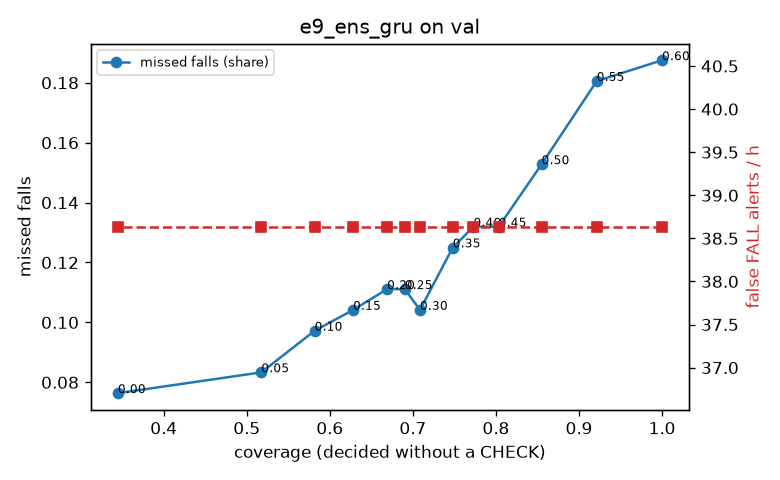

# Evaluation: e9_ens_gru on val

Thresholds: t_high 0.6, t_low 0.3 (models\e9_ens_gru\thresholds.yaml). 589 clips, 144 falls, 1.00 h (0.75 h normal activity); 0 clips have no score rows (counted as silent). 95% intervals: bootstrap over clips.

## Systems

| System | Sensitivity (FALL) | Sensitivity (FALL or CHECK) | False FALL alerts / h | CHECK requests / h | Coverage | Median latency (s) | Alerts |
| --- | --- | --- | --- | --- | --- | --- | --- |
| e9_ens_gru (one threshold) | 81.2% (73.3%–89.4%) | 81.2% (73.3%–89.4%) | 38.64 (26.75–53.62) | 0.00 (0.00–0.00) | 100.0% (100.0%–100.0%) | 1.93 (1.93–1.93) | 150 FALL, 0 CHECK |
| e9_ens_gru (CHECK band) | 81.2% (73.3%–89.4%) | 89.6% (81.0%–97.7%) | 38.64 (26.75–53.62) | 103.90 (85.89–123.95) | 70.9% (66.1%–75.4%) | 1.93 (1.93–1.93) | 150 FALL, 104 CHECK |
| rule baseline (E0) | 68.8% (56.7%–80.6%) | 68.8% (56.7%–80.6%) | 167.86 (142.60–195.93) | 0.00 (0.00–0.00) | 100.0% (100.0%–100.0%) | 2.53 (2.33–2.77) | 226 FALL, 0 CHECK |

## Breakdown (e9_ens_gru (CHECK band))

| Group | Value | Clips | Falls | Hours | Sens. (FALL) | Sens. (any) | False FALL / h | CHECK / h |
| --- | --- | --- | --- | --- | --- | --- | --- | --- |
| dataset | GMDCSA24 | 47 | 23 | 0.12 | 95.7% (85.7%–100.0%) | 100.0% (100.0%–100.0%) | 24.82 (0.00–64.17) | 179.24 (124.65–240.36) |
| dataset | caucafall | 8 | 4 | 0.03 | 100.0% (100.0%–100.0%) | 100.0% (100.0%–100.0%) | 74.07 (0.00–213.14) | 263.78 (191.76–313.72) |
| dataset | le2i | 15 | 11 | 0.04 | 100.0% (100.0%–100.0%) | 100.0% (100.0%–100.0%) | 0.00 (0.00–0.00) | 156.98 (73.36–251.58) |
| dataset | occu | 2 | 16 | 0.08 | 37.5% (37.5%–37.5%) | 37.5% (37.5%–37.5%) | 68.91 (66.43–71.58) | 37.78 (25.80–49.20) |
| dataset | of-syn | 517 | 90 | 0.73 | 82.2% (74.4%–89.5%) | 94.4% (89.3%–98.9%) | 39.93 (26.56–55.17) | 89.33 (68.71–109.94) |
| qc_pass | True | 589 | 144 | 1.00 | 81.2% (73.3%–89.4%) | 89.6% (81.0%–97.7%) | 38.64 (26.75–53.62) | 103.90 (85.89–123.95) |
| of-syn age | child | 72 | 13 | 0.10 | 92.3% (72.7%–100.0%) | 92.3% (72.7%–100.0%) | 60.21 (12.46–114.64) | 69.07 (29.36–118.41) |
| of-syn age | elderly | 184 | 25 | 0.26 | 76.0% (59.1%–90.9%) | 92.0% (81.0%–100.0%) | 44.68 (21.79–74.79) | 96.53 (65.64–131.28) |
| of-syn age | middle-aged | 61 | 12 | 0.09 | 91.7% (71.4%–100.0%) | 91.7% (71.4%–100.0%) | 29.00 (0.00–72.50) | 69.88 (23.29–128.12) |
| of-syn age | teen | 61 | 10 | 0.09 | 60.0% (27.3%–88.9%) | 100.0% (100.0%–100.0%) | 27.86 (0.00–71.05) | 128.12 (69.88–198.00) |
| of-syn age | toddler | 72 | 15 | 0.10 | 80.0% (58.8%–100.0%) | 93.3% (77.8%–100.0%) | 37.39 (0.00–81.98) | 88.81 (39.47–148.02) |
| of-syn age | young adult | 67 | 15 | 0.09 | 93.3% (77.8%–100.0%) | 100.0% (100.0%–100.0%) | 27.33 (0.00–69.65) | 74.23 (31.81–127.25) |
| of-syn BMI | normal | 135 | 19 | 0.19 | 89.5% (75.0%–100.0%) | 94.7% (83.3%–100.0%) | 24.50 (5.97–49.87) | 84.20 (47.37–126.31) |
| of-syn BMI | obese | 125 | 18 | 0.18 | 61.1% (38.4%–85.0%) | 83.3% (63.6%–100.0%) | 33.20 (6.64–60.90) | 96.63 (56.84–136.55) |
| of-syn BMI | overweight | 134 | 27 | 0.19 | 81.5% (65.7%–95.8%) | 96.3% (86.7%–100.0%) | 53.12 (20.90–90.42) | 116.65 (74.23–164.36) |
| of-syn BMI | underweight | 123 | 26 | 0.17 | 92.3% (80.0%–100.0%) | 100.0% (100.0%–100.0%) | 51.27 (14.96–90.70) | 57.76 (28.88–92.42) |

## Windows (4 classes)

Macro F1 0.738 over 12454 windows.

| true \ predicted | upright | falling | fallen | controlled_low |
| --- | --- | --- | --- | --- |
| upright | 4121 | 151 | 66 | 782 |
| falling | 109 | 952 | 20 | 94 |
| fallen | 31 | 247 | 894 | 390 |
| controlled_low | 444 | 224 | 228 | 3701 |

## Coverage–error curve

| CHECK band | t_low | Coverage | Missed falls | False FALL / h | CHECK / h |
| --- | --- | --- | --- | --- | --- |
| 0.00 | 0.60 | 100.0% | 18.8% | 38.64 | 0.00 |
| 0.05 | 0.55 | 92.1% | 18.1% | 38.64 | 23.98 |
| 0.10 | 0.50 | 85.5% | 15.3% | 38.64 | 43.96 |
| 0.15 | 0.45 | 80.3% | 13.2% | 38.64 | 61.94 |
| 0.20 | 0.40 | 77.3% | 13.2% | 38.64 | 75.93 |
| 0.25 | 0.35 | 74.8% | 12.5% | 38.64 | 86.92 |
| 0.30 | 0.30 | 70.9% | 10.4% | 38.64 | 103.90 |
| 0.35 | 0.25 | 69.0% | 11.1% | 38.64 | 115.89 |
| 0.40 | 0.20 | 66.9% | 11.1% | 38.64 | 128.88 |
| 0.45 | 0.15 | 62.8% | 10.4% | 38.64 | 154.85 |
| 0.50 | 0.10 | 58.2% | 9.7% | 38.64 | 188.82 |
| 0.55 | 0.05 | 51.8% | 8.3% | 38.64 | 244.77 |
| 0.60 | 0.00 | 34.5% | 7.6% | 38.64 | 511.51 |

Definitions: fall event = OmniFall `fall` segment; detected = alert from the segment start to 10 s after its end; false alert = alert matching no fall; normal-activity hours exclude [start − 2 s, end + 10 s]; FALL and ON FLOOR count as alarms, CHECK hands over to a person.
