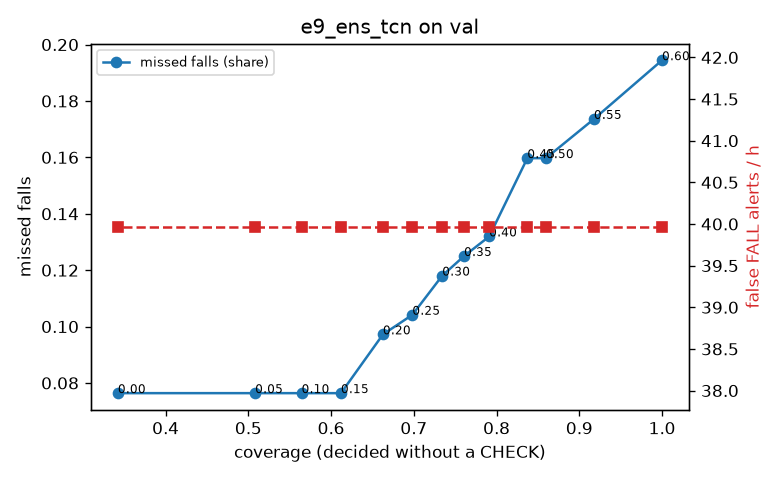

# Evaluation: e9_ens_tcn on val

Thresholds: t_high 0.6, t_low 0.3 (models\e9_ens_tcn\thresholds.yaml). 589 clips, 144 falls, 1.00 h (0.75 h normal activity); 0 clips have no score rows (counted as silent). 95% intervals: bootstrap over clips.

## Systems

| System | Sensitivity (FALL) | Sensitivity (FALL or CHECK) | False FALL alerts / h | CHECK requests / h | Coverage | Median latency (s) | Alerts |
| --- | --- | --- | --- | --- | --- | --- | --- |
| e9_ens_tcn (one threshold) | 80.6% (72.3%–89.3%) | 80.6% (72.3%–89.3%) | 39.97 (27.06–54.28) | 0.00 (0.00–0.00) | 100.0% (100.0%–100.0%) | 1.93 (1.93–1.93) | 149 FALL, 0 CHECK |
| e9_ens_tcn (CHECK band) | 80.6% (72.3%–89.3%) | 88.2% (80.1%–96.6%) | 39.97 (27.06–54.28) | 90.91 (75.02–109.54) | 73.4% (68.5%–77.7%) | 1.93 (1.93–1.93) | 149 FALL, 91 CHECK |
| rule baseline (E0) | 68.8% (56.7%–80.6%) | 68.8% (56.7%–80.6%) | 167.86 (142.60–195.93) | 0.00 (0.00–0.00) | 100.0% (100.0%–100.0%) | 2.53 (2.33–2.77) | 226 FALL, 0 CHECK |

## Breakdown (e9_ens_tcn (CHECK band))

| Group | Value | Clips | Falls | Hours | Sens. (FALL) | Sens. (any) | False FALL / h | CHECK / h |
| --- | --- | --- | --- | --- | --- | --- | --- | --- |
| dataset | GMDCSA24 | 47 | 23 | 0.12 | 95.7% (85.7%–100.0%) | 95.7% (85.7%–100.0%) | 49.64 (11.14–99.27) | 146.65 (93.11–209.07) |
| dataset | caucafall | 8 | 4 | 0.03 | 100.0% (100.0%–100.0%) | 100.0% (100.0%–100.0%) | 148.14 (0.00–283.19) | 150.73 (39.74–246.79) |
| dataset | le2i | 15 | 11 | 0.04 | 100.0% (100.0%–100.0%) | 100.0% (100.0%–100.0%) | 0.00 (0.00–0.00) | 134.55 (53.94–211.60) |
| dataset | occu | 2 | 16 | 0.08 | 37.5% (37.5%–37.5%) | 37.5% (37.5%–37.5%) | 68.91 (66.43–71.58) | 37.78 (25.80–49.20) |
| dataset | of-syn | 517 | 90 | 0.73 | 81.1% (73.0%–88.8%) | 93.3% (87.9%–98.0%) | 36.61 (22.81–51.46) | 82.45 (64.59–101.69) |
| qc_pass | True | 589 | 144 | 1.00 | 80.6% (72.3%–89.3%) | 88.2% (80.1%–96.6%) | 39.97 (27.06–54.28) | 90.91 (75.02–109.54) |
| of-syn age | child | 72 | 13 | 0.10 | 84.6% (62.5%–100.0%) | 92.3% (72.7%–100.0%) | 60.21 (12.46–114.18) | 98.68 (49.34–157.88) |
| of-syn age | elderly | 184 | 25 | 0.26 | 72.0% (54.5%–87.5%) | 84.0% (68.4%–96.4%) | 44.68 (21.79–74.36) | 81.09 (53.96–119.70) |
| of-syn age | middle-aged | 61 | 12 | 0.09 | 91.7% (71.4%–100.0%) | 91.7% (71.4%–100.0%) | 14.50 (0.00–45.35) | 58.24 (11.65–104.82) |
| of-syn age | teen | 61 | 10 | 0.09 | 70.0% (40.0%–100.0%) | 100.0% (100.0%–100.0%) | 13.93 (0.00–45.35) | 93.18 (34.94–163.06) |
| of-syn age | toddler | 72 | 15 | 0.10 | 80.0% (58.3%–100.0%) | 100.0% (100.0%–100.0%) | 24.93 (0.00–65.79) | 88.81 (39.47–148.02) |
| of-syn age | young adult | 67 | 15 | 0.09 | 93.3% (77.8%–100.0%) | 100.0% (100.0%–100.0%) | 40.99 (0.00–90.43) | 74.23 (31.81–127.25) |
| of-syn BMI | normal | 135 | 19 | 0.19 | 89.5% (75.0%–100.0%) | 100.0% (100.0%–100.0%) | 30.62 (6.29–60.72) | 57.89 (26.31–89.47) |
| of-syn BMI | obese | 125 | 18 | 0.18 | 66.7% (44.4%–87.0%) | 77.8% (56.5%–95.2%) | 13.28 (0.00–33.84) | 96.63 (56.84–136.41) |
| of-syn BMI | overweight | 134 | 27 | 0.19 | 77.8% (62.1%–92.9%) | 92.6% (81.5%–100.0%) | 66.40 (31.11–104.71) | 95.44 (58.32–137.85) |
| of-syn BMI | underweight | 123 | 26 | 0.17 | 88.5% (75.0%–100.0%) | 100.0% (100.0%–100.0%) | 36.62 (7.25–71.05) | 80.87 (40.43–121.30) |

## Windows (4 classes)

Macro F1 0.742 over 12454 windows.

| true \ predicted | upright | falling | fallen | controlled_low |
| --- | --- | --- | --- | --- |
| upright | 4131 | 210 | 69 | 710 |
| falling | 97 | 966 | 35 | 77 |
| fallen | 9 | 223 | 945 | 385 |
| controlled_low | 427 | 220 | 273 | 3677 |

## Coverage–error curve

| CHECK band | t_low | Coverage | Missed falls | False FALL / h | CHECK / h |
| --- | --- | --- | --- | --- | --- |
| 0.00 | 0.60 | 100.0% | 19.4% | 39.97 | 0.00 |
| 0.05 | 0.55 | 91.8% | 17.4% | 39.97 | 22.98 |
| 0.10 | 0.50 | 86.0% | 16.0% | 39.97 | 41.96 |
| 0.15 | 0.45 | 83.7% | 16.0% | 39.97 | 50.95 |
| 0.20 | 0.40 | 79.1% | 13.2% | 39.97 | 65.94 |
| 0.25 | 0.35 | 76.1% | 12.5% | 39.97 | 78.92 |
| 0.30 | 0.30 | 73.4% | 11.8% | 39.97 | 90.91 |
| 0.35 | 0.25 | 69.8% | 10.4% | 39.97 | 107.90 |
| 0.40 | 0.20 | 66.3% | 9.7% | 39.97 | 127.88 |
| 0.45 | 0.15 | 61.2% | 7.6% | 39.97 | 157.85 |
| 0.50 | 0.10 | 56.4% | 7.6% | 39.97 | 195.81 |
| 0.55 | 0.05 | 50.8% | 7.6% | 39.97 | 249.76 |
| 0.60 | 0.00 | 34.2% | 7.6% | 39.97 | 512.51 |

Definitions: fall event = OmniFall `fall` segment; detected = alert from the segment start to 10 s after its end; false alert = alert matching no fall; normal-activity hours exclude [start − 2 s, end + 10 s]; FALL and ON FLOOR count as alarms, CHECK hands over to a person.
