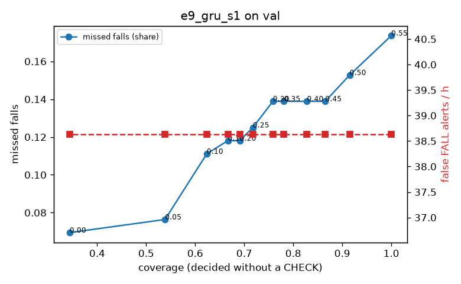

# Evaluation: e9_gru_s1 on val

Thresholds: t_high 0.55, t_low 0.2 (models\e9_gru_s1\thresholds.yaml). 589 clips, 144 falls, 1.00 h (0.75 h normal activity); 0 clips have no score rows (counted as silent). 95% intervals: bootstrap over clips.

## Systems

| System | Sensitivity (FALL) | Sensitivity (FALL or CHECK) | False FALL alerts / h | CHECK requests / h | Coverage | Median latency (s) | Alerts |
| --- | --- | --- | --- | --- | --- | --- | --- |
| e9_gru_s1 (one threshold) | 82.6% (74.5%–91.0%) | 82.6% (74.5%–91.0%) | 38.64 (26.84–52.35) | 0.00 (0.00–0.00) | 100.0% (100.0%–100.0%) | 1.93 (1.93–1.93) | 150 FALL, 0 CHECK |
| e9_gru_s1 (CHECK band) | 82.6% (74.5%–91.0%) | 88.2% (80.1%–96.4%) | 38.64 (26.84–52.35) | 119.89 (101.21–140.23) | 69.1% (64.7%–73.1%) | 1.93 (1.93–1.93) | 150 FALL, 120 CHECK |
| rule baseline (E0) | 68.8% (56.7%–80.6%) | 68.8% (56.7%–80.6%) | 167.86 (142.60–195.93) | 0.00 (0.00–0.00) | 100.0% (100.0%–100.0%) | 2.53 (2.33–2.77) | 226 FALL, 0 CHECK |

## Breakdown (e9_gru_s1 (CHECK band))

| Group | Value | Clips | Falls | Hours | Sens. (FALL) | Sens. (any) | False FALL / h | CHECK / h |
| --- | --- | --- | --- | --- | --- | --- | --- | --- |
| dataset | GMDCSA24 | 47 | 23 | 0.12 | 100.0% (100.0%–100.0%) | 100.0% (100.0%–100.0%) | 37.23 (0.00–86.29) | 171.09 (115.03–230.77) |
| dataset | caucafall | 8 | 4 | 0.03 | 100.0% (100.0%–100.0%) | 100.0% (100.0%–100.0%) | 148.14 (0.00–283.19) | 263.78 (187.75–319.29) |
| dataset | le2i | 15 | 11 | 0.04 | 100.0% (100.0%–100.0%) | 100.0% (100.0%–100.0%) | 37.72 (0.00–118.36) | 246.68 (163.19–337.03) |
| dataset | occu | 2 | 16 | 0.08 | 37.5% (37.5%–37.5%) | 37.5% (37.5%–37.5%) | 68.91 (66.43–71.58) | 62.97 (51.60–73.80) |
| dataset | of-syn | 517 | 90 | 0.73 | 83.3% (75.6%–90.7%) | 92.2% (86.2%–97.7%) | 34.94 (20.95–49.80) | 104.44 (83.83–125.09) |
| qc_pass | True | 589 | 144 | 1.00 | 82.6% (74.5%–91.0%) | 88.2% (80.1%–96.4%) | 38.64 (26.84–52.35) | 119.89 (101.21–140.23) |
| of-syn age | child | 72 | 13 | 0.10 | 92.3% (72.7%–100.0%) | 92.3% (72.7%–100.0%) | 60.21 (12.25–114.59) | 108.55 (49.34–167.75) |
| of-syn age | elderly | 184 | 25 | 0.26 | 76.0% (59.3%–92.0%) | 84.0% (68.9%–96.2%) | 26.81 (8.72–49.16) | 100.39 (65.64–135.15) |
| of-syn age | middle-aged | 61 | 12 | 0.09 | 91.7% (71.4%–100.0%) | 91.7% (71.4%–100.0%) | 14.50 (0.00–45.35) | 93.18 (46.59–151.41) |
| of-syn age | teen | 61 | 10 | 0.09 | 70.0% (40.0%–100.0%) | 100.0% (100.0%–100.0%) | 41.79 (0.00–93.84) | 128.12 (58.24–198.00) |
| of-syn age | toddler | 72 | 15 | 0.10 | 80.0% (58.8%–100.0%) | 93.3% (77.8%–100.0%) | 37.39 (0.00–82.89) | 88.81 (39.47–148.02) |
| of-syn age | young adult | 67 | 15 | 0.09 | 93.3% (77.8%–100.0%) | 100.0% (100.0%–100.0%) | 40.99 (0.00–90.42) | 116.65 (63.63–180.27) |
| of-syn BMI | normal | 135 | 19 | 0.19 | 84.2% (68.4%–100.0%) | 94.7% (83.3%–100.0%) | 30.62 (6.29–60.75) | 110.52 (68.42–157.88) |
| of-syn BMI | obese | 125 | 18 | 0.18 | 66.7% (43.8%–88.9%) | 77.8% (56.5%–95.2%) | 26.56 (6.46–54.13) | 113.68 (68.21–159.15) |
| of-syn BMI | overweight | 134 | 27 | 0.19 | 85.2% (70.8%–96.7%) | 96.3% (86.7%–100.0%) | 33.20 (7.03–64.60) | 111.34 (74.23–153.89) |
| of-syn BMI | underweight | 123 | 26 | 0.17 | 92.3% (80.0%–100.0%) | 96.2% (88.0%–100.0%) | 51.27 (20.11–90.56) | 80.87 (46.21–121.30) |

## Windows (4 classes)

Macro F1 0.735 over 12454 windows.

| true \ predicted | upright | falling | fallen | controlled_low |
| --- | --- | --- | --- | --- |
| upright | 4078 | 122 | 84 | 836 |
| falling | 115 | 900 | 20 | 140 |
| fallen | 54 | 228 | 900 | 380 |
| controlled_low | 421 | 178 | 240 | 3758 |

## Coverage–error curve

| CHECK band | t_low | Coverage | Missed falls | False FALL / h | CHECK / h |
| --- | --- | --- | --- | --- | --- |
| 0.00 | 0.55 | 100.0% | 17.4% | 38.64 | 0.00 |
| 0.05 | 0.50 | 91.5% | 15.3% | 38.64 | 23.98 |
| 0.10 | 0.45 | 86.5% | 13.9% | 38.64 | 39.96 |
| 0.15 | 0.40 | 82.8% | 13.9% | 38.64 | 54.95 |
| 0.20 | 0.35 | 78.1% | 13.9% | 38.64 | 75.93 |
| 0.25 | 0.30 | 75.9% | 13.9% | 38.64 | 86.92 |
| 0.30 | 0.25 | 71.8% | 12.5% | 38.64 | 105.90 |
| 0.35 | 0.20 | 69.1% | 11.8% | 38.64 | 119.89 |
| 0.40 | 0.15 | 66.7% | 11.8% | 38.64 | 134.87 |
| 0.45 | 0.10 | 62.4% | 11.1% | 38.64 | 162.84 |
| 0.50 | 0.05 | 53.8% | 7.6% | 38.64 | 225.78 |
| 0.55 | 0.00 | 34.4% | 6.9% | 38.64 | 516.51 |

Definitions: fall event = OmniFall `fall` segment; detected = alert from the segment start to 10 s after its end; false alert = alert matching no fall; normal-activity hours exclude [start − 2 s, end + 10 s]; FALL and ON FLOOR count as alarms, CHECK hands over to a person.
