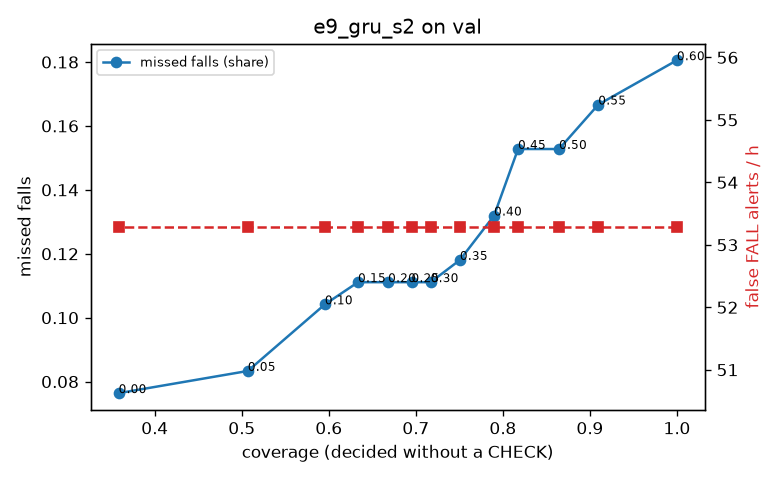

# Evaluation: e9_gru_s2 on val

Thresholds: t_high 0.6, t_low 0.35 (models\e9_gru_s2\thresholds.yaml). 589 clips, 144 falls, 1.00 h (0.75 h normal activity); 0 clips have no score rows (counted as silent). 95% intervals: bootstrap over clips.

## Systems

| System | Sensitivity (FALL) | Sensitivity (FALL or CHECK) | False FALL alerts / h | CHECK requests / h | Coverage | Median latency (s) | Alerts |
| --- | --- | --- | --- | --- | --- | --- | --- |
| e9_gru_s2 (one threshold) | 81.9% (73.9%–90.6%) | 81.9% (73.9%–90.6%) | 53.29 (39.66–70.14) | 0.00 (0.00–0.00) | 100.0% (100.0%–100.0%) | 1.93 (1.93–1.93) | 160 FALL, 0 CHECK |
| e9_gru_s2 (CHECK band) | 81.9% (73.9%–90.6%) | 88.2% (79.9%–96.5%) | 53.29 (39.66–70.14) | 88.92 (71.85–107.09) | 75.1% (70.5%–79.4%) | 1.93 (1.93–1.93) | 160 FALL, 89 CHECK |
| rule baseline (E0) | 68.8% (56.7%–80.6%) | 68.8% (56.7%–80.6%) | 167.86 (142.60–195.93) | 0.00 (0.00–0.00) | 100.0% (100.0%–100.0%) | 2.53 (2.33–2.77) | 226 FALL, 0 CHECK |

## Breakdown (e9_gru_s2 (CHECK band))

| Group | Value | Clips | Falls | Hours | Sens. (FALL) | Sens. (any) | False FALL / h | CHECK / h |
| --- | --- | --- | --- | --- | --- | --- | --- | --- |
| dataset | GMDCSA24 | 47 | 23 | 0.12 | 95.7% (85.7%–100.0%) | 100.0% (100.0%–100.0%) | 24.82 (0.00–64.17) | 146.65 (91.34–204.80) |
| dataset | caucafall | 8 | 4 | 0.03 | 75.0% (25.0%–100.0%) | 100.0% (100.0%–100.0%) | 74.07 (0.00–213.14) | 150.73 (40.39–245.64) |
| dataset | le2i | 15 | 11 | 0.04 | 100.0% (100.0%–100.0%) | 100.0% (100.0%–100.0%) | 37.72 (0.00–118.36) | 201.83 (118.09–292.77) |
| dataset | occu | 2 | 16 | 0.08 | 37.5% (37.5%–37.5%) | 37.5% (37.5%–37.5%) | 68.91 (66.43–71.58) | 37.78 (25.80–49.20) |
| dataset | of-syn | 517 | 90 | 0.73 | 84.4% (76.5%–92.1%) | 92.2% (86.7%–97.4%) | 56.57 (37.91–75.70) | 75.58 (56.34–94.82) |
| qc_pass | True | 589 | 144 | 1.00 | 81.9% (73.9%–90.6%) | 88.2% (79.9%–96.5%) | 53.29 (39.66–70.14) | 88.92 (71.85–107.09) |
| of-syn age | child | 72 | 13 | 0.10 | 92.3% (72.7%–100.0%) | 92.3% (72.7%–100.0%) | 60.21 (12.68–122.50) | 59.21 (19.74–108.55) |
| of-syn age | elderly | 184 | 25 | 0.26 | 76.0% (56.5%–91.3%) | 88.0% (75.0%–100.0%) | 71.49 (39.47–107.66) | 77.23 (46.34–108.12) |
| of-syn age | middle-aged | 61 | 12 | 0.09 | 83.3% (58.8%–100.0%) | 91.7% (71.4%–100.0%) | 29.00 (0.00–71.05) | 46.59 (11.65–93.18) |
| of-syn age | teen | 61 | 10 | 0.09 | 80.0% (50.0%–100.0%) | 100.0% (100.0%–100.0%) | 41.79 (0.00–93.84) | 104.82 (46.59–174.71) |
| of-syn age | toddler | 72 | 15 | 0.10 | 86.7% (69.2%–100.0%) | 93.3% (77.8%–100.0%) | 62.32 (13.66–120.42) | 78.94 (29.60–128.28) |
| of-syn age | young adult | 67 | 15 | 0.09 | 93.3% (77.8%–100.0%) | 93.3% (77.8%–100.0%) | 40.99 (0.00–90.43) | 84.83 (42.42–148.46) |
| of-syn BMI | normal | 135 | 19 | 0.19 | 89.5% (75.0%–100.0%) | 89.5% (75.0%–100.0%) | 61.25 (30.11–103.14) | 63.15 (31.58–99.99) |
| of-syn BMI | obese | 125 | 18 | 0.18 | 83.3% (63.6%–100.0%) | 83.3% (63.6%–100.0%) | 39.84 (13.03–71.70) | 68.21 (34.10–102.31) |
| of-syn BMI | overweight | 134 | 27 | 0.19 | 74.1% (56.5%–89.7%) | 92.6% (80.9%–100.0%) | 66.40 (32.59–109.32) | 100.74 (58.32–148.46) |
| of-syn BMI | underweight | 123 | 26 | 0.17 | 92.3% (80.0%–100.0%) | 100.0% (100.0%–100.0%) | 58.60 (21.53–102.53) | 69.32 (34.66–109.75) |

## Windows (4 classes)

Macro F1 0.707 over 12454 windows.

| true \ predicted | upright | falling | fallen | controlled_low |
| --- | --- | --- | --- | --- |
| upright | 3993 | 262 | 67 | 798 |
| falling | 128 | 931 | 29 | 87 |
| fallen | 21 | 300 | 869 | 372 |
| controlled_low | 449 | 340 | 239 | 3569 |

## Coverage–error curve

| CHECK band | t_low | Coverage | Missed falls | False FALL / h | CHECK / h |
| --- | --- | --- | --- | --- | --- |
| 0.00 | 0.60 | 100.0% | 18.1% | 53.29 | 0.00 |
| 0.05 | 0.55 | 91.0% | 16.7% | 53.29 | 27.97 |
| 0.10 | 0.50 | 86.5% | 15.3% | 53.29 | 42.96 |
| 0.15 | 0.45 | 81.7% | 15.3% | 53.29 | 62.94 |
| 0.20 | 0.40 | 79.0% | 13.2% | 53.29 | 71.93 |
| 0.25 | 0.35 | 75.1% | 11.8% | 53.29 | 88.92 |
| 0.30 | 0.30 | 71.7% | 11.1% | 53.29 | 105.90 |
| 0.35 | 0.25 | 69.5% | 11.1% | 53.29 | 118.89 |
| 0.40 | 0.20 | 66.8% | 11.1% | 53.29 | 135.87 |
| 0.45 | 0.15 | 63.4% | 11.1% | 53.29 | 159.85 |
| 0.50 | 0.10 | 59.6% | 10.4% | 53.29 | 187.82 |
| 0.55 | 0.05 | 50.7% | 8.3% | 53.29 | 267.74 |
| 0.60 | 0.00 | 35.9% | 7.6% | 53.29 | 501.52 |

Definitions: fall event = OmniFall `fall` segment; detected = alert from the segment start to 10 s after its end; false alert = alert matching no fall; normal-activity hours exclude [start − 2 s, end + 10 s]; FALL and ON FLOOR count as alarms, CHECK hands over to a person.
