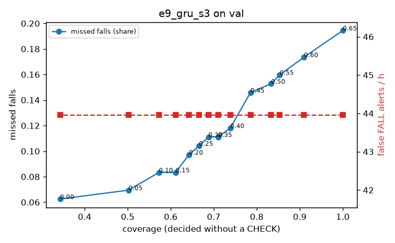

# Evaluation: e9_gru_s3 on val

Thresholds: t_high 0.65, t_low 0.4 (models\e9_gru_s3\thresholds.yaml). 589 clips, 144 falls, 1.00 h (0.75 h normal activity); 0 clips have no score rows (counted as silent). 95% intervals: bootstrap over clips.

## Systems

| System | Sensitivity (FALL) | Sensitivity (FALL or CHECK) | False FALL alerts / h | CHECK requests / h | Coverage | Median latency (s) | Alerts |
| --- | --- | --- | --- | --- | --- | --- | --- |
| e9_gru_s3 (one threshold) | 80.6% (73.2%–88.4%) | 80.6% (73.2%–88.4%) | 43.96 (30.91–59.19) | 0.00 (0.00–0.00) | 100.0% (100.0%–100.0%) | 1.93 (1.75–1.93) | 152 FALL, 0 CHECK |
| e9_gru_s3 (CHECK band) | 80.6% (73.2%–88.4%) | 88.2% (80.7%–95.8%) | 43.96 (30.91–59.19) | 89.91 (73.42–107.50) | 73.8% (69.1%–78.1%) | 1.93 (1.75–1.93) | 152 FALL, 90 CHECK |
| rule baseline (E0) | 68.8% (56.7%–80.6%) | 68.8% (56.7%–80.6%) | 167.86 (142.60–195.93) | 0.00 (0.00–0.00) | 100.0% (100.0%–100.0%) | 2.53 (2.33–2.77) | 226 FALL, 0 CHECK |

## Breakdown (e9_gru_s3 (CHECK band))

| Group | Value | Clips | Falls | Hours | Sens. (FALL) | Sens. (any) | False FALL / h | CHECK / h |
| --- | --- | --- | --- | --- | --- | --- | --- | --- |
| dataset | GMDCSA24 | 47 | 23 | 0.12 | 95.7% (85.7%–100.0%) | 100.0% (100.0%–100.0%) | 49.64 (11.98–99.97) | 122.21 (70.71–182.29) |
| dataset | caucafall | 8 | 4 | 0.03 | 100.0% (100.0%–100.0%) | 100.0% (100.0%–100.0%) | 74.07 (0.00–213.14) | 226.10 (143.48–306.16) |
| dataset | le2i | 15 | 11 | 0.04 | 100.0% (100.0%–100.0%) | 100.0% (100.0%–100.0%) | 0.00 (0.00–0.00) | 201.83 (118.52–288.01) |
| dataset | occu | 2 | 16 | 0.08 | 43.8% (37.5%–50.0%) | 43.8% (37.5%–50.0%) | 68.91 (66.43–71.58) | 37.78 (25.80–49.20) |
| dataset | of-syn | 517 | 90 | 0.73 | 80.0% (71.8%–87.9%) | 91.1% (84.9%–96.7%) | 43.26 (28.49–59.64) | 78.33 (60.47–96.23) |
| qc_pass | True | 589 | 144 | 1.00 | 80.6% (73.2%–88.4%) | 88.2% (80.7%–95.8%) | 43.96 (30.91–59.19) | 89.91 (73.42–107.50) |
| of-syn age | child | 72 | 13 | 0.10 | 84.6% (62.5%–100.0%) | 92.3% (72.7%–100.0%) | 36.13 (0.00–81.53) | 78.94 (29.60–128.53) |
| of-syn age | elderly | 184 | 25 | 0.26 | 72.0% (53.8%–88.9%) | 88.0% (75.0%–100.0%) | 49.15 (25.99–79.93) | 81.09 (53.96–115.84) |
| of-syn age | middle-aged | 61 | 12 | 0.09 | 91.7% (71.4%–100.0%) | 91.7% (71.4%–100.0%) | 29.00 (0.00–72.50) | 46.59 (11.65–93.18) |
| of-syn age | teen | 61 | 10 | 0.09 | 70.0% (40.0%–100.0%) | 90.0% (66.7%–100.0%) | 55.72 (12.92–111.49) | 116.47 (58.24–186.36) |
| of-syn age | toddler | 72 | 15 | 0.10 | 80.0% (58.3%–100.0%) | 93.3% (77.8%–100.0%) | 49.86 (11.84–103.13) | 78.94 (29.60–138.15) |
| of-syn age | young adult | 67 | 15 | 0.09 | 86.7% (66.7%–100.0%) | 93.3% (77.8%–100.0%) | 27.33 (0.00–69.65) | 63.63 (21.21–116.65) |
| of-syn BMI | normal | 135 | 19 | 0.19 | 89.5% (75.0%–100.0%) | 89.5% (75.0%–100.0%) | 24.50 (6.02–49.42) | 68.42 (36.84–105.26) |
| of-syn BMI | obese | 125 | 18 | 0.18 | 61.1% (38.1%–84.6%) | 77.8% (56.5%–95.2%) | 33.20 (6.70–61.50) | 85.26 (45.47–125.04) |
| of-syn BMI | overweight | 134 | 27 | 0.19 | 81.5% (65.7%–95.8%) | 92.6% (80.6%–100.0%) | 66.40 (32.00–105.28) | 95.44 (58.32–137.85) |
| of-syn BMI | underweight | 123 | 26 | 0.17 | 84.6% (69.6%–96.6%) | 100.0% (100.0%–100.0%) | 51.27 (14.96–90.70) | 63.54 (28.88–98.20) |

## Windows (4 classes)

Macro F1 0.723 over 12454 windows.

| true \ predicted | upright | falling | fallen | controlled_low |
| --- | --- | --- | --- | --- |
| upright | 4078 | 241 | 73 | 728 |
| falling | 103 | 944 | 32 | 96 |
| fallen | 20 | 240 | 891 | 411 |
| controlled_low | 459 | 274 | 250 | 3614 |

## Coverage–error curve

| CHECK band | t_low | Coverage | Missed falls | False FALL / h | CHECK / h |
| --- | --- | --- | --- | --- | --- |
| 0.00 | 0.65 | 100.0% | 19.4% | 43.96 | 0.00 |
| 0.05 | 0.60 | 91.0% | 17.4% | 43.96 | 25.98 |
| 0.10 | 0.55 | 85.3% | 16.0% | 43.96 | 44.96 |
| 0.15 | 0.50 | 83.3% | 15.3% | 43.96 | 51.95 |
| 0.20 | 0.45 | 78.5% | 14.6% | 43.96 | 71.93 |
| 0.25 | 0.40 | 73.8% | 11.8% | 43.96 | 89.91 |
| 0.30 | 0.35 | 71.0% | 11.1% | 43.96 | 103.90 |
| 0.35 | 0.30 | 68.8% | 11.1% | 43.96 | 116.89 |
| 0.40 | 0.25 | 66.6% | 10.4% | 43.96 | 128.88 |
| 0.45 | 0.20 | 64.2% | 9.7% | 43.96 | 142.86 |
| 0.50 | 0.15 | 61.1% | 8.3% | 43.96 | 161.85 |
| 0.55 | 0.10 | 57.3% | 8.3% | 43.96 | 192.82 |
| 0.60 | 0.05 | 50.2% | 6.9% | 43.96 | 257.75 |
| 0.65 | 0.00 | 34.3% | 6.2% | 43.96 | 511.51 |

Definitions: fall event = OmniFall `fall` segment; detected = alert from the segment start to 10 s after its end; false alert = alert matching no fall; normal-activity hours exclude [start − 2 s, end + 10 s]; FALL and ON FLOOR count as alarms, CHECK hands over to a person.
