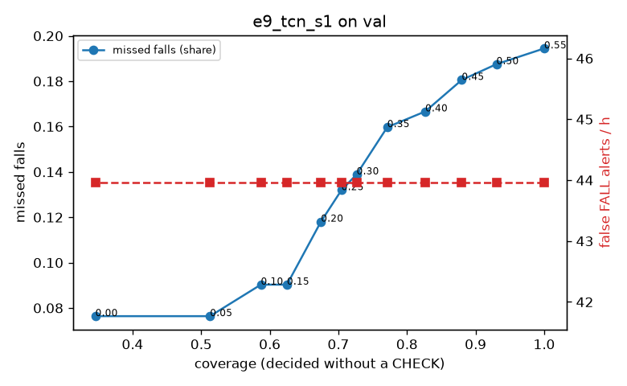

# Evaluation: e9_tcn_s1 on val

Thresholds: t_high 0.55, t_low 0.2 (models\e9_tcn_s1\thresholds.yaml). 589 clips, 144 falls, 1.00 h (0.75 h normal activity); 0 clips have no score rows (counted as silent). 95% intervals: bootstrap over clips.

## Systems

| System | Sensitivity (FALL) | Sensitivity (FALL or CHECK) | False FALL alerts / h | CHECK requests / h | Coverage | Median latency (s) | Alerts |
| --- | --- | --- | --- | --- | --- | --- | --- |
| e9_tcn_s1 (one threshold) | 80.6% (72.7%–89.5%) | 80.6% (72.7%–89.5%) | 43.96 (31.11–58.45) | 0.00 (0.00–0.00) | 100.0% (100.0%–100.0%) | 1.93 (1.93–1.93) | 151 FALL, 0 CHECK |
| e9_tcn_s1 (CHECK band) | 80.6% (72.7%–89.5%) | 88.2% (79.9%–96.5%) | 43.96 (31.11–58.45) | 125.88 (105.01–147.84) | 67.5% (62.4%–72.3%) | 1.93 (1.93–1.93) | 151 FALL, 126 CHECK |
| rule baseline (E0) | 68.8% (56.7%–80.6%) | 68.8% (56.7%–80.6%) | 167.86 (142.60–195.93) | 0.00 (0.00–0.00) | 100.0% (100.0%–100.0%) | 2.53 (2.33–2.77) | 226 FALL, 0 CHECK |

## Breakdown (e9_tcn_s1 (CHECK band))

| Group | Value | Clips | Falls | Hours | Sens. (FALL) | Sens. (any) | False FALL / h | CHECK / h |
| --- | --- | --- | --- | --- | --- | --- | --- | --- |
| dataset | GMDCSA24 | 47 | 23 | 0.12 | 95.7% (85.7%–100.0%) | 95.7% (85.7%–100.0%) | 49.64 (11.12–99.28) | 211.83 (154.83–265.32) |
| dataset | caucafall | 8 | 4 | 0.03 | 100.0% (100.0%–100.0%) | 100.0% (100.0%–100.0%) | 148.14 (0.00–283.19) | 188.41 (80.78–268.47) |
| dataset | le2i | 15 | 11 | 0.04 | 100.0% (100.0%–100.0%) | 100.0% (100.0%–100.0%) | 0.00 (0.00–0.00) | 246.68 (164.64–323.06) |
| dataset | occu | 2 | 16 | 0.08 | 37.5% (37.5%–37.5%) | 37.5% (37.5%–37.5%) | 68.91 (66.43–71.58) | 37.78 (25.80–49.20) |
| dataset | of-syn | 517 | 90 | 0.73 | 81.1% (72.7%–88.8%) | 93.3% (87.6%–97.9%) | 41.60 (26.37–58.00) | 111.31 (90.67–134.68) |
| qc_pass | True | 589 | 144 | 1.00 | 80.6% (72.7%–89.5%) | 88.2% (79.9%–96.5%) | 43.96 (31.11–58.45) | 125.88 (105.01–147.84) |
| of-syn age | child | 72 | 13 | 0.10 | 92.3% (72.7%–100.0%) | 92.3% (72.7%–100.0%) | 72.25 (23.67–129.21) | 98.68 (49.34–157.88) |
| of-syn age | elderly | 184 | 25 | 0.26 | 72.0% (53.3%–88.0%) | 92.0% (79.2%–100.0%) | 44.68 (21.79–73.36) | 127.42 (92.67–169.90) |
| of-syn age | middle-aged | 61 | 12 | 0.09 | 91.7% (71.4%–100.0%) | 91.7% (71.4%–100.0%) | 14.50 (0.00–45.35) | 46.59 (11.65–93.18) |
| of-syn age | teen | 61 | 10 | 0.09 | 70.0% (40.0%–100.0%) | 100.0% (100.0%–100.0%) | 27.86 (0.00–71.05) | 116.47 (58.24–186.36) |
| of-syn age | toddler | 72 | 15 | 0.10 | 80.0% (58.3%–100.0%) | 86.7% (65.0%–100.0%) | 49.86 (12.04–103.35) | 128.28 (69.07–197.36) |
| of-syn age | young adult | 67 | 15 | 0.09 | 86.7% (66.7%–100.0%) | 100.0% (100.0%–100.0%) | 27.33 (0.00–69.65) | 116.65 (63.63–180.27) |
| of-syn BMI | normal | 135 | 19 | 0.19 | 78.9% (58.3%–95.5%) | 94.7% (83.3%–100.0%) | 30.62 (6.40–61.26) | 99.99 (63.15–147.36) |
| of-syn BMI | obese | 125 | 18 | 0.18 | 66.7% (44.4%–87.0%) | 83.3% (65.0%–100.0%) | 19.92 (0.00–46.06) | 125.04 (79.57–176.20) |
| of-syn BMI | overweight | 134 | 27 | 0.19 | 81.5% (65.7%–95.8%) | 92.6% (81.5%–100.0%) | 79.68 (42.21–122.72) | 111.34 (68.93–159.06) |
| of-syn BMI | underweight | 123 | 26 | 0.17 | 92.3% (80.0%–100.0%) | 100.0% (100.0%–100.0%) | 36.62 (7.25–71.05) | 109.75 (69.32–155.96) |

## Windows (4 classes)

Macro F1 0.743 over 12454 windows.

| true \ predicted | upright | falling | fallen | controlled_low |
| --- | --- | --- | --- | --- |
| upright | 4223 | 206 | 62 | 629 |
| falling | 111 | 943 | 49 | 72 |
| fallen | 12 | 173 | 950 | 427 |
| controlled_low | 537 | 206 | 262 | 3592 |

## Coverage–error curve

| CHECK band | t_low | Coverage | Missed falls | False FALL / h | CHECK / h |
| --- | --- | --- | --- | --- | --- |
| 0.00 | 0.55 | 100.0% | 19.4% | 43.96 | 0.00 |
| 0.05 | 0.50 | 93.0% | 18.8% | 43.96 | 20.98 |
| 0.10 | 0.45 | 88.0% | 18.1% | 43.96 | 37.96 |
| 0.15 | 0.40 | 82.7% | 16.7% | 43.96 | 56.95 |
| 0.20 | 0.35 | 77.1% | 16.0% | 43.96 | 80.92 |
| 0.25 | 0.30 | 72.7% | 13.9% | 43.96 | 99.90 |
| 0.30 | 0.25 | 70.4% | 13.2% | 43.96 | 110.89 |
| 0.35 | 0.20 | 67.5% | 11.8% | 43.96 | 125.88 |
| 0.40 | 0.15 | 62.5% | 9.0% | 43.96 | 152.85 |
| 0.45 | 0.10 | 58.7% | 9.0% | 43.96 | 181.83 |
| 0.50 | 0.05 | 51.3% | 7.6% | 43.96 | 246.76 |
| 0.55 | 0.00 | 34.6% | 7.6% | 43.96 | 508.51 |

Definitions: fall event = OmniFall `fall` segment; detected = alert from the segment start to 10 s after its end; false alert = alert matching no fall; normal-activity hours exclude [start − 2 s, end + 10 s]; FALL and ON FLOOR count as alarms, CHECK hands over to a person.
