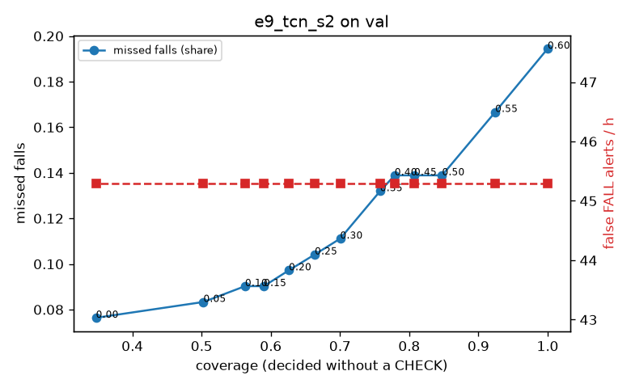

# Evaluation: e9_tcn_s2 on val

Thresholds: t_high 0.6, t_low 0.3 (models\e9_tcn_s2\thresholds.yaml). 589 clips, 144 falls, 1.00 h (0.75 h normal activity); 0 clips have no score rows (counted as silent). 95% intervals: bootstrap over clips.

## Systems

| System | Sensitivity (FALL) | Sensitivity (FALL or CHECK) | False FALL alerts / h | CHECK requests / h | Coverage | Median latency (s) | Alerts |
| --- | --- | --- | --- | --- | --- | --- | --- |
| e9_tcn_s2 (one threshold) | 80.6% (71.9%–89.3%) | 80.6% (71.9%–89.3%) | 45.30 (31.82–60.06) | 0.00 (0.00–0.00) | 100.0% (100.0%–100.0%) | 1.93 (1.93–1.93) | 153 FALL, 0 CHECK |
| e9_tcn_s2 (CHECK band) | 80.6% (71.9%–89.3%) | 88.9% (80.9%–97.4%) | 45.30 (31.82–60.06) | 109.89 (91.51–129.21) | 70.0% (65.3%–74.3%) | 1.93 (1.93–1.93) | 153 FALL, 110 CHECK |
| rule baseline (E0) | 68.8% (56.7%–80.6%) | 68.8% (56.7%–80.6%) | 167.86 (142.60–195.93) | 0.00 (0.00–0.00) | 100.0% (100.0%–100.0%) | 2.53 (2.33–2.77) | 226 FALL, 0 CHECK |

## Breakdown (e9_tcn_s2 (CHECK band))

| Group | Value | Clips | Falls | Hours | Sens. (FALL) | Sens. (any) | False FALL / h | CHECK / h |
| --- | --- | --- | --- | --- | --- | --- | --- | --- |
| dataset | GMDCSA24 | 47 | 23 | 0.12 | 95.7% (85.7%–100.0%) | 95.7% (85.7%–100.0%) | 86.88 (37.38–141.04) | 162.94 (104.95–221.97) |
| dataset | caucafall | 8 | 4 | 0.03 | 100.0% (100.0%–100.0%) | 100.0% (100.0%–100.0%) | 148.14 (0.00–283.19) | 188.41 (78.88–280.21) |
| dataset | le2i | 15 | 11 | 0.04 | 100.0% (100.0%–100.0%) | 100.0% (100.0%–100.0%) | 0.00 (0.00–0.00) | 201.83 (123.06–290.59) |
| dataset | occu | 2 | 16 | 0.08 | 37.5% (37.5%–37.5%) | 37.5% (37.5%–37.5%) | 68.91 (66.43–71.58) | 37.78 (25.80–49.20) |
| dataset | of-syn | 517 | 90 | 0.73 | 81.1% (73.3%–88.6%) | 94.4% (89.7%–98.9%) | 38.27 (23.74–54.13) | 100.32 (79.71–120.97) |
| qc_pass | True | 589 | 144 | 1.00 | 80.6% (71.9%–89.3%) | 88.9% (80.9%–97.4%) | 45.30 (31.82–60.06) | 109.89 (91.51–129.21) |
| of-syn age | child | 72 | 13 | 0.10 | 84.6% (62.5%–100.0%) | 92.3% (72.7%–100.0%) | 60.21 (12.69–114.18) | 118.41 (59.21–187.49) |
| of-syn age | elderly | 184 | 25 | 0.26 | 72.0% (55.6%–88.9%) | 88.0% (74.1%–100.0%) | 40.22 (17.65–67.45) | 100.39 (69.50–135.15) |
| of-syn age | middle-aged | 61 | 12 | 0.09 | 91.7% (71.4%–100.0%) | 91.7% (71.4%–100.0%) | 0.00 (0.00–0.00) | 58.24 (11.65–104.82) |
| of-syn age | teen | 61 | 10 | 0.09 | 80.0% (50.0%–100.0%) | 100.0% (100.0%–100.0%) | 27.86 (0.00–71.05) | 116.47 (58.24–186.36) |
| of-syn age | toddler | 72 | 15 | 0.10 | 73.3% (50.0%–93.3%) | 100.0% (100.0%–100.0%) | 49.86 (11.84–103.64) | 108.55 (49.34–167.75) |
| of-syn age | young adult | 67 | 15 | 0.09 | 93.3% (77.8%–100.0%) | 100.0% (100.0%–100.0%) | 40.99 (0.00–90.43) | 95.44 (42.42–148.46) |
| of-syn BMI | normal | 135 | 19 | 0.19 | 84.2% (66.7%–100.0%) | 100.0% (100.0%–100.0%) | 30.62 (6.18–59.72) | 105.26 (63.15–152.62) |
| of-syn BMI | obese | 125 | 18 | 0.18 | 61.1% (37.5%–83.4%) | 83.3% (64.7%–100.0%) | 26.56 (6.34–53.13) | 119.36 (73.89–164.83) |
| of-syn BMI | overweight | 134 | 27 | 0.19 | 85.2% (71.4%–96.6%) | 92.6% (81.5%–100.0%) | 53.12 (21.09–89.76) | 100.74 (63.63–143.29) |
| of-syn BMI | underweight | 123 | 26 | 0.17 | 88.5% (75.0%–100.0%) | 100.0% (100.0%–100.0%) | 43.95 (13.79–79.75) | 75.09 (40.43–115.53) |

## Windows (4 classes)

Macro F1 0.743 over 12454 windows.

| true \ predicted | upright | falling | fallen | controlled_low |
| --- | --- | --- | --- | --- |
| upright | 4070 | 258 | 114 | 678 |
| falling | 85 | 978 | 42 | 70 |
| fallen | 18 | 210 | 1013 | 321 |
| controlled_low | 423 | 227 | 313 | 3634 |

## Coverage–error curve

| CHECK band | t_low | Coverage | Missed falls | False FALL / h | CHECK / h |
| --- | --- | --- | --- | --- | --- |
| 0.00 | 0.60 | 100.0% | 19.4% | 45.30 | 0.00 |
| 0.05 | 0.55 | 92.4% | 16.7% | 45.30 | 19.98 |
| 0.10 | 0.50 | 84.8% | 13.9% | 45.30 | 43.96 |
| 0.15 | 0.45 | 80.7% | 13.9% | 45.30 | 60.94 |
| 0.20 | 0.40 | 77.9% | 13.9% | 45.30 | 73.93 |
| 0.25 | 0.35 | 75.8% | 13.2% | 45.30 | 82.92 |
| 0.30 | 0.30 | 70.0% | 11.1% | 45.30 | 109.89 |
| 0.35 | 0.25 | 66.4% | 10.4% | 45.30 | 130.87 |
| 0.40 | 0.20 | 62.6% | 9.7% | 45.30 | 154.85 |
| 0.45 | 0.15 | 59.0% | 9.0% | 45.30 | 180.83 |
| 0.50 | 0.10 | 56.3% | 9.0% | 45.30 | 203.81 |
| 0.55 | 0.05 | 50.3% | 8.3% | 45.30 | 261.75 |
| 0.60 | 0.00 | 34.7% | 7.6% | 45.30 | 508.51 |

Definitions: fall event = OmniFall `fall` segment; detected = alert from the segment start to 10 s after its end; false alert = alert matching no fall; normal-activity hours exclude [start − 2 s, end + 10 s]; FALL and ON FLOOR count as alarms, CHECK hands over to a person.
