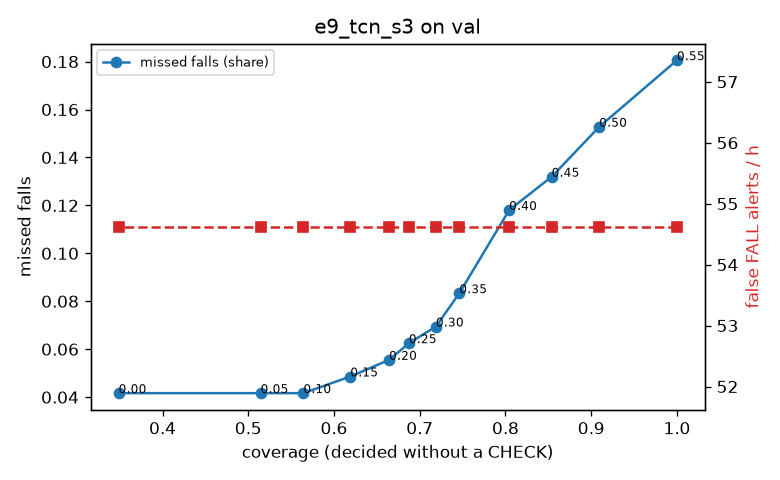

# Evaluation: e9_tcn_s3 on val

Thresholds: t_high 0.55, t_low 0.35 (models\e9_tcn_s3\thresholds.yaml). 589 clips, 144 falls, 1.00 h (0.75 h normal activity); 0 clips have no score rows (counted as silent). 95% intervals: bootstrap over clips.

## Systems

| System | Sensitivity (FALL) | Sensitivity (FALL or CHECK) | False FALL alerts / h | CHECK requests / h | Coverage | Median latency (s) | Alerts |
| --- | --- | --- | --- | --- | --- | --- | --- |
| e9_tcn_s3 (one threshold) | 81.9% (74.2%–90.5%) | 81.9% (74.2%–90.5%) | 54.62 (39.58–71.22) | 0.00 (0.00–0.00) | 100.0% (100.0%–100.0%) | 1.93 (1.93–1.93) | 161 FALL, 0 CHECK |
| e9_tcn_s3 (CHECK band) | 81.9% (74.2%–90.5%) | 91.7% (85.6%–97.8%) | 54.62 (39.58–71.22) | 84.92 (68.91–101.34) | 74.6% (70.6%–78.9%) | 1.93 (1.93–1.93) | 161 FALL, 85 CHECK |
| rule baseline (E0) | 68.8% (56.7%–80.6%) | 68.8% (56.7%–80.6%) | 167.86 (142.60–195.93) | 0.00 (0.00–0.00) | 100.0% (100.0%–100.0%) | 2.53 (2.33–2.77) | 226 FALL, 0 CHECK |

## Breakdown (e9_tcn_s3 (CHECK band))

| Group | Value | Clips | Falls | Hours | Sens. (FALL) | Sens. (any) | False FALL / h | CHECK / h |
| --- | --- | --- | --- | --- | --- | --- | --- | --- |
| dataset | GMDCSA24 | 47 | 23 | 0.12 | 100.0% (100.0%–100.0%) | 100.0% (100.0%–100.0%) | 49.64 (11.14–99.27) | 97.77 (49.45–150.66) |
| dataset | caucafall | 8 | 4 | 0.03 | 100.0% (100.0%–100.0%) | 100.0% (100.0%–100.0%) | 148.14 (0.00–283.19) | 150.73 (39.74–246.79) |
| dataset | le2i | 15 | 11 | 0.04 | 100.0% (100.0%–100.0%) | 100.0% (100.0%–100.0%) | 0.00 (0.00–0.00) | 134.55 (50.95–218.83) |
| dataset | occu | 2 | 16 | 0.08 | 37.5% (37.5%–37.5%) | 56.2% (50.0%–62.5%) | 34.45 (0.00–66.43) | 88.15 (77.40–98.41) |
| dataset | of-syn | 517 | 90 | 0.73 | 82.2% (74.3%–90.0%) | 94.4% (89.1%–98.8%) | 56.57 (40.02–75.06) | 76.96 (57.72–94.86) |
| qc_pass | True | 589 | 144 | 1.00 | 81.9% (74.2%–90.5%) | 91.7% (85.6%–97.8%) | 54.62 (39.58–71.22) | 84.92 (68.91–101.34) |
| of-syn age | child | 72 | 13 | 0.10 | 84.6% (62.5%–100.0%) | 100.0% (100.0%–100.0%) | 72.25 (24.50–137.11) | 69.07 (29.60–128.28) |
| of-syn age | elderly | 184 | 25 | 0.26 | 68.0% (50.0%–85.2%) | 88.0% (75.0%–100.0%) | 75.96 (45.54–113.14) | 81.09 (50.20–115.84) |
| of-syn age | middle-aged | 61 | 12 | 0.09 | 91.7% (71.4%–100.0%) | 91.7% (71.4%–100.0%) | 43.50 (0.00–92.67) | 69.88 (23.29–128.12) |
| of-syn age | teen | 61 | 10 | 0.09 | 80.0% (50.0%–100.0%) | 90.0% (66.7%–100.0%) | 41.79 (0.00–99.47) | 116.47 (58.24–186.36) |
| of-syn age | toddler | 72 | 15 | 0.10 | 86.7% (69.2%–100.0%) | 100.0% (100.0%–100.0%) | 24.93 (0.00–65.79) | 78.94 (29.60–128.28) |
| of-syn age | young adult | 67 | 15 | 0.09 | 93.3% (77.3%–100.0%) | 100.0% (100.0%–100.0%) | 40.99 (0.00–90.43) | 42.42 (10.60–84.83) |
| of-syn BMI | normal | 135 | 19 | 0.19 | 94.7% (83.3%–100.0%) | 100.0% (100.0%–100.0%) | 36.75 (11.94–68.56) | 63.15 (31.58–94.73) |
| of-syn BMI | obese | 125 | 18 | 0.18 | 77.8% (56.5%–95.2%) | 83.3% (66.7%–100.0%) | 39.84 (12.69–74.44) | 68.21 (34.10–107.99) |
| of-syn BMI | overweight | 134 | 27 | 0.19 | 77.8% (62.1%–92.9%) | 96.3% (87.5%–100.0%) | 92.96 (53.10–139.59) | 100.74 (63.63–143.16) |
| of-syn BMI | underweight | 123 | 26 | 0.17 | 80.8% (64.3%–95.2%) | 96.2% (88.0%–100.0%) | 58.60 (22.44–100.47) | 75.09 (40.43–115.53) |

## Windows (4 classes)

Macro F1 0.736 over 12454 windows.

| true \ predicted | upright | falling | fallen | controlled_low |
| --- | --- | --- | --- | --- |
| upright | 4022 | 233 | 56 | 809 |
| falling | 104 | 948 | 16 | 107 |
| fallen | 14 | 276 | 928 | 344 |
| controlled_low | 387 | 232 | 221 | 3757 |

## Coverage–error curve

| CHECK band | t_low | Coverage | Missed falls | False FALL / h | CHECK / h |
| --- | --- | --- | --- | --- | --- |
| 0.00 | 0.55 | 100.0% | 18.1% | 54.62 | 0.00 |
| 0.05 | 0.50 | 90.9% | 15.3% | 54.62 | 25.98 |
| 0.10 | 0.45 | 85.4% | 13.2% | 54.62 | 43.96 |
| 0.15 | 0.40 | 80.4% | 11.8% | 54.62 | 62.94 |
| 0.20 | 0.35 | 74.6% | 8.3% | 54.62 | 84.92 |
| 0.25 | 0.30 | 71.9% | 6.9% | 54.62 | 96.91 |
| 0.30 | 0.25 | 68.7% | 6.2% | 54.62 | 113.89 |
| 0.35 | 0.20 | 66.4% | 5.6% | 54.62 | 126.88 |
| 0.40 | 0.15 | 61.9% | 4.9% | 54.62 | 156.85 |
| 0.45 | 0.10 | 56.4% | 4.2% | 54.62 | 199.81 |
| 0.50 | 0.05 | 51.4% | 4.2% | 54.62 | 248.76 |
| 0.55 | 0.00 | 34.9% | 4.2% | 54.62 | 511.51 |

Definitions: fall event = OmniFall `fall` segment; detected = alert from the segment start to 10 s after its end; false alert = alert matching no fall; normal-activity hours exclude [start − 2 s, end + 10 s]; FALL and ON FLOOR count as alarms, CHECK hands over to a person.
